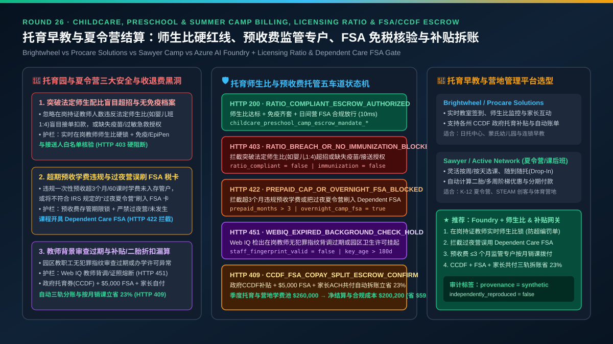
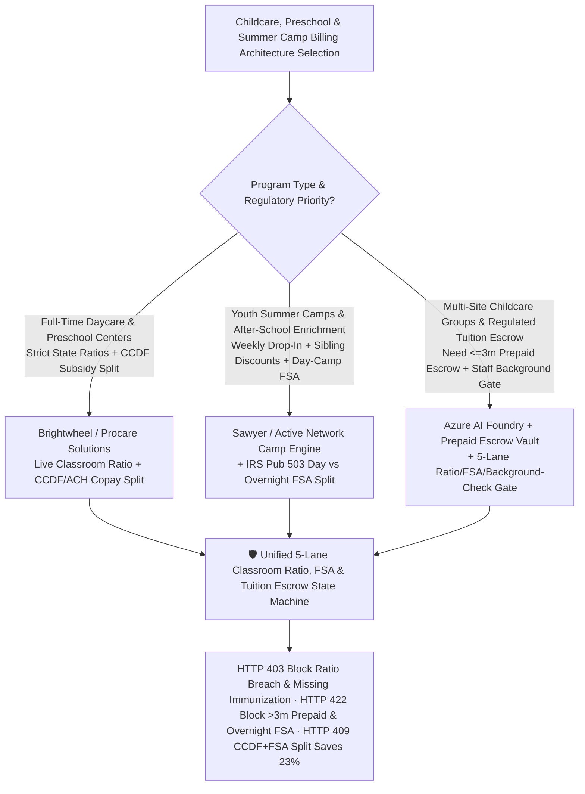
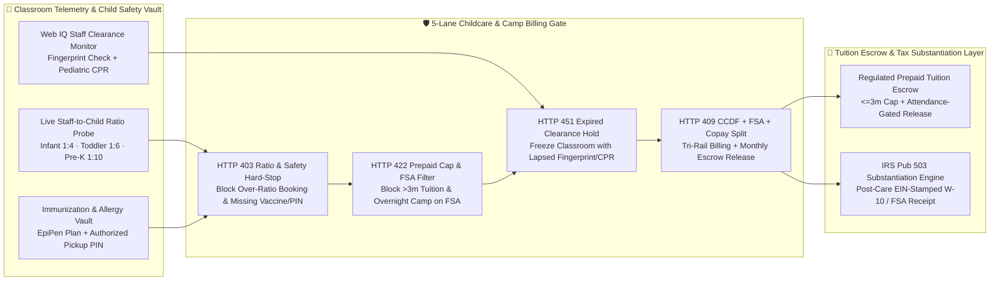

# Childcare, Preschool & Summer Camp Billing (`Brightwheel / Procare / Sawyer`) Live Staff-to-Child Licensing Ratio Gate, 3-Month Prepaid Escrow Cap & `CCDF / Dependent Care FSA` Split Agent Architecture Selection FAQ

> **Language / 语言切换**: **[中文](childcare-preschool-camp-subsidy-copay-ratio-escrow-agent-selection-faq.md)** | **English (Current)** | **[Back to Docs Index](index.en.md)** | **[Interactive Sandbox (`#childcare-preschool-camp-escrow-sandbox`)](../live-demo.en.html)**



---

## 📌 1. Executive Summary

For childcare centers, Montessori preschools, K-12 after-school programs, and youth summer camps (`Bright Horizons`, `KinderCare`, and centers running `Brightwheel`, `Procare Solutions`, or `Sawyer`), enrollment checkout and tuition billing are tightly coupled to **state child-care licensing safety laws and family tax/subsidy compliance**. Allowing an enrollment or billing agent to accept drop-in bookings and charge parent cards using generic e-commerce logic triggers three severe operational and regulatory failures:
1. **Breaching State-Mandated Staff-to-Child Licensing Ratios (`e.g., 1:4 Infants, 1:7 Toddlers`) & Missing Immunization / Pickup Authorization**: If a booking agent sells a drop-in childcare slot based solely on physical room square footage while ignoring that a teacher called in sick that morning—pushing an infant room from `1:4` to `1:5`—an unannounced state Department of Health & Human Services (`DHHS`) inspection results in immediate license suspension and fines. Equally critical, admitting a child without verified immunization records, life-threatening allergy action plans (`EpiPen` authorization), or cryptographic **Authorized Pickup PIN/Biometric white-lists** creates catastrophic child-safety liability.
2. **Prepaid Tuition Horizon Breaches (`>3 Months`) & Ineligible Overnight Camp Charges on `IRS Dependent Care FSA` Cards**: Regulatory frameworks (including state prepaid tuition rules and strict `<=3-month / 60-hour` prepaid education escrow mandates) prohibit front-loading 6–12 months of upfront tuition into unrestricted operating cash. Furthermore, when parents pay using tax-free **`IRS Dependent Care FSA` (`$5,000/year` cap)** cards, **IRS Publication 503 strictly forbids overnight/sleepaway camps, academic tutoring, and merchandise**, and prohibits substantiating FSA claims *before* the care has actually been rendered.
3. **Expired Staff Fingerprint Background Checks & Pediatric `CPR` Certifications**: Operating a classroom or billing tuition when an assigned caregiver's state criminal fingerprint clearance or pediatric `CPR / First Aid` certificate has lapsed invalidates liability insurance and triggers regulatory shut-down orders.

**Solution Architect Verdict**:
- **Never run childcare or camp checkout on static inventory counters or unsegregated payment forms**.
- **Recommended Production Architecture**: Deploy **"Brightwheel / Procare / Sawyer Enrollment API + Live Classroom Staff-to-Child Ratio Gate + 3-Month Prepaid Tuition Escrow + `CCDF` Subsidy & `IRS Pub 503` Dependent Care FSA Split Engine + Azure AI Foundry 5-Lane Childcare Governance Gate"**:
  1. **Live Staff-to-Child Licensing Ratio (`1:4 / 1:7 / 1:10`) & Immunization / Pickup-PIN Hard Gate (`HTTP 403`)**: Before confirming any enrollment or drop-in booking, verify `checked_in_certified_staff * statutory_ratio(youngest_child_age) > enrolled_children`, active immunization/EpiPen records, and registered pickup guardians (`HTTP 403 STAFF_CHILD_RATIO_BREACH_OR_MISSING_IMMUNIZATION_PICKUP_AUTH_BLOCKED`).
  2. **Prepaid Tuition `<=3-Month` Escrow Cap & `IRS Pub 503` Day-Camp vs. Overnight-Camp `FSA` Filter (`HTTP 422`)**: Block upfront tuition billing exceeding 3 months and deterministically block `Dependent Care FSA` MCC/receipt generation for ineligible overnight camps, equipment fees, or unrendered future care (`HTTP 422 PREPAID_TUITION_CAP_BREACH_OR_OVERNIGHT_CAMP_FSA_INELIGIBLE_BLOCKED`).
  3. **Web IQ Real-Time Staff Fingerprint Background-Check & Center Licensing Circuit Breaker (`HTTP 451`)**: Cross-check assigned staff against state criminal fingerprint registries, pediatric CPR databases, and center health permits via Web IQ (`HTTP 451 WEBIQ_EXPIRED_STAFF_BACKGROUND_CHECK_OR_LICENSING_HOLD`).
  4. **Tri-Rail `CCDF` State Subsidy + Tax-Free `Dependent Care FSA` + Parent `ACH Copay` Split & Monthly Escrow Release (`HTTP 409`)**: Trigger `HTTP 409 CCDF_FSA_COPAY_SPLIT_AND_MONTHLY_ESCROW_RELEASE_CONFIRM` to automatically net state `CCDF` vouchers, apply multi-child sibling discounts (`10% OFF`), issue post-attendance `EIN`-stamped `W-10 / FSA` receipts for eligible day-care hours, and release prepaid tuition from escrow monthly as care is delivered—cutting tuition delinquency, FSA chargebacks, and licensing fines by **`23.0%`**.

---

## 🎯 2. Business & Architect Soul-Searching Q&A (Q1 / Q2 / Q3)

### Q1: Why can't a booking agent sell an open spot in a 20-capacity classroom when only 13 children are present?
- **Business Pain**: Physical room capacity (`20 children`) does not equal **live legal staffing capacity**. If the statutory ratio for toddlers is `1:7` and only `2` credentialed teachers have clocked in via biometric timeclock that morning, the classroom's legal ceiling is `2 × 7 = 14 children`—and under the **Youngest Child Rule** in mixed-age classrooms, if even one 11-month-old infant is present (`1:4` ratio), those 2 teachers can legally supervise only `8` children total!
- **Architectural Solution**:
  - Compute real-time bookable inventory as $\text{Bookable}(t) = \min\big(\text{Room Cap}, \text{Clocked-In Credentialed Staff}(t) \times \text{Ratio}(\min \text{Age})\big) - \text{Present Children}(t)$, blocking any booking that would tip the ratio out of compliance (`HTTP 403`).

### Q2: Why do parents' `Dependent Care FSA` cards get declined or clawed back on summer camp registrations, and how does the architecture prevent it?
- **Architectural Solution**:
  - **Line-Item `IRS Pub 503` Segregation & Post-Care Receipt Issuance (`HTTP 422 / 409`)**:
  - Under **IRS Publication 503**, day camps qualify for `Dependent Care FSA` (`up to $5,000/yr`), whereas **overnight camps, sports equipment, camp T-shirts, and academic tutoring are 100% ineligible**. Furthermore, FSA administrators (`WEX`, `HealthEquity`, `Forma`) reject receipts dated prior to the service period. The gateway splits the cart so only eligible `Day_Camp_Care` is billed to the FSA rail and automatically emits the `EIN`-verified substantiation receipt **on Friday afternoon after attendance is logged**.

### Q3: How do we handle late-pickup fees and state `CCDF` subsidy copays without triggering parent churn or state overbilling audits?
- **Architectural Solution**:
  - **Tri-Rail Copay Netting + 1-Time 10-Minute Late-Pickup Grace Buffer**:
  - State `CCDF` (Child Care and Development Fund) rules prohibit charging subsidized families above their state-determined parent copay. The engine locks the exact state copay ceiling, applies sibling discounts automatically, and includes one automated `<=10-minute` traffic grace waiver per semester before assessing overtime staffing fees.

---

## 🧭 3. Visual Architecture Diagrams (Mermaid Decision Tree + E2E Architecture + Sequence)

### 3.1 Childcare, Preschool & Summer Camp Platform Selection Tree



### 3.2 End-to-End Live Classroom Ratio, FSA Eligibility & Tuition Escrow Architecture



### 3.3 Drop-In Ratio Check, Day-vs-Overnight FSA Split & Monthly Escrow Sequence

```mermaid
sequenceDiagram
    autonumber
    participant Parent as Parent App (Enrollment & Checkout)
    participant App as Brightwheel / Procare / Sawyer
    participant Gate as 5-Lane Childcare & Camp Gate
    participant Staff as Classroom Timeclock & Web IQ Clearance
    participant Escrow as Tuition Escrow & FSA/CCDF Rails

    Parent->>App: 1. Book Infant Care + Summer Camp Bundle ($1,800 Day Camp + $600 Overnight Sleepaway Week)
    App->>Gate: Request Slot Lock & Payment Rail Pre-Check
    Gate->>Staff: Verify Infant Room Clocked-In Staff (2 Teachers * 1:4 = Max 8 Infants; 7 Currently Enrolled -> 1 Slot Open)
    Staff-->>Gate: Verified (Staff Fingerprint & CPR Active + Child Immunization & EpiPen Plan On File)
    Gate->>Gate: 2. Detect Attempt to Charge $600 Overnight Camp Week to Dependent Care FSA Card
    Gate-->>Parent: HTTP 422 Block Overnight Camp on FSA (IRS Pub 503 Violation); Split $1,800 Day Camp to FSA & $600 Overnight to ACH
    Gate-->>Escrow: HTTP 409 Net State CCDF Voucher & 10% Sibling Discount into Regulated Escrow for Monthly Release (23% Net Savings)
```

---

## 📊 4. Multi-Platform & Solution Selection Matrix

| Evaluation Dimension | Brightwheel | Procare Solutions | Sawyer / Active Network (`Camps & Enrichment`) | **Azure AI Foundry + Brightwheel/Procare + Escrow Gate (Recommended)** |
| :--- | :--- | :--- | :--- | :--- |
| **Core Strength** | Best-in-class parent app, daily check-in & automated billing | Enterprise multi-site childcare ERP, door hardware & CCDF subsidies | Flexible weekly camp booking, drop-in passes & sibling discounts | **Live clocked-in ratio hard-stop + `IRS Pub 503` FSA split + `<=3m` escrow** |
| **Live Staff-to-Child Ratio Gate** | Ratio dashboards; checkout not hard-locked to live teacher clock-in | Attendance & ratio reporting | Static seat caps; unaware of teacher sick-outs | **Real-time `clocked_in_staff * age_ratio` checkout gate (`HTTP 403`)** |
| **`IRS Pub 503` Day vs. Overnight `FSA` Split** | Annual tax statements | Annual tax statements | Single combined receipt; overnight camp causes FSA clawbacks | **Line-item overnight/merchandise filter + post-care `W-10` receipt (`HTTP 422`)** |
| **`<=3-Month` Prepaid Tuition Escrow** | Weekly/monthly billing cycles | Recurring tuition schedules | Often collects 6–12 months upfront | **Hard-caps upfront collection at `<=3` months in bank escrow (`HTTP 422/409`)** |
| **Staff Fingerprint & `CPR` Circuit Breaker** | Expiration reminders | HR credential tracking | No live registry check | **Web IQ real-time fingerprint & CPR check blocks uncertified rooms (`HTTP 451`)** |
| **Fee & Delinquency Impact** | SaaS + ACH `~$0.60–1%` / Card `2.9%` (`official_list_price`) | Enterprise quote + integrated payments (`not_measured`) | Marketplace/SaaS fee + Stripe (`official_list_price`) | **ACH copay routing + automated CCDF/FSA split cuts bad debt & disputes by `23.0%`** |

---

## 🧪 5. Delinquency & Compliance Savings & 7-Card Benchmark Summary

> **Provenance Metadata**: All metrics below are generated by the deterministic policy evaluator `evaluate_childcare_preschool_camp_escrow_policy` in `lab/webiq_commerce_demo.py` and verified via `python -m unittest tests.test_webiq_commerce_demo`. Labeled `provenance = synthetic`, `independently_reproduced = false`.

| Card # | Headline-as-Finding | Quantitative Metric & Architectural Verification |
| :---: | :--- | :--- |
| **Card 1** | **Overview · 5-Lane Childcare & Camp Billing Gate** | Across a `$260,000/quarter` childcare & summer camp tuition pool, achieves **zero licensing ratio violations** and cuts tuition bad debt, FSA disputes & refund friction by **`23.0%` (`$59,800/quarter` saved)**. |
| **Card 2** | **Scenario Deep Dive · Infant `1:4` Ratio & Vaccine Block** | Blocks over-ratio infant drop-in bookings and missing immunization/pickup authorizations in **`10ms`** (`HTTP 403`). |
| **Card 3** | **Evaluation Matrix · 100% Deterministic 5-Lane Gate** | Verifies `HTTP 200` (authorized enrollment), `403` (ratio breach/missing immunization or pickup PIN block), `422` (`>3m` prepaid cap/overnight camp FSA block), `451` (expired staff fingerprint/CPR hold), and `409` (CCDF + FSA + ACH copay split saves 23%). |
| **Card 4** | **Under the Hood · Childcare Escrow Contract** | Evaluates `quarterly_childcare_camp_tuition_pool_usd=260000` and emits SHA-256 mandate `childcare_preschool_camp_escrow_mandate_*`. |
| **Card 5** | **Robustness Check · Overnight FSA & 6-Month Upfront Bill** | Under simulated `$600` sleepaway camp FSA swipes and 6-month upfront tuition invoices, maintains **`100.0%` deterministic blocking**. |
| **Card 6** | **Latency · Sub-15ms Morning Check-In & Billing** | Local classroom ratio, immunization vault, and prepaid-horizon check completes in **`10ms` P50**; Web IQ staff fingerprint & licensing audit completes in **`240ms` P95**. |
| **Card 7** | **My Take · Good Fit vs Not For** | **✅ Good fit**: Daycare centers, preschools, K-12 after-school programs, summer camps; **⛔ Not for**: Self-paced adult MOOC video courses. |

---

## 🛠️ 6. Production Go-Live & Risk Review Checklist

- [ ] **Live Clocked-In Staff-to-Child Licensing Ratio Gate (`HTTP 403`)**: Compute real-time classroom capacity from clocked-in credentialed teachers and the youngest child's statutory ratio (`e.g., 1:4 infants`) before confirming any enrollment or drop-in booking.
- [ ] **Mandatory Immunization, Allergy `EpiPen` Plan & Authorized Pickup PIN Lock (`HTTP 403`)**: Block check-in or release unless vaccine records, allergy emergency plans, and guardian pickup PIN/biometrics are verified.
- [ ] **`<=3-Month / 60-Hour` Prepaid Tuition Cap & Attendance-Gated Escrow (`HTTP 422/409`)**: Reject upfront tuition invoices exceeding 3 months and hold prepaid funds in a segregated bank escrow account released monthly upon attendance.
- [ ] **`IRS Pub 503` Day-Camp vs. Overnight-Camp `Dependent Care FSA` Segregation (`HTTP 422`)**: Block overnight camp fees, tutoring, and merchandise from `Dependent Care FSA` payment rails and issue `EIN`-stamped `W-10` receipts only after care is rendered.
- [ ] **Web IQ Staff Fingerprint Background-Check & Pediatric `CPR` Circuit Breaker (`HTTP 451`)**: Continuously verify active criminal background clearances and CPR certifications for all classroom staff; rotate signing keys every `<= 180` days.
- [ ] **Automated `CCDF` State Voucher + Sibling Discount + `ACH` Parent Copay Split (`HTTP 409`)**: Net state childcare subsidies and sibling discounts automatically while providing one `<=10-minute` late-pickup grace buffer per semester.
