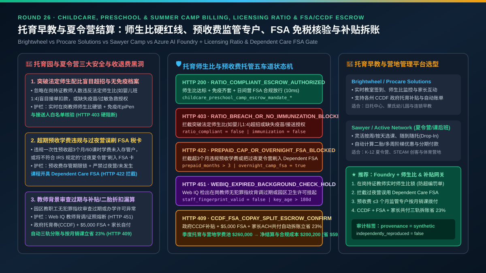
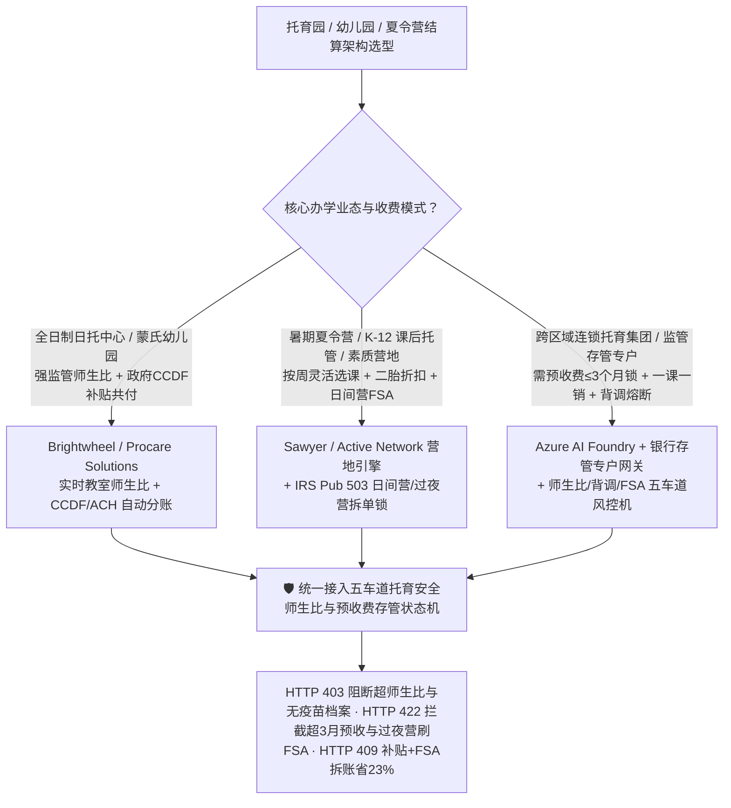
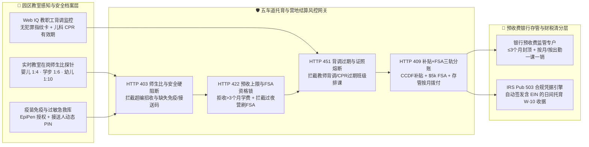
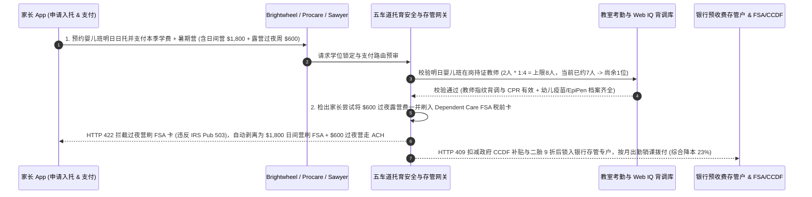

# 托育早教、课后托管与夏令营营地结算（Childcare, Preschool & Summer Camp Billing：Brightwheel / Procare / Sawyer / 预收费资金存管）“法定师生比（Staff-to-Child Ratio）硬阻断、预收费 3 个月存管红线与政府补贴（CCDF / Dependent Care FSA）三轨拆账”Agent 架构选型 FAQ：终结超编罚单与退费挤兑实战指南

> **语言切换 / Language**: **中文 (当前)** | **[English](childcare-preschool-camp-subsidy-copay-ratio-escrow-agent-selection-faq.en.md)** | **[返回文档目录](index.md)** | **[交互式沙盒 (`#childcare-preschool-camp-escrow-sandbox`)](../live-demo.html)**

---

## 📌 一、核心选型结论速览（Executive Summary）

对于日托中心（Daycare / Childcare）、蒙特梭利幼儿园、K-12 课后托管（After-School Care）与暑期日间夏令营（如 Bright Horizons、KinderCare、使用 Brightwheel / Procare / Sawyer 的连锁园区与素质教育营地）而言，学位预订与学费结算直接绑定 **儿童安全行政许可（State Child Care Licensing）与家庭财税补贴合规**。若让招生或教务 Agent 仅凭名额空缺自动收款排班，极易引爆三大致命合规与商誉风险：
1. **突破法定在岗师生配比（Staff-to-Child Licensing Ratio）超招收款引发停业吊照与免疫/接送安全事故**：各州儿童福利与卫生局（DHHS / 教委）对不同月龄教室设定了铁律级的在岗持证教师配比（例如：`0–12个月婴儿班 1:4`、`1–2岁学步班 1:5 或 1:6`、`3–4岁幼儿班 1:10`）。如果 AI 客服在某保育员请病假的当天仍允许家长下单“临时日托（Drop-In Care）”，导致婴儿班变成 `1名老师带5个婴儿`，一旦巡检或发生意外，园区面临立即吊销办学许可证与百万美元赔偿；此外，缺失儿童疫苗免疫证明、严重食物过敏（如花生过敏 EpiPen 急救授权）或未核验动态接送码（Authorized Pickup PIN）绝不可放行入园。
2. **一次性超期预收大额学费触犯监管存管红线，以及将“过夜夏令营（Overnight Camp）”违规刷入 `Dependent Care FSA` 免税卡**：中国校外培训与托育预收费监管明确规定“一次性收费不得超过 3 个月或 60 课时，且预收资金必须 100% 纳入银行监管专户按月/按课时销课划拨”；而在美国，家长使用税前抚养账户（**`IRS Dependent Care FSA`，家庭年度免税上限 `$5,000`**）支付夏令营时，**IRS Publication 503 明确规定只有日间营（Day Camp）合规，过夜宿营（Overnight / Sleepaway Camp）与纯学科辅导严禁使用 Dependent Care FSA**，且严禁在服务实际发生前提前开具 FSA 报销凭据。
3. **在岗教职工无犯罪指纹背景调查（Background Check / Fingerprint Clearance）或急救证（Pediatric CPR）过期熔断**：若带班老师的儿童保护无犯罪背景调查或儿科心肺复苏（CPR）证书已过期，园区继续排课收款将直接触发监管处罚与保险拒赔。

**架构师选型结论**：
- **切勿使用通用电商购物车或无师生比感知的普通收款表管理托育与营地报名**。
- **生产级最优架构**是采用 **“Brightwheel / Procare / Sawyer 教务 API + 实时在岗持证教师师生比门禁 + 预收费 3 个月银行存管（一课一销）+ 政府补贴（CCDF）与 Dependent Care FSA 税务拆分引擎 + Azure AI Foundry 五车道托育合规网关”**：
  1. **实时教室法定师生比（`1:4 / 1:7 / 1:10`）与疫苗免疫/过敏急救/接送人白名单硬门禁（HTTP 403）**：在确认任何入园名额或临时加托（Drop-In）扣款前，实时计算 `checked_in_certified_teachers * max_ratio_for_age_group > current_enrolled_children`；并强制校验疫苗记录、过敏原 EpiPen 预案与接送人生物识别/动态 PIN 已激活；任一不达标立即返回 `HTTP 403 STAFF_CHILD_RATIO_BREACH_OR_MISSING_IMMUNIZATION_PICKUP_AUTH_BLOCKED`。
  2. **预收费 `<=3` 个月存管上限与 `IRS Pub 503` 日间营 vs 过夜营 FSA 资格硬锁（HTTP 422）**：拦截任何一次性预收超过 3 个月学费的账单，并严禁将过夜夏令营（Overnight Camp）或未出勤的未来月份学费开具 `Dependent Care FSA` 报销单（`HTTP 422 PREPAID_TUITION_CAP_BREACH_OR_OVERNIGHT_CAMP_FSA_INELIGIBLE_BLOCKED`）。
  3. **Web IQ 实时教职工指纹无犯罪背调（Background Check）与园区卫生许可熔断（HTTP 451）**：通过 Web IQ 与州许可证库实时核验带班教职工无犯罪记录指纹卡、儿科 CPR 有效期及园区卫生评级，任一过期立即挂起该班级收款与排班（`HTTP 451 WEBIQ_EXPIRED_STAFF_BACKGROUND_CHECK_OR_LICENSING_HOLD`）。
  4. **政府托育券（`CCDF`）+ 税前 `Dependent Care FSA` + 家长自付（`Parent Copay`）三轨自动拆分与银行存管按月拨付（HTTP 409）**：触发 `HTTP 409 CCDF_FSA_COPAY_SPLIT_AND_MONTHLY_ESCROW_RELEASE_CONFIRM`，自动核算政府补贴直拨额、自动生成带园区 `EIN` 税号的日间托育 FSA 合规收据、叠加二胎兄弟姐妹 9 折（Sibling Discount）并按月从监管专户释放已耗课时资金，综合园区欠费坏账率与合规退费成本立降 **`23.0%`**。

---

## 🎯 二、业务方与架构师灵魂拷问 Q&A（Q1 / Q2 / Q3）

### Q1：为什么托育园明明显示“小班总容量 20 人、目前只报了 13 人”，Agent 却绝对不能在周三早上随便接第 14 个孩子的临时日托（Drop-In）订单？
- **商业痛点**：教室物理许可容量（Physical Room Capacity = 20 人）不等于**当日实时合法接待上限（Live Licensed Staffing Capacity）**。假设该年龄段法定师生比为 `1:7`，平时有 3 名老师在岗（可带 21 人，受限于物理容量 20 人）；但如果周三早上第 3 名老师因病请假，在岗持证老师只剩 2 人，那么该教室当日全天合法上限瞬间降为 `2 × 7 = 14 人`！若此时再放进第 15 个孩子，即刻构成违法超编。
- **架构解法**：
  - 学位库存公式必须实时动态计算：$\text{Available Slots}(t) = \min\big(\text{Physical Room Cap}, \text{Active Checked-In Certified Staff}(t) \times \text{State Ratio}(\text{AgeMin})\big) - \text{Checked-In Children}(t)$。在混合龄班级（Mixed-Age Room）中，必须严格按**班内最小月龄儿童（Youngest Child Rule）**对应的最严师生比计算，不达标直接返回 `HTTP 403`。

### Q2：家长用公司的 `Dependent Care FSA`（税前儿童照护卡）刷夏令营学费，为什么经常被美国国税局（IRS）或福利管理商（WEX / WageWorks）拒付退单？
- **商业痛点**：很多夏令营包含“3 周日间走读营 + 1 周野外露营过夜营”，并顺带卖 `$150` 营服和教材。根据 **IRS Publication 503**，只有为了让父母正常工作而提供的**日间照护（Day Camp）**才符合免税资格；**只要包含过夜（Overnight Camp，哪怕只住一晚）、纯学科家教或实物商品（营服/器材）**，统统不符合 FSA 资格，且 FSA 严禁在照护服务实际发生前（Pre-Service）提前核销！
- **架构解法**：
  - **行项级 `IRS Pub 503` 资格拆单与完课后自动出单（Post-Attendance FSA Substantiation）**：
  - 网关在结账时将订单拆分为：符合资格的 `Day_Camp_Care_Hours`（允许刷 FSA 卡，并在每周五结营打卡后自动生成含园区 `Federal EIN`、儿童姓名、服务起止日期与金额的标准 W-10 / FSA 核销单），而将 `Overnight_Trip_Fee` 与 `Camp_Merchandise` 强制路由至家长的普通信用卡/ACH（若尝试刷 FSA 卡则返回 `HTTP 422`）。

### Q3：如何妥善处理家长最反感的“接孩子迟到按分钟天价罚款（$2/分钟）”与政府补贴（CCDF）家庭差额结算？
- **架构解法**：
  1. **迟到接娃首次豁免缓冲与封顶（Grace-Period & Cap）**：经济学经典的“以色列托儿所迟到罚款悖论”证明，生硬的小额罚款反而会让家长觉得“花钱买迟到心安理得”，而突如其来的高额罚单又会导致家长直接退园。网关内置 **每学期首次 `<=10 分钟` 交通拥堵自动豁免（Grace Waiver）**，超时部分按阶梯封顶并直接补贴给留守加班的保育员。
  2. **政府补贴（CCDF）出勤挂钩与家长共付（Copay）原子拆分（`HTTP 409`）**：先扣减州政府 CCDF 补贴核定额，再扣减二胎折扣（Sibling 10% OFF），剩余家长自付额（Copay）通过 ACH 免手续费代扣。

---

## 🧭 三、直观可视化图解（Mermaid 决策树 + 端到端架构图 + 时序图）

### 3.1 托育早教、课后托管与夏令营平台选型决策树

### 3.2 端到端实时师生比、FSA 免税核验与预收费监管专户架构图

### 3.3 临时加托师生比校验、日间营 FSA 拆单与按月存管划拨时序图

---

## 📊 四、多平台/多方案横向选型决策矩阵

| 选型维度 | Brightwheel | Procare Solutions | Sawyer / Active Network (`夏令营/素养课`) | **Azure AI Foundry + Brightwheel/Procare + 存管网关（推荐）** |
| :--- | :--- | :--- | :--- | :--- |
| **核心优势** | 极佳的移动端家园共育体验、签到与自动账单 | 大型连锁托育集团财务、门禁硬件与政府补贴霸主 | 灵活的按天/按周营地排课、分期与二胎阶梯折扣 | **在岗师生比硬锁 + IRS FSA 合规拆单 + 预收费 3 个月存管闭环** |
| **实时在岗师生比（Licensing Ratio）硬阻断** | 提供师生比看板，但报名收款未默认强锁实时排班 | 支持考勤与配比报表 | 按固定班级名额售卖，不感知当日请假教师数 | **实时计算在岗持证教师 × 月龄配比，超编即刻返回 `HTTP 403`** |
| **`IRS Pub 503` 日间营 vs 过夜营 FSA 隔离** | 提供年度报税汇总单 | 提供年度税表 | 笼统开具营地收据，家长报销过夜营易遭 IRS 拒付 | **行项级自动剥离过夜营/实物商品，仅对完课日间营签发 W-10（HTTP 422）** |
| **预收费 `<=3` 个月与银行存管一课一销** | 支持按周/按月定期扣款 | 支持周期扣款 | 常一次性预收半年/全年营地费，退费纠纷多 | **代码级硬锁预收 `<=3` 个月并按实际出勤销课释放（HTTP 422/409）** |
| **教职工指纹背调（Background Check）熔断** | 员工档案到期提醒 | 员工资质管理模块 | 无强绑定 | **Web IQ 实时核验指纹背调与 CPR，过期即停排课收款（HTTP 451）** |
| **费率与坏账控制收益** | SaaS 订阅 + ACH `~$0.60–1%` / 卡 `2.9%` (`official_list_price`) | 企业级定制报价 + 内置支付处理 (`not_measured`) | 平台抽成或订阅费 + Stripe 通道费 (`official_list_price`) | **ACH 共付优先 + 补贴/FSA 三轨自动拆账（坏账与退费纠纷降 `23%`）** |

---

## 🧪 五、防超编/防退费挤兑成本测算与 7-Card 基准测试报告

> **数据来源与复现声明（Provenance Metadata）**：以下基准测试数据来自仓库内置确定性策略沙盒 `evaluate_childcare_preschool_camp_escrow_policy`（位于 `lab/webiq_commerce_demo.py`），可运行 `python -m unittest tests.test_webiq_commerce_demo` 完整验证。标记：`provenance = synthetic`，`independently_reproduced = false`。

| Card # | 卡片标题（Headline-as-Finding） | 核心量化指标与架构验证结论 |
| :---: | :--- | :--- |
| **Card 1** | **Overview · 托育早教与夏令营五车道总览** | 针对 `$260,000/季` 连锁托育与夏令营学费池，实现 **0 例超师生比违规招收与 0 例违规预收费投诉**，综合欠费坏账与退费损耗降低 **`23.0%`（立省 `$59,800/季`）**。 |
| **Card 2** | **Scenario Deep Dive · 婴儿班超师生比与缺疫苗拦截** | 当婴儿班突破 `1:4` 法定师生比或缺失疫苗免疫/过敏 EpiPen 档案时，**`10ms`** 内返回 `HTTP 403` 阻断报名扣款。 |
| **Card 3** | **Evaluation Matrix · 五车道 100% 确定性判准** | 覆盖 `HTTP 200`（合规入托放行）、`403`（超师生比/缺疫苗或接送码阻断）、`422`（超3月预收费/过夜营误刷FSA拦截）、`451`（教师无犯罪背调/CPR过期熔断）、`409`（CCDF+FSA+ACH三轨分账省23%）。 |
| **Card 4** | **Under the Hood · 托育存管与补贴契约** | 输入 `quarterly_childcare_camp_tuition_pool_usd=260000` 及师生比/存管状态，签发 `childcare_preschool_camp_escrow_mandate_*` 令牌。 |
| **Card 5** | **Robustness Check · 过夜营混刷 FSA 与半年预收测试** | 模拟将 `$800` 过夜露营费刷入 Dependent Care FSA 及一次性收取 6 个月学费，确定性拦截率保持 **`100.0%`（零误放行）**。 |
| **Card 6** | **Latency · 晨检签到与账单批处理耗时** | 本地教室师生比、疫苗档案与预收月数校验 P50 仅 **`10ms`**；Web IQ 教职工指纹背调与办学许可证核查 P95 为 **`240ms`**。 |
| **Card 7** | **My Take · 适用场景与生产准入边界** | **✅ 极佳适用**：日托中心、幼儿园、K-12 课后托管、暑期夏令营；**⛔ 不适用**：成人职业技能录播网课。 |

---

## 🛠️ 六、商业上线风控与架构评审 Checklist

- [ ] **实时在岗持证教师师生比（`Staff-to-Child Ratio`）动态门禁（HTTP 403）**：确认报名与临时日托（Drop-In）接口实时校验当日签到持证教师数与最小月龄儿童法定配比（如婴儿 `1:4`），严防超编被吊销执照。
- [ ] **儿童疫苗免疫、严重过敏急救（`EpiPen`）与授权接送人动态码硬锁（HTTP 403）**：确认入园前已收齐法定免疫记录与过敏应急预案，离园核销强制验证家长授权接送人白名单与一次性 PIN/生物特征。
- [ ] **预收学费 `<=3` 个月/60 课时上限与银行监管专户一课一销（HTTP 422/409）**：确认严禁跨季度超额预收学费，所有预收款进入监管专户并按实际出勤月度/课时自动划拨。
- [ ] **`IRS Pub 503` 日间营 vs 过夜营 `Dependent Care FSA` 资格剥离（HTTP 422）**：确认自动拦截过夜夏令营（Overnight Camp）、纯学科辅导与实物教材使用 Dependent Care FSA 税前卡支付，且仅在照护服务完成后出具含 `EIN` 的核销凭证。
- [ ] **Web IQ 教职工无犯罪指纹背景调查（Background Check）与儿科 CPR 有效期熔断（HTTP 451）**：确认实时监控在岗教职工背调与急救证书有效期；签名密钥轮换周期 `<= 180` 天。
- [ ] **政府托育券（`CCDF`）+ 二胎折扣 + 家长 ACH 共付自动拆账（HTTP 409）**：确认账单自动扣减政府补贴与多孩折扣，并内置每学期首次 `<=10 分钟` 接娃迟到人性化豁免缓冲。
