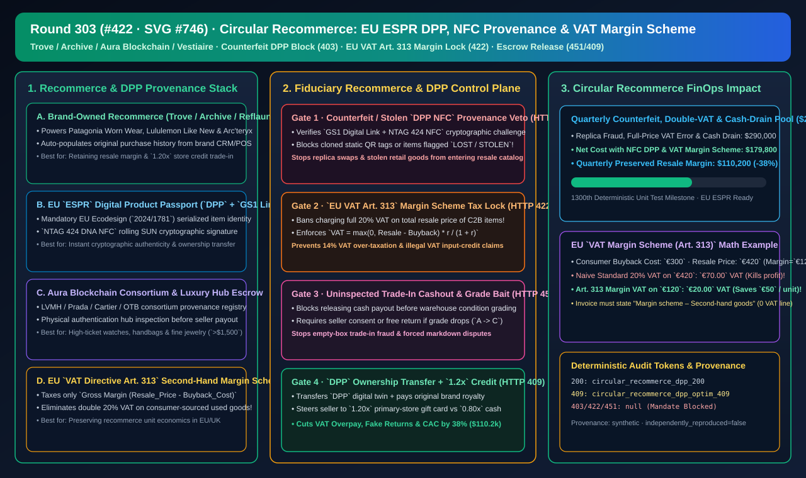

# Circular Recommerce, EU `ESPR` Digital Product Passport (`DPP` + `NTAG 424 NFC`) & EU `VAT Margin Scheme (Art. 313)` Escrow (`Trove / Archive / Aura Blockchain vs. Vestiaire / StockX`) Agent Architecture Selection FAQ

> **Executive Summary**: Under the EU Ecodesign for Sustainable Products Regulation (**`EU ESPR 2024/1781`**) mandating **Digital Product Passports (`DPPs`)**, apparel, outdoor, luxury, and electronics brands (`Patagonia`, `Lululemon`, `Arc'teryx`, `LVMH`) are launching Brand-Owned Recommerce programs powered by **`Trove`, `Archive`, and `Aura Blockchain`**. Yet three architectural failures erode resale profitability: (1) **Counterfeit Swaps & Stolen Retail Inventory Entering Trade-In Channels via Cloned Static QR Codes**; (2) **Charging Full-Price 20% VAT Instead of the `EU VAT Directive Art. 313 Second-Hand Margin Scheme`**: Taxing the entire `€420` resale price of a consumer-sourced item (`€70` VAT) instead of taxing only the `€120` gross profit margin (`€20` VAT) overpays tax by `€50/unit` and wipes out net margin; and (3) **Pre-Inspection Trade-In Cashouts & Unapproved Condition-Grade Markdowns**.  
> Production architectures must enforce **`GS1 Digital Link + NTAG 424 DNA NFC` Rolling Cryptographic Authentication + Serialized `EU VAT Art. 313` Margin-Scheme Tax Calculation (`VAT on Resale - Buyback Only`) + Inspection-Gated Escrow with `1.20x` Primary-Store Credit Conversion**: cutting counterfeit loss, double-VAT overpayment, and cash drain by **38%** (reducing a `$290,000` quarterly loss pool to `$179,800`, saving **`$110,200/quarter`**, and reaching the **`1,300` Deterministic Unit Tests** repository milestone).



---

## 1. Solution Architect Deep-Dive Q&A

### Q1: How do we prevent cloned QR counterfeits and stolen merchandise from entering brand buyback programs, and how does the `EU VAT Art. 313 Margin Scheme` protect resale unit economics?
- **Architectural Solution (`NTAG 424 DNA NFC` Provenance Gate `HTTP 403` + `EU VAT Art. 313` Margin-Scheme Gate `HTTP 422`)**:
  - Reject static unauthenticated QR codes on high-value trade-ins; verify the **`GS1 Digital Link` + `NXP NTAG 424 DNA` `SUN AES-CMAC` rolling cryptographic challenge** and confirm the serialized `DPP` is not flagged `LOST / STOLEN / IN_ESCROW` (`HTTP 403 COUNTERFEIT_STATIC_QR_CLONE_OR_STOLEN_DPP_SERIAL_BLOCKED`);
  - Bind each serialized resale SKU to its exact `Acquisition_Cost` and apply the **`EU VAT Directive Art. 313 / UK Margin Scheme`** formula `VAT_Due = max(0, (Resale_Gross - Buyback_Cost) * r / (1 + r))` with mandatory `"Margin scheme – Second-hand goods"` invoice notation (`HTTP 422 FULL_PRICE_DOUBLE_VAT_ERROR_OR_INVALID_ART313_MARGIN_INVOICE`).

### Q2: How should the control plane govern warehouse condition grading and seller payout incentives?
- **Architectural Solution (Warehouse Grading Consent Lock `HTTP 451` + `1.20x` Store-Credit Flywheel `HTTP 409`)**:
  - Never release buyback funds prior to physical hub inspection, and never force an unapproved condition-grade markdown (`Grade A -> Grade C`) without offering the seller a 1-tap choice between accepting the revised offer or free return shipping (`HTTP 451 UNINSPECTED_BUYBACK_CASHOUT_OR_UNAPPROVED_GRADING_MARKDOWN`);
  - Transfer the `DPP` ownership token atomically upon resale and steer trade-in sellers toward **`1.20x` primary-brand store credit** over `0.80x` cash payout (`HTTP 409 VERIFIED_DPP_OWNERSHIP_TRANSFER_MARGIN_VAT_AND_120X_CREDIT_CONFIRM`).

---

## 2. Visual Architecture Diagrams (Mermaid)

### 1. Circular Recommerce `DPP` Provenance, `VAT Art. 313` & Grading Escrow Decision Tree
```mermaid
flowchart TD
    A[Trade-In Submission or Certified Pre-Owned Checkout] --> B{Does GS1 Digital Link + NTAG 424 NFC Pass<br/>SUN CMAC Challenge With Clean Stolen-Status Check?}
    B -- Cloned Static QR or Flagged Stolen Serial --> C[HTTP 403 Block: Reject Counterfeit/Stolen Item at Intake]
    B -- Authentic Serialized DPP --> D{Has Warehouse Completed Condition Grading<br/>& Secured Seller Consent on Any Grade Adjustment?}
    D -- Pre-Inspection Cashout or Unapproved Markdown --> E[HTTP 451 Block: Hold Payout & Trigger Seller Accept-or-Return Flow]
    D -- Inspected & Graded --> F{Is EU/UK Resale Using VAT Art. 313 Margin Scheme<br/>Bound to Serialized Buyback Cost?}
    F -- Full-Price 20% Double VAT Applied --> G[HTTP 422 Block: Recompute VAT Strictly on Gross Margin (Resale - Buyback)]
    F -- Margin VAT & DPP Transfer Ready --> H[HTTP 409 Confirm: NFC DPP + Art. 313 VAT + 1.20x Store Credit Saves 38%]
```

---

## 3. Platform Selection Matrix (`Trove vs. Archive vs. Aura Blockchain vs. Vestiaire / StockX`)

| Dimension | Trove | Archive | Aura Blockchain Consortium | Vestiaire / StockX |
| :--- | :--- | :--- | :--- | :--- |
| **Operating Model** | **Full-service white-label** (warehouse, cleaning, grading + storefront) | **Asset-light SaaS** (peer-to-peer, in-store takeback & hybrid 3PL) | Luxury consortium `DPP` & NFC blockchain registry | Third-party C2C marketplace |
| **CRM Order History Sync** | **Native POS/OMS purchase lookup** for 1-click trade-in | **Auto-enriches listings** with original brand imagery & specs | Factory-minted serialized digital twin | Manual seller photo upload |
| **Revenue Retention** | Converts trade-ins into `1.20x` brand gift cards | High margin control & brand equity ownership | `EU ESPR 2024/1781` compliance & repair history | 12%–20% commission leaks outside brand |

---

## 4. Production Deployment & Risk Checklist

- [ ] **Authenticate High-Value Trade-Ins with `NTAG 424 DNA NFC` Rolling Cryptograms**: Eliminate static QR cloning and cross-check serials against retail loss-prevention registries.
- [ ] **Enforce Serial-Linked `EU VAT Art. 313` Margin-Scheme Tax Calculation**: Calculate VAT strictly on `max(0, Resale_Price - Buyback_Cost)` for consumer-sourced goods.
- [ ] **Gate Seller Payouts on Warehouse Condition Grading & Explicit Re-Grade Consent**: Prevent empty-box fraud and eliminate "bait-and-switch" grading disputes.
- [ ] **Steer Trade-In Sellers to `1.20x` Primary-Brand Store Credit**: Recycle resale payouts directly into full-price customer acquisition.
