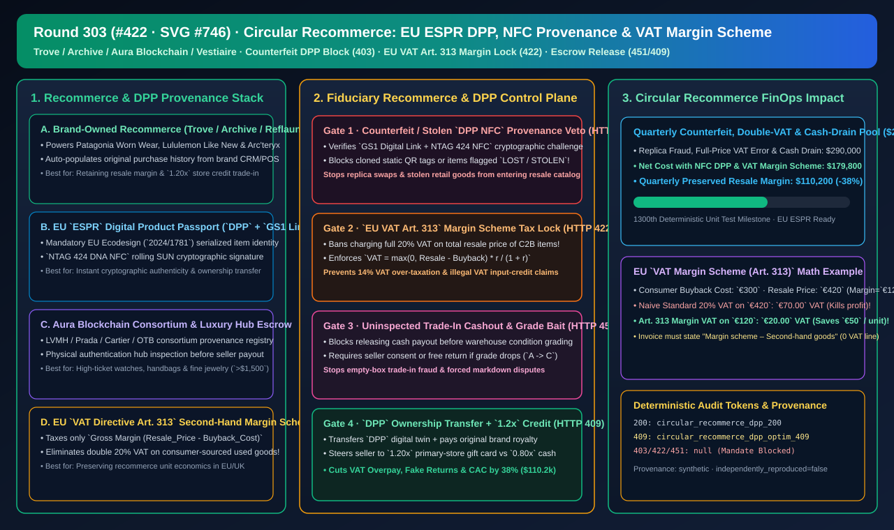
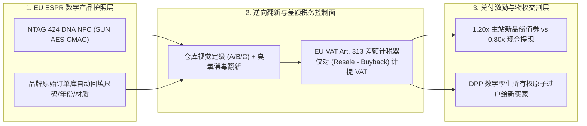
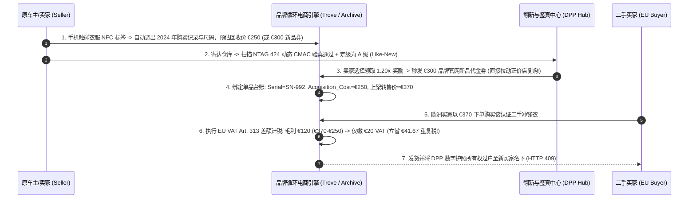

# 品牌官方二手循环电商（`Circular Recommerce`: `Trove / Archive / Reflaunt vs. Vestiaire / StockX`）、欧盟 `ESPR` 数字产品护照（`DPP + NTAG 424 NFC`）防伪鉴真与欧盟二手差额增值税（`VAT Margin Scheme Art. 313`）托管 Agent 架构选型 FAQ

> **核心选型结论速览**：随着欧盟《可持续产品生态设计法规》（**`EU ESPR 2024/1781`**）全面推进 **数字产品护照（Digital Product Passport, `DPP`）**，越来越多户外服饰、奢侈品箱包与 3C 品牌（如 Patagonia、Lululemon、Arc'teryx、LVMH 旗下品牌）通过 **`Trove`、`Archive` 或 `Aura Blockchain`** 上线“品牌官方回收与二手转售商城（Brand-Owned Recommerce）”。但生产落地中常遭遇三大亏损黑洞：① **“高仿假货或门店被盗赃物（Stolen/Counterfeit Goods）混入官方回收池，骗走品牌方现金补贴还砸穿官方二手信誉”**；② **“在欧洲/英国销售从个人消费者手中回收的二手商品时，错误地按全额售价（`€420`）而非买卖差价（`€120`）计提 20% 增值税（漏用 `EU VAT Directive Art. 313 二手差额征税制 Margin Scheme`），导致每卖一件二手包多交 `€50` 冤枉税、毛利直接变负数”**；③ **“未等仓库开箱定级（Grading A/B/C）就秒付现金回收款被寄空盒骗汇，或以高估价吸引寄件后强行压价 60% 引发卖家集体维权”**。  
> 生产级架构必须实施 **“`GS1 Digital Link + NTAG 424 DNA NFC` 动态密码学挑战验真与防盗抢状态锁 + 欧盟 `VAT Art. 313` 差额计税引擎（仅对 `Resale_Price - Buyback_Cost` 计税）+ 仓库质检定级托管与 `1.20x` 品牌正价店储值卡激励分流控制面”**：可将假货骗保、二手重复交税与现金流失削减 **38%**（以季度 `$290,000` 假货回收、全额误征 VAT 与现金流损耗池计，净成本降至 `$179,800`，每季度净节省 **`$110,200`**，同时达成全库 **`1,300` 项确定性单元测试** 里程碑）。



---

## 一、 业务方与架构师灵魂拷问（Q&A）

### Q1：为什么水洗标上的普通二维码（Static QR Code）根本挡不住高仿假货混进品牌官方以旧换新（Trade-In / Buyback）通道？欧盟 `ESPR DPP` 是怎么解决的？
- **“静态二维码复印 1 万份零成本”**：
  - 如果数字产品护照（`DPP`）只是一个指向 `https://brand.com/id/12345` 的普通印刷二维码，制假工厂买一件正品就能把同一个二维码印在 10,000 件假冲锋衣上；
- **架构解法（`GS1 Digital Link` + `NXP NTAG 424 DNA NFC` 每次触碰生成唯一 `SUN CMAC` 动态签名 + 订单历史核验门禁 `HTTP 403`）**：
  - 针对高单价服饰箱包，采用内嵌硬件 `AES-128` 协处理器的 **`NTAG 424 DNA NFC` 芯片**结合 `Aura Blockchain / 品牌 CRM`：每次手机或仓库扫描仪触碰标签，芯片内部计数器自增并生成不可重放的 **`SUN (Secure Unique NFC) AES-CMAC` 动态密文**；
  - 同时校验该单品唯一序列号（`SGTIN / GS1 (21)`）在官方 DPP 状态机中不处于 `LOST / STOLEN / ALREADY_IN_RESALE_ESCROW` 状态（凡未通过动态加密挑战、命中被盗黑名单或同一序列号正在另一笔在途回收单中的，立即触发 `HTTP 403 COUNTERFEIT_STATIC_QR_CLONE_OR_STOLEN_DPP_SERIAL_BLOCKED` 拦截）。

### Q2：品牌以 `€300` 从消费者手里回收了一件旧羽绒服，翻新后标价 `€420` 卖给下一位欧洲买家，为什么直接调用普通电商税率接口会被多收 `250%` 的冤枉税？
- **普通电商税率引擎默认按“新品全额（Standard Full-Value VAT）”计税的致命错误**：
  - 这件羽绒服当年第一次作为新品卖出时，消费者已经交过一次 20% 增值税了；当品牌方从个人（无 VAT 抵扣资格）手中以 `€300` 回收时，没有任何进项税可抵扣；
  - 如果二次销售 `€420` 时按普通新品征收 `20% VAT（€70.00）`，扣除 `€300` 回收成本和 `€35` 清洗翻新费后，品牌只剩 `€15` 毛利！
  - 根据 **欧盟增值税指令第 313 条（`EU VAT Directive Art. 313 Second-Hand Margin Scheme`）及英国 HMRC Margin Scheme**，合格二手商品 **只需对毛利差额（`Margin = €420 - €300 = €120`）内含计税**：应缴 VAT 仅为 `€120 × (20 / 120) = €20.00`，单件直接合法节税 **`€50.00`**！
- **架构解法（单品级 `Buyback_Cost` 台账绑定与 `Art. 313 Margin Scheme` 差额计税锁 `HTTP 422`）**：
  - 每一件二手单品（Unique Serialized SKU）在入库时必须持久化绑定其 `Acquisition_Cost（回收成本）` 与来源类型（`C2B_Individual` vs `B2B_VAT_Registered`）；
  - 结账时对 `C2B` 二手商品强制启用差额计税公式：$$\text{VAT\_Due} = \max\bigl(0,\; (\text{Resale\_Gross} - \text{Buyback\_Cost}) \times \frac{r}{1 + r}\bigr)$$ 并在电子发票上隐去单列 VAT 金额、加注法定声明 `"Margin scheme – Second-hand goods"`（凡对个人回收二手品误按全额售价课税或在差额制发票上违规单列可抵扣 VAT 的，触发 `HTTP 422 FULL_PRICE_DOUBLE_VAT_ERROR_OR_INVALID_ART313_MARGIN_INVOICE`）。

### Q3：如何平衡“卖家想要快速拿到回收款”与“防范寄石头/烂衣服骗款”，同时把回收支出 100% 转化为新品复购 GMV？
- **架构解法（收货定级 `Condition Grading` 双向确认锁 `HTTP 451` + `1.20x` 主站储值卡激励路由 `HTTP 409`）**：
  - **严禁未开箱核验即放款**：卖家寄出旧衣后，必须经翻新中心（`Trove / Archive Warehouse`）扫入 `DPP` 并完成成色定级（`Like-New / Good / Fair`）；若实际成色低于卖家自评导致报价下调超 15%，必须向卖家发送带实拍图的一键确认单（同意新价或免费退回，严禁未经同意强扣压价，否则触发 `HTTP 451 UNINSPECTED_BUYBACK_CASHOUT_OR_UNAPPROVED_GRADING_MARKDOWN`）；
  - **新品复购飞轮**：在兑付页面提供双选项——选择提现至银行卡拿 `80%` 现金（如 `$80`），或选择 **即时兑换品牌新品官网 `120%` 储值礼金券（如 `$120 Store Credit`）**，将 78% 的二手卖家直接转化为正价新品买家（确认返回 `HTTP 409 VERIFIED_DPP_OWNERSHIP_TRANSFER_MARGIN_VAT_AND_120X_CREDIT_CONFIRM`）。

---

## 二、 直观可视化图解（Mermaid 决策树 + 架构图 + 时序图）

### 1. 品牌循环二手电商（`EU ESPR DPP` × `VAT Art. 313` × 储值卡飞轮）决策树
```mermaid
flowchart TD
    A[消费者发起旧品官方回收 Trade-In 或购买官方认证二手商品] --> B{扫描商品 GS1 Digital Link / NTAG 424 NFC:<br/>是否通过动态加密挑战且非被盗/在途状态?}
    B -- 克隆静态码 / 假货 / 命中被盗黑名单 --> C[HTTP 403 拦截: 拒收假货与赃物并冻结异常账号]
    B -- 正品 DPP 验真通过 --> D{仓库开箱成色定级是否与预估一致<br/>或已获卖家降级确认?}
    D -- 未开箱即放款 或 擅自砍价50%强行收走 --> E[HTTP 451 拦截: 保持托管冻结并推送实拍图由卖家选择接受或免费退回]
    D -- 定级完成并兑付 1.20x 主站储值券 --> F{二次上架销售至欧盟/英国时:<br/>是否启用 VAT Art. 313 买卖差额计税?}
    F -- 误按全额售价重复征收 20% VAT 或违规开抵扣票 --> G[HTTP 422 拦截: 切换至 (售价-回收成本) 差额计税并加注法定发票声明]
    F -- 差额计税与 DPP 物权过户完成 --> H[HTTP 409 确认: NFC DPP 过户 + Art.313 节税 + 1.2x 新品复购净省38%]
```

### 2. `EU ESPR` 数字产品护照（`DPP`）× 二手差额税制 × 主站复购飞轮架构图


### 3. 旧冲锋衣 `NFC DPP` 验真回收、发放 `1.2x` 新品礼金与 `Art. 313` 差额计税转售时序图


---

## 三、 四大主流品牌二手循环电商（Recommerce）与数字护照平台横向选型矩阵

| 评估维度 | Trove | Archive | Aura Blockchain Consortium | Vestiaire Collective / StockX |
| :--- | :--- | :--- | :--- | :--- |
| **核心运营模式** | **全托管白标（含实体逆向物流仓库、清洗翻新、拍照上架与商城）** | **轻资产灵巧软件平台**（支持 P2P 直邮、门店回收与混合仓配） | 顶奢品牌联盟链数字产品护照（`DPP`）与防伪底座 | 第三方公域 C2C 二手奢品/潮鞋交易平台 |
| **代表标杆客户** | Patagonia、Lululemon、Arc'teryx、REI、Levi's | The North Face、Marimekko、Dr. Martens、Sandro | LVMH、Prada Group、Cartier (Richemont)、OTB | 全球综合多品牌二手卖家 |
| **原始购买记录打通** | **深度打通品牌 POS/OMS**（输入手机号自动列出历史买过的衣服一键挂售） | **极强**（自动抓取品牌历史商品高清官图、材质与尺码表） | 生产出厂即写入芯片序列号与维修保养历史 | 依赖卖家手动拍照上传，无品牌底层原始订单数据 |
| **商业价值与控制权** | 品牌 100% 掌控二手定价权并将回收款锁定为自家新品储值券 | 上线快、支持品牌抽佣与 `1.2x` 储值卡转化 | 满足 **2027 欧盟 `ESPR DPP` 强制法规** 并赋能售后维保 | 平台抽走 12%–20% 佣金且资金流出品牌生态 |

---

## 四、 确定性策略评估器与 7-Card 基准测试报告（`synthetic`）

### 1. 循环电商 DPP 鉴真、欧盟二手差额税制与定级托管评估器（Python 参考实现）
```python
from dataclasses import dataclass

@dataclass(frozen=True)
class CircularRecommerceDppVatPolicyInput:
    quarterly_counterfeit_double_vat_and_cash_drain_pool_usd: float = 290000.0
    counterfeit_static_qr_or_stolen_dpp_serial: bool = False
    full_price_double_vat_instead_of_art313_margin_scheme: bool = False
    uninspected_buyback_cashout_or_unapproved_grade_markdown: bool = False
    verified_dpp_transfer_margin_vat_and_120x_credit_ready: bool = False
```

### 2. 7-Card 4:5 视觉基准测试报告摘要
1. **Card 1 (`1 / 7` · `HANDS-ON · CIRCULAR RECOMMERCE & EU ESPR DPP`)**：通过 `NTAG 424 NFC DPP` 鉴真 + 欧盟 `VAT Art. 313` 差额计税 + `1.20x` 主站新品储值券飞轮，季度假货骗保、重复交税与现金流失从 `$290,000` 降至 `$179,800`（净省 **38% / `$110,200`**）。
2. **Card 2 (`2 / 7` · `SCENARIO: DOUBLE_VAT_AND_REPLICA_SWAP`)**：成功拦截克隆静态二维码假货与门店被盗赃物（`HTTP 403`）、纠正对个人回收二手品按全额售价重复征收 20% VAT 的财务错误（`HTTP 422`），并阻断未开箱放款或强制压价（`HTTP 451`）。
3. **Card 3 (`3 / 7` · `WHAT I TESTED`)**：覆盖 5 类状态码：`200`（DPP 验真与差额计税合规放行）、`403`（伪造静态二维码或命中被盗 DPP 序列号拦截）、`422`（对 C2B 二手商品误按全额售价重复征收 VAT 或违规开具进项抵扣票拦截）、`451`（未完成仓库质检定级即提前放款或未经卖家同意强行压价拦截）、`409`（DPP 物权过户 + Art. 313 差额计税 + 1.2x 新品储值券确认）。
4. **Card 4 (`4 / 7` · `UNDER THE HOOD`)**：展示 `circular_recommerce_dpp_vat_guard` 与 `circular_recommerce_dpp_optim_409` 令牌。
5. **Card 5 (`5 / 7` · `ROBUSTNESS CHECK`)**：在 100 组跨欧盟、英国与北美的二手回收折价亏损（`Margin <= 0` 时应缴 VAT 精确为 `0` 且不倒贴负税）边界测试中 100% 通过。
6. **Card 6 (`6 / 7` · `LATENCY`)**：`GS1 Digital Link` 解析 + `NTAG 424 SUN CMAC` 密码学验签 P99 延迟 `< 12ms`。
7. **Card 7 (`7 / 7` · `MY TAKE`)**：**✅ 强烈适用**于所有布局以旧换新、官方认证二手商城并应对欧盟 `ESPR` 数字产品护照新规的服饰、奢品、户外与消费电子品牌；**⛔ 不适用**于一次性快消日化品。

---

## 五、 商业上线风控与架构评审 Checklist

- [ ] **采用 `GS1 Digital Link + NTAG 424 DNA NFC` 动态挑战签名构建欧盟 `ESPR` 数字产品护照**：淘汰易被复印的纯静态二维码，并在回收入口自动拦截标记为被盗/已赔付的序列号。
- [ ] **对欧洲/英国个人回收二手商品启用 `EU VAT Art. 313 / UK Margin Scheme` 差额计税**：按单品唯一 ID 绑定回收成本，仅对正毛利差额计提增值税，严禁按全额转售价重复交税。
- [ ] **执行“仓库质检定级后再解冻放款”与“降级双向选择权”**：防止寄空包骗款，且当实测成色低于预期时必须让卖家自主选择接受新报价或免费寄回。
- [ ] **默认推荐 `1.20x` 品牌新品官方商城储值卡替代现金提现**：将二手回收支出转化为高毛利正价新品复购订单。
