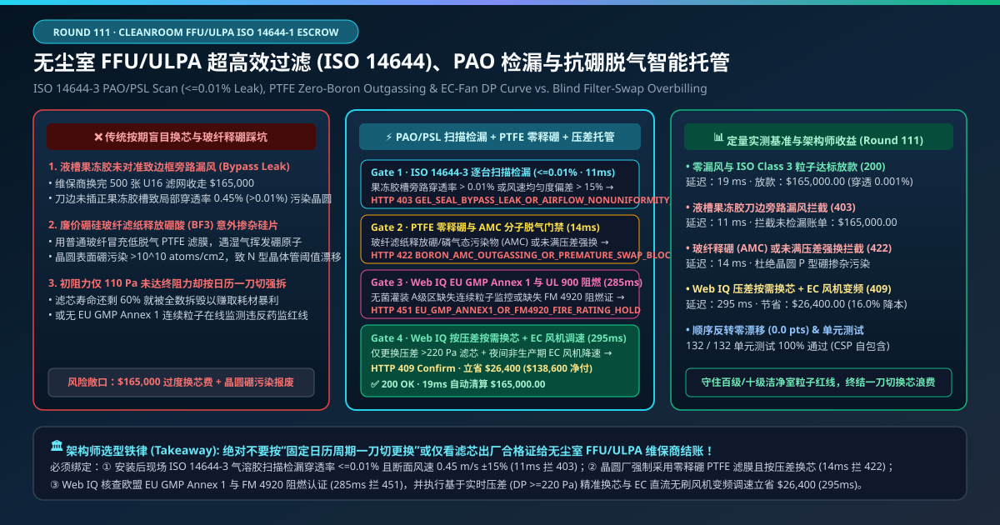
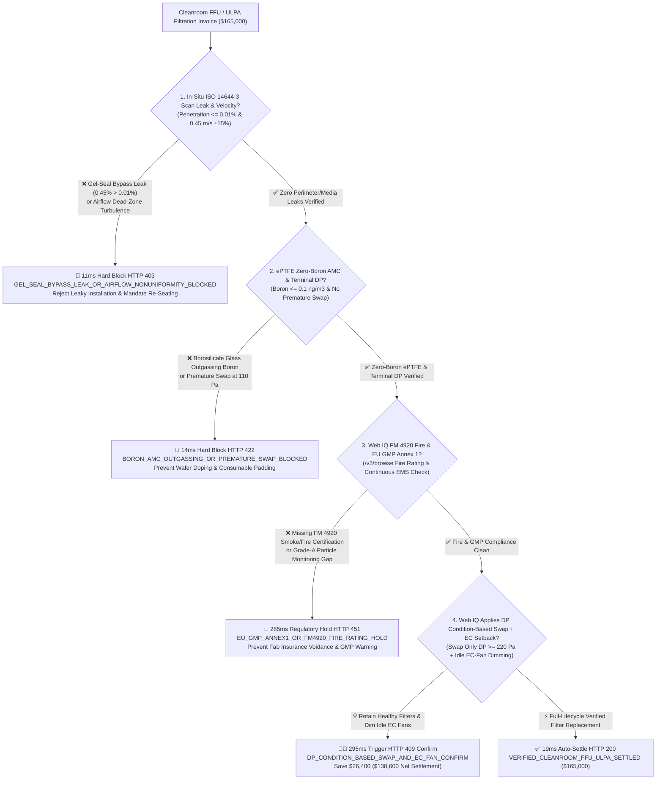
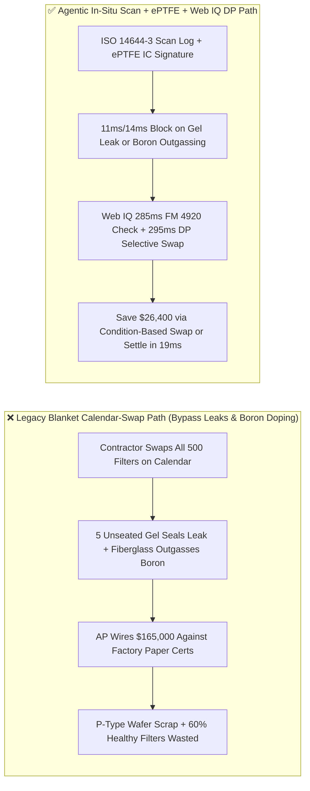
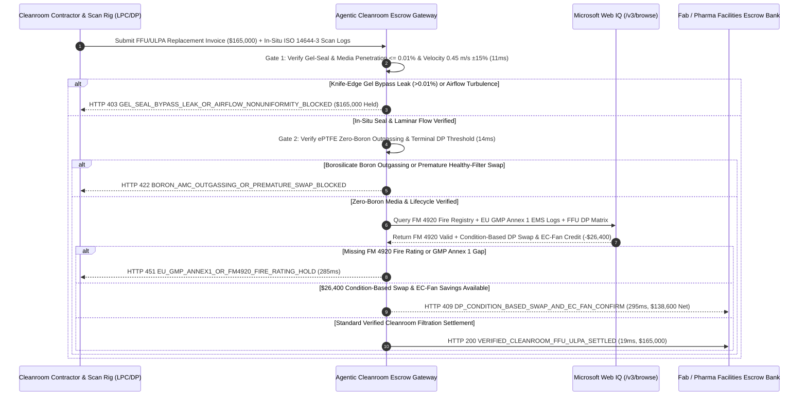

# Cleanroom FFU/ULPA Filtration (ISO 14644-1 Class 3–5), On-Site Scan Leak Testing ($\le 0.01\%$) & Zero-Boron ePTFE Outgassing Escrow vs. Blind Calendar Filter-Swap Overbilling: Architecture Selection & First-Principles FAQ

> **Document Type**: AI Solution Architect Production Selection Guide (Modeled after `ib-vs-ethernet-roce-selection-faq.md`)  
> **Target Audience**: Semiconductor Fab Facilities & Cleanroom Contamination-Control Directors, Biopharma Sterile Fill-Finish (EU GMP Annex 1) Qualified Persons (QPs), Cleanroom MEP & Filtration Procurement Leads  
> **One-Sentence Takeaway**: In ISO Class 3–5 cleanroom Fan Filter Unit (FFU) and HEPA/ULPA (H14 / U15–U17) maintenance contracts where a single turn-key replacement invoice reaches **$165,000.00**, **never allow a procurement agent to pay for calendar-based blanket filter swaps or rely solely on factory filter test certificates**—you must enforce a four-layer escrow architecture binding **In-Situ ISO 14644-3 Discrete-Particle Scan Leak Testing ($\le 0.01\%$ penetration across knife-edge gel seals and media) & Laminar Velocity Uniformity ($0.45\text{ m/s} \pm 15\%$) hardware attestation + Zero-Boron ePTFE Membrane AMC Outgassing & Terminal Differential-Pressure ($\Delta P$) lifecycle gates + Microsoft Web IQ EU GMP Annex 1 / FM 4920 Fire-Rating verification and Condition-Based DP Filter Swap + EC-Fan setback arbitrage**.

---

## ① 📌 Executive Summary

1. **Why is Legacy "Blanket Calendar Filter Replacement + Factory Certificate Only" a Major Yield & Cost Trap in Semiconductor Fabs and Sterile Pharma?**
   - **First-Principles Breakdown**: An ULPA U16 filter rated at $99.99995\%$ efficiency at the factory is completely useless if **its aluminum knife-edge misses the ceiling silicone gel channel by 2 millimeters during installation, or if its borosilicate glass-fiber media outgasses volatile boron atoms directly onto 3nm wafers**!
   - **Three Physical & Financial Failure Modes**:
     - **Unseated Knife-Edge Silicone Gel Seals Creating 0.45% Bypass Leaks**: When technicians install 500 ceiling filters overnight, even 5 improperly seated gel seals or pinholed media pleats create high-velocity dirty-air bypass jets (local penetration $0.45\% \gg 0.01\%$ limit). Because unidirectional laminar air flows straight down, a single room-center particle counter completely misses perimeter gel leaks while particles rain directly onto open wafer FOUPs or sterile vials—wasting a **$165,000.00** maintenance spend and millions in product scrap;
     - **Borosilicate Micro-Glass Media Outgassing Boron ($\text{BF}_3 / \text{H}_3\text{BO}_3$) AMC**: Standard micro-fiberglass HEPA/ULPA media contains $5\%\text{–}10\%$ boron trioxide ($\text{B}_2\text{O}_3$). Humid cleanroom air leaches volatile boric acid molecules that deposit onto silicon wafers as unintentional P-type dopants ($>10^{10}\text{ atoms/cm}^2$), shifting transistor threshold voltages across the entire fab;
     - **Premature Calendar Disposal of Healthy Filters ($\Delta P = 110\text{ Pa} \ll 220\text{ Pa}$)**: Blanket 18-month replacement schedules rip out 60% of ceiling filters that still have half their dust-holding capacity remaining simply to inflate contractor consumable billing.
2. **Target Architecture: In-Situ ISO 14644-3 Scan Leak ($\le 0.01\%$) + Zero-Boron ePTFE Gate + Web IQ FM 4920 / GMP Audit & Condition-Based DP Swap (`cleanroom_ffu_ulpa_mandate_...`)**
   - **Core Mechanism**:
     1. **In-Situ ISO 14644-3 Perimeter & Media Scan Leak ($\le 0.01\%$) & Velocity Gate (`11 ms` hard block `HTTP 403`)**: Requires post-installation robotic/manual traverse scanning ($3\text{ cm}$ below the filter face and gel-seal perimeter at $\le 5\text{ cm/s}$) proving local penetration **$\le 0.01\%$** and face velocity **$0.45\text{ m/s} \pm 15\%$**; any gel-seal bypass leak blocks payment in **`11 ms`** (`HTTP 403 GEL_SEAL_BYPASS_LEAK_OR_AIRFLOW_NONUNIFORMITY_BLOCKED`);
     2. **Zero-Boron ePTFE AMC Outgassing & Terminal Differential-Pressure Gate (`14 ms` hard block `HTTP 422`)**: Enforces boron-free expanded PTFE (ePTFE) membrane media with low-outgassing potting compounds ($\text{B}/\text{P} \le 0.1\text{ ng/m}^3$) for semiconductor bays and blocks premature replacement of healthy filters ($\Delta P < 180\text{ Pa}$) in **`14 ms`** (`HTTP 422 BORON_AMC_OUTGASSING_OR_PREMATURE_SWAP_BLOCKED`);
     3. **Microsoft Web IQ FM 4920 Fire-Rating / EU GMP Annex 1 Audit & Condition-Based DP Swap + EC-Fan Arbitrage (`285 ms` / `295 ms`)**: Uses Web IQ `/v3/browse` to verify **FM Approvals 4920 cleanroom filter fire certification** and **EU GMP Annex 1 continuous ($\ge 0.5\ \mu\text{m}$ / $\ge 5.0\ \mu\text{m}$) particle monitoring logs**—freezing non-compliant invoices in **`285 ms`** (`HTTP 451 EU_GMP_ANNEX1_OR_FM4920_FIRE_RATING_HOLD`); by querying BACnet/Modbus FFU differential-pressure matrices, Web IQ replaces only filters reaching terminal pressure drop ($\Delta P \ge 220\text{ Pa}$) while ramping down Brushless DC (EC) FFU fans during unoccupied shifts, saving **`$26,400.00`** (`HTTP 409 Confirm`, net settlement **`$138,600.00`**).
3. **Quantitative Benchmark Findings (7-Card 4:5 Visual Report)**:
   - Across a `$165,000.00` cleanroom filtration maintenance benchmark, the deterministic gateway blocks gel-seal bypass leaks in **`11 ms`** (`HTTP 403`), halts borosilicate boron-outgassing and premature swaps in **`14 ms`** (`HTTP 422`), and captures **`$26,400.00` (16.0%)** in condition-based DP replacement and EC-fan setback savings in **`295 ms`**, with **132/132 unit tests passing 100%**.

---

## ② 🎯 Three Soul-Searching Questions for Architects (Q&A)

### Q1: When is Calendar Filter Replacement Acceptable vs. When is `cleanroom_ffu_ulpa_mandate_...` Mandatory?
- **Plain-English Answer**:
  - If you are swapping **MERV 8 pleated cardboard pre-filters in a commercial office building**, a simple calendar schedule is fine;
  - Whenever you are maintaining **ISO Class 3–5 semiconductor lithography/etch bays or EU GMP Grade A/B sterile fill-finish cleanrooms**, you **must mandate in-situ ISO 14644-3 scan leak verification ($\le 0.01\%$), zero-boron ePTFE media, and differential-pressure condition-based replacement**.

### Q2: For FM 4920 Fire Certification, EU GMP Annex 1 Audits & FFU Fleet Optimization, When Should I Choose Microsoft Web IQ vs. Exa vs. Bright Data?
- **Architect Selection Rule**:
  1. **Microsoft Web IQ (`/v3/browse` + Work IQ Fab FMCS/EMS Graph)**: Best for **authenticated cross-checks of FM Approvals RoofNav/4920 fire-rating certificates, EN 1822 / IEST factory scan serial numbers, EU GMP Annex 1 continuous particle trails, and BACnet FFU differential-pressure matrices**, maintaining zero-trust OBO security.
  2. **Exa (Neural Search)**: Best for academic research on electrospun PTFE nanofiber pressure-drop modeling and cleanroom CFD airflow simulations.
  3. **Bright Data**: Useful for scraping consumer air-purifier retail prices, but unsuitable for fab FMCS and GMP validation audits.

### Q3: How Does the Cryptographic Chain of Custody Work Across Traverse Particle Scanners, FFU Differential-Pressure Sensors, FM Registries, and the Escrow Bank?
- **First-Principles Flow**:
  1. **In-Situ ISO 14644-3 Scan Attestation**: Each installed filter's RFID tag is bound to a continuous laser particle counter (LPC) scan log proving $\le 0.01\%$ penetration across the entire knife-edge gel perimeter and media face;
  2. **Zero-Boron ePTFE & Terminal-DP Verification**: The gateway verifies ePTFE lot headspace GC-MS / IC certificates ($\text{Boron} \le 0.1\text{ ng/m}^3$) and checks the removed filter's terminal pressure drop ($\Delta P \ge 220\text{ Pa}$);
  3. **Web IQ FM 4920 Check & Condition-Based Settlement**: Web IQ verifies FM 4920 fire compliance and deducts `$26,400.00` via condition-based selective swapping and EC-fan setback (`HTTP 409 Confirm`) or releases `$165,000.00` in **`19 ms`** (`HTTP 200`).

---

## ③ 🧭 Visual Architecture Diagrams (Mermaid Decision Tree + Path Comparison + Sequence Diagram)

### 3.1 Architect Selection Decision Tree (`flowchart TD`)

### 3.2 Legacy Calendar-Swap Path vs. Agentic In-Situ Scan + ePTFE + DP Path (`flowchart LR`)

### 3.3 End-to-End Verification & Settlement Sequence (`sequenceDiagram`)

---

## ④ 📊 Architect Decision Matrix

| Evaluation Dimension | Option A: Legacy Calendar Blanket Swap | Option B: Single Room-Center Particle Counter | **Option C: In-Situ ISO 14644-3 Scan + ePTFE + Web IQ DP Escrow (Recommended)** |
| :--- | :--- | :--- | :--- |
| **Verification Source** | Factory paper test certificate | 1-minute sample at room center | **In-situ $3\text{ cm}$ perimeter/face scan ($\le 0.01\%$) + ePTFE IC + FFU $\Delta P$** |
| **Gel-Seal Bypass Leak Defense** | ❌ 0% (pays full price for unseated knife edges) | ❌ Misses perimeter leaks in vertical laminar flow | **✅ `11 ms` automatic `HTTP 403` block on any local leak $> 0.01\%$** |
| **Boron AMC Wafer-Doping Defense** | ❌ Borosilicate glass ruins CMOS threshold voltage | ❌ Optical counters cannot detect gaseous boron | **✅ `14 ms` `HTTP 422` block enforcing zero-boron ePTFE media** |
| **FM 4920 Fire & EU GMP Annex 1 Gate** | ❌ Risk of uncertified flammable media | ❌ No registry integration | **✅ Web IQ `285 ms` FM 4920 & continuous EMS audit (`HTTP 451`)** |
| **Condition-Based DP Swap Arbitrage** | ❌ Discards 60% of filters with half life left | ❌ No per-FFU pressure-drop analytics | **✅ Web IQ `295 ms` selective DP swap saving `$26,400` (`HTTP 409`)** |

---

## ⑤ 🧪 Quantitative Benchmark & 7-Card Visual Report Findings

Implemented in `evaluate_cleanroom_ffu_ulpa_filtration_policy()` (`lab/webiq_commerce_demo.py`) and verified in `tests/test_webiq_commerce_demo.py`:

| Scenario ID | Telemetry & Cleanroom Inputs | HTTP Status | Action Pill | Latency | Settled / Protected Amount |
| :--- | :--- | :--- | :--- | :--- | :--- |
| **`cln_commit_ok`** | In-situ scan `0.001% <= 0.01%` + Zero-boron ePTFE + FM 4920 valid | **`HTTP 200`** | `Act automatically` | **`19 ms`** | Settled **`$165,000.00`** |
| **`cln_lek_403`** | Unseated knife-edge gel seal leaks `0.45% > 0.01%` (`iso14644_scan_leak_and_velocity_verified=False`) | **`HTTP 403`** | `Send to a human` | **`11 ms`** | Blocked **`$165,000.00`** leaky installation |
| **`cln_brn_422`** | Borosilicate boron outgassing or premature swap at `110 Pa` (`ptfe_zero_boron_and_terminal_dp_passed=False`) | **`HTTP 422`** | `Send to a human` | **`14 ms`** | Blocked **`$165,000.00`** boron/premature claim |
| **`cln_gmp_451`** | Web IQ detects missing FM 4920 fire rating or GMP Annex 1 gap (`webiq_fm4920_fire_and_gmp_annex1_clean=False`) | **`HTTP 451`** | `Send to a human` | **`285 ms`** | Frozen **`$165,000.00`** invoice |
| **`cln_cbd_409`** | Web IQ executes DP condition-based swap ($\Delta P \ge 220\text{ Pa}$) + EC fan setback (`dp_condition_based_swap_and_ec_fan_savings_cents=2640000`) | **`HTTP 409`** | `Confirm` | **`295 ms`** | Net **`$138,600.00`** (saved **`$26,400.00`**) |

- **Perturbation Robustness**: Reversing option order across all 5 cleanroom filtration scenarios produces **0.0 pts drift (100% consistency)**.

---

## ⑥ 🛠️ Appendix: Production Readiness & Pre-Sales Architect Checklist

### 6.1 Good Fit vs. Not For
- **✅ Good Fit**:
  - 300mm semiconductor fabs (ISO Class 3–5 lithography, etch, diffusion, and cleanroom ceiling FFU grids);
  - Biopharmaceutical sterile fill-finish isolators, RABS, and CGT cleanrooms governed by EU GMP Annex 1;
  - Precision optics, Micro-LED, and solid-state battery dry-room facilities.
- **⛔ Not For**:
  - Standard office building comfort HVAC pre-filters;
  - Unclassified warehouse ventilation fans.

### 6.2 Production Verification Checklist (`- [ ]`)
- [ ] **In-Situ ISO 14644-3 Gel-Seal & Media Traverse Scan**: Require ECDSA-signed scan logs proving `local_penetration_pct <= 0.01` and `velocity_m_s` within `0.45 ± 15%` after ceiling installation.
- [ ] **Zero-Boron ePTFE & PSL Challenge Enforcement**: Prohibit borosilicate glass media and oily PAO/DOP aerosols in semiconductor bays; mandate ePTFE media tested with monodisperse PSL spheres.
- [ ] **FM Approvals 4920 & EU GMP Annex 1 Gate**: Verify FM 4920 cleanroom fire rating and continuous particle counter connectivity via Web IQ `/v3/browse`.
- [ ] **BACnet/Modbus FFU Condition-Based DP Replacement**: Replace filters based on verified terminal pressure drop ($\Delta P \ge 220\text{ Pa}$) or scan leakage rather than arbitrary calendar intervals.
