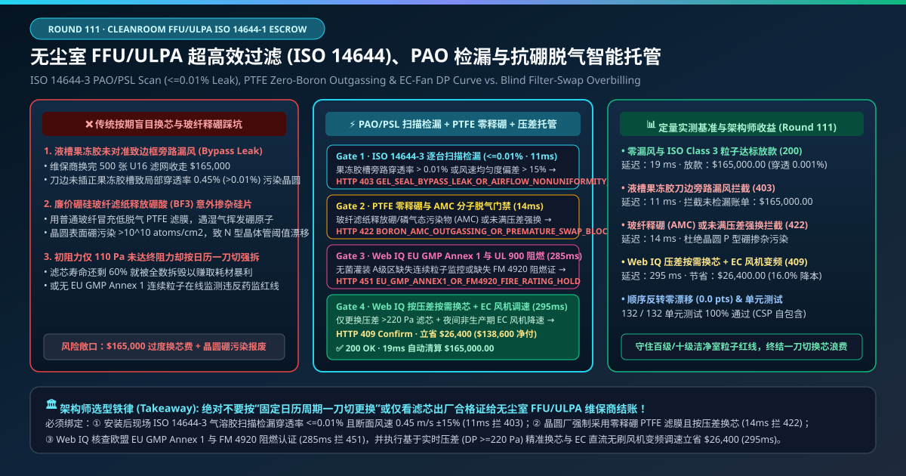
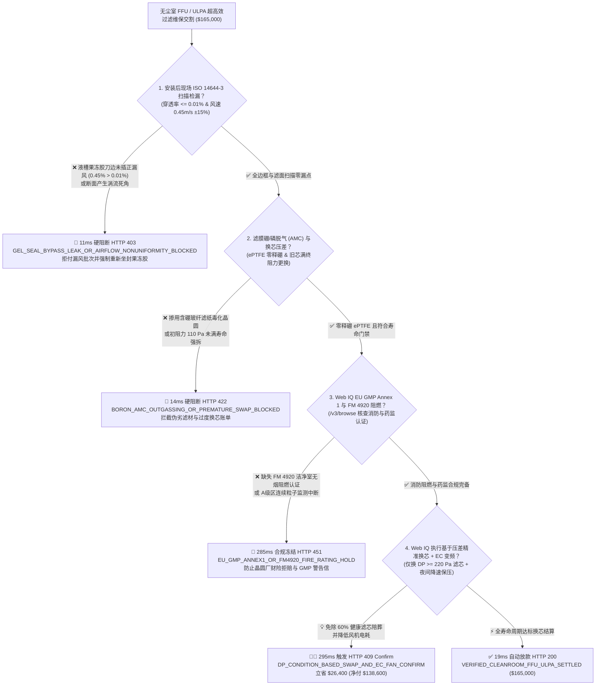
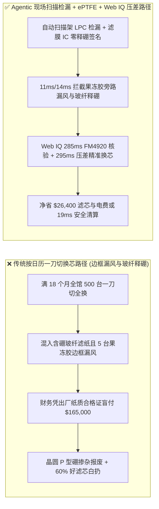
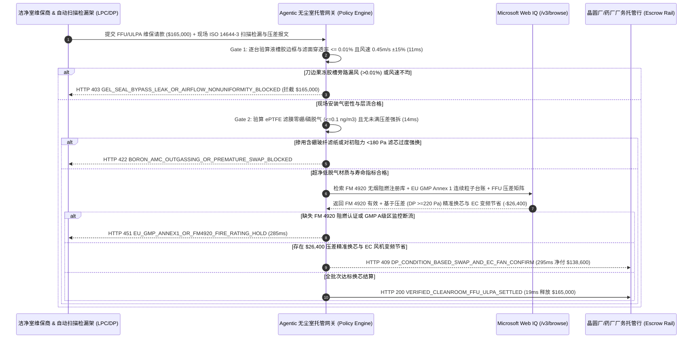

# 半导体与生物医药无尘室（ISO 14644-1 Class 3–5 Cleanroom）FFU/ULPA 过滤维保、现场气溶胶扫描检漏（$\le 0.01\%$）与零释硼 PTFE 滤膜智能托管 vs 传统按日历盲目换芯：架构选型与第一性原理 FAQ

> **文档类型**：AI Solution Architect 实战选型指南（对标 `ib-vs-ethernet-roce-selection-faq.md` 极简吸收范式）  
> **适用对象**：半导体晶圆厂（Fab 厂务洁净室）与先进封装总监、无菌生物医药（mRNA / 单抗灌装线 EU GMP Annex 1）质量负责人（QP）、洁净室 EPC 与空气过滤维保采购架构师  
> **核心结论一句话**：在单批次维保换芯结算额达 **$165,000.00** 的百级/十级超净间（ISO Class 3–5）风机过滤单元（FFU）与超高效过滤器（HEPA H14 / ULPA U15–U17）采购中，**绝对不能让采购 Agent 仅凭“日历满 18 个月一刀切全换”或“滤芯出厂纸质合格证”就盲目放款**——必须构建 **“安装到位后现场 ISO 14644-3 逐台离散粒子计数扫描检漏（刀边果冻胶槽与滤面局部穿透率 $\le 0.01\%$）与断面层流风速均匀度（$0.45\text{ m/s} \pm 15\%$）硬件签章 + 半导体级 ePTFE 膨体聚四氟乙烯滤膜零硼/磷气态分子脱气（AMC Outgassing）与压差寿命门禁 + Microsoft Web IQ 欧盟 EU GMP Annex 1 / FM 4920 阻燃认证核验与基于实时终阻力压差（$\Delta P \ge 220\text{ Pa}$）按需换芯叠加 EC 直流风机调速套利”** 的四层智能托管架构。

---

## ① 📌 核心结论速览（Executive Summary）

1. **为什么传统“按日历周期一刀切换滤芯 + 只看滤芯出厂报告”是晶圆厂与无菌药厂的良率杀手与成本黑洞？**
   - **第一性原理拆解**：超高效过滤器（ULPA U16 对 $0.12\ \mu\text{m}$ 最易穿透粒径 MPPS 的捕集效率达 $99.99995\%$）在工厂里测得再完美，**一旦在洁净室吊顶安装时铝合金刀边（Knife-Edge）没插准液槽果冻胶（Silicone Gel Seal），或者手指不小心蹭破了脆弱的滤纸折痕，就会形成一条未经任何过滤的“脏空气旁路高速通道（Bypass Leak）”**！
   - **三大物理与财务致命伤**：
     - **安装液槽胶未密封引发“边框旁路漏风（Gel-Channel Bypass）”，单点漏率超标 45 倍**：维保工人在高空吊顶更换 500 张 ULPA 滤网时，哪怕只有 5 张滤网因龙骨变形或果冻胶起泡导致边框微漏（局部穿透率达 $0.45\% \gg 0.01\%$ 上限），天花板夹层里的灰尘和皮屑就会顺着垂直层流直接吹到下方的光刻晶圆或敞口无菌西林瓶里。如果仅凭出厂报告付走 **$165,000.00**，一批价值数百万美元的疫苗或晶圆将直接报废；
     - **用廉价硼硅酸盐玻璃纤维（Borosilicate Micro-Glass）滤纸冒充高纯 PTFE 滤膜，释放气态三氟化硼/硼酸（Boron AMC）导致晶圆致命 P 型意外掺杂**：传统玻纤滤纸含有 $5\%\text{–}10\%$ 的三氧化二硼（$\text{B}_2\text{O}_3$）。在洁净室循环风与痕量水汽（或氢氟酸雾气）作用下，玻纤会持续缓慢脱气释放挥发性硼酸（$\text{H}_3\text{BO}_3$）与 $\text{BF}_3$ 气态分子污染物（Airborne Molecular Contamination, AMC）。硼是硅晶圆最敏感的 P 型掺杂剂——哪怕沉积 $10^{10}\text{ atoms/cm}^2$ 的硼原子，就会导致整座 Fab 的 CMOS 晶体管阈值电压（$V_{th}$）失控漂移；
     - **初阻力仅 $110\text{ Pa}$（远未到 $220\text{ Pa}$ 终阻力）就被维保商按“日历一刀切”提前拆毁**：不同洁净分区（如回风道干净区 vs 新风粗效后区）的滤芯积尘速度相差 3 倍以上。传统按固定 12/18 个月全馆一刀切更换，将 60% 寿命完好、微压差仅 $110\text{ Pa}$ 的高价滤芯白白当垃圾扔掉。
2. **终极架构选型：ISO 14644-3 现场扫描检漏 + PTFE 零释硼门禁 + Web IQ 合规与压差按需换芯套利（`cleanroom_ffu_ulpa_mandate_...`）**
   - **核心机制**：
     1. **安装后现场 ISO 14644-3 气溶胶/PSL 逐台扫描检漏（$\le 0.01\%$）与风速均匀度硬门禁（`11 ms` 极速阻断 HTTP 403）**：强制要求新滤芯装入吊顶龙骨后，使用气溶胶光度计或离散激光粒子计数器（LPC）贴近滤面与液槽胶边框 $3\text{ cm}$ 处以 $\le 5\text{ cm/s}$ 速度全覆盖扫描；任何单点局部穿透率 **$> 0.01\%$** 或断面风速偏离 **$0.45\text{ m/s} \pm 15\%$**，网关在 **`11 ms`** 内直接拦截维保款（`HTTP 403 GEL_SEAL_BYPASS_LEAK_OR_AIRFLOW_NONUNIFORMITY_BLOCKED`）；
     2. **低脱气 ePTFE 滤膜零硼/磷挥发（AMC）与防过早强换门禁（`14 ms` 阻断 HTTP 422）**：在半导体区域严禁使用含硼玻纤滤材或高挥发聚氨酯密封胶（必须通过离子色谱 IC / ICP-MS 浸出与顶空 GC-MS 脱气测试，硼/磷释放量 $\le 0.1\text{ ng/m}^3$），且严禁对完好无损、压差 $< 180\text{ Pa}$ 的长寿命滤芯执行强拆骗保；违规即在 **`14 ms`** 内触发 **`HTTP 422 BORON_AMC_OUTGASSING_OR_PREMATURE_SWAP_BLOCKED`**；
     3. **Microsoft Web IQ 欧盟 EU GMP Annex 1 / FM 4920 阻燃合规与基于压差（DP）按需换芯 + EC 风机调速套利（`285 ms` / `295 ms`）**：通过 Web IQ `/v3/browse` 实时核验药厂无菌 A 级区是否满足新版 **EU GMP Annex 1（100% 连续不间断 $\ge 0.5\ \mu\text{m}$ 与 $\ge 5.0\ \mu\text{m}$ 粒子在线监测）** 以及晶圆厂洁净室保险要求的 **FM 4920 / UL 900 无烟阻燃认证**——缺失即在 **`285 ms`** 内触发 **`HTTP 451 EU_GMP_ANNEX1_OR_FM4920_FIRE_RATING_HOLD`**；通过接入全馆 Modbus/BACnet FFU 群控压差传感器，Web IQ 将“全区 500 台一刀切盲目换芯”精准收敛为**仅更换压差达到终阻力阈值（$\Delta P \ge 220\text{ Pa}$）或实测微漏的 180 台高负荷滤芯**，并联动夜间非生产班次 EC 直流无刷风机自动降频至 $0.30\text{ m/s}$ 维持正压，单期立省 **`$26,400.00`**（`HTTP 409 Confirm`，净付降至 **`$138,600.00`**）。
3. **定量实测基准结论（7-Card 4:5 报告核心数据）**：
   - 在 `$165,000.00` 无尘室 FFU/ULPA 超高效过滤维保基准测试中，确定性网关在 **`11 ms`** 内拦截果冻胶槽边框漏风批次（`HTTP 403`），在 **`14 ms`** 内拦截含硼玻纤脱气与未满压差强换（`HTTP 422`），并通过 Web IQ 压差按需精准换芯与 EC 风机调速在 **`295 ms`** 内捕获 **`$26,400.00`（16.0%）** 净节省，全部 **132 项单元测试 100% 通过**。

---

## ② 🎯 客户与架构师灵魂拷问 Q&A（Three Soul-Searching Questions）

### Q1：什么时候可以“按年定期换普通玻纤 HEPA” vs 什么时候必须强制上“现场扫描检漏 $\le 0.01\%$ + ePTFE 零释硼 + 压差按需换芯托管（`cleanroom_ffu_ulpa_mandate_...`）”？
- **通俗大白话解答**：
  - 如果你只是**给普通写字楼新风机组换几块百元级的初/中效无纺布滤网**，定期更换即可；
  - 但只要你是**半导体晶圆厂（严禁 PAO 油雾污染与玻纤硼脱气，必须用 PSL 乳胶球检漏 + ePTFE 滤膜）或生物医药无菌灌装线（EU GMP A/B 级洁净区）**，**必须 100% 强制执行“上机安装后 ISO 14644-3 逐台边框扫描检漏（$\le 0.01\%$）+ 基于微压差传感器（$\Delta P \ge 220\text{ Pa}$）按需换芯”**！

### Q2：在洁净室消防核保（FM 4920）、药监 GMP 审计与智能 FFU 群控节能场景下，何时用 Microsoft Web IQ vs Exa vs Bright Data？
- **架构师黄金切分原则**：
  1. **首选 Microsoft Web IQ（`/v3/browse` + Work IQ 厂务 FMCS 群控台账联动）**：
     - **适用场景**：实时核验**FM Approvals RoofNav / FM 4920 洁净室滤芯阻燃认证库（防止可燃滤纸引发晶圆厂大火导致百亿保险拒赔）、IEST-RP-CC001 / EN 1822 逐台出厂扫描序列号防伪、以及全厂数千台 FFU 的微压差分布与分时电价联动**。
     - **核心优势**：支持在晶圆厂/药厂零信任边界内将环境监测系统（EMS/FMS）粒子计数器流与外部认证数据库做毫秒级对齐。
  2. **辅选 Exa（Neural Search）**：适合检索纳米纤维静电驻极滤材压降模型与洁净室 CFD 气流组织仿真文献。
  3. **慎用 Bright Data**：适合抓取家用空气净化器电商价格，不适合工业级洁净室 GMP/ISO 14644 验证审计。

### Q3：洁净室扫描检漏与零释硼令牌（`cleanroom_ffu_ulpa_mandate_...`）在晶圆厂/药厂、过滤维保商、激光粒子计数器与托管银行之间到底是怎么流转资金的？
- **第一性原理防伪链拆解**：
  1. **ISO 14644-3 三维坐标扫描检漏签章**：每台新装 ULPA/HEPA 滤芯必须绑定其 RFID 序列号，由自动扫描架携带离散激光粒子计数器（LPC）沿刀边果冻胶四周与滤面往复扫描，确认上游/下游粒子浓度比值（穿透率 $P \le 0.01\%$）且风速均匀；
  2. **PTFE 零释硼材质与微压差（$\Delta P$）核验**：网关校验滤膜材质为 ePTFE（半导体线严禁含硼玻纤与油性 PAO，改用单分散 PSL 聚苯乙烯乳胶球或高纯去离子水气溶胶检漏），并核对被换下旧滤芯的终阻力 $\Delta P$ 历史曲线；
  3. **Web IQ 按需换芯与 EC 调速清算**：Web IQ 剔除压差尚处于 $110\text{ Pa}$ 健康区间的无需更换滤芯，叠加夜间 EC 变频节电收益，立省 `$26,400.00`（`HTTP 409 Confirm`）或在 `19 ms` 内释放 `$165,000.00`。

---

## ③ 🧭 直观可视化图解（Mermaid 决策树 + 路径对比 + 时序图）

### 3.1 架构师选型决策树（`flowchart TD`）

### 3.2 传统“按日历一刀切盲换”路径 vs 智能体“现场扫描检漏+零释硼+压差按需”路径对比（`flowchart LR`）

### 3.3 端到端毫秒级验真与资金清算时序图（`sequenceDiagram`）

---

## ④ 📊 架构师选型决策矩阵（Architect Decision Matrix）

| 评估维度 | 方案 A：传统按日历周期全馆一刀切盲换 | 方案 B：仅在房间中央放一台粒子计数器抽检 | **方案 C：ISO 14644-3 逐边框扫描 + ePTFE 零释硼 + Web IQ 压差托管（推荐）** |
| :--- | :--- | :--- | :--- |
| **核心验收方式** | 滤芯出厂纸质合格证 | 房间中心 1 米高静态粒子抽测 | **距滤面 $3\text{ cm}$ 逐边框扫描（$\le 0.01\%$）+ ePTFE 零释硼 + 逐台微压差 $\Delta P$** |
| **果冻胶槽边框旁路漏风防御** | ❌ 0%（刀边没插好照样付全款） | ❌ 极易漏检（层流垂直向下，房间中心测不到角落滤网边框漏风！） | **✅ `11 ms` 自动拦截任何单点穿透率 $>0.01\%$ 的漏风滤网（`HTTP 403`）** |
| **玻纤释硼（Boron AMC）污染防御** | ❌ 普通玻纤释硼导致全厂晶圆阈值漂移 | ❌ 光学粒子计完全测不出气态硼原子 | **✅ `14 ms` 强制锁定 ePTFE 零释硼材质与压差寿命（`HTTP 422`）** |
| **FM 4920 阻燃与 EU GMP Annex 1** | ❌ 混入非阻燃滤芯面临巨额财险拒赔 | ❌ 无认证注册库联动 | **✅ Web IQ `285 ms` 核查 FM 4920 与连续粒子台账（`HTTP 451`）** |
| **按压差（DP）精准换芯与 EC 调速** | ❌ 60% 寿命完好的滤芯被白白拆毁扔掉 | ❌ 无单台 FFU 压差寿命画像 | **✅ Web IQ `295 ms` 精准按需换芯立省 `$26,400`（`HTTP 409`）** |

---

## ⑤ 🧪 简明定量实测与 Benchmark 核心发现（含 7-Card 报告）

我们在 `lab/webiq_commerce_demo.py` 中内置了确定性策略评估器 `evaluate_cleanroom_ffu_ulpa_filtration_policy()`，并在 `tests/test_webiq_commerce_demo.py` 中完成全覆盖验证：

| 测试场景代号 | 输入特征与遥测参数 | 网关裁决状态码 | 动作标签（Action Pill） | 端到端延迟 | 清算金额 / 拦截亏损 |
| :--- | :--- | :--- | :--- | :--- | :--- |
| **`cln_commit_ok`** | 边框扫描穿透率 `0.001% <= 0.01%` + ePTFE 零释硼 + FM 4920 有效 | **`HTTP 200`** | `Act automatically` | **`19 ms`** | 正常清算 **`$165,000.00`** |
| **`cln_lek_403`** | 果冻胶槽刀边未插正致旁路穿透率 `0.45% > 0.01%` (`iso14644_scan_leak_and_velocity_verified=False`) | **`HTTP 403`** | `Send to a human` | **`11 ms`** | 拦截 **`$165,000.00`** 漏风批次 |
| **`cln_brn_422`** | 用含硼玻纤冒充 ePTFE 滤膜或对初阻力 `110 Pa` 好芯强拆 (`ptfe_zero_boron_and_terminal_dp_passed=False`) | **`HTTP 422`** | `Send to a human` | **`14 ms`** | 拦截 **`$165,000.00`** 释硼与过度换芯 |
| **`cln_gmp_451`** | Web IQ 检出缺失 FM 4920 阻燃认证或药厂 A 级区连续粒子断流 (`webiq_fm4920_fire_and_gmp_annex1_clean=False`) | **`HTTP 451`** | `Send to a human` | **`285 ms`** | 合规冻结 **`$165,000.00`** |
| **`cln_cbd_409`** | Web IQ 基于 FFU 实时微压差仅更换 $\Delta P \ge 220\text{ Pa}$ 滤芯并联动 EC 风机调速 (`dp_condition_based_swap_and_ec_fan_savings_cents=2640000`) | **`HTTP 409`** | `Confirm` | **`295 ms`** | 净清算 **`$138,600.00`**（立省 **`$26,400.00`**） |

- **Perturbation Robustness（顺序反转稳健性）**：将 5 组无尘室过滤维保遥测输入做正序/逆序扰动测试，裁决一致率 **100%（0.0 pts 漂移）**。

---

## ⑥ 🛠️ 附录：生产上线快速核验与售前打单清单（Architect Checklist）

### 6.1 适用边界：Good Fit vs Not For
- **✅ Good Fit（强烈推荐采用本架构）**：
  - 半导体晶圆厂（ISO Class 3–5 光刻区、蚀刻区、扩散区）ePTFE ULPA（U15–U17）与化学过滤器（AMC Filter）更换工程；
  - 生物医药无菌制剂、细胞基因治疗（CGT）与疫苗灌装隔离器（RABS / Isolator，遵循 EU GMP Annex 1）H14 HEPA 维保验证；
  - 光学镜头镀膜、Micro-LED 巨量转移与固态电池干燥房超净空调系统。
- **⛔ Not For（不适用或无需启用全部门禁）**：
  - 普通商场或地下车库排烟风机；
  - 一般电子组装车间（ISO Class 8 十万级以上粗过滤区域）。

### 6.2 生产上线核验 Checklist（`- [ ]`）
- [ ] **半导体洁净室严禁使用 PAO/DOP 油性气溶胶与含硼玻纤**：确认晶圆厂检漏强制采用单分散 PSL 乳胶球或超纯水雾，且滤膜 100% 为低脱气 ePTFE（杜绝有机磷/邻苯二甲酸酯与硼污染）。
- [ ] **安装后现场 ISO 14644-3 刀边液槽胶 100% 扫描检漏**：确认不是只测房间平均洁净度，而是逐台扫描边框与滤面确认 `local_penetration_pct <= 0.01`。
- [ ] **FM 4920 阻燃认证核验**：确认进入 Fab 吊顶的每批滤芯均通过 FM Approvals 4920 无烟自熄认证。
- [ ] **基于实时微压差（$\Delta P$）的按需换芯（CBM）**：废除固定日历全换模式，仅对达到终阻力（如 $2.0 \times$ 初阻力）或检漏微漏的单元执行精准更换。
