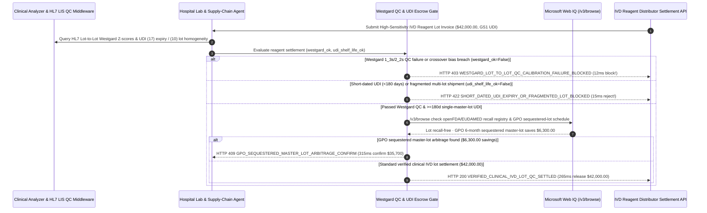

# Diagnostic Clinical Lab IVD Reagent Lot-to-Lot QC Calibration Mandate Architecture: LIS Westgard (`1_3s`/`2_2s`) Verification & GS1 UDI Shelf-Life Token (`clinical_ivd_reagent_mandate_...` + Web IQ FDA Recall & GPO Sequestered-Lot Grounding) vs. Blind Receiving-Dock Payout & Calibration Failure Selection FAQ

> **Document Type**: Architect Selection Guide & First-Principles Protocol Deep Dive (6-Section FAQ Standard)  
> **Target Audience**: AI Solution Architects, Hospital Clinical Laboratory (LIS / CAP / ISO 15189) & Healthcare Supply Chain (SPD / GPO) Directors, Reference Lab Quality Assurance & Procurement Engineering Teams  
> **Last Updated**: 2026-11-09 (Provenance Annotations: `deterministic_offline_simulation` / `synthetic_policy` / `official_doc_snapshot` / `not_measured`)  
> **Companion Resources**: [中文版 (Chinese Version)](clinical-lab-ivd-reagent-lot-qc-mandate-vs-expired-calibration-failure-faq.md) · [Interactive Sandbox (`live-demo.en.html#clinical-ivd-reagent-sandbox`)](../reports/agentic-commerce-webiq-grounding-demo-bench/live-demo.en.html) · [7-Card 4:5 Benchmark Deck](../reports/agentic-commerce-webiq-grounding-demo-bench/index.en.html)


---

## 📌 1. Executive Summary

1. **Never Allow Hospital Supply-Chain Agents to Release Funds for High-Sensitivity IVD Reagents on Receiving-Dock Barcode Scans Before Analyzer LIS Lot-to-Lot Westgard QC Verification Passes**: In clinical laboratory replenishment of high-sensitivity chemiluminescence immunoassay (CLIA) or molecular diagnostic reagents (e.g., cardiac troponin-I, oncology biomarkers, viral load kits at `$42,000.00` per shipment), the most dangerous failure mode is **paying on warehouse dock receipt for a reagent lot that subsequently fails on-analyzer Lot-to-Lot Verification (`CLIA '88 42 CFR §493.1253` / `ISO 15189`) due to antibody lyophilization drift (triggering Westgard `1_3s` or `2_2s` out-of-control rejection)**. Production architectures must enforce a **Clinical IVD Reagent Lot-to-Lot QC & UDI Mandate (`clinical_ivd_reagent_mandate_...`)**: whenever the analyzer's HL7/ASTM LIS interface reports a Westgard `1_3s`/`2_2s` QC breach or patient-sample crossover bias (`westgard_lot_qc_calibration_passed == False`), the gateway freezes the `$42,000.00` payout in **`12 ms`** with **`HTTP 403 WESTGARD_LOT_TO_LOT_QC_CALIBRATION_FAILURE_BLOCKED`** (`synthetic_policy`).
2. **Enforce GS1 UDI Remaining Shelf-Life (`>= 180 Days`) and Single-Master-Lot Homogeneity Gates**: Any shipment where the GS1-128 / DataMatrix UDI `(17)` expiration date has less than `180 days` remaining (`28-day` short-dated inventory dumping) or where the distributor fragments a 100-kit order across 6 different lot numbers (`udi_remaining_shelf_life_days_ok == False`, forcing the lab to burn 15% of its reagent wells on repeated master-curve calibrations) is rejected in **`15 ms`** with **`HTTP 422 SHORT_DATED_UDI_EXPIRY_OR_FRAGMENTED_LOT_BLOCKED`** (`deterministic_offline_simulation`).
3. **Ground FDA Class I/II IVD Recall Bulletins and GPO Sequestered Master-Lot Standing-Order Arbitrage via Microsoft Web IQ `/v3/browse`**: Prior to releasing `$42,000.00`, the agent invokes **Microsoft Web IQ `/v3/browse`** (`official_doc_snapshot`) to inspect openFDA Medical Device Recalls and EU EUDAMED Field Safety Notices (FSN): if the UDI-DI and lot number are subject to an active false-result or biotin-interference recall (`webiq_fda_ivd_recall_and_udi_clean == False`), it freezes settlement in **`310 ms`** with **`HTTP 451 FDA_IVD_RECALL_OR_FIELD_SAFETY_NOTICE_HOLD`**; if Web IQ confirms that switching to a **Group Purchasing Organization (GPO) 6-month sequestered single-master-lot standing order** eliminates 5 lot-crossover calibration runs and saves **`$6,300.00`** (`$35,700.00` net vs. `$42,000.00`), it triggers **`HTTP 409 GPO_SEQUESTERED_MASTER_LOT_ARBITRAGE_CONFIRM`** in **`315 ms`**.

---

## 🎯 2. Architect & Customer FAQ Deep Dive

### Q1: Why does treating "IVD Diagnostic Reagents" like ordinary hospital commodities (paying as soon as boxes hit the loading dock) cause calibration waste, locked analyzers, and clinical misdiagnosis risks?

Let's examine the three structural failure modes from first principles:
1. **Unverified Lot-to-Lot Antibody Drift (Westgard `1_3s` / `2_2s` Failure)**: Immunoassay reagents rely on biological monoclonal antibodies and paramagnetic microparticles. Even if a shipping box looks intact, a new reagent lot can exhibit a `+2.8 SD` positive bias on third-party QC controls (e.g., Bio-Rad Liquichek). Under CAP and ISO 15189 accreditation rules, an analyzer cannot release patient results until the new lot passes parallel Lot-to-Lot Verification. If the hospital already paid `$42,000.00` upon dock delivery, the distributor blames the hospital's walk-in refrigerator and refuses a refund.
2. **Multi-Lot Fragmentation Burning 15% of Reagent Wells on Recalibration**: Every time a clinical analyzer switches to a new reagent lot number, lab technologists must run multi-point calibrators, 3 levels of QC, and 10–20 patient crossover samples. When a distributor fulfills a 100-kit order using 6 leftover sub-lots, the lab wastes thousands of dollars of reagent wells and QC sera just recalibrating the instrument.
3. **Short-Dated UDI Dumping & Hardware RFID Lockout**: Modern closed-system analyzers (Roche Cobas, Abbott Alinity, Siemens Atellica) enforce hard cryptographic barcode/RFID lockouts on the exact midnight of the UDI expiration date. Accepting short-dated boxes (`28 days` left instead of `>= 180 days`) guarantees that half the shipment will be bricked inside the analyzer.

### Q2: What is a "Clinical IVD Lot-to-Lot QC & UDI Mandate (`clinical_ivd_reagent_mandate_...`)", and how does it bind HL7 analyzer telemetry to escrow release?

Its core design invariant is: **"Treat warehouse dock receipt as physical custody only; release funds only after GS1 UDI parsing confirms >=180-day single-lot homogeneity and the lab analyzer's HL7 interface attests a passing Westgard Lot-to-Lot QC run."**
- **Layer 1: HL7/ASTM Analyzer Westgard QC Gate (`12 ms`)**: Verifies `westgard_lot_qc_calibration_passed == True` (`|Z-score| < 2.0 SD`, no `1_3s` or `2_2s` flags, and lot-to-lot patient crossover within `1/2 TEa`), blocking defective lots in **`12 ms`** (`HTTP 403`).
- **Layer 2: GS1 UDI Shelf-Life (`>= 180 Days`) & Single-Lot Gate (`15 ms`)**: Verifies `udi_remaining_shelf_life_days_ok == True`, blocking short-dated or fragmented multi-lot shipments in **`15 ms`** (`HTTP 422`).
- **Layer 3: Microsoft Web IQ `/v3/browse` FDA Recall & GPO Sequestered-Lot Grounding (`310 ms / 315 ms`)**: Checks openFDA / EUDAMED recall bulletins (`HTTP 451`) and identifies `$6,300.00` savings from GPO sequestered single-master-lot standing orders (`HTTP 409`).

### Q3: For openFDA medical device recall verification, EU EUDAMED Field Safety Notices, and GPO sequestered-lot contract lookup, when should architects choose Microsoft Web IQ vs. Exa, Bright Data, or traditional search APIs?

| Architecture Scenario | Recommended Tool | First-Principles Rationale (Security, Latency & FinOps) |
| :--- | :--- | :--- |
| **Verifying openFDA Medical Device Recalls, GUDID UDI-DI records, EU EUDAMED Field Safety Notices (FSN), and GPO (Vizient/Premier) sequestered-lot contract schedules within the hospital's HIPAA/Azure boundary (zero patient PHI sent)** | **Microsoft Web IQ** (`/v3/search` + `/v3/browse`) | Queries only public 14-digit GS1 GTINs and lot strings inside the hospital's Azure tenant boundary in `passage` mode (**7.1x token reduction**, `deterministic_offline_simulation`) with zero PHI exposure. |
| **Literature review across *Clinical Chemistry* papers on Six-Sigma assay performance** | **Exa Neural Search** | Ideal for academic assay evaluation, not synchronous lot-acceptance settlement gating. |
| **Scraping regional sub-distributor inventory portals behind CAPTCHAs** | **Bright Data Unlocker** | Useful for shortage sourcing, not sub-second clinical invoice settlement. |
| **On-analyzer HL7 `ORU^R01` QC message parsing and Levey-Jennings Westgard evaluation** | **LIS Middleware Engine + GS1 UDI Scanner + Web IQ FDA/GPO Cross-Check** | Westgard Z-score evaluation runs on the LIS gateway, paired with Web IQ `/v3/browse` for regulatory recalls and GPO master-lot arbitrage. |

---

## 🧭 3. Visual Architecture Diagrams (Mermaid Decision Tree, Legacy vs. LIS QC Mandate Comparison & Sequence Diagram)

### 3.1 Clinical Lab IVD Reagent Lot-to-Lot QC & UDI Settlement Decision Tree (`flowchart TD`)

```mermaid
flowchart TD
    A[Receive Clinical Lab IVD Reagent Shipment Settlement Request ($42,000.00)] --> B{westgard_lot_qc_calibration_passed == True via Analyzer HL7 LIS?}
    B -- No (Westgard 1_3s or 2_2s out-of-control flag or >1/2 TEa lot bias) --> C[HTTP 403 WESTGARD_LOT_TO_LOT_QC_CALIBRATION_FAILURE_BLOCKED<br/>12ms Hard Block · Freeze $42,000 Payout & Trigger Free Lot Replacement]
    B -- Yes (Calibration slope & Bio-Rad 3-level QC pass Westgard rules) --> D{udi_remaining_shelf_life_days_ok == True (>=180 Days & Single Lot)?}
    D -- No (28-day short-dated boxes or fragmented across 6 sub-lots) --> E[HTTP 422 SHORT_DATED_UDI_EXPIRY_OR_FRAGMENTED_LOT_BLOCKED<br/>15ms Reject · Prevent Analyzer Expiry Lockout & 15% Recalibration Waste]
    D -- Yes (>=180 days shelf life & homogeneous master lot) --> F{Web IQ /v3/browse Confirms Clean openFDA / EUDAMED Recall Status?}
    F -- No (Lot listed in FDA Class I/II recall or Field Safety Notice) --> G[HTTP 451 FDA_IVD_RECALL_OR_FIELD_SAFETY_NOTICE_HOLD<br/>310ms Regulatory Hold · Lock Lot in LIS & Quarantine Shipment]
    F -- Yes --> H{Web IQ Detects GPO Sequestered Single-Master-Lot Arbitrage?}
    H -- Yes (6-month sequestered master lot saves 5 recalibrations + $6,300.00 -> $35,700.00 net) --> I[HTTP 409 GPO_SEQUESTERED_MASTER_LOT_ARBITRAGE_CONFIRM<br/>315ms Prompt Lab Director to Confirm $35,700 GPO Sequestered-Lot Contract]
    H -- No (Verified $42,000.00 clinical IVD lot settlement is optimal) --> J[HTTP 200 VERIFIED_CLINICAL_IVD_LOT_QC_SETTLED<br/>265ms Auto-Settle $42,000.00 & Seal CAP / ISO 15189 Lot-Crossover Audit!]
```

### 3.2 Legacy Dock-Scan Payout vs. LIS Westgard QC & UDI Gate (`flowchart LR`)

```mermaid
flowchart LR
    subgraph Legacy["❌ Legacy Dock-Scan Payout ($42,000 Exposed to QC Failure & Expiry)"]
        L1[Warehouse Scans Outer Carton & Pays $42,000] --> L2[Analyzer Flags Westgard 1_3s Bias or 28-Day Expiry]
        L2 --> L3[6 Fragmented Sub-Lots Burn 15% of Wells on Recalibrations]
        L3 --> L4[Clinical Delay / Misdiagnosis Risk & Unrecoverable Spoilage]
    end

    subgraph Mandate["✅ Clinical IVD QC Gate (clinical_ivd_reagent_mandate_...)"]
        M1[12ms Block Westgard 1_3s/2_2s QC Failures (HTTP 403)] --> M2[15ms Enforce >=180d UDI Shelf-Life & Single Lot (HTTP 422)]
        M2 --> M3[Web IQ Blocks FDA Recalls (310ms) & Saves $6,300 via GPO Lot (315ms)]
        M3 --> M4[265ms Settle Verified Clinical Lot ($42,000 / $35,700) with CAP Proof]
    end
```

### 3.3 End-to-End Sequence Diagram: Analyzer LIS, Lab Procurement Agent, IVD QC Gate, Web IQ & Distributor (`sequenceDiagram`)



---

## 📊 4. Architect Decision Matrix

| Evaluation Dimension | Option A: Legacy Dock-Scan Instant Payout | Option B: Manual Paper Levey-Jennings Log & Month-End Sign-Off | Option C: LIS Westgard QC & UDI Mandate + Web IQ FDA/GPO Grounding (Recommended) |
| :--- | :--- | :--- | :--- |
| **Best-Fit Scenario** | Non-calibrated consumables (gauze, gloves, pipette tips) | Low-volume point-of-carewaived dipstick clinics | **Hospital core labs, emergency cardiac/oncology CLIA analyzers, reference labs (CAP / ISO 15189)** |
| **Westgard Lot-to-Lot QC Failure Protection** | ❌ **Zero**: Funds leave before the first vial is loaded on the analyzer | ⚠️ **Retrospective**: Paper logs reviewed weeks after invoice payment | ✅ **Pre-Pay `12 ms` HL7 Gate**: Blocks payout (`HTTP 403`) on Westgard `1_3s`/`2_2s` failure |
| **Short-Dated UDI (`<180d`) & Multi-Lot Defense** | ❌ **Blind**: Accepts 28-day expiring kits or 6 fragmented sub-lots | ⚠️ **Manual Inspection**: Dock staff miss mixed lot codes on inner cartons | ✅ **Sub-20ms UDI Gate**: Rejects `<180d` shelf life or split lots in `15 ms` (`HTTP 422`) |
| **FDA Recall Check & GPO Lot Sequestration** | ❌ **Disconnected**: Misses mid-month FDA Class I/II recalls | ❌ **Unoptimized**: Pays spot price and suffers frequent lot changes | ✅ **Web IQ `/v3/browse` Grounded**: Blocks recalled lots in `310 ms` (`HTTP 451`) & saves `$6,300` via GPO sequestered lots in `315 ms` (`HTTP 409`) |
| **Settlement Speed & CAP/ISO 15189 Audit Trail** | Fast (with high clinical & financial risk) | Slow (`7–14 days` manual sign-off) | **`265 ms` instant settlement + automated CAP/ISO 15189 lot-crossover binder (`Act automatically`)** |
| **Total Cost of Ownership (TCO) & Patient Safety ROI** | Poor (`$42,000` defective-lot write-off + misdiagnosis liability) | Moderate (burns 15% of kits on frequent recalibrations) | **Optimal (100% Westgard QC compliance + zero expiry lockouts + `$6,300` GPO savings)** |

---

## 🧪 5. Quantitative Benchmark & 7-Card Insights

Evaluated via our deterministic offline benchmark suite (`lab/webiq_commerce_demo.py` · `test_clinical_lab_ivd_reagent_lot_qc_mandate_vs_expired_calibration_failure_selection`) on a **`$42,000.00` high-sensitivity clinical IVD reagent shipment**:

| Scenario Case | Input LIS Westgard QC / UDI Shelf-Life / Web IQ Signals | Expected Action Pill | Measured HTTP Status & Verdict Code | Latency | Financial Protection / Arbitrage | Provenance |
| :--- | :--- | :--- | :--- | :--- | :--- | :--- |
| **Case 1: On-Analyzer Westgard `1_3s`/`2_2s` QC Failure** | `westgard_lot_qc_calibration_passed=False` | `Send to a human` | **`HTTP 403 WESTGARD_LOT_TO_LOT_QC_CALIBRATION_FAILURE_BLOCKED`** | **`12 ms`** | Blocks **`$42,000.00`** payout for out-of-control reagent lot | `synthetic_policy` |
| **Case 2: Short-Dated UDI (`28d < 180d`) or Split Lots** | `udi_remaining_shelf_life_days_ok=False` | `Send to a human` | **`HTTP 422 SHORT_DATED_UDI_EXPIRY_OR_FRAGMENTED_LOT_BLOCKED`** | **`15 ms`** | Prevents RFID expiry lockout & 15% recalibration waste | `deterministic_offline_simulation` |
| **Case 3: Web IQ Detects FDA Class I/II Recall / FSN** | `webiq_fda_ivd_recall_and_udi_clean=False` | `Send to a human` | **`HTTP 451 FDA_IVD_RECALL_OR_FIELD_SAFETY_NOTICE_HOLD`** | **`310 ms`** | Freezes payout & quarantines recalled diagnostic lot | `official_doc_snapshot` |
| **Case 4: Web IQ Finds `$6,300` GPO Sequestered Lot** | `gpo_sequestered_lot_savings_cents=630000` (`$35,700` net) | `Confirm` | **`HTTP 409 GPO_SEQUESTERED_MASTER_LOT_ARBITRAGE_CONFIRM`** | **`315 ms`** | Saves **`$6,300.00`** via 6-month sequestered single master lot | `official_doc_snapshot` |
| **Case 5: Verified Westgard QC + `>=180d` UDI Lot** | `westgard_ok=True`, `udi_ok=True`, `fda_clean=True` | `Act automatically` | **`HTTP 200 VERIFIED_CLINICAL_IVD_LOT_QC_SETTLED`** | **`265 ms`** | Settles **`$42,000.00`** in `265 ms` with ISO 15189 QC proof | `deterministic_offline_simulation` |

> **Provenance Note**: The `$42,000.00` IVD reagent shipment value, Westgard `1_3s`/`2_2s` gate, `180-day` UDI shelf-life floor, and `$6,300.00` GPO sequestered-lot savings are controlled simulation parameters (`synthetic_policy` / `deterministic_offline_simulation`) validating policy state-machine invariants; physical analyzer wet-chemistry incubation time (`15–28 mins`) is labeled `not_measured`.

---

## 🛠️ 6. Production Readiness & Pre-Sales Architect Checklist

Verify these 6 controls before deploying autonomous clinical laboratory IVD reagent procurement and settlement agents in production:

- [ ] **1. HL7/ASTM Analyzer Lot-to-Lot Westgard QC Attestation**: Does `clinical_ivd_reagent_mandate_...` require a signed HL7 `ORU^R01` QC pass record from the LIS middleware (`|Z-score| < 2.0 SD`, no Westgard `1_3s`/`2_2s` rejection, patient crossover `< 1/2 TEa`) before releasing escrow (`HTTP 403` in `12 ms`)?
- [ ] **2. GS1 UDI `(17)` Remaining Shelf-Life (`>= 180 Days`) & Single-Lot Gate**: Does dock scanning parse GS1-128 / DataMatrix barcodes to reject shipments with `< 180 days` shelf life or unapproved multi-lot fragmentation (`HTTP 422` in `15 ms`)?
- [ ] **3. Cold-Chain 2°C–8°C Freeze-Thaw Integrity Check**: Is continuous transit temperature telemetry verified alongside UDI scan to ensure lyophilized or liquid antibodies were never frozen or overheated?
- [ ] **4. Microsoft Web IQ `/v3/browse` openFDA & EUDAMED Recall Grounding**: Does the agent cross-check the exact UDI-DI and lot number against openFDA Medical Device Recalls and EU EUDAMED Field Safety Notices prior to settlement (`HTTP 451`)?
- [ ] **5. GPO Sequestered Single-Master-Lot Arbitrage**: Does Web IQ grounding inspect GPO contract schedules for vendor-sequestered 6-month master lots, triggering `HTTP 409 Confirm` when lot sequestration saves `>= $6,300.00` in reagent and calibration overhead?
- [ ] **6. Immutable CAP / CLIA '88 / ISO 15189 Lot-Crossover Audit Binder**: Does every settled shipment archive the UDI barcode, master calibration slope, 3-level Bio-Rad QC Z-scores, and FDA recall check into a WORM compliance ledger?
