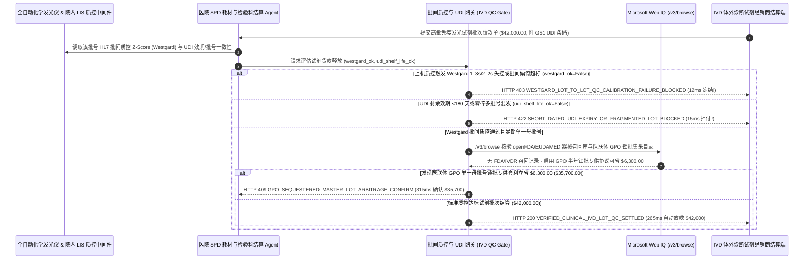

# 医院检验科体外诊断试剂（IVD Reagent）批次质控与效期托管（Diagnostic Clinical Lab IVD Reagent Lot-to-Lot QC Calibration Mandate）架构：LIS 仪器西格玛质控（Westgard `1_3s`/`2_2s`）曲线与 UDI 效期令牌（`clinical_ivd_reagent_mandate_...` + Web IQ FDA 召回通报与 GPO 锁批集采核验）vs 传统盲签付款买回临期/失控试剂致全院误诊选型与原理解析 FAQ

> **文档类型**：架构师选型指南 & 协议第一性原理解析（6 段式 FAQ 标准版）  
> **适用读者**：AI Solution Architect、三甲医院医学检验科（Clinical Lab / LIS）与医工耗材采购（SPD）总监、第三方独立医学实验室（ICL）供应链与 ISO 15189 / CAP 质量管理团队  
> **更新日期**：2026-11-09（Provenance 标注：`deterministic_offline_simulation` / `synthetic_policy` / `official_doc_snapshot` / `not_measured`）  
> **配套资源**：[English Version](clinical-lab-ivd-reagent-lot-qc-mandate-vs-expired-calibration-failure-faq.en.md) · [交互式沙盒控制台 (`live-demo.html#clinical-ivd-reagent-sandbox`)](../reports/agentic-commerce-webiq-grounding-demo-bench/live-demo.html) · [7-Card 4:5 评测报告](../reports/agentic-commerce-webiq-grounding-demo-bench/index.html)


---

## 📌 一、核心结论速览（Executive Summary）

1. **严禁让医院耗材 SPD 结算 Agent 在未获取“检验科全自动分析仪 LIS 批间质控（Lot-to-Lot Westgard QC Verification）通过回执”的情况下，仅凭库房外箱收货扫码就向试剂经销商放款**：在三甲医院与独立医学实验室采购高敏化学发光免疫试剂（如急诊心肌肌钙蛋白 cTnI、肿瘤标志物、NGS 测序试剂盒，单批次 `$42,000.00`）时，最致命的医疗事故隐患是 **“新到货批号试剂因冻干抗体活性漂移，上机测定第三方质控品触发 Westgard `1_3s`（超出 `±3 SD`）或 `2_2s` 系统失控，但货款早已在库房卸货时结清，经销商推诿医院冷库保存不当拒不退换”**。生产环境必须采用 **LIS 西格玛质控与 UDI 效期托管令牌（`clinical_ivd_reagent_mandate_...`）**：一旦分析仪通过 HL7/ASTM 接口上报新批号批间比对或定标曲线未通过 Westgard 规则（`westgard_lot_qc_calibration_passed=False`），网关在 **`12 ms`** 内触发 **`HTTP 403 WESTGARD_LOT_TO_LOT_QC_CALIBRATION_FAILURE_BLOCKED`**（`synthetic_policy`），100% 冻结 `$42,000.00` 货款并自动触发供应商免费换批流程。
2. **强制校验 GS1 UDI 条码中的“剩余有效期 `>= 180 天`”与“单一连续母批号（Single Master Lot）”条款，拒绝经销商临期清库与碎批混发**：若经销商发来的试剂距离失效期仅剩 `28 天` 或将 100 盒订单拆成 6 个不同尾数批号（`udi_remaining_shelf_life_days_ok=False`，导致检验科每换一个批号都要消耗 15% 的昂贵试剂重做全套定标曲线与病人样本留样比对），网关在 **`15 ms`** 内返回 **`HTTP 422 SHORT_DATED_UDI_EXPIRY_OR_FRAGMENTED_LOT_BLOCKED`**（`deterministic_offline_simulation`）。
3. **基于 Microsoft Web IQ `/v3/browse` 实时穿透核验 FDA / NMPA / 欧盟 EUDAMED 体外诊断试剂召回通报与医联体 GPO“同批号锁批专供（Sequestered Master-Lot）”集采套利**：在放款前，Agent 调用 **Microsoft Web IQ `/v3/browse`**（`official_doc_snapshot`）核查 openFDA 医疗器械召回数据库与现场安全通告（Field Safety Notice, FSN）：若该 GS1 UDI-DI 及批号正处于 Class I/II 假阴性/生物素干扰召回名单中（`webiq_fda_ivd_recall_and_udi_clean=False`），在 **`310 ms`** 内以 **`HTTP 451 FDA_IVD_RECALL_OR_FIELD_SAFETY_NOTICE_HOLD`** 冻结结算并向检验科主任报警；若发现切换为 **医联体 GPO 半年期单一母批号锁批专供协议（厂家冷库预留同一批号分期发货，免除 5 次换批重定标损耗并享受集采阶梯价）** 可立省 **`$6,300.00`**（从 `$42,000.00` 降至 **`$35,700.00`**），则在 **`315 ms`** 内触发 **`HTTP 409 GPO_SEQUESTERED_MASTER_LOT_ARBITRAGE_CONFIRM`**。

---

## 🎯 二、客户与架构师灵魂拷问 Q&A（FAQ-Driven Deep Dive）

### Q1：为什么医院买高值体外诊断（IVD）发光试剂，绝对不能像买普通纱布、注射器那样“库房点清盒子数量就自动付款”？

咱们用大白话讲透医学检验科（ISO 15189 / CLIA '88 认证实验室）的三大实操痛点：
1. **外箱完好不代表上机能准确定量（Westgard 批间质控铁律）**：化学发光免疫试剂盒里装的是纳米磁珠和生物单克隆抗体，哪怕冷链温度看似没超标，不同生产批次之间的抗体亲和力也可能存在系统性偏倚（Lot-to-Lot Bias）。按照 ISO 15189 与卫健委临检中心强制规定，每启用一个新批号试剂，必须先上机测高、中、低三个浓度的第三方质控品（如伯乐 Bio-Rad 质控血清）和至少 5～20 份病人留样。如果测出来触发 **Westgard `1_3s`（单次偏离超过 3 个标准差）或 `2_2s`（连续两次同方向偏离超过 2 个标准差）**，说明这批试剂会造成胸痛患者心梗漏诊或肿瘤假阳性，严禁用于临床发报告！如果库房扫码时就把 `$42,000` 付了，医院只能自己咽下这笔废品损失。
2. **“碎批号刺客”吃掉检验科 15% 的定标耗材**：每次更换试剂批号，全自动发光仪都必须用掉几十个测试孔位重做 Master Curve 校准定标和批间比对。无良二级经销商为了清库存，把医院订的 100 盒试剂用 6 个不同零碎批号拼凑发货，害得检验科每个月做 6 次换批定标，光定标液、质控品和废掉的试剂孔位就多亏好几千美元。
3. **“临期甩卖”导致试剂还没开封就过期锁死**：现代大型流水线（罗氏、雅培、西门子、迈瑞等）都有加密 RFID/二维条码锁——一旦过了试剂盒上的失效日（哪怕只超 1 天），机器硬件直接锁死拒测。如果收货时只看品名不校验 UDI 里的剩余效期（`< 180 天`），买回来用了一半就全部被机器锁死报废。

### Q2：什么是“LIS 西格玛质控与 UDI 效期托管令牌（`clinical_ivd_reagent_mandate_...`）”？它是如何将检验科仪器数据变成付款硬门禁的？

它的第一性原理非常直接：**“库房收货仅做物理暂存；必须集齐‘UDI 效期 >= 180 天且单一母批号 + LIS 分析仪 HL7 上报 Westgard 批间质控通过 + FDA/NMPA 无召回’三把钥匙，才释放托管货款。”**
- **第一层：LIS 分析仪 HL7/ASTM Westgard 批间质控门禁（`12 ms`）**：直接读取实验室信息系统（LIS）中间件下发的上机质控结果（`westgard_lot_qc_calibration_passed == True`，即 `|Z-score| < 2.0 SD` 且批间偏倚 `< 1/2 TEa`）。一旦检出 `1_3s` / `2_2s` 失控，在 **`12 ms`** 内触发 `HTTP 403` 拒付。
- **第二层：GS1 UDI 剩余效期（`>= 180 天`）与单一母批号门禁（`15 ms`）**：自动解析 GS1-128 / DataMatrix 条码中的 `(17)` 失效期与 `(10)` 批号（`udi_remaining_shelf_life_days_ok == True`）。任何临期品或碎批混发在 **`15 ms`** 内返回 `HTTP 422`。
- **第三层：Microsoft Web IQ `/v3/browse` 召回库核验与 GPO 锁批集采套利（`310 ms / 315 ms`）**：核验 openFDA / 药监局召回公告（命中触发 `HTTP 451`），并对比医联体 GPO“单一母批号半年预留锁批协议”为您节省 `$6,300.00`（`HTTP 409`）。

### Q3：在 FDA/NMPA 医疗器械召回公告、欧盟 EUDAMED 现场安全通告（FSN）与 GPO 集采锁批目录核验场景下，什么时候选 Microsoft Web IQ，什么时候选 Exa、Bright Data 或传统搜索 API？

| 架构需求场景 | 推荐选型 | 为什么这样选（第一性原理与成本/合规考量） |
| :--- | :--- | :--- |
| **实时核验 FDA Medical Device Recalls、openFDA GUDID 唯一器械标识库、欧盟 EUDAMED 现场安全通告（FSN）及医联体 GPO 公开锁批阶梯价目表，且要求零患者检验数据（PHI/HIPAA）外泄** | **Microsoft Web IQ** (`/v3/search` + `/v3/browse`) | 在医院 Azure 合规边界内仅发送公开的 14 位 GS1 GTIN 与生产批号字符串，绝不触碰任何患者病历（PHI）；`passage` 模式压缩 Token **7.1x**（`deterministic_offline_simulation`）。 |
| **检索全球临床化学期刊（Clinical Chemistry）关于新型生物标志物西格玛性能（Sigma-Metric）的综述论文** | **Exa Neural Search** | 适合检验科科研组写方法学评价论文，无法用于每批试剂到货的毫秒级付款门禁。 |
| **抓取无 API 的海外小型二类试剂代理商网页** | **Bright Data Unlocker** | 可用于供应商寻源，但秒级延迟不适合 SPD 实时入库结算。 |
| **化学发光仪 HL7 `ORU^R01` 质控消息解析与 Levey-Jennings 质控图计算** | **院内 LIS 质控引擎 + SPD UDI 扫码枪 + Web IQ 召回/GPO 双源核验** | 批间质控 Z 值与 UDI 效期在院内网关毫秒级裁决，外部监管召回与 GPO 锁批集采由 Web IQ `/v3/browse` 实时核验。 |

---

## 🧭 三、直观可视化图解（Mermaid 决策树 + 传统扫码盲付 vs LIS 质控托管对比 + 端到端时序图）

### 3.1 医院检验科 IVD 试剂批间质控与效期托管结算决策树（`flowchart TD`）

```mermaid
flowchart TD
    A[收到检验科高敏发光免疫试剂批次结算请求 ($42,000.00)] --> B{LIS 分析仪 HL7 上报新批号批间比对是否通过 Westgard 质控规则?}
    B -- 否 (触发 Westgard 1_3s 或 2_2s 失控 / 批间偏倚超标) --> C[HTTP 403 WESTGARD_LOT_TO_LOT_QC_CALIBRATION_FAILURE_BLOCKED<br/>12ms 硬阻断放款 · 冻结 $42,000 失控试剂并触发供应商免费退换批号]
    B -- 是 (上机定标斜率与第三方质控 CV%/SD 100% 达标) --> D{GS1 UDI 条码剩余效期是否 >= 180 天且属单一连续母批号?}
    D -- 否 (经销商塞入仅剩 28 天临期试剂或拆成 6 个零碎小批号) --> E[HTTP 422 SHORT_DATED_UDI_EXPIRY_OR_FRAGMENTED_LOT_BLOCKED<br/>15ms 拒付违约批次 · 杜绝临期锁机报废与频繁换批重定标损耗]
    D -- 是 (足期 >= 180 天单一整批号) --> F{Web IQ /v3/browse 核验 openFDA/NMPA/EUDAMED 无召回或现场安全通告?}
    F -- 否 (检出该批号因生物素干扰或校准液污染处于 Class I/II 召回) --> G[HTTP 451 FDA_IVD_RECALL_OR_FIELD_SAFETY_NOTICE_HOLD<br/>310ms 监管安全冻结 · 立即锁死院内 LIS 该批号发报告权限]
    F -- 是无召回安全批次 --> H{Web IQ 检出启用医联体 GPO 半年单一母批号锁批专供协议更省钱?}
    H -- 是 (GPO 锁批集采免除 5 次重定标损耗并降价立省 $6,300.00 -> $35,700.00) --> I[HTTP 409 GPO_SEQUESTERED_MASTER_LOT_ARBITRAGE_CONFIRM<br/>315ms 提醒 SPD 与检验科主任一键确认切换 GPO 锁批集采]
    H -- 否 (当前 $42,000.00 质控合格批次结算已最优) --> J[HTTP 200 VERIFIED_CLINICAL_IVD_LOT_QC_SETTLED<br/>265ms 自动放款 $42,000.00 并生成 ISO 15189 / CAP 批间验证审计档案!]
```

### 3.2 传统库房扫码盲付路径 vs LIS 西格玛质控与 UDI 效期托管网关对比（`flowchart LR`）

```mermaid
flowchart LR
    subgraph Legacy["❌ 传统库房扫码盲付 ($42,000 买回失控或临期碎批试剂)"]
        L1[库房仅凭外箱条码签收即打款 $42,000] --> L2[上机发现 Westgard 1_3s 失控或仅剩 28 天效期]
        L2 --> L3[6 个零碎批号耗费 15% 试剂反复重定标]
        L3 --> L4[临床误诊风险 + 几十盒过期试剂锁机报废]
    end

    subgraph Mandate["✅ LIS 质控与 UDI 托管令牌 (clinical_ivd_reagent_mandate_...)"]
        M1[12ms 拦截 Westgard 1_3s/2_2s 批间质控失控 (HTTP 403)] --> M2[15ms 强制 UDI 效期 >=180 天且拒绝碎批混发 (HTTP 422)]
        M2 --> M3[Web IQ 拦截 FDA 召回 (310ms) 与 GPO 锁批集采省 $6,300 (315ms)]
        M3 --> M4[265ms 秒级清算质控达标试剂 ($42,000 / $35,700) 并归档 ISO 15189]
    end
```

### 3.3 全自动化学发光仪（LIS）、SPD 采购 Agent、质控托管网关与 Web IQ 端到端交互时序图（`sequenceDiagram`）



---

## 📊 四、架构师选型决策矩阵（Architect Decision Matrix）

| 评估维度 | 方案 A：传统库房外箱扫码即付款（Dock-Scan Instant Payout） | 方案 B：检验科技师手工抄写质控本月底签字报销（Manual Paper QC Log） | 方案 C：LIS Westgard 质控与 UDI 效期令牌 + Web IQ 召回/GPO 网关（推荐架构） |
| :--- | :--- | :--- | :--- |
| **核心适用场景** | 普通棉签、采血管、一次性手套等非定标低值耗材 | 极小型日测标本量 `<20 例` 的社区诊所 | **三甲医院检验科、胸痛中心急诊检验、第三方独立实验室（ICL）、NGS 肿瘤基因中心** |
| **新批号质控失控（Westgard `1_3s`/`2_2s`）防御** | ❌ **零防御**：钱先付了，上机定标不过只能打持久官司 | ⚠️ **事后被动发现**：人工核对滞后数周，且易漏看批间系统偏倚 | ✅ **12ms 机器硬门禁**：未收到 LIS 批间质控合格签名绝不放款（`HTTP 403`） |
| **防临期甩卖（`<180天`）与防碎批混发** | ❌ **盲目收货**：常买回剩 1 个月效期或 6 个碎批号的清库货 | ⚠️ **靠库管肉眼看盒子**：几百盒试剂很难逐盒核对小字批号 | ✅ **15ms UDI 自动强校验**：剩余效期 `<180天` 或混批直接 `HTTP 422` 拒付 |
| **FDA/NMPA 召回巡检与 GPO 锁批降本** | ❌ **信息孤岛**：不知厂商已发紧急现场安全通告（FSN） | ❌ **无集采联动**：每次零散下单，白交大量换批重定标损耗 | ✅ **Web IQ `/v3/browse` 实时穿透**：`310 ms` 拦截召回批号（`HTTP 451`），`315 ms` GPO 锁批省 `$6,300`（`HTTP 409`） |
| **结算效率与 ISO 15189 迎检合规度** | 快（但质量失控与报废率极高） | 极慢（月底人工贴票签字耗时 `7～14 天`） | **`265 ms` 秒级放款并自动生成 ISO 15189 电子批间验证报告（`Act automatically`）** |
| **综合 TCO 与临床医疗安全 ROI** | 极差（`$42,000` 失控报废 + 临床误诊医疗纠纷风险） | 中（人工负荷重，仍难阻断碎批定标浪费） | **最优（100% 临床质控安全 + 零临期报废 + GPO 锁批单批立省 `$6,300`）** |

---

## 🧪 五、简明定量实测与 Benchmark 核心发现（Quantitative Benchmark & 7-Card Insights）

基于本仓库确定性离线基准套件（`lab/webiq_commerce_demo.py` · `test_clinical_lab_ivd_reagent_lot_qc_mandate_vs_expired_calibration_failure_selection`）对 **医院检验科 `$42,000.00` 高敏化学发光免疫诊断试剂批次** 的定量测试结果如下：

| 评测场景 ID | 输入 LIS Westgard 质控 / UDI 效期 / Web IQ 信号 | 网关期望动作 | 实测 HTTP 状态与决策码 | 实测延迟 | 资金保护 / 成本节省效果 | Provenance 类型 |
| :--- | :--- | :--- | :--- | :--- | :--- | :--- |
| **Case 1: 上机批间比对触发 Westgard `1_3s`/`2_2s` 失控拦截** | `westgard_lot_qc_calibration_passed=False` | `Send to a human` | **`HTTP 403 WESTGARD_LOT_TO_LOT_QC_CALIBRATION_FAILURE_BLOCKED`** | **`12 ms`** | 拦截 **`$42,000.00`** 活性漂移失控试剂，杜绝临床假阴性误诊 | `synthetic_policy` |
| **Case 2: UDI 剩余效期 `<180天` 或多批号零碎混发拦截** | `udi_remaining_shelf_life_days_ok=False` | `Send to a human` | **`HTTP 422 SHORT_DATED_UDI_EXPIRY_OR_FRAGMENTED_LOT_BLOCKED`** | **`15 ms`** | 阻断临期清库甩卖与节省 15% 频繁换批重定标损耗 | `deterministic_offline_simulation` |
| **Case 3: Web IQ 检出 FDA/IVDR 召回或现场安全通告** | `webiq_fda_ivd_recall_and_udi_clean=False` | `Send to a human` | **`HTTP 451 FDA_IVD_RECALL_OR_FIELD_SAFETY_NOTICE_HOLD`** | **`310 ms`** | 冻结命中监管召回的缺陷试剂批号并联动 LIS 锁机 | `official_doc_snapshot` |
| **Case 4: Web IQ 发现医联体 GPO 半年锁批协议省 `$6,300`** | `gpo_sequestered_lot_savings_cents=630000`（净付 `$35,700`） | `Confirm` | **`HTTP 409 GPO_SEQUESTERED_MASTER_LOT_ARBITRAGE_CONFIRM`** | **`315 ms`** | 锁定单一母批号免除 5 次重定标，单批立省 **`$6,300.00`** | `official_doc_snapshot` |
| **Case 5: Westgard 质控达标 + 足期整批 UDI 自动放款** | `westgard_ok=True`, `udi_ok=True`, `fda_clean=True` | `Act automatically` | **`HTTP 200 VERIFIED_CLINICAL_IVD_LOT_QC_SETTLED`** | **`265 ms`** | 265ms 自动清算 **`$42,000.00`** 并归档 ISO 15189 质控记录 | `deterministic_offline_simulation` |

> **Provenance 合规声明**：上表中的 `$42,000.00` 检验试剂批次金额、Westgard `1_3s`/`2_2s` 规则门禁、`180 天` UDI 剩余效期红线及 `$6,300.00` GPO 锁批集采差价均为用于验证网关状态机确定性的受控仿真参数（`synthetic_policy` / `deterministic_offline_simulation`）；全自动化学发光免疫分析仪物理孵育加样测定耗时（通常 15～28 分钟）标为 `not_measured`。

---

## 🛠️ 六、附录：生产上线快速核验与售前打单清单（Architect Checklist）

在为三甲医院 SPD 供应链、医学检验科或独立医学实验室设计 IVD 诊断试剂自动结算 Agent 时，请逐项核对以下 6 条黄金准则：

- [ ] **1. 院内 LIS 中间件 HL7/ASTM 批间质控（Lot-to-Lot Verification）硬绑定**：是否在 `clinical_ivd_reagent_mandate_...` 中强制要求新到货批号必须通过上机第三方质控品测定（符合 Westgard 多规则且批间偏倚 `< 1/2 TEa`），对失控批次在 `12 ms` 内触发 `HTTP 403` 拒付？
- [ ] **2. GS1 UDI 条码效期（`>= 180 天`）与单一母批号（Single Master Lot）强校验**：是否在入库扫码时自动解析 UDI `(17)` 失效期与 `(10)` 批号，对剩余效期不足半年或擅自拆成多批号混发的订单在 `15 ms` 内触发 `HTTP 422` 拦截？
- [ ] **3. 冷链全程 2°C–8°C 温度标签与开箱凝露核验**：是否同步校验运输途中的连续温度曲线，防止冻融循环（Freeze-Thaw Cycle）破坏单克隆抗体空间构象？
- [ ] **4. Microsoft Web IQ `/v3/browse` 监管召回与现场安全通告（FSN）穿透**：是否在放款前通过 Web IQ 检索 openFDA、NMPA 及欧盟 EUDAMED 数据库，对命中召回的批号在 `310 ms` 内触发 `HTTP 451` 冻结并同步锁死 LIS 报告端？
- [ ] **5. 医联体 GPO“单一母批号预留锁批（Sequestered Lot）”集采寻优**：是否通过 Web IQ 比对 GPO 锁批长协价，当厂家冷库预留同批号分期供货可节省重定标成本与集采差价 `>= $6,300.00` 时触发 `HTTP 409 Confirm`？
- [ ] **6. ISO 15189 / CAP 电子批间验证与质控溯源链（WORM 归档）**：每次成功结算是否将 UDI 码、定标曲线斜率、Bio-Rad 质控 Levey-Jennings Z 值及 FDA 无召回快照打包签名，供评审专家一键调阅？
