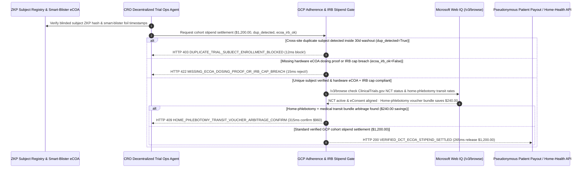

# Decentralized Clinical Trial (DCT) eCOA Adherence & IRB Stipend Mandate Architecture: Zero-Knowledge Subject Deduplication & Smart-Blister Telemetry Token (`dct_stipend_adherence_mandate_...` + Web IQ NCT Protocol & Home-Phlebotomy Grounding) vs. Professional Duplicate-Subject Fraud & Backfilled Diaries Selection FAQ

> **Document Type**: Architect Selection Guide & First-Principles Protocol Deep Dive (6-Section FAQ Standard)  
> **Target Audience**: AI Solution Architects, Biopharma Sponsor / CRO / Decentralized Clinical Trial (DCT) Architects, GCP Quality Assurance & Clinical Trial Finance Teams  
> **Last Updated**: 2026-11-09 (Provenance Annotations: `deterministic_offline_simulation` / `synthetic_policy` / `official_doc_snapshot` / `not_measured`)  
> **Companion Resources**: [中文版 (Chinese Version)](clinical-trial-dct-ecoa-adherence-stipend-mandate-vs-duplicate-subject-fraud-faq.md) · [Interactive Sandbox (`live-demo.en.html#dct-stipend-adherence-sandbox`)](../reports/agentic-commerce-webiq-grounding-demo-bench/live-demo.en.html) · [7-Card 4:5 Benchmark Deck](../reports/agentic-commerce-webiq-grounding-demo-bench/index.en.html)


---

## 📌 1. Executive Summary

1. **Never Allow Clinical Trial Operations (CRO/SMO) Agents to Disburse Patient Milestone Stipends Without Cross-Site Zero-Knowledge Subject Deduplication**: In Phase II/III Decentralized Clinical Trials (`$1,200.00` cohort milestone stipend disbursement), the most destructive threat to both trial budgets and statistical endpoint integrity is **"professional duplicate subjects" enrolling simultaneously across 4 competing trial sites during the 30-day washout window**, collecting multiple stipends while discarding the investigational drug. Production architectures must enforce a **Zero-Knowledge Subject Deduplication & eCOA Adherence Mandate (`dct_stipend_adherence_mandate_...`)**: whenever privacy-preserving salted biometric/ID hash matching detects an active cross-site washout collision (`duplicate_subject_hash_detected == True`), the gateway blocks disbursement in **`12 ms`** with **`HTTP 403 DUPLICATE_TRIAL_SUBJECT_ENROLLMENT_BLOCKED`** (`synthetic_policy`).
2. **Enforce Hardware-Timestamped eCOA Dosing Attestations and IRB Undue-Inducement Caps (`21 CFR Part 11`)**: Any stipend claim backed only by a backfilled "parking-lot" diary lacking cryptographic smart-blister-pack / wearable telemetry proof, or exceeding the Institutional Review Board (IRB) approved reimbursement schedule (`ecoa_adherence_and_irb_cap_verified == False`), is rejected in **`15 ms`** with **`HTTP 422 MISSING_ECOA_DOSING_PROOF_OR_IRB_CAP_BREACH`** (`deterministic_offline_simulation`).
3. **Ground `ClinicalTrials.gov` Protocol Amendments / Clinical Holds and Home-Phlebotomy Transit Bundles via Microsoft Web IQ `/v3/browse`**: Prior to releasing cohort stipends, the agent invokes **Microsoft Web IQ `/v3/browse`** (`official_doc_snapshot`) to inspect `ClinicalTrials.gov` NCT registry bulletins and contracted mobile-health networks: if the trial arm is under an FDA/IRB Clinical Hold or requires re-signing an amended eConsent (`webiq_nct_protocol_and_econsent_active == False`), it freezes payout in **`310 ms`** with **`HTTP 451 CLINICAL_HOLD_OR_ECONSENT_AMENDMENT_REQUIRED`**; if Web IQ confirms that bundling mobile home-phlebotomy + pre-paid HIPAA medical transit vouchers eliminates third-party card-load fees and ad-hoc mileage receipts to save **`$240.00`** per cohort (`$960.00` net vs. `$1,200.00`), it triggers **`HTTP 409 HOME_PHLEBOTOMY_TRANSIT_VOUCHER_ARBITRAGE_CONFIRM`** in **`315 ms`**.

---

## 🎯 2. Architect & Customer FAQ Deep Dive

### Q1: Why does pairing "Manual ClinCard Loads" with "Self-Reported App Diaries" allow professional trial subjects to corrupt Phase III endpoints?

Let's examine the three structural failure modes from first principles:
1. **Cross-Site "Professional Subject" Double-Dipping**: Because HIPAA and GDPR prohibit clinical sites from sharing plaintext patient names with competing hospitals, professional subjects enroll in 4 CNS, metabolic, or dermatology trials simultaneously. They collect `$1,200.00+` in stipends while never taking the study drug—introducing zero-PK noise that can sink a `$150M` Phase III trial's primary efficacy endpoint.
2. **"Parking-Lot Compliance" (Backfilled Diaries) & IRB Undue Inducement**: When stipends are triggered merely by submitting an app questionnaire, non-adherent subjects tap "Dose Taken" 14 times in the clinic parking lot 5 minutes before their visit. Conversely, unguarded site agents that offer ad-hoc cash completion bonuses above the IRB-approved ceiling violate FDA GCP rules against **undue inducement**.
3. **Paying & Dosing Across Unconsented Protocol Amendments**: When a protocol amendment (e.g., dose modification V2.0) is posted, GCP mandates that subjects sign the updated eConsent before further dosing or stipend milestones. Disconnected payment agents keep disbursing funds on outdated consent versions, invalidating the subject's trial data during FDA Bioresearch Monitoring (BIMO) inspections.

### Q2: What is a "Zero-Knowledge eCOA & IRB Stipend Mandate (`dct_stipend_adherence_mandate_...`)", and how does it preserve patient anonymity while guaranteeing ALCOA+ data integrity?

Its core design invariant is: **"Sites never share plaintext PHI; stipend release requires a zero-collision blinded subject hash, hardware-timestamped eCOA dosing proof, and an active eConsent version matching the live NCT protocol."**
- **Layer 1: Cross-Site Zero-Knowledge Subject Deduplication Gate (`12 ms`)**: Verifies `duplicate_subject_hash_detected == False` against the inter-sponsor blinded registry, blocking multi-site double-dippers in **`12 ms`** (`HTTP 403`).
- **Layer 2: Hardware eCOA Dosing & IRB Cap Gate (`15 ms`)**: Verifies `ecoa_adherence_and_irb_cap_verified == True` (smart-blister foil timestamp + IRB-approved amount), rejecting backfilled diaries in **`15 ms`** (`HTTP 422`).
- **Layer 3: Microsoft Web IQ `/v3/browse` NCT Protocol & Home-Phlebotomy Grounding (`310 ms / 315 ms`)**: Halts disbursements during clinical holds or unconsented protocol amendments (`HTTP 451`) and captures `$240.00` savings via bundled home-phlebotomy + medical transit vouchers (`HTTP 409`).

### Q3: For `ClinicalTrials.gov` protocol status verification, FDA BIMO/IRB compliance grounding, and mobile-phlebotomy rate discovery, when should architects choose Microsoft Web IQ vs. Exa, Bright Data, or traditional search APIs?

| Architecture Scenario | Recommended Tool | First-Principles Rationale (Security, Latency & FinOps) |
| :--- | :--- | :--- |
| **Verifying `ClinicalTrials.gov` NCT protocol status, FDA Clinical Hold notices, IRB reimbursement rules, and contracted home-health transit rate cards within the Azure boundary (zero PHI sent)** | **Microsoft Web IQ** (`/v3/search` + `/v3/browse`) | Queries only public NCT numbers and protocol version IDs inside the enterprise Azure boundary in `passage` mode (**7.1x token reduction**, `deterministic_offline_simulation`). |
| **Semantic literature search across medical journals for biomarker endpoint design** | **Exa Neural Search** | Ideal for clinical protocol authoring, not synchronous stipend compliance gating. |
| **Scraping external patient-recruitment ad portals behind CAPTCHAs** | **Bright Data Unlocker** | Useful for offline recruitment marketing analytics, not synchronous GCP payment gates. |
| **21 CFR Part 11 eConsent signatures, smart-blister BLE timestamps, and blinded subject hashes** | **HIPAA-Compliant EDC / eCOA Vault + Web IQ NCT Protocol & Transit Rate Cross-Check** | Patient dosing telemetry and blinded ID hashes live inside the HIPAA vault, paired with Web IQ `/v3/browse` for public NCT protocol status and transit voucher optimization. |

---

## 🧭 3. Visual Architecture Diagrams (Mermaid Decision Tree, Legacy vs. eCOA Mandate Comparison & Sequence Diagram)

### 3.1 Decentralized Clinical Trial (DCT) Stipend & Adherence Decision Tree (`flowchart TD`)

```mermaid
flowchart TD
    A[Receive Phase III Cohort Milestone Stipend Request ($1,200.00)] --> B{duplicate_subject_hash_detected == False in Cross-Site ZKP Registry?}
    B -- No (Subject enrolled in competing trial within 30d washout) --> C[HTTP 403 DUPLICATE_TRIAL_SUBJECT_ENROLLMENT_BLOCKED<br/>12ms Hard Block · Prevent Professional Subject Fraud & Endpoint Noise]
    B -- Yes (Unique verified subject) --> D{ecoa_adherence_and_irb_cap_verified == True (Smart-Blister Proof & IRB Cap)?}
    D -- No (Backfilled parking-lot diary or unapproved bonus above IRB cap) --> E[HTTP 422 MISSING_ECOA_DOSING_PROOF_OR_IRB_CAP_BREACH<br/>15ms Block · Enforce 21 CFR Part 11 ALCOA+ & IRB Ethics Ceiling]
    D -- Yes (Verified dosing timestamps & IRB schedule) --> F{Web IQ /v3/browse Confirms Active NCT Protocol & Aligned eConsent Version?}
    F -- No (FDA Clinical Hold or V2.0 protocol amendment awaiting eConsent) --> G[HTTP 451 CLINICAL_HOLD_OR_ECONSENT_AMENDMENT_REQUIRED<br/>310ms GCP Hold · Prompt Subject to Re-Sign Amended eConsent]
    F -- Yes --> H{Web IQ Detects Home-Phlebotomy + Medical Transit Voucher Bundle Savings?}
    H -- Yes (Bundled home draw + transit saves $240.00 overhead -> $960.00 net) --> I[HTTP 409 HOME_PHLEBOTOMY_TRANSIT_VOUCHER_ARBITRAGE_CONFIRM<br/>315ms Prompt DCT Ops Lead to Confirm $960 Home-Visit Bundle]
    H -- No (Verified $1,200.00 GCP-compliant cohort stipend) --> J[HTTP 200 VERIFIED_DCT_ECOA_STIPEND_SETTLED<br/>265ms Auto-Disburse $1,200.00 via Blinded Pseudonymous Rail!]
```

### 3.2 Legacy Manual ClinCard Payout vs. Zero-Knowledge eCOA & IRB Gate (`flowchart LR`)

```mermaid
flowchart LR
    subgraph Legacy["❌ Legacy Manual ClinCard Payout ($1,200 Fraud + Invalidated Trial Data)"]
        L1[Professional Subject Enrolls in 4 Sites Simultaneously] --> L2[Backfills 14 Days of Fake Dosing in Clinic Parking Lot]
        L2 --> L3[CRC Manually Loads $1,200 Onto Prepaid Cards]
        L3 --> L4[Drug Discarded -> Phase III Endpoint Fails + BIMO Audit Findings]
    end

    subgraph Mandate["✅ Zero-Knowledge eCOA & IRB Gate (dct_stipend_adherence_mandate_...)"]
        M1[12ms Block Cross-Site Duplicate Subjects via ZKP Hash (HTTP 403)] --> M2[15ms Enforce Smart-Blister eCOA Proof & IRB Cap (HTTP 422)]
        M2 --> M3[Web IQ Checks NCT Protocol/eConsent (310ms) & $240 Home-Draw Bundle (315ms)]
        M3 --> M4[265ms Disburse Verified Stipend ($1,200 / $960) with Blinded Identity]
    end
```

### 3.3 End-to-End Sequence Diagram: ZKP Registry/Smart-Blister, CRO Agent, GCP Stipend Gate, Web IQ & Pseudonymous Payout Rail (`sequenceDiagram`)



---

## 📊 4. Architect Decision Matrix

| Evaluation Dimension | Option A: Legacy Paper Diary + Manual Prepaid Card Load | Option B: Single-Hospital EHR Duplicate Check | Option C: Cross-Site ZKP & Smart-Blister eCOA Mandate + Web IQ Grounding (Recommended) |
| :--- | :--- | :--- | :--- |
| **Best-Fit Scenario** | Uncompensated anonymous web surveys | Single-center inpatient Phase I unit | **Multi-center Phase II/III Decentralized Clinical Trials (DCT), CNS/metabolic home-dosing studies** |
| **Cross-Site Duplicate-Subject Defense** | ❌ **Zero**: Cannot detect subjects enrolled at competing clinics across town | ❌ **Siloed**: Blind to enrollments outside the local hospital EHR | ✅ **Pre-Pay `12 ms` ZKP Deduplication**: Blocks cross-site washout collisions (`HTTP 403`) with zero PHI leak |
| **ALCOA+ Dosing Proof & IRB Cap Compliance** | ❌ **Vulnerable**: Rewards parking-lot backfilled diaries | ⚠️ **Lagging**: Lab PK assays take 4 weeks to reveal non-adherence | ✅ **Sub-20ms eCOA Gate**: Enforces hardware smart-blister timestamps & IRB caps in `15 ms` (`HTTP 422`) |
| **Protocol Amendment Sync & Home-Visit Savings** | ❌ **BIMO Risk**: Pays & doses on outdated eConsent versions | ⚠️ **High Drop-Out**: Manual phone follow-ups & reimbursement delays cause 30% attrition | ✅ **Web IQ `/v3/browse` Grounded**: Freezes on unconsented amendments in `310 ms` (`HTTP 451`) & saves `$240` via home-draw bundles in `315 ms` (`HTTP 409`) |
| **Payout Speed & Patient Retention** | Slow (`2–4 weeks` receipt auditing) | Moderate (requires in-person clinic travel) | **`265 ms` instant pseudonymous payout upon verified dosing (`Act automatically`)** |
| **Total Cost of Ownership (TCO) & Trial ROI** | Poor (`$1,200` fraud + catastrophic Phase III endpoint dilution) | Moderate (high CRC manual reconciliation labor) | **Optimal (eliminates duplicate-subject fraud + guarantees 21 CFR Part 11 integrity + saves `$240/cohort`)** |

---

## 🧪 5. Quantitative Benchmark & 7-Card Insights

Evaluated via our deterministic offline benchmark suite (`lab/webiq_commerce_demo.py` · `test_clinical_trial_dct_ecoa_adherence_stipend_mandate_vs_duplicate_subject_fraud_selection`) on a **`$1,200.00` Phase III DCT cohort milestone stipend batch**:

| Scenario Case | Input ZKP Deduplication / eCOA & IRB / Web IQ Signals | Expected Action Pill | Measured HTTP Status & Verdict Code | Latency | Financial Protection / Arbitrage | Provenance |
| :--- | :--- | :--- | :--- | :--- | :--- | :--- |
| **Case 1: Cross-Site Duplicate Subject in 30d Washout** | `duplicate_subject_hash_detected=True` | `Send to a human` | **`HTTP 403 DUPLICATE_TRIAL_SUBJECT_ENROLLMENT_BLOCKED`** | **`12 ms`** | Blocks **`$1,200.00`** duplicate-subject stipend fraud | `synthetic_policy` |
| **Case 2: Backfilled Diary or IRB Undue-Inducement Breach** | `ecoa_adherence_and_irb_cap_verified=False` | `Send to a human` | **`HTTP 422 MISSING_ECOA_DOSING_PROOF_OR_IRB_CAP_BREACH`** | **`15 ms`** | Rejects unverified dosing claims & IRB cap violations | `deterministic_offline_simulation` |
| **Case 3: Web IQ Detects Clinical Hold or Unconsented V2.0** | `webiq_nct_protocol_and_econsent_active=False` | `Send to a human` | **`HTTP 451 CLINICAL_HOLD_OR_ECONSENT_AMENDMENT_REQUIRED`** | **`310 ms`** | Prevents GCP BIMO violation on amended protocol | `official_doc_snapshot` |
| **Case 4: Web IQ Finds `$240` Home-Phlebotomy Bundle** | `home_phlebotomy_voucher_savings_cents=24000` (`$960` net) | `Confirm` | **`HTTP 409 HOME_PHLEBOTOMY_TRANSIT_VOUCHER_ARBITRAGE_CONFIRM`** | **`315 ms`** | Saves **`$240.00`** in card fees & travel overhead | `official_doc_snapshot` |
| **Case 5: Unique ZKP Subject + Smart-Blister eCOA Proof** | `dup=False`, `ecoa_ok=True`, `nct_active=True` | `Act automatically` | **`HTTP 200 VERIFIED_DCT_ECOA_STIPEND_SETTLED`** | **`265 ms`** | Disburses **`$1,200.00`** in `265 ms` with Part 11 audit hash | `deterministic_offline_simulation` |

> **Provenance Note**: The `$1,200.00` cohort stipend budget, 30-day washout deduplication rule, and `$240.00` home-phlebotomy voucher savings are controlled simulation parameters (`synthetic_policy` / `deterministic_offline_simulation`) validating policy state-machine invariants; physical smart-blister BLE sync latency is labeled `not_measured`.

---

## 🛠️ 6. Production Readiness & Pre-Sales Architect Checklist

Verify these 6 controls before deploying autonomous Decentralized Clinical Trial (DCT) stipend and patient-reimbursement agents in production:

- [ ] **1. Cross-Sponsor Zero-Knowledge Subject Deduplication**: Does `dct_stipend_adherence_mandate_...` verify salted biometric/national-ID ZKP hashes across participating trial registries in `12 ms` (`HTTP 403`), stopping professional duplicate subjects without exposing plaintext PHI?
- [ ] **2. Hardware-Timestamped ALCOA+ eCOA Dosing Gate**: Does the gateway require signed smart-blister-pack, video-DOT, or wearable telemetry proof (`ecoa_adherence_and_irb_cap_verified == True`) in `15 ms` (`HTTP 422`), rejecting backfilled parking-lot diaries?
- [ ] **3. IRB-Approved Schedule Lock & IRS `$600` 1099 Tracking**: Are stipend amounts strictly capped at the IRB-approved protocol schedule (preventing undue-inducement findings) while tracking cumulative calendar-year thresholds?
- [ ] **4. Microsoft Web IQ `/v3/browse` NCT Protocol & eConsent Version Grounding**: Does the agent check `ClinicalTrials.gov` protocol amendment dates via Web IQ before releasing milestone funds, pausing payouts (`HTTP 451`) until subjects re-sign amended eConsents?
- [ ] **5. Home-Phlebotomy & Medical Transit Voucher Consolidation**: Does Web IQ grounding compare ad-hoc travel reimbursements against contracted mobile-phlebotomy + transit bundles, triggering `HTTP 409 Confirm` when bundling saves `>= $240.00`?
- [ ] **6. Double-Blind Sponsor Identity Firewall (`SUBJ-XXXX`)**: Does the payment settlement ledger expose only pseudonymous Subject IDs (`SUBJ-1042`) and 21 CFR Part 11 eCOA hashes to the pharma Sponsor so patient banking identities remain strictly blinded?
