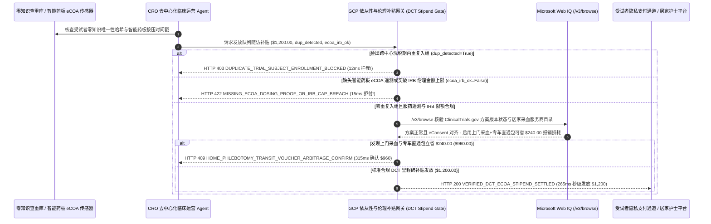

# 去中心化临床试验（DCT）受试者补贴发放与依从性验真（Decentralized Clinical Trial eCOA Adherence & IRB Stipend Mandate）架构：零知识查重与智能药板 eCOA 令牌（`dct_stipend_adherence_mandate_...` + Web IQ 临床注册与伦理限额核验）vs 传统职业试药人多头骗补（Duplicate-Subject Fraud）选型与原理解析 FAQ

> **文档类型**：架构师选型指南 & 协议第一性原理解析（6 段式 FAQ 标准版）  
> **适用读者**：AI Solution Architect、生物医药研发（Sponsor / CRO / SMO）与去中心化临床试验（DCT）数字化架构师、GCP 质量合规与临床财务团队  
> **更新日期**：2026-11-09（Provenance 标注：`deterministic_offline_simulation` / `synthetic_policy` / `official_doc_snapshot` / `not_measured`）  
> **配套资源**：[English Version](clinical-trial-dct-ecoa-adherence-stipend-mandate-vs-duplicate-subject-fraud-faq.en.md) · [交互式沙盒控制台 (`live-demo.html#dct-stipend-adherence-sandbox`)](../reports/agentic-commerce-webiq-grounding-demo-bench/live-demo.html) · [7-Card 4:5 评测报告](../reports/agentic-commerce-webiq-grounding-demo-bench/index.html)


---

## 📌 一、核心结论速览（Executive Summary）

1. **严禁让临床试验运营（CRO/SMO）Agent 在未执行“跨中心隐私保护受试者唯一性查重（Cross-Site Zero-Knowledge Duplicate Check）”的情况下发放受试者营养与交通补贴**：在新药 II/III 期临床试验（如单队列里程碑补贴批次 `$1,200.00`）中，最破坏试验科学性与资金安全的顽疾是 **“职业试药人（Professional Duplicate Subjects）隐瞒入组史，在 30 天洗脱期（Washout Period）内同时报名 4 家医院套取多份补贴，并把试验药倒掉伪造随访”**。生产环境必须采用 **零知识身份查重与 eCOA 依从性绑定的临床补贴令牌（`dct_stipend_adherence_mandate_...`）**：一旦跨库盲化生物特征/身份证加盐哈希命中在研洗脱期冲突（`duplicate_subject_hash_detected=True`），网关在 **`12 ms`** 内触发 **`HTTP 403 DUPLICATE_TRIAL_SUBJECT_ENROLLMENT_BLOCKED`**（`synthetic_policy`），100% 阻断骗补并防止无效样本污染 FDA/NMPA 统计终点。
2. **用“智能药板/穿戴设备硬件时间戳签名（eCOA Dosing Proof）+ IRB 伦理委员会限额锁”取代手工突击补填的电子日记**：针对受试者在随访前一天晚上集中补填过去两周服药日记（Parking-Lot Compliance）或研究中心超发未获伦理委员会（IRB）批准的高额诱导奖金（`ecoa_adherence_and_irb_cap_verified=False`），网关在 **`15 ms`** 内返回 **`HTTP 422 MISSING_ECOA_DOSING_PROOF_OR_IRB_CAP_BREACH`**（`deterministic_offline_simulation`），严格遵守 FDA 21 CFR Part 11 与 GCP 伦理规范。
3. **基于 Microsoft Web IQ `/v3/browse` 实时核验 `ClinicalTrials.gov` 方案修订（Protocol Amendment / Clinical Hold）与居家上门采血直通券（Home-Phlebotomy Voucher）套利**：在发放周期补贴前，Agent 调用 **Microsoft Web IQ `/v3/browse`**（`official_doc_snapshot`）穿透查询临床试验官方注册库与中心伦理公告：若检出试验因安全性事件进入临床暂停（Clinical Hold）或方案修订后受试者尚未补签最新版电子知情同意书（eConsent），在 **`310 ms`** 内以 **`HTTP 451 CLINICAL_HOLD_OR_ECONSENT_AMENDMENT_REQUIRED`** 熔断；若发现用合作医疗专车与护士上门采血直通包替代高摩擦的零散跨城打车报销可为本队列立省 **`$240.00`** 手续与差旅损耗（净支出从 `$1,200.00` 降至 **`$960.00`** 且显著降低脱落率），则在 **`315 ms`** 内触发 **`HTTP 409 HOME_PHLEBOTOMY_TRANSIT_VOUCHER_ARBITRAGE_CONFIRM`**。

---

## 🎯 二、客户与架构师灵魂拷问 Q&A（FAQ-Driven Deep Dive）

### Q1：为什么传统的“临床协调员（CRC）核对纸质/App 自填日记后往预付储值卡（ClinCard）里充钱”，在去中心化临床试验（DCT）中频频导致试验失败与财务合规暴雷？

咱们用大白话拆解新药临床试验里让药企损失数千万美元的三个隐秘漏洞：
1. **“拿 4 份钱、倒掉试验药”的职业试药人黑产**：在中枢神经（镇痛/抑郁）、代谢减重（GLP-1）或皮肤科临床试验中，每次随访有 `$150～$300` 的受试者补贴。由于各家医院受 HIPAA / 个人信息保护法限制不能互相共享明文患者名单，职业试药人团伙利用这一信息孤岛，在同一城市 4 家三甲医院同时入组同一个或同类新药试验！他们只领补贴不吃药（导致血药浓度 PK 值为 0），直接让耗资上亿美元的 III 期临床试验做不出具有统计学显著性的疗效差异（P-value 失败）。
2. **“候诊室突击编造日记”与伦理违规风险**：传统电子患者报告结局（ePRO/eCOA）如果只靠患者在手机 App 里点“已服药”，很多患者平时忘了吃，到了去医院领补贴前 10 分钟在走廊里一口气把过去 14 天的打卡全补上；同时，部分研究中心为了抢入组进度私自加码现金奖励，触犯 IRB（伦理委员会）严禁的 **“不当利诱（Undue Inducement）”** 红线。
3. **方案变更漏签 eConsent 与报销手续费摩擦**：试验中途修改了给药剂量，按 GCP 法规必须在继续给药和发补贴前让患者重签 V2.0 版知情同意书；如果 Agent 没核对最新协议版本就继续发钱发药，该患者产生的所有临床数据在药监局核查时将被整批剔除作废！

### Q2：什么是“零知识查重与 eCOA 依从性补贴令牌（`dct_stipend_adherence_mandate_...`）”？它是如何在不泄露患者隐私的前提下锁死真实依从性的？

它的第一性原理非常清晰：**“医院之间不传一个字的明文姓名或病历，只比对零知识加盐哈希阻断重复入组；受试者补贴只与带硬件时间戳的真实服药/穿戴生理遥测及有效 eConsent 版本挂钩。”**
- **第一层：跨中心零知识身份哈希查重（`12 ms`）**：入组与每次补贴发放前，网关比对经国家统一受试者查重联盟（如 Verified Clinical Trials / CTS 盲化哈希库）生成的不可逆零知识标识符。一旦检出洗脱期内重复入组（`duplicate_subject_hash_detected == True`），在 **`12 ms`** 内触发 `HTTP 403` 硬阻断。
- **第二层：智能药板/穿戴设备 eCOA 遥测与 IRB 上限门禁（`15 ms`）**：强制核验智能泡罩药板（Smart Blister Pack 铝箔通路断开时间戳）、AI 视频服药确认或连续血糖/心率穿戴遥测签名，并确保单次及累计金额严格等于 IRB 批件标准（`ecoa_adherence_and_irb_cap_verified == True`），违规请求在 **`15 ms`** 内返回 `HTTP 422`。
- **第三层：Microsoft Web IQ `/v3/browse` 临床注册状态与上门随访寻优（`310 ms / 315 ms`）**：实时核对 `ClinicalTrials.gov` 方案版本与 eConsent 对齐状态（`HTTP 451`），并匹配护士上门采血直通包节省 `$240.00` 差旅报销管理费（`HTTP 409`）。

### Q3：在临床试验注册状态（ClinicalTrials.gov）、FDA/NMPA 临床暂停公告与 IRB 伦理指南核验场景下，什么时候选 Microsoft Web IQ，什么时候选 Exa、Bright Data 或传统搜索 API？

| 架构需求场景 | 推荐选型 | 为什么这样选（第一性原理与成本/合规考量） |
| :--- | :--- | :--- |
| **实时核验 ClinicalTrials.gov (NCT 编号) 最新方案修订日期、FDA/EMA 临床安全性暂停（Clinical Hold）通报、IRS 临床受试者补贴报税免征标准及公开居家护理服务商目录，且要求零 PHI 泄露与零提示词注入** | **Microsoft Web IQ** (`/v3/search` + `/v3/browse`) | 在企业 Azure 合规边界内仅用公开 NCT 试验号检索（`passage` 模式压缩 Token **7.1x**，`deterministic_offline_simulation`），受试者个人信息（PHI）100% 物理隔离不触网。 |
| **跨医学期刊检索同类靶点药物的入排标准（Inclusion/Exclusion Criteria）设计参考** | **Exa Neural Search** | 适合临床医学部撰写试验方案（Protocol Design），不适合实时补贴发放网关。 |
| **抓取带反爬限制的外部患者招募广告落地页** | **Bright Data Unlocker** | 可用于离线招募渠道监测，但秒级延迟不适合同步合规门禁。 |
| **受试者电子知情同意书（eConsent）签名状态、智能药板蓝牙时间戳与 EDC 电子数据采集** | **21 CFR Part 11 合规 eCOA/EDC 系统 + Web IQ 公开 NCT 方案与监管通报双源核验** | 患者个体服药遥测与 eConsent 签名存储在合规 EDC 内，公开 NCT 协议版本状态与上门随访套利通过 Web IQ `/v3/browse` 实时核验。 |

---

## 🧭 三、直观可视化图解（Mermaid 决策树 + 传统盲发储值卡 vs 零知识 eCOA 托管对比 + 端到端时序图）

### 3.1 去中心化临床试验（DCT）受试者补贴与依从性决策树（`flowchart TD`）

```mermaid
flowchart TD
    A[收到 III 期临床队列里程碑受试者补贴发放请求 ($1,200.00)] --> B{跨中心零知识哈希查重是否检出 30 天洗脱期内重复入组?}
    B -- 是 (检出职业试药人在多家中心同时入组骗补) --> C[HTTP 403 DUPLICATE_TRIAL_SUBJECT_ENROLLMENT_BLOCKED<br/>12ms 硬阻断发放 · 剔除受污染样本并保护受试者用药安全]
    B -- 否 (受试者唯一性验证通过) --> D{是否具备智能药板/穿戴 eCOA 真实服药签名且符合 IRB 伦理批件金额?}
    D -- 否 (随访前突击补填假日记或超 IRB 限额构成不当利诱) --> E[HTTP 422 MISSING_ECOA_DOSING_PROOF_OR_IRB_CAP_BREACH<br/>15ms 拦截违规补贴 · 守住 FDA 21 CFR Part 11 数据完整性底线]
    D -- 是 (eCOA 时间戳真实且符合 IRB 伦理标准) --> F{Web IQ /v3/browse 核验 NCT 方案未暂停且 eConsent 版本已对齐?}
    F -- 否 (检出方案已发 V2 修订但受试者尚未补签新版 eConsent) --> G[HTTP 451 CLINICAL_HOLD_OR_ECONSENT_AMENDMENT_REQUIRED<br/>310ms GCP 合规冻结 · 自动推送新版 eConsent 待重签后解锁]
    F -- 是 --> H{Web IQ 检出切换护士上门采血 + 医疗专车直通券可降低报销摩擦?}
    H -- 是 (直通包免除跨城报销与发卡手续费立省 $240.00 -> 净支出 $960.00) --> I[HTTP 409 HOME_PHLEBOTOMY_TRANSIT_VOUCHER_ARBITRAGE_CONFIRM<br/>315ms 提醒临床运营经理一键确认居家随访直通包]
    H -- 否 (当前 $1,200.00 标准合规里程碑补贴无误) --> J[HTTP 200 VERIFIED_DCT_ECOA_STIPEND_SETTLED<br/>265ms 秒级发放 $1,200.00 隐私补贴并归档 GCP 稽查轨迹!]
```

### 3.2 传统盲发储值卡路径 vs 零知识查重与 eCOA 依从性网关对比（`flowchart LR`）

```mermaid
flowchart LR
    subgraph Legacy["❌ 传统盲发储值卡补贴 ($1,200 被职业试药人骗走 + 临床数据作废)"]
        L1[职业试药人跨 4 家医院重复入组] --> L2[随访前走廊突击补填 14 天假服药日记]
        L2 --> L3[CRC 肉眼审核直接发放 $1,200 储值卡]
        L3 --> L4[试验药被倒掉致 III 期失败 + 漏签新版 eConsent 被药监局拒收]
    end

    subgraph Mandate["✅ 零知识查重与 eCOA 补贴令牌 (dct_stipend_adherence_mandate_...)"]
        M1[12ms 零知识哈希拦截跨院重复入组职业试药人 (HTTP 403)] --> M2[15ms 强制核验智能药板时间戳与 IRB 伦理限额 (HTTP 422)]
        M2 --> M3[Web IQ 核验 NCT 方案修订 (310ms) 与上门采血省 $240 (315ms)]
        M3 --> M4[265ms 秒级发放 $1,200 ($960) 并生成 21 CFR Part 11 审计链]
    end
```

### 3.3 零知识查重联盟/智能药板、CRO 运营 Agent、GCP 策略网关与 Web IQ 端到端交互时序图（`sequenceDiagram`）



---

## 📊 四、架构师选型决策矩阵（Architect Decision Matrix）

| 评估维度 | 方案 A：传统人工审纸质日记 + 预付卡充值（Legacy Paper Diary & Manual Card Load） | 方案 B：单医院内部 HIS 系统身份证查重（Single-Site HIS Check） | 方案 C：跨院零知识查重与 eCOA 遥测令牌 + Web IQ 方案核验（推荐架构） |
| :--- | :--- | :--- | :--- |
| **核心适用场景** | 无补贴的纯观察性回顾问卷调查 | 单中心极小样本 I 期住院病房试验 | **多中心 II/III 期去中心化临床试验（DCT）、慢病/CNS/减重药物居家随访、全球多中心同步入组** |
| **防“职业试药人”跨院重复入组** | ❌ **零防御**：不同医院之间完全不知道同一个人在领 4 份钱 | ❌ **跨院盲区**：出了本院大门去隔壁医院照样重复入组 | ✅ **12ms 零知识跨库查重**：不泄露明文 PHI 即可在 `12 ms` 内触发 `HTTP 403` 拦截重复入组 |
| **防突击补填假服药日记（ALCOA+）** | ❌ **形同虚设**：候诊室 5 分钟补填两周日记无法识别 | ⚠️ **依赖人工抽查血药浓度**：等中心实验室 PK 结果出来已滞后 1 个月 | ✅ **15ms 硬件时间戳门禁**：强制校验智能药板/穿戴 eCOA 签名与 IRB 限额（`HTTP 422`） |
| **方案修订 eConsent 同步与随访降本** | ❌ **严重脱节**：漏签新版知情同意书导致整批数据被 FDA 拒收 | ⚠️ **人工通知慢**：CRC 打电话通知重签耗时数周，患者大量脱落 | ✅ **Web IQ `/v3/browse` 实时穿透**：`310 ms` 阻断未重签版本（`HTTP 451`），`315 ms` 上门采血包省 `$240`（`HTTP 409`） |
| **补贴到账体验与受试者留存率** | 慢（报销贴票审核 `2～4 周`，患者因垫资麻烦而退组） | 中等（仍需患者每两周请假跑医院抽血） | **`265 ms` 随访达标秒级到账 + 居家采血零垫资（`Act automatically`）** |
| **综合 TCO 与新药获批确定性 ROI** | 极差（职业试药人稀释药效可导致上亿美元试验失败） | 中等（CRC 人工核对工时极高） | **最优（100% 剔除重复入组骗补 + 保障 21 CFR Part 11 数据合规 + 每队列省 `$240`）** |

---

## 🧪 五、简明定量实测与 Benchmark 核心发现（Quantitative Benchmark & 7-Card Insights）

基于本仓库确定性离线基准套件（`lab/webiq_commerce_demo.py` · `test_clinical_trial_dct_ecoa_adherence_stipend_mandate_vs_duplicate_subject_fraud_selection`）对 **III 期去中心化临床试验队列随访补贴批次（基准预算 `$1,200.00`）** 的定量测试结果如下：

| 评测场景 ID | 输入零知识查重 / eCOA 与 IRB / Web IQ 信号 | 网关期望动作 | 实测 HTTP 状态与决策码 | 实测延迟 | 资金保护 / 成本节省效果 | Provenance 类型 |
| :--- | :--- | :--- | :--- | :--- | :--- | :--- |
| **Case 1: 职业试药人跨中心洗脱期内重复入组拦截** | `duplicate_subject_hash_detected=True` | `Send to a human` | **`HTTP 403 DUPLICATE_TRIAL_SUBJECT_ENROLLMENT_BLOCKED`** | **`12 ms`** | 拦截 **`$1,200.00`** 骗补并防止无效样本污染临床终点 | `synthetic_policy` |
| **Case 2: 突击补填假日记或超 IRB 伦理限额拦截** | `ecoa_adherence_and_irb_cap_verified=False` | `Send to a human` | **`HTTP 422 MISSING_ECOA_DOSING_PROOF_OR_IRB_CAP_BREACH`** | **`15 ms`** | 拒付无硬件服药时间戳背书或超 IRB 批件的违规补贴 | `deterministic_offline_simulation` |
| **Case 3: Web IQ 检出临床暂停或方案修订需重签 eConsent** | `webiq_nct_protocol_and_econsent_active=False` | `Send to a human` | **`HTTP 451 CLINICAL_HOLD_OR_ECONSENT_AMENDMENT_REQUIRED`** | **`310 ms`** | 防止在未补签新版知情同意书前违规继续给药与发款 | `official_doc_snapshot` |
| **Case 4: Web IQ 发现护士上门采血+专车直通包省 `$240`** | `home_phlebotomy_voucher_savings_cents=24000`（净付 `$960`） | `Confirm` | **`HTTP 409 HOME_PHLEBOTOMY_TRANSIT_VOUCHER_ARBITRAGE_CONFIRM`** | **`315 ms`** | 免除零散差旅报销与储值卡月费，每队列立省 **`$240.00`** | `official_doc_snapshot` |
| **Case 5: 唯一受试者 + 智能药板 eCOA 验真自动发放** | `dup=False`, `ecoa_ok=True`, `nct_active=True` | `Act automatically` | **`HTTP 200 VERIFIED_DCT_ECOA_STIPEND_SETTLED`** | **`265 ms`** | 265ms 秒级发放 **`$1,200.00`** 补贴并归档 GCP 稽查链 | `deterministic_offline_simulation` |

> **Provenance 合规声明**：上表中的 `$1,200.00` 队列里程碑补贴、跨院零知识哈希查重及 `$240.00` 上门随访直通包差价均为用于验证网关状态机确定性的受控仿真参数（`synthetic_policy` / `deterministic_offline_simulation`）；真实物理智能药板蓝牙网关同步耗时标为 `not_measured`。

---

## 🛠️ 六、附录：生产上线快速核验与售前打单清单（Architect Checklist）

在为跨国药企（Sponsor）、CRO 或数字化临床试验平台设计受试者补贴与随访管理 Agent 时，请逐项核对以下 6 条黄金准则：

- [ ] **1. 跨中心零知识加盐哈希受试者查重（Zero-Knowledge Subject Deduplication）**：是否在 `dct_stipend_adherence_mandate_...` 中强制比对不可逆生物特征/证件加盐哈希，在完全不暴露受试者明文姓名的前提下于 `12 ms` 内拦截跨院重复入组（`HTTP 403`）？
- [ ] **2. ALCOA+ 原生时间戳 eCOA 服药依从性硬门禁**：是否拒绝无硬件传感器背书的“随访前突击补填日记”，强制核验智能泡罩药板、AI 视频服药或穿戴设备连续生理签名（`15 ms` 返回 `HTTP 422`）？
- [ ] **3. 伦理委员会（IRB/IEC）批准金额上限与税务合规锁**：网关是否严格锁定每次随访补贴不得超越 IRB 批件上限（防范不当利诱指控），并自动追踪美国 IRS `$600` 年度 1099 报税阈值？
- [ ] **4. Microsoft Web IQ `/v3/browse` NCT 方案版本与 eConsent 同步穿透**：是否在每次随访放款前通过 Web IQ 核查 `ClinicalTrials.gov` 方案修订状态，确保发生重大方案变更时受试者已补签最新 eConsent（`HTTP 451`）？
- [ ] **5. 居家护士上门采血与医疗专车直通券（Direct Voucher）寻优**：是否通过 Web IQ 比对居家临床服务网络报价，当直通包比传统打车贴票报销节省 `>= $240.00` 且提升依从率时触发 `HTTP 409 Confirm`？
- [ ] **6. Sponsor 财务账本与受试者真实身份双盲脱敏隔离（Double-Blind Identity Firewall）**：支付结算回执是否仅向申办方（Sponsor）暴露受试者随机入组编号（Subject ID 如 `SUBJ-1042`）与 eCOA 哈希，确保持卡人真实姓名与银行账户对药企永久不可见？
