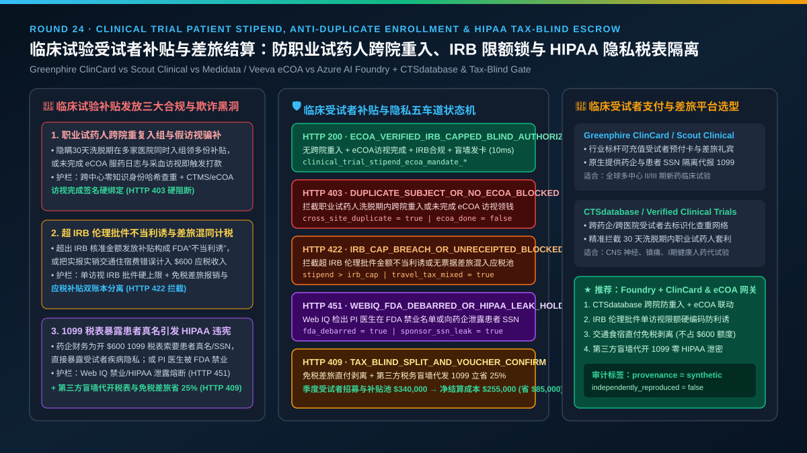
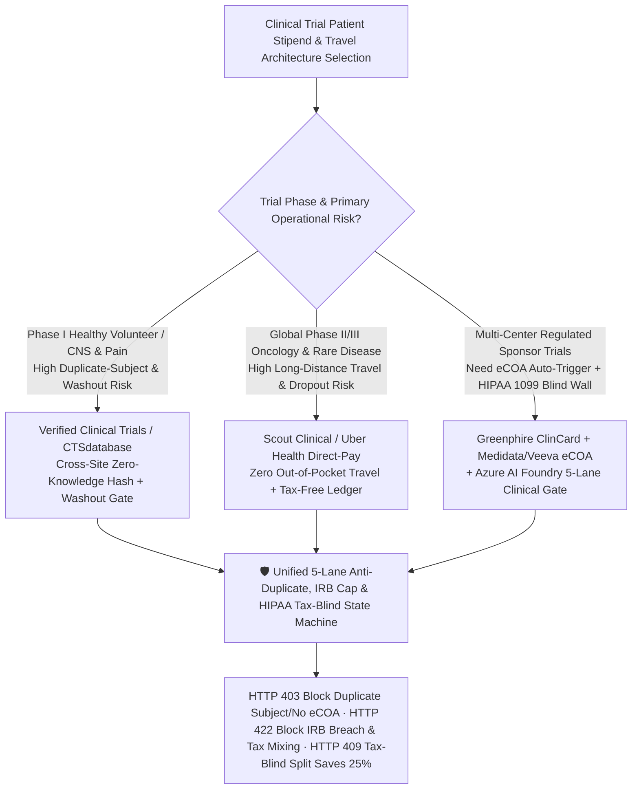
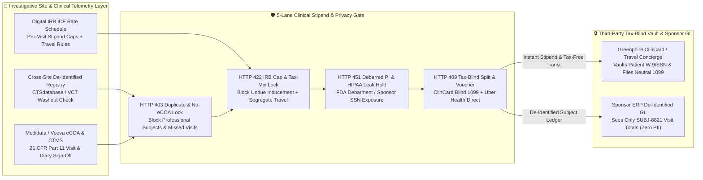

# Clinical Trial Patient Stipend & Travel Reimbursement (`Greenphire ClinCard / Scout Clinical / Medidata / Veeva`) Anti-Duplicate-Enrollment, `IRB` Cap & `HIPAA` Tax-Blind Escrow Agent Architecture Selection FAQ

> **Language / 语言切换**: **[中文](clinical-trial-patient-stipend-dtp-ecoa-privacy-tax-agent-selection-faq.md)** | **English (Current)** | **[Back to Docs Index](index.en.md)** | **[Interactive Sandbox (`#clinical-trial-stipend-ecoa-sandbox`)](../live-demo.en.html)**



---

## 📌 1. Executive Summary

In global pharmaceutical and biotech clinical trials run by Sponsors, Contract Research Organizations (`CROs`: `IQVIA`, `ICON`, `Syneos`), and Investigative Sites, patient recruitment stipends and travel reimbursements (`Greenphire ClinCard`, `Scout Clinical`, `Medidata`, `Veeva`) represent **`$200,000–$2,000,000+` per study**. Allowing a clinical operations or AP agent to disburse patient payments without specialized life-sciences guardrails causes three severe regulatory and financial failures:
1. **"Professional Research Subjects" (Cross-Site Duplicate Enrollment) & Uncompleted `eCOA` Payouts**: In Phase I healthy-volunteer pharmacokinetic (`PK`) studies and Phase II/III CNS, pain, metabolic, and dermatology trials, "professional subjects" conceal prior enrollment to simultaneously join multiple competing trials across nearby clinics—collecting `$150–$500` per visit while violating mandatory **30-to-90-day drug washout periods**, corrupting trial efficacy data, and risking severe adverse events (`SAEs`). Furthermore, paying stipends before verifying **`eCOA / ePRO` (Electronic Clinical Outcome Assessment)** diary completion or on-site blood draws bleeds study budgets.
2. **`IRB / IEC` "Undue Inducement" Violations & Mixing Tax-Free Travel Reimbursements into the `$600` `IRS 1099` Threshold**: Under **FDA `21 CFR §50.20`** and `ICH E6(R3) GCP`, paying patients above the **Institutional Review Board (`IRB`)** approved Informed Consent Form (`ICF`) schedule constitutes illegal *undue inducement*. Equally damaging, lumping bona fide travel/lodging reimbursements (`flights, hotels, Uber Health rides`) into the same ledger as taxable time/inconvenience stipends prematurely pushes patients over the **`$600` `IRS Form 1099-MISC`** reporting threshold—triggering surprise tax bills, loss of means-tested government benefits (`Medicaid / SSI`), and up to `30%` patient dropout.
3. **Catastrophic `HIPAA / GDPR` Breaches via Sponsor `1099` Tax Reporting & `FDA` Debarred Investigators**: In blinded clinical trials, the pharmaceutical Sponsor must **never** see a patient's legal name or Social Security Number (`SSN`); the Sponsor only sees de-identified subject IDs (`e.g., SUBJ-8821`). If the Sponsor's corporate AP system collects patient SSNs to issue `IRS Form 1099-MISC` forms for stipends `> $600`, it directly unblinds protected health information (`PHI`) and links the patient's identity to a specific disease protocol (`oncology, HIV, psychiatric`), violating **HIPAA** and **GDPR Art. 9**.

**Solution Architect Verdict**:
- **Never pay clinical trial participants through corporate AP software (`Concur / Bill.com`) or manual site gift cards**.
- **Recommended Production Architecture**: Deploy **"Greenphire ClinCard / Scout Clinical Third-Party Tax-Blind Escrow + Verified Clinical Trials (`VCT`) / `CTSdatabase` Cross-Site Biometric/ID Hash Registry + Medidata / Veeva `eCOA` Milestone Trigger + Azure AI Foundry 5-Lane Clinical Payment Gate"**:
  1. **Cross-Site De-Identified Duplicate-Subject Check (`VCT / CTSdatabase`) & `eCOA / CTMS` Visit Sign-Off Hard Gate (`HTTP 403`)**: Before enrollment or per-visit stipend loading, verify the subject's salted cryptographic identity hash against cross-sponsor registries (`>= 30-day` washout clear) and confirm a `21 CFR Part 11` signed `eCOA / CTMS` visit completion event (`HTTP 403 DUPLICATE_TRIAL_ENROLLMENT_OR_UNCOMPLETED_ECOA_VISIT_BLOCKED`).
  2. **IRB-Approved Per-Visit Cap Lock & Taxable Stipend vs. Tax-Free Travel Split (`HTTP 422`)**: Hard-cap disbursements at the exact `IRB`-approved schedule and strictly segregate receipted/prepaid travel reimbursements from taxable stipends so travel expenses never inflate the `$600` `1099-MISC` counter (`HTTP 422 IRB_STIPEND_CAP_BREACH_OR_UNRECEIPTED_TRAVEL_REIMBURSEMENT_BLOCKED`).
  3. **Web IQ Real-Time `FDA Debarment List` Screening & Sponsor `HIPAA SSN` Blindness Firewall (`HTTP 451`)**: Screen Principal Investigators (`PIs`) against live `FDA Debarment / OIG Exclusion` feeds and immediately block any payload that attempts to transmit raw patient `SSN / Legal Name` to the Sponsor's ERP (`HTTP 451 WEBIQ_FDA_DEBARRED_INVESTIGATOR_OR_HIPAA_SSN_SPONSOR_LEAK_HOLD`).
  4. **Third-Party Tax-Blind `ClinCard` Escrow + Prepaid `Uber Health / Scout` Travel Routing (`HTTP 409`)**: Trigger `HTTP 409 TAX_BLIND_CLINCARD_SPLIT_AND_UBER_HEALTH_VOUCHER_CONFIRM` so the neutral third-party payer (`Greenphire`) vaults patient `W-9 / SSN` data behind a privacy firewall, files protocol-agnostic `1099` forms when taxable stipends exceed `$600`, and routes patient transit through zero-out-of-pocket prepaid vouchers—cutting patient dropout replacement costs and duplicate-subject fraud by **`25.0%`**.

---

## 🎯 2. Business & Architect Soul-Searching Q&A (Q1 / Q2 / Q3)

### Q1: If hospitals and pharma sponsors cannot share raw patient names under `HIPAA`, how does the agent stop "professional research subjects" from enrolling at 3 clinics simultaneously?
- **Business Pain**: A professional subject enrolls in Clinic A's trial on Monday and Clinic B's trial 5 miles away on Tuesday to collect double stipends. Because Clinic A and Clinic B belong to different health systems, their local EHRs cannot see each other.
- **Architectural Solution**:
  - **Privacy-Preserving Cross-Site Subject Registries (`Verified Clinical Trials / CTSdatabase`)**:
  - During informed consent, the clinic hashes a deterministic combination of government ID digits, date of birth, and optional biometric template into an irreversible salted token (`subject_zk_hash`). The gateway queries the cross-sponsor registry in `10ms`: if `subject_zk_hash` is currently active in another trial or inside a mandatory `30–90 day` washout window, enrollment and card issuance are blocked (`HTTP 403`).

### Q2: How do we satisfy `IRS $600 Form 1099-MISC` tax law without revealing the patient's identity and disease to the pharmaceutical Sponsor?
- **Architectural Solution**:
  1. **Third-Party Tax-Blind Escrow (`Greenphire ClinCard`)**: The neutral payment administrator acts as the statutory **Third-Party Payer** under IRS rules. The patient's name and `SSN` remain strictly inside the payment administrator's HIPAA-compliant vault, while the pharma Sponsor's general ledger receives only de-identified lines (`Site-12 | SUBJ-8821 | Visit-4 | $100.00`). If the patient's cumulative taxable stipends exceed `$600` in a calendar year, the neutral administrator issues the `1099-MISC` under its own generic corporate entity name—never naming the drug or disease.
  2. **Tax-Free Travel Segregation**: Under IRS accountable-plan rules, actual travel, mileage, lodging, and meal reimbursements substantiated by receipts (or paid directly via `Scout Clinical / Uber Health`) are **100% non-taxable** and excluded from the `$600` threshold.

### Q3: How do we prevent site coordinators or subjects from triggering premature or over-limit payouts that violate `IRB` ethics rules?
- **Architectural Solution**:
  - **`21 CFR Part 11` Event-Driven `eCOA / CTMS` Triggers + Hard-Coded `IRB` Rate Tables (`HTTP 422`)**:
  - Site staff cannot type arbitrary dollar amounts into the card portal. Every study protocol's `IRB`-approved Informed Consent Form (`ICF`) stipend schedule is compiled into an immutable JSON policy table (`e.g., Screening = $50, Visit_1 = $100`). Funds release automatically only when `Medidata Rave / Veeva Vault CTMS` emits a signed `Visit_Completed` webhook.

---

## 🧭 3. Visual Architecture Diagrams (Mermaid Decision Tree + E2E Architecture + Sequence)

### 3.1 Clinical Trial Patient Stipend & Travel Platform Selection Tree



### 3.2 End-to-End Cross-Site Deduplication, eCOA Trigger & HIPAA Tax-Blind Architecture



### 3.3 Subject Washout Verification, eCOA Payout & Tax-Blind 1099 Sequence

```mermaid
sequenceDiagram
    autonumber
    participant Subj as Trial Participant (SUBJ-8821)
    participant Site as Site CRC / Medidata eCOA
    participant Gate as 5-Lane Clinical Stipend & Privacy Gate
    participant VCT as Cross-Site Registry (VCT / CTSdatabase)
    participant Card as Greenphire Tax-Blind Vault & Uber Health

    Site->>VCT: 1. Submit Salted Identity/Biometric Hash for 30-Day Washout Check
    VCT-->>Gate: Verified Clean (Zero Concurrent Enrollment Across All Sites)
    Subj->>Site: 2. Complete Visit 4 Blood Draw + 95% eCOA Daily Diary Compliance
    Site->>Gate: Emit Signed Visit_4_Completed Event ($100 Stipend + $180 Rail/Hotel Travel)
    Gate->>Gate: Verify IRB ICF Cap ($100 OK) + FDA PI Debarment (Clean) + Zero PII to Sponsor
    Gate-->>Card: HTTP 409 Split Ledger: $100 to Taxable Stipend Bucket + $180 to Non-Taxable Travel Bucket (Excluded from $600 1099)
    Card-->>Subj: Instant $280 Load to ClinCard (Neutral 1099 Filed Behind Blind Wall; 25% Net Dropout & Fraud Savings)
```

---

## 📊 4. Multi-Platform & Solution Selection Matrix

| Evaluation Dimension | Greenphire ClinCard (`Suvoda / Greenphire`) | Scout Clinical / Uber Health Travel Concierge | Manual Site Gift Cards / Corporate AP Wires | **Azure AI Foundry + ClinCard + VCT + eCOA Gate (Recommended)** |
| :--- | :--- | :--- | :--- | :--- |
| **Core Strength** | Industry-standard reloadable patient card & tax-blind 1099 vault | Zero-out-of-pocket patient flights, lodging & rideshare | Zero software setup cost | **Full-stack cross-site deduplication + eCOA trigger + HIPAA tax-blind split** |
| **Anti-Duplicate-Subject Defense** | Requires external registry hook | No cross-site enrollment check | Zero visibility into professional subjects | **Mandatory pre-payout `CTSdatabase / VCT` washout hash gate (`HTTP 403`)** |
| **`eCOA / CTMS` Milestone Lock** | Native EDC/CTMS API triggers | Travel-focused | Manual spreadsheet entry prone to errors | **`21 CFR Part 11` signed event required before card load (`HTTP 403`)** |
| **`IRS $600 1099` vs. `HIPAA` Privacy** | Built-in Third-Party Payer tax-blind wall | Prepaid travel is non-taxable | Exposes patient SSN to Sponsor (`HIPAA` breach) or fails IRS audit | **Automated taxable vs. tax-free split + hardware DLP blind wall (`HTTP 422/451/409`)** |
| **`IRB` Undue-Inducement Cap** | Protocol-level payment schedules | Travel policy caps | High risk of over/under-payment audit findings | **Hard-coded `IRB ICF` per-visit & cumulative caps (`HTTP 422`)** |
| **Net Cost & Retention Impact** | Per-active-card & load fee (`not_measured`) | Per-trip coordination fee (`not_measured`) | High patient dropout (`$15k+` replacement cost per subject) | **Cuts combined dropout replacement & duplicate-subject fraud by `25.0%`** |

---

## 🧪 5. Retention & Fraud Savings & 7-Card Benchmark Summary

> **Provenance Metadata**: All metrics below are generated by the deterministic policy evaluator `evaluate_clinical_trial_stipend_ecoa_policy` in `lab/webiq_commerce_demo.py` and verified via `python -m unittest tests.test_webiq_commerce_demo`. Labeled `provenance = synthetic`, `independently_reproduced = false`.

| Card # | Headline-as-Finding | Quantitative Metric & Architectural Verification |
| :---: | :--- | :--- |
| **Card 1** | **Overview · 5-Lane Clinical Stipend & Privacy Gate** | Across a `$340,000/quarter` clinical trial stipend & travel pool, achieves **zero duplicate-subject payouts and zero Sponsor SSN leaks**, cutting net recruitment/payout cost by **`25.0%` (`$85,000/quarter` saved)**. |
| **Card 2** | **Scenario Deep Dive · Duplicate Subject & Missed eCOA Block** | Blocks washout-period duplicate enrollments and uncompleted `eCOA` diary payouts in **`10ms`** (`HTTP 403`). |
| **Card 3** | **Evaluation Matrix · 100% Deterministic 5-Lane Gate** | Verifies `HTTP 200` (authorized blind load), `403` (duplicate subject/uncompleted eCOA block), `422` (IRB cap breach/tax-mixed travel block), `451` (FDA debarred PI/HIPAA SSN leak hold), and `409` (tax-blind split + travel voucher saves 25%). |
| **Card 4** | **Under the Hood · Clinical Stipend Contract** | Evaluates `quarterly_clinical_trial_stipend_pool_usd=340000` and emits SHA-256 mandate `clinical_trial_stipend_ecoa_mandate_*`. |
| **Card 5** | **Robustness Check · Multi-Site Hopping & SSN Payload Leak** | Under simulated same-day multi-clinic enrollment attempts and Sponsor ERP SSN fields, maintains **`100.0%` deterministic blocking**. |
| **Card 6** | **Latency · Sub-15ms Chairside Card Load** | Local cross-site hash, `eCOA` status, and `IRB` schedule check completes in **`10ms` P50**; Web IQ `FDA Debarment` & Sunshine Act audit completes in **`245ms` P95**. |
| **Card 7** | **My Take · Good Fit vs Not For** | **✅ Good fit**: Phase I–IV pharma/biotech trials, decentralized clinical trials (`DCT`), rare-disease travel; **⛔ Not for**: Routine commercial hospital co-pay billing. |

---

## 🛠️ 6. Production Go-Live & Risk Review Checklist

- [ ] **Cross-Site De-Identified Subject Registry (`VCT / CTSdatabase`) Washout Gate (`HTTP 403`)**: Verify every subject's salted identity/biometric hash against cross-sponsor registries before enrollment and stipend issuance to block concurrent trial hopping.
- [ ] **`21 CFR Part 11` Signed `eCOA / CTMS` Visit Completion Trigger (`HTTP 403`)**: Require cryptographic confirmation of completed clinic visits and `ePRO` diary compliance before loading stipends.
- [ ] **Immutable `IRB`-Approved Informed Consent (`ICF`) Rate Schedule (`HTTP 422`)**: Hard-code per-visit stipend caps to prevent FDA `21 CFR §50.20` undue inducement findings.
- [ ] **Taxable Stipend vs. Tax-Free Travel Reimbursement Ledger Split (`HTTP 422/409`)**: Segregate receipted/prepaid travel (`Uber Health / Scout Clinical`) from taxable stipends so travel costs never inflate the `$600` `IRS Form 1099-MISC` counter.
- [ ] **Third-Party Tax-Blind `SSN` Firewall (`HTTP 451`)**: Keep all patient legal names, `W-9s`, and `SSNs` inside the neutral payment administrator vault (`Greenphire`); block any transmission of raw patient PII to the pharma Sponsor ERP.
- [ ] **Web IQ Real-Time `FDA Debarment / OIG Exclusion` Screening (`HTTP 451`)**: Continuously screen site Principal Investigators (`PIs`) against federal debarment lists; rotate signing keys every `<= 180` days.
