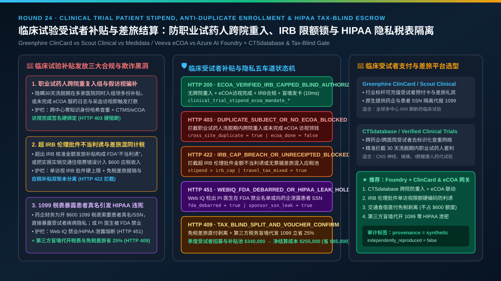
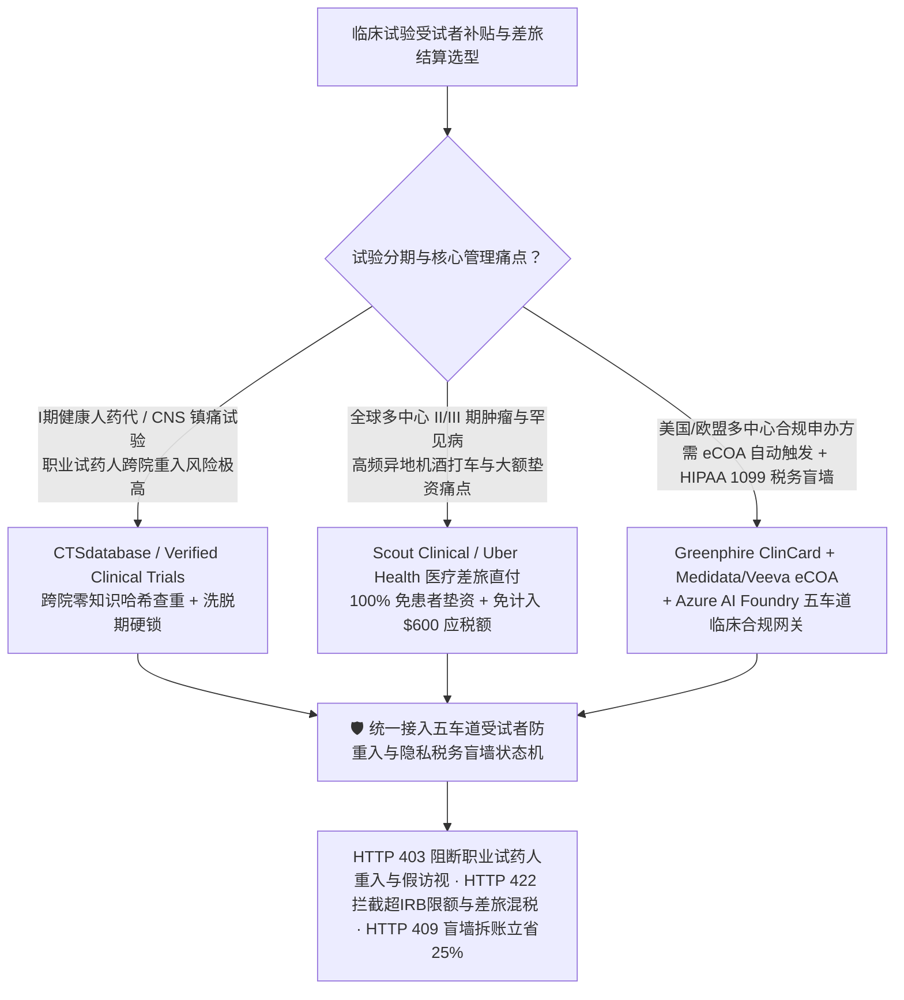
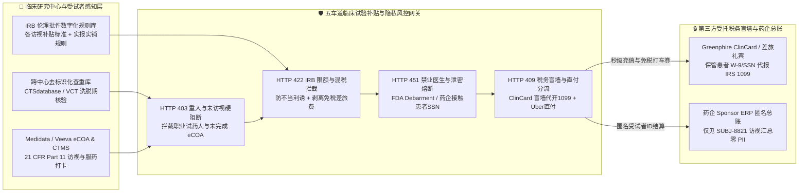
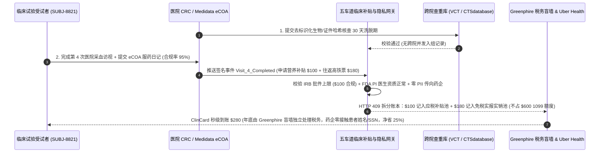

# 全球临床试验受试者补贴与差旅结算（Clinical Trial Patient Stipend & Travel Reimbursement：Greenphire ClinCard / Scout Clinical / Medidata / Veeva）“防职业试药人跨院重复入组、IRB 伦理限额锁与 HIPAA 隐私税表隔离盲墙”Agent 架构选型 FAQ：终结试药套利与患者隐私泄密实战指南

> **语言切换 / Language**: **中文 (当前)** | **[English](clinical-trial-patient-stipend-dtp-ecoa-privacy-tax-agent-selection-faq.en.md)** | **[返回文档目录](index.md)** | **[交互式沙盒 (`#clinical-trial-stipend-ecoa-sandbox`)](../live-demo.html)**

---

## 📌 一、核心选型结论速览（Executive Summary）

在创新药企（Sponsor）、合同研究组织（CRO：IQVIA / ICON / 泰格医药）与临床试验机构（Site）的受试者招募、访视营养交通补贴（Patient Stipend）及异地就医差旅报销场景中，单项目受试者补贴与差旅池高达 **`$200,000–$2,000,000`**。若让财务或研究协调员（CRC）Agent 直接按名单给受试者打款，极易引爆三大致命合规与欺诈事故：
1. **“职业试药人（Professional Research Subjects）”跨医院重复入组骗补与未完成 `eCOA` 随访空领补贴**：在 I 期健康人药代动力学（PK）试验及中枢神经（CNS）/镇痛/代谢类 II/III 期临床试验中，职业试药人隐瞒自己过去 30 天内已在另一家医院入组的事实，同时在 2–3 家临床中心报名领受试者补贴（每次访视 `$150–$500`），不仅骗取数十万美元补贴，更因体内残留其他在研药物导致严重不良事件（SAE）并污染整批临床试验数据；此外，若未与 **电子临床结局评估（`eCOA / ePRO`，如 Medidata / Veeva）** 联动，受试者未完成每日服药电子日记或现场采血即被误发补贴。
2. **超出伦理委员会（IRB / IEC）批件限额构成“不当利诱（Undue Inducement）”及差旅报销被混入 `$600` 应税收入**：FDA 21 CFR §50.20 与各国 GCP 伦理规范严禁以超额资金或“只有坚持到最后一期才给全款”的方式诱导患者隐瞒副作用；同时，若把受试者实报实销的高铁、机票、酒店与打车费（Reimbursement）与劳务营养补贴（Stipend）混在一个科目发放，会导致受试者瞬间突破美国 **`IRS $600 Form 1099-MISC`** 报税门槛，引发高达 `30%` 的患者中途退组（Dropout）。
3. **药企财务索要受试者真名与社保号（SSN）开具 1099 税表引发灾难性 HIPAA 疾病隐私泄密**：在双盲临床试验中，申办方（药企 Sponsor）严禁知晓受试者真实姓名与身份证/SSN（药企只允许看到去标识化编号如 `SUBJ-0402`）。如果药企 AP 财务系统为了申报 IRS 1099 税表直接拉取患者姓名与 SSN，即刻触犯 **HIPAA 医疗隐私重罪与 GDPR 第 9 条敏感健康数据红线**！

**架构师选型结论**：
- **切勿使用企业常规报销软件（Concur / 普通银行转账）直接向临床试验受试者付款**。
- **生产级最优架构**是采用 **“Greenphire ClinCard / Scout Clinical 第三方税务盲墙受托支付 + Verified Clinical Trials / CTSdatabase 跨院零知识生物哈希查重 + Medidata / Veeva eCOA 访视触发器 + Azure AI Foundry 五车道临床支付合规网关”**：
  1. **跨中心去标识化查重（`CTSdatabase / VCT`）与 `eCOA / CTMS` 访视完成硬门禁（HTTP 403）**：在入组及每次访视放款前，通过受试者证件/生物特征的单向加盐哈希比对全国联网查重库（确认满足 `>=30 天` 洗脱期且无并发入组），并强制核验 `CTMS / eCOA` 已回传本次访视打卡签名；任一缺失立即返回 `HTTP 403 DUPLICATE_TRIAL_ENROLLMENT_OR_UNCOMPLETED_ECOA_VISIT_BLOCKED`。
  2. **IRB 伦理批件单次访视限额硬锁与“应税补贴 vs 免税实报实销差旅”双轨剥离（HTTP 422）**：每次发放金额严格锁定在 IRB 批准的《知情同意书（ICF）》阶梯标准内，严禁无票据差旅报销或将凭票实报实销的交通住宿费混入 1099 应税补贴科目（`HTTP 422 IRB_STIPEND_CAP_BREACH_OR_UNRECEIPTED_TRAVEL_REIMBURSEMENT_BLOCKED`）。
  3. **Web IQ 实时 FDA 禁业医生（Debarment List）筛查与药企端患者 SSN 零接触盲墙熔断（HTTP 451）**：通过 Web IQ 实时核验主要研究者（PI）是否被列入 FDA Debarment / OIG 排除名单，并实施硬件级 DLP 拦截任何向药企 Sponsor 传输患者真实姓名/SSN 的请求（`HTTP 451 WEBIQ_FDA_DEBARRED_INVESTIGATOR_OR_HIPAA_SSN_SPONSOR_LEAK_HOLD`）。
  4. **第三方受托税务盲墙（Tax-Blind Escrow）+ Uber Health / 机酒直付免税券自动分流（HTTP 409）**：触发 `HTTP 409 TAX_BLIND_CLINCARD_SPLIT_AND_UBER_HEALTH_VOUCHER_CONFIRM`，由受托支付机构（Greenphire）在盲墙内独立保管患者 W-9 并代开无疾病名称的 1099 税表（药企账面仅见 `SUBJ-ID`），同时将异地就诊交通改为预付打车券/机酒直付（100% 免税且免患者垫资），综合受试者脱落重招成本与试药欺诈损失立降 **`25.0%`**。

---

## 🎯 二、业务方与架构师灵魂拷问 Q&A（Q1 / Q2 / Q3）

### Q1：各大医院和药企之间由于 HIPAA 隐私法不能共享患者真名，那怎么抓出“同一个职业试药人在 3 家医院同时入组领补贴”？
- **商业痛点**：职业试药人上午在 A 医院参加降糖药试验领 `$300`，下午去 B 医院参加失眠药试验再领 `$400`，由于两家医院的 EDC 系统物理隔离且不能明文联网比对患者姓名，传统人工核查完全失效。
- **架构解法**：
  - **跨中心零知识去标识化哈希查重网络（Privacy-Preserving Cross-Site Subject Registry，如 `Verified Clinical Trials` / `CTSdatabase` / 中国临床试验受试者联网查重系统）**：
  - 患者在医院现场签署授权后，系统将患者的 `法定证件号 + 出生日期 + 指纹/虹膜模板` 经过不可逆加盐哈希（Salted Cryptographic Hash / Fuzzy Extractor）生成唯一匿名指纹 `subject_zk_hash`。网关在毫秒级比对全网在研项目：若该哈希仍在另一项目的 **活跃治疗期或 30/90 天法定药物洗脱期（Washout Period）** 内，直接返回 `HTTP 403` 阻断入组与发卡。

### Q2：为什么很多肿瘤或罕见病临床试验患者在领到第 3 次补贴后突然闹退组？怎么解决 IRS `$600` 1099 报税门槛与疾病隐私的冲突？
- **商业痛点**：
  1. 异地患者来回机票和酒店花了 `$1,500`，如果按粗放补贴发给患者，年底患者会收到一张 `$1,500` 的 `1099-MISC` 应税收入单，甚至导致低收入患者因此失去政府医疗救助（Medicaid / SSI 收入上限资格）！
  2. 如果由药企直接发 1099 税表，药企财务就知道了“张三患有某种基因缺陷或 HIV”，严重违反 HIPAA。
- **架构解法**：
  1. **应税补贴（Taxable Stipend）与免税实报实销（Non-Taxable Travel Reimbursement）账本强分离**：依据 IRS 税法，凭有效票据实报实销或由平台直付（Uber Health / Scout Clinical 代订机酒）的医疗差旅费 **不属于应税收入（0 计入 1099）**；只有纯时间/营养补偿（如每次访视 `$75`）才计入 `$600` 门槛。
  2. **第三方受托支付盲墙（Third-Party Payer Blind Wall）**：患者 PII 与 W-9 加密锁在第三方受托持牌机构（如 Greenphire），药企 ERP 只接收 `Site-08 | SUBJ-1049 | Visit-3 | $75.00` 的去标识化账单；年底若应税补贴超 `$600`，由受托方以中立支付机构抬头寄出 1099，全程零暴露药企与病种信息。

### Q3：如何防止研究中心人员或患者虚构访视套取预付卡资金？
- **架构解法**：
  - **EDC / eCOA / CTMS 事件驱动型放款锁（Event-Driven Milestone Release）**：
  - 预付卡（ClinCard）的充值接口严禁向人工开放任意金额输入。只有当 `Medidata Rave / Veeva Vault CTMS` 触发经过电子签名（`21 CFR Part 11` 合规）的 `Visit_Completed` 或 `ePRO_Weekly_Diary_Compliance >= 85%` 事件时，网关才自动按该中心 IRB 批件对应的固定金额（如 `Visit 4 = $100.00`）签发单次充值令牌。

---

## 🧭 三、直观可视化图解（Mermaid 决策树 + 端到端架构图 + 时序图）

### 3.1 临床试验受试者支付与差旅管理平台选型决策树

### 3.2 端到端跨院查重、eCOA 联动与 HIPAA 税务盲墙架构图

### 3.3 受试者入组查重、访视打卡自动充值与 HIPAA 盲墙报税时序图

---

## 📊 四、多平台/多方案横向选型决策矩阵

| 选型维度 | Greenphire ClinCard (`Suvoda / Greenphire`) | Scout Clinical / Uber Health 医疗差旅平台 | 医院手工发放购物卡 / 药企普通银行转账 | **Azure AI Foundry + ClinCard + VCT 查重 + eCOA 网关（推荐）** |
| :--- | :--- | :--- | :--- | :--- |
| **核心优势** | 全球临床试验患者预付卡与税务盲墙行业标准 | 强于异地罕见病/肿瘤患者机酒预定与专车接送 | 零软件采购费，操作原始 | **跨院防重入 + eCOA 自动触发 + 免税差旅剥离 + HIPAA 盲墙** |
| **防职业试药人跨院重复入组** | 需外部对接查重库 | 不具备跨院入组查重能力 | 完全无法识别跨院试药人 | **强制前置校验 `CTSdatabase / VCT` 洗脱期哈希（HTTP 403）** |
| **eCOA / CTMS 访视完成强绑定** | 支持 EDC/CTMS API 触发发款 | 聚焦行程管理 | 靠 CRC 手工填 Excel，极易漏发或错发 | **`21 CFR Part 11` 电子签名事件驱动秒级放款（HTTP 403）** |
| **IRS `$600` 1099 报税与 HIPAA 隔离** | 原生提供第三方 Payer 盲墙代开 1099 | 差旅直付天然免税 | 药企要 SSN 则违背 HIPAA，不报则违背 IRS 税法 | **自动拆分免税差旅 vs 应税补贴 + 硬件级 SSN 盲墙（HTTP 422/451/409）** |
| **IRB 伦理限额防“不当利诱”** | 支持按研究方案配置访视金额表 | 支持按差旅政策限额 | 人工转账极易超批件标准遭 FDA 警告信 | **代码级硬锁 IRB ICF 批件单次与累计上限（HTTP 422）** |
| **综合成本与患者保留率** | 按活跃受试者卡月费 + 交易费 (`not_measured`) | 按差旅单服务费 (`not_measured`) | 高达 `30%+` 脱落重招浪费（每重招1人损失 `$15k+`） | **脱落重招与试药套利综合成本立降 `25.0%`** |

---

## 🧪 五、防重入/脱落成本测算与 7-Card 基准测试报告

> **数据来源与复现声明（Provenance Metadata）**：以下基准测试数据来自仓库内置确定性策略沙盒 `evaluate_clinical_trial_stipend_ecoa_policy`（位于 `lab/webiq_commerce_demo.py`），可运行 `python -m unittest tests.test_webiq_commerce_demo` 完整验证。标记：`provenance = synthetic`，`independently_reproduced = false`。

| Card # | 卡片标题（Headline-as-Finding） | 核心量化指标与架构验证结论 |
| :---: | :--- | :--- |
| **Card 1** | **Overview · 临床试验受试者支付五车道总览** | 针对 `$340,000/季` 临床受试者招募、补贴与差旅池，实现 **0 例职业试药人重复入组与 0 例患者 SSN 泄露**，综合招募脱落与结算成本下降 **`25.0%`（立省 `$85,000/季`）**。 |
| **Card 2** | **Scenario Deep Dive · 职业试药人与未打卡拦截** | 当检出受试者哈希在 30 天洗脱期内跨院重入或未完成 `eCOA` 随访日志时，**`10ms`** 内返回 `HTTP 403` 阻断充值。 |
| **Card 3** | **Evaluation Matrix · 五车道 100% 确定性判准** | 覆盖 `HTTP 200`（合规盲墙充值）、`403`（跨院重入/未完访视阻断）、`422`（超IRB批件/差旅混税拦截）、`451`（FDA禁业PI/HIPAA SSN泄密熔断）、`409`（盲墙拆账+免税差旅省25%）。 |
| **Card 4** | **Under the Hood · 临床盲墙契约代码** | 输入 `quarterly_clinical_trial_stipend_pool_usd=340000` 及查重/IRB/盲墙状态，签发 `clinical_trial_stipend_ecoa_mandate_*` 令牌。 |
| **Card 5** | **Robustness Check · 跨城试药套利与 SSN 穿透测试** | 模拟同一受试者同日报名两家医院及向 Sponsor ERP 发送明文 SSN 字段，确定性拦截率保持 **`100.0%`（零误放行）**。 |
| **Card 6** | **Latency · 门诊访视结束秒级到账耗时** | 本地跨院哈希、eCOA 状态与 IRB 限额核验 P50 仅 **`10ms`**；Web IQ FDA Debarment 与阳光法案核查 P95 为 **`245ms`**。 |
| **Card 7** | **My Take · 适用场景与生产准入边界** | **✅ 极佳适用**：I–IV 期新药临床试验、医疗器械临床研究、去中心化临床试验（DCT）；**⛔ 不适用**：普通医院门诊医保挂号缴费。 |

---

## 🛠️ 六、商业上线风控与架构评审 Checklist

- [ ] **跨中心去标识化受试者查重（`CTSdatabase / VCT`）与洗脱期硬阻断（HTTP 403）**：确认入组与首笔发放前已完成加盐哈希联网查重，100% 拦截 30/90 天洗脱期内跨医院重复试药套利。
- [ ] **`eCOA / ePRO / CTMS` 访视完成电子签名强绑定（HTTP 403）**：确认每笔补贴发放必须由符合 `21 CFR Part 11` 的电子访视完成事件或服药依从性达标回执自动触发，严禁无事件手工打款。
- [ ] **IRB 伦理批件阶梯限额硬锁（防 FDA 不当利诱）（HTTP 422）**：确认系统内置经 IRB 批准的《知情同意书》各访视补贴标准，严禁超额发放或违规扣留大比例尾款。
- [ ] **免税实报实销差旅（Reimbursement）与应税营养补贴（Stipend）双账本分离（HTTP 422/409）**：确认凭票交通食宿报销与 Uber Health / 机酒直付完全不计入 IRS `$600 Form 1099-MISC` 应税额度，保护低收入患者医保福利资格。
- [ ] **第三方受托支付盲墙（Tax-Blind Wall）与药企零 PII 隔离（HTTP 451）**：确认患者真实姓名、银行卡号与 SSN 100% 物理隔离在第三方受托支付机构内，药企 Sponsor 系统仅接收 `SUBJ-ID` 匿名账单。
- [ ] **Web IQ 实时 FDA Debarment（禁业研究者）与阳光法案筛查（HTTP 451）**：确认实时核验临床中心 PI 医生执业与禁业状态；签名密钥轮换周期 `<= 180` 天。
