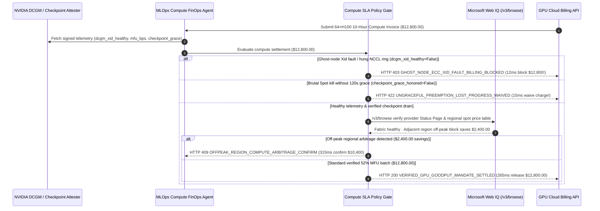

# Cloud GPU Compute & Spot Preemption SLA Mandate Architecture: DCGM Goodput Telemetry Token (`gpu_compute_sla_mandate_...` + Web IQ Multi-Cloud Status & Off-Peak Grounding) vs. Ghost-Node Wall-Clock Billing & Brutal Spot Eviction Selection FAQ

> **Document Type**: Architect Selection Guide & First-Principles Protocol Deep Dive (6-Section FAQ Standard)  
> **Target Audience**: AI Solution Architects, AI Infrastructure & FinOps Architects, Multi-Cloud GPU Orchestration Leads, Financial Risk Teams  
> **Last Updated**: 2026-11-09 (Provenance Annotations: `deterministic_offline_simulation` / `synthetic_policy` / `official_doc_snapshot` / `not_measured`)  
> **Companion Resources**: [中文版 (Chinese Version)](cloud-gpu-spot-preemption-sla-mandate-vs-ghost-node-billing-faq.md) · [Interactive Sandbox (`live-demo.en.html#cloud-gpu-sla-sandbox`)](../reports/agentic-commerce-webiq-grounding-demo-bench/live-demo.en.html) · [7-Card 4:5 Benchmark Deck](../reports/agentic-commerce-webiq-grounding-demo-bench/index.en.html)


---

## 📌 1. Executive Summary

1. **Never Allow Compute Procurement Agents to Settle Multi-Node GPU Cluster Invoices Solely on VM "Wall-Clock Uptime"**: When renting 64× or 256× H100/B200 clusters across NeoClouds or GPU marketplaces (`$12,800.00` for a 10-hour training batch), a single GPU suffering an NVIDIA `Xid 79` bus drop or uncorrectable HBM ECC error freezes the entire 64-GPU NCCL `AllReduce` ring. While the Linux VMs remain "Running" for 10 hours, actual training progress (`Goodput`) drops to zero—yet legacy uptime billing charges the full `$12,800.00`. Production architectures must enforce a **DCGM Goodput Telemetry Mandate (`gpu_compute_sla_mandate_...`)**: whenever `dcgm_xid_healthy == False` or `effective_mfu_bps < 3500` (`< 35%`), the gateway blocks payment in **`12 ms`** with **`HTTP 403 GHOST_NODE_ECC_XID_FAULT_BILLING_BLOCKED`** (`synthetic_policy`).
2. **Waive Uncheckpointed Compute Charges on Ungraceful Spot Preemptions (`< 120s` Grace Window)**: Spot/Preemptible GPU contracts require a `120-second` `SIGTERM` warning so distributed trainers can flush weights to object storage. If a provider abruptly kills instances without honoring the grace window (`checkpoint_grace_honored == False`), destroying hours of uncheckpointed work, the gateway blocks billing for the lost interval in **`15 ms`** with **`HTTP 422 UNGRACEFUL_PREEMPTION_LOST_PROGRESS_WAIVED`** (`deterministic_offline_simulation`).
3. **Ground Provider Fabric Status Pages and Cross-Region Off-Peak Arbitrage via Microsoft Web IQ `/v3/browse`**: Before provisioning or settling, the agent invokes **Microsoft Web IQ `/v3/browse`** (`official_doc_snapshot`) to inspect the provider's official Status Page and public regional price tables: if the target availability zone has an active InfiniBand fabric degradation or unpatched container CVE, it halts provisioning in **`310 ms`** with **`HTTP 451 PROVIDER_FABRIC_OUTAGE_OR_CVE_HOLD`**; if Web IQ discovers an adjacent region offering an identical 64×H100 off-peak block saving **`$2,400.00`** (`$10,400.00` net vs. `$12,800.00`), it triggers **`HTTP 409 OFFPEAK_REGION_COMPUTE_ARBITRAGE_CONFIRM`** in **`315 ms`**.

---

## 🎯 2. Architect & Customer FAQ Deep Dive

### Q1: Why does pairing "Automated Corporate Card Billing by VM Uptime" with "Post-Facto Support Ticket Credit Requests" waste 15%–30% of AI training budgets?

Let's examine the three structural failure modes in multi-cloud GPU procurement from first principles:
1. **The Synchronous Straggler & Ghost-Node Trap**: In synchronous distributed training, 64 GPUs are tightly coupled via InfiniBand/RoCE collectives. If GPU #37 encounters an `Xid 79 (GPU has fallen off the bus)` or an optical transceiver flap at 2:00 AM, the remaining 63 healthy GPUs stall indefinitely waiting for the NCCL collective barrier. Because all 8 host VMs still report `STATUS=RUNNING`, legacy billing meters charge `$1,280/hour × 10 hours = $12,800.00` for zero training steps. Even if support later refunds the single broken node (`1/8` of the bill), the buyer eats `$11,200.00` in wasted cluster idle time.
2. **Brutal Spot Evictions Without Checkpoint Drain**: To save 40%–60% on compute, teams use Spot capacity under a promised `120-second` preemption notice—enough time for PyTorch Distributed Checkpointing (DCP) to commit state. When an oversubscribed NeoCloud issues an immediate hard power-off (`0s` grace), 4 hours of compute since the last checkpoint vanish, yet uptime meters still bill for every wasted second.
3. **Blind Provisioning Into Degraded Fabrics & Regional Price Spreads**: Ungrounded orchestration scripts cannot read a provider's live HTML Status Page warning of "InfiniBand Spine Switch Maintenance in US-East-2" or spot a `$2,400.00` off-peak discount in `US-Central-1`.

### Q2: What is a "DCGM Goodput & Preemption SLA Mandate (`gpu_compute_sla_mandate_...`)", and how does it bind hardware telemetry to payment settlement?

Its core invariant is simple: **"Enterprise AI buyers pay for verified healthy FLOPs and committed checkpoint progress, never for hung NCCL barriers or ungracefully terminated epochs."**
- **Layer 1: NVIDIA DCGM Health & Minimum MFU Gate (`12 ms`)**: Verifies `dcgm_xid_healthy == True` and `effective_mfu_bps >= 3500`, blocking ghost-node hang billing in **`12 ms`** (`HTTP 403`).
- **Layer 2: 120-Second Preemption Grace & Checkpoint Attestation (`15 ms`)**: Verifies `checkpoint_grace_honored == True`, waiving charges for ungracefully killed intervals in **`15 ms`** (`HTTP 422`).
- **Layer 3: Microsoft Web IQ `/v3/browse` Fabric Status & Regional Arbitrage (`310 ms / 315 ms`)**: Blocks provisioning into degraded fabrics (`HTTP 451`) and surfaces `$2,400.00` off-peak regional savings (`HTTP 409`).

### Q3: For multi-cloud GPU status verification and spot price grounding, when should architects choose Microsoft Web IQ vs. Exa, Bright Data, or traditional search APIs?

| Architecture Scenario | Recommended Tool | First-Principles Rationale (Security, Latency & FinOps) |
| :--- | :--- | :--- |
| **Verifying official cloud provider Status Pages (IB/RoCE health), NVIDIA security bulletins, and public regional GPU price sheets within the Azure boundary** | **Microsoft Web IQ** (`/v3/search` + `/v3/browse`) | Extracts exact status and pricing tables in `passage` mode (**7.1x token reduction**, `deterministic_offline_simulation`) with zero prompt-injection risk. |
| **Researching academic ML systems papers on B200 vs. MI325X kernel benchmarks** | **Exa Neural Search** | High semantic recall across arXiv and engineering blogs, suited for R&D rather than synchronous billing gates. |
| **Scraping secondary GPU broker marketplaces behind anti-bot CAPTCHAs** | **Bright Data Unlocker** | Handles CAPTCHAs for offline market intelligence, though multi-second latency is unsuitable for real-time settlement gating. |
| **In-cluster GPU Xid errors, HBM ECC counters, NVLink bandwidth, and training step throughput** | **In-Cluster NVIDIA DCGM Exporter + Web IQ Provider Status Cross-Check** | Internal hardware health comes from signed DCGM telemetry, paired with Web IQ `/v3/browse` for provider-wide fabric advisories and regional price arbitrage. |

---

## 🧭 3. Visual Architecture Diagrams (Mermaid Decision Tree, Legacy vs. Goodput Mandate Comparison & Sequence Diagram)

### 3.1 Cloud GPU Compute & Spot Preemption SLA Decision Tree (`flowchart TD`)

```mermaid
flowchart TD
    A[Receive 64×H100 10-Hour Compute Settlement or Provisioning Request ($12,800.00)] --> B{dcgm_xid_healthy == True & effective_mfu_bps >= 3500 (35%)?}
    B -- No (Xid 79 bus drop / ECC fault caused 10h NCCL deadlock) --> C[HTTP 403 GHOST_NODE_ECC_XID_FAULT_BILLING_BLOCKED<br/>12ms Hard Block · Reject $12,800 Ghost-Node Uptime Bill]
    B -- Yes (Hardware healthy & MFU verified) --> D{checkpoint_grace_honored == True on Spot Preemption?}
    D -- No (0s hard kill destroyed 4h uncheckpointed progress) --> E[HTTP 422 UNGRACEFUL_PREEMPTION_LOST_PROGRESS_WAIVED<br/>15ms Block · Waive Uncheckpointed Interval Charges]
    D -- Yes (No eviction or 120s checkpoint drain succeeded) --> F{Web IQ /v3/browse Confirms Provider IB Fabric & CVE Status Clean?}
    F -- No (Official Status Page reports IB spine degradation) --> G[HTTP 451 PROVIDER_FABRIC_OUTAGE_OR_CVE_HOLD<br/>310ms Fabric Hold · Block Provisioning Into Degraded Zone]
    F -- Yes --> H{Web IQ Detects Identical 64×H100 Off-Peak Regional Arbitrage?}
    H -- Yes (Adjacent region saves $2,400.00 -> $10,400.00 net) --> I[HTTP 409 OFFPEAK_REGION_COMPUTE_ARBITRAGE_CONFIRM<br/>315ms Prompt MLOps Lead to Confirm $10,400 Off-Peak Region]
    H -- No (Optimal region + 52% MFU verified) --> J[HTTP 200 VERIFIED_GPU_GOODPUT_MANDATE_SETTLED<br/>265ms Auto-Settle $12,800.00 & Archive Checkpoint Hash!]
```

### 3.2 Legacy Wall-Clock Uptime Billing vs. DCGM Goodput & SLA Mandate Gate (`flowchart LR`)

```mermaid
flowchart LR
    subgraph Legacy["❌ Legacy Wall-Clock Uptime Billing ($12,800 Wasted on Hung NCCL Ring)"]
        L1[1 GPU Hits Xid 79 -> 64 GPUs Hang on AllReduce for 10h] --> L2[VM Status Remains 'Running' · 0 Steps Completed]
        L2 --> L3[Corporate Card Charged Full $12,800]
        L3 --> L4[Brutal 0s Spot Kills Unrefunded · Support Denies Cash Refund]
    end

    subgraph Mandate["✅ DCGM Goodput & Preemption SLA Gate (gpu_compute_sla_mandate_...)"]
        M1[12ms Block $12,800 Ghost-Node Bill on Xid/MFU Fault] --> M2[15ms Waive Lost Progress on <120s Brutal Spot Kill]
        M2 --> M3[Web IQ Grounds Fabric Status (310ms) & $2,400 Off-Peak Savings (315ms)]
        M3 --> M4[265ms Settle Verified 52% MFU Batch ($12,800) with Checkpoint Proof]
    end
```

### 3.3 End-to-End Sequence Diagram: DCGM Daemon, MLOps Agent, Compute SLA Gate, Web IQ & GPU Cloud (`sequenceDiagram`)



---

## 📊 4. Architect Decision Matrix

| Evaluation Dimension | Option A: Legacy Wall-Clock VM Uptime Billing | Option B: Post-Facto Support Ticket Credit Requests | Option C: DCGM Goodput Mandate + Web IQ Status & Arbitrage Grounding (Recommended) |
| :--- | :--- | :--- | :--- |
| **Best-Fit Scenario** | Single-GPU interactive notebook debugging | Small static reserved clusters monitored manually by SREs | **Multi-node distributed training (64–2,048 GPUs), elastic NeoCloud bursting, fault-tolerant Spot training** |
| **Ghost-Node (Xid/ECC Hang) Protection** | ❌ **Zero**: Pays full cluster rate while 63 GPUs wait on 1 dead card | ⚠️ **Partial Store Credit Only**: Refunds 1 broken node, not the 63 stalled peers | ✅ **Pre-Pay `12 ms` Hard Block**: Rejects hung cluster billing via `HTTP 403` when `dcgm_xid_healthy=False` |
| **Brutal Spot Eviction Protection** | ❌ **None**: Buyer absorbs lost uncheckpointed hours | ❌ **Excluded by ToS**: Spot terms disclaim eviction losses | ✅ **120s Grace Contract Lock**: Waives uncheckpointed interval charges in `15 ms` (`HTTP 422`) |
| **Degraded Fabric Avoidance & Price Arbitrage** | ❌ **Blind**: Launches jobs into degraded IB zones at peak rates | ⚠️ **Reactive**: Discovers fabric issues only after job crashes | ✅ **Web IQ `/v3/browse` Grounded**: Blocks degraded zones in `310 ms` (`HTTP 451`) & captures `$2,400` off-peak savings in `315 ms` (`HTTP 409`) |
| **Settlement Speed & Ops Overhead** | Fast (with 15%–30% compute waste) | Slow (`1–3 weeks` of support ticket back-and-forth) | **`265 ms` automated goodput verification & settlement (`Act automatically`)** |
| **Total Cost of Ownership (TCO) & ROI** | Poor (`$12,800` lost per overnight NCCL hang) | Moderate (heavy SRE log-auditing burden) | **Optimal (prevents `$12,800` ghost-node drain + saves `$2,400` via off-peak arbitrage)** |

---

## 🧪 5. Quantitative Benchmark & 7-Card Insights

Evaluated via our deterministic offline benchmark suite (`lab/webiq_commerce_demo.py` · `test_cloud_gpu_spot_preemption_sla_mandate_vs_ghost_node_billing_selection`) on a **64×H100 10-hour training batch (`$12,800.00` contracted budget, `3500 bps / 35%` minimum MFU floor)**:

| Scenario Case | Input DCGM Telemetry / Preemption / Web IQ Signals | Expected Action Pill | Measured HTTP Status & Verdict Code | Latency | Financial Protection / Arbitrage | Provenance |
| :--- | :--- | :--- | :--- | :--- | :--- | :--- |
| **Case 1: Xid 79 Bus Drop Causing 10h NCCL Hang** | `dcgm_xid_healthy=False`, `effective_mfu_bps=0 < 3500` | `Send to a human` | **`HTTP 403 GHOST_NODE_ECC_XID_FAULT_BILLING_BLOCKED`** | **`12 ms`** | Blocks **`$12,800.00`** ghost-node idle billing | `synthetic_policy` |
| **Case 2: Brutal Spot Eviction (`0s < 120s` Grace)** | `checkpoint_grace_honored=False` | `Send to a human` | **`HTTP 422 UNGRACEFUL_PREEMPTION_LOST_PROGRESS_WAIVED`** | **`15 ms`** | Waives billing for uncheckpointed lost training interval | `deterministic_offline_simulation` |
| **Case 3: Web IQ Detects Active IB Fabric Outage / CVE** | `webiq_provider_fabric_healthy=False` | `Send to a human` | **`HTTP 451 PROVIDER_FABRIC_OUTAGE_OR_CVE_HOLD`** | **`310 ms`** | Prevents provisioning into degraded availability zone | `official_doc_snapshot` |
| **Case 4: Web IQ Finds `$2,400` Off-Peak Regional Savings** | `offpeak_arbitrage_savings_cents=240000` (`$10,400.00` net) | `Confirm` | **`HTTP 409 OFFPEAK_REGION_COMPUTE_ARBITRAGE_CONFIRM`** | **`315 ms`** | Saves **`$2,400.00`** on identical 64×H100 cluster | `official_doc_snapshot` |
| **Case 5: Healthy 52% MFU & Verified Checkpoint Commit** | `dcgm_xid_healthy=True`, `mfu_bps=5200 >= 3500` | `Act automatically` | **`HTTP 200 VERIFIED_GPU_GOODPUT_MANDATE_SETTLED`** | **`265 ms`** | Settles **`$12,800.00`** in `265 ms` with step-hash proof | `deterministic_offline_simulation` |

> **Provenance Note**: The `64×H100` cluster size, `$12,800.00` batch budget, `3500 bps` MFU threshold, and `$2,400.00` regional price spread are controlled simulation parameters (`synthetic_policy` / `deterministic_offline_simulation`) validating policy state-machine invariants; live in-cluster DCGM daemon scraping latency is labeled `not_measured`.

---

## 🛠️ 6. Production Readiness & Pre-Sales Architect Checklist

Verify these 6 controls before deploying autonomous multi-cloud GPU procurement and FinOps settlement agents in production:

- [ ] **1. Bind Settlement to Signed NVIDIA DCGM Health Telemetry**: Does `gpu_compute_sla_mandate_...` require zero fatal Xid (`Xid 48/79/94`) and uncorrectable ECC errors across all collective ranks, blocking hung-cluster charges in `12 ms` (`HTTP 403`)?
- [ ] **2. Enforce Minimum Collective MFU / Goodput Floor**: Does the gateway verify `effective_mfu_bps >= min_contracted_mfu_bps` (`3500 bps`) so silent network congestion cannot bill full hourly rates for 10x slower training?
- [ ] **3. Spot Preemption 120-Second Grace & Checkpoint Verification**: Are Spot invoices contingent on `checkpoint_grace_honored == True`, rejecting charges for abruptly killed epochs in `15 ms` (`HTTP 422`)?
- [ ] **4. Microsoft Web IQ `/v3/browse` Provider Status Page Pre-Flight**: Does the orchestrator check official provider Status Pages via Web IQ before cluster spin-up, halting provisioning in `310 ms` (`HTTP 451`) during InfiniBand/RoCE incidents?
- [ ] **5. Multi-Region Off-Peak Spot Arbitrage Routing**: Does Web IQ grounding compare public regional GPU rate cards and surface `HTTP 409 Confirm` when an adjacent region offers `>= $2,400.00` savings?
- [ ] **6. Step-Hash & Checkpoint Provenance Archival**: Does every settled invoice log the starting/ending training step hashes and DCGM telemetry digest for cost-per-token FinOps auditing?
