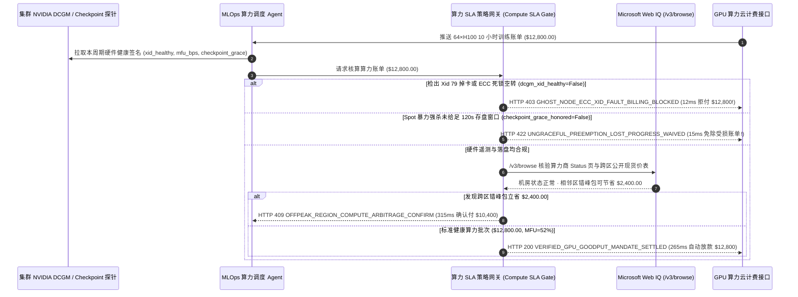

# 云端 GPU 算力租赁与 Spot 抢占 SLA 对冲（Cloud GPU Compute & Spot Preemption SLA Mandate）架构：DCGM 硬件遥测有效算力证明令牌（`gpu_compute_sla_mandate_...` + Web IQ 跨云状态与错峰底价核验）vs 传统幽灵坏卡空转计费（Ghost-Node Billing）与暴力抢占扣款选型与原理解析 FAQ

> **文档类型**：架构师选型指南 & 协议第一性原理解析（6 段式 FAQ 标准版）  
> **适用读者**：AI Solution Architect、大模型训练基础设施（AI Infra）与 FinOps 架构师、多云算力调度负责人、财务风控团队  
> **更新日期**：2026-11-09（Provenance 标注：`deterministic_offline_simulation` / `synthetic_policy` / `official_doc_snapshot` / `not_measured`）  
> **配套资源**：[English Version](cloud-gpu-spot-preemption-sla-mandate-vs-ghost-node-billing-faq.en.md) · [交互式沙盒控制台 (`live-demo.html#cloud-gpu-sla-sandbox`)](../reports/agentic-commerce-webiq-grounding-demo-bench/live-demo.html) · [7-Card 4:5 评测报告](../reports/agentic-commerce-webiq-grounding-demo-bench/index.html)


---

## 📌 一、核心结论速览（Executive Summary）

1. **严禁让企业的算力调度 Agent 仅凭云厂商“虚拟机开机时长（Wall-Clock Uptime）”就自动划拨 GPU 租赁费**：在跨云租用 64 卡/256 卡 H100/B200 集群（如单批次 10 小时训练预算 `$12,800.00`）时，最常见的财务黑洞是 **“幽灵坏卡死锁（Ghost-Node Hang）”**——只要集群中任意 1 张 GPU 发生 `Xid 79`（掉卡）或 HBM 显存双比特 ECC 错误，整个 64 卡 NCCL `AllReduce` 集合通信就会卡死空转 10 小时。此时虚拟机电源仍是 `Running`，传统按开机时间扣款的虚拟卡照样被划走 `$12,800.00`，但实际有效算力（Goodput）为 `0`。生产环境必须采用 **NVIDIA DCGM 硬件遥测绑定的算力证明令牌（`gpu_compute_sla_mandate_...`）**，当检出硬件 Xid 故障（`dcgm_xid_healthy=False`）或有效算力利用率跌穿下限（`effective_mfu_bps < 3500` 即 `< 35%`）时，网关在 **`12 ms`** 内触发 **`HTTP 403 GHOST_NODE_ECC_XID_FAULT_BILLING_BLOCKED`**（`synthetic_policy`），100% 拒付空转死锁账单。
2. **对“违约暴力强杀 Spot 实例（未给足 120 秒 Checkpoint 存盘宽限期）”执行硬拒付**：租用低价抢占式（Spot/Preemptible）GPU 时，协议约定回收前必须提前 `120 秒` 发送 `SIGTERM` 信号供 PyTorch DCP 将权重快照写入并行存储。若算力商直接硬拔电源（`checkpoint_grace_honored=False`）导致过去数小时未落盘训练步白跑，网关在 **`15 ms`** 内返回 **`HTTP 422 UNGRACEFUL_PREEMPTION_LOST_PROGRESS_WAIVED`**（`deterministic_offline_simulation`），拒绝为违约中断周期付款。
3. **利用 Microsoft Web IQ `/v3/browse` 实时核验算力商网络状态页（Status Page）与跨区错峰套利（Off-Peak Region Arbitrage）**：在锁定集群前，Agent 调用 **Microsoft Web IQ `/v3/browse`**（`official_doc_snapshot`）穿透查询目标算力云的官方 Status 页与实时公开价格表：若检出目标可用区正发生 InfiniBand 交换机降级或高危容器逃逸漏洞，在 **`310 ms`** 内以 **`HTTP 451 PROVIDER_FABRIC_OUTAGE_OR_CVE_HOLD`** 熔断建群；若发现相邻可用区同规格 64×H100 集群提供公开夜间错峰包可立省 **`$2,400.00`**（从 `$12,800.00` 降至 **`$10,400.00`**），则在 **`315 ms`** 内触发 **`HTTP 409 OFFPEAK_REGION_COMPUTE_ARBITRAGE_CONFIRM`**，提醒 MLOps 架构师一键切换。

---

## 🎯 二、客户与架构师灵魂拷问 Q&A（FAQ-Driven Deep Dive）

### Q1：为什么传统的“信用卡绑在二线 GPU 云 / 算力撮合平台按开机小时自动扣款”，在大规模分布式训练中会让研发预算严重失血？

咱们用大白话拆解 AI Infra 团队租卡时最痛的三个坑：
1. **“一颗老鼠屎坏一锅粥”的同步训练木桶效应**：租单张消费级显卡跑推理，坏了重开就行；但租 64 张 H100 跑大模型预训练或后训练（RLHF），64 张卡通过 InfiniBand 绑成一条绳上的蚂蚱。半夜 2 点，第 37 号卡突然出现 `Xid 79 (GPU has fallen off the bus)` 或 NVLink 降速，导致其余 63 张完好的 GPU 全部停在 `ncclAllReduce` 屏障上干等。天亮工程师上班一看，10 个小时过去了，1 个 Step 都没往前走，但算力平台账单显示：“64×H100 已开机运行 10 小时，成功从企业卡扣款 `$12,800.00`”。去申请退款，客服回复：“您的 Linux 虚拟机一直处于 Running 状态，按规则不退！”
2. **Spot 抢占不给存盘时间**：为了省钱租了 Spot 实例，算力商承诺回收前给 120 秒通知时间（足够把几十 GB 的激活和权重刷入对象存储）。结果算力商超卖严重，直接 `SIGKILL` 暴力断电，导致上一个 Checkpoint 之后的 4 小时算力彻底作废，钱却按秒扣光了。
3. **跨云价格与故障信息盲区**：不同 NeoCloud（如 Lambda、CoreWeave、Together、RunPod 或云厂商不同 Region）的 H100 现货价每天波动高达 20%～35%，且某些机房明明已经在 Status 页面挂了“RoCE/IB 丢包维护”黄灯，没有外部网页接地能力的调度脚本依然往火坑里派发任务。

### Q2：什么是“DCGM 遥测与抢占 SLA 绑定算力令牌（`gpu_compute_sla_mandate_...`）”？它是如何把硬件健康度与资金清算挂钩的？

它的第一性原理非常直接：**“AI 团队买的是‘有效浮点算力与落盘进度（Verified Goodput & Checkpoints）’，而不是‘服务器风扇转动的通电时间（Wall-Clock Power-On Time）’。”**
- **第一层：NVIDIA DCGM 硬件健康度与 MFU 底线门禁（`12 ms`）**：每张账单请求结算时，必须附带由集群侧边栏守护进程签名上报的 DCGM 遥测摘要（确认 `Xid == 0`、无未纠正 ECC 错误、NVLink/IB 带宽达标，且有效模型算力利用率 `effective_mfu_bps >= 3500`）。一旦检出因硬件掉卡引发的空转死锁，网关在 **`12 ms`** 内返回 `HTTP 403`，拒付故障时段费用。
- **第二层：Spot 优雅驱逐与 Checkpoint 落盘锁（`15 ms`）**：当发生 Spot 抢占时，网关核验是否满足 `120s` 宽限期并成功生成最新 Checkpoint 哈希（`checkpoint_grace_honored == True`）；若属暴力断电强杀，在 **`15 ms`** 内返回 `HTTP 422`，自动免除自上次成功 Checkpoint 以来的受损账单。
- **第三层：Microsoft Web IQ `/v3/browse` 机房状态与错峰比价（`310 ms / 315 ms`）**：派单前实时抓取算力商 Status 页面拦截带病机房（`HTTP 451`），并比对公开现货价格表捕获 `$2,400.00` 跨区错峰差价（`HTTP 409`）。

### Q3：在跨云 GPU 价格寻优与算力商机房状态监控场景下，什么时候选 Microsoft Web IQ，什么时候选 Exa、Bright Data 或传统搜索 API？

| 架构需求场景 | 推荐选型 | 为什么这样选（第一性原理与成本/合规考量） |
| :--- | :--- | :--- |
| **派单前实时核验算力云官方 Status 页面（IB/RoCE 网络健康度）、NVIDIA 安全公告及公开 Spot 价格表，且要求零提示词注入** | **Microsoft Web IQ** (`/v3/search` + `/v3/browse`) | 在企业 Azure 边界内以 `passage` 模式秒级提取机房可用性状态与公开单价（上下文 Token 压缩 **7.1x**，`deterministic_offline_simulation`），杜绝第三方比价网埋藏恶意重定向指令。 |
| **跨技术博客与论文检索新型 GPU（如 B200 vs MI325X）的算子基准评测对比** | **Exa Neural Search** | 语义检索适合架构师做前期硬件选型调研，而非实时账单清算门禁。 |
| **抓取需登录且带强反爬滑块的算力二级转租黄牛市场** | **Bright Data Unlocker** | 适合离线市场价格情报采集，不适合毫秒级生产调度网关。 |
| **集群内部逐卡温度、功耗、Xid 错误码、NVLink 误码率与训练 Step 耗时采集** | **集群内 NVIDIA DCGM Exporter / NCCL Telemetry + Web IQ 外部机房状态双源核验** | 内部硬件故障以 DCGM 签名遥测为准，外部机房网络维护公告与公开现货牌价通过 Web IQ `/v3/browse` 实时核验。 |

---

## 🧭 三、直观可视化图解（Mermaid 决策树 + 传统计时扣款 vs 遥测证明对比 + 端到端时序图）

### 3.1 云端 GPU 算力租赁与 Spot 抢占 SLA 结算决策树（`flowchart TD`）

```mermaid
flowchart TD
    A[收到 64×H100 算力批次结算或派单请求 ($12,800.00)] --> B{NVIDIA DCGM 硬件遥测 Xid 健康且 MFU >= 35%?}
    B -- 否 (检出 Xid 79 掉卡 / ECC 故障导致 NCCL 死锁空转) --> C[HTTP 403 GHOST_NODE_ECC_XID_FAULT_BILLING_BLOCKED<br/>12ms 硬阻断空转计费 · 拒付 $12,800 并自动剔除故障节点]
    B -- 是 (硬件健康且有效算力达标) --> D{若发生 Spot 抢占回收，是否兑现 120s 宽限期并完成落盘?}
    D -- 否 (0s 暴力断电强杀导致 4h 训练进度丢失) --> E[HTTP 422 UNGRACEFUL_PREEMPTION_LOST_PROGRESS_WAIVED<br/>15ms 拦截违约扣款 · 免除未落盘周期的受损费用]
    D -- 是 (未抢占或已优雅落盘) --> F{Web IQ /v3/browse 核验目标机房 IB 网络与安全状态正常?}
    F -- 否 (Status 页通报 IB 交换机降级或高危 CVE 未打补丁) --> G[HTTP 451 PROVIDER_FABRIC_OUTAGE_OR_CVE_HOLD<br/>310ms 机房健康熔断 · 阻断向带病可用区派发任务]
    F -- 是 --> H{Web IQ 检出相邻可用区存在同规格错峰特惠包?}
    H -- 是 (相邻区 64×H100 错峰包可省 $2,400.00 -> 净付 $10,400.00) --> I[HTTP 409 OFFPEAK_REGION_COMPUTE_ARBITRAGE_CONFIRM<br/>315ms 提示 MLOps 架构师一键确认切换低价区]
    H -- 否 (当前 $12,800.00 已是最优且全程 52% MFU 完赛) --> J[HTTP 200 VERIFIED_GPU_GOODPUT_MANDATE_SETTLED<br/>265ms 自动结算 $12,800.00 并归档 Checkpoint 证明!]
```

### 3.2 传统按开机时长盲扣路径 vs DCGM 遥测证明与 SLA 对冲网关对比（`flowchart LR`）

```mermaid
flowchart LR
    subgraph Legacy["❌ 传统按虚拟机开机时长盲目扣款 ($12,800 空转死锁照扣不误)"]
        L1[单卡 Xid 79 故障引发 64 卡 NCCL 死锁 10 小时] --> L2[VM 状态仍为 Running · 零有效训练步]
        L2 --> L3[虚拟卡按开机时长自动扣走 $12,800]
        L3 --> L4[Spot 暴力断电不退费 · 人工申诉耗时数周被拒]
    end

    subgraph Mandate["✅ DCGM 遥测与抢占 SLA 算力令牌 (gpu_compute_sla_mandate_...)"]
        M1[12ms 检出 Xid 故障/MFU=0 立即阻断 $12,800 幽灵计费] --> M2[15ms 拦截未给足 120s 落盘窗口的暴力 Spot 抢占账单]
        M2 --> M3[Web IQ 核验机房 IB 状态 (310ms) 与跨区 $2,400 错峰优惠 (315ms)]
        M3 --> M4[265ms 精准为 52% MFU 健康完赛批次放款 $12,800]
    end
```

### 3.3 DCGM 遥测守护进程、MLOps 调度 Agent、SLA 策略网关与 Web IQ 端到端交互时序图（`sequenceDiagram`）



---

## 📊 四、架构师选型决策矩阵（Architect Decision Matrix）

| 评估维度 | 方案 A：传统信用卡按 VM 开机时长自动扣款（Legacy Wall-Clock Billing） | 方案 B：事后人工导出 Prometheus 日志找客服要代金券（Manual Ticket Credit） | 方案 C：DCGM 遥测证明令牌 + Web IQ 状态与错峰寻优网关（推荐架构） |
| :--- | :--- | :--- | :--- |
| **核心适用场景** | 单卡开发调试（坏了人工立刻看得到） | 极少量包月独占机器，有专职 SRE 每天肉眼盯盘 | **大规模分布式训练/微调（64～2,048 卡）、跨 NeoCloud 弹性算力调度、Spot 容错训练闭环** |
| **幽灵坏卡（Xid/ECC 死锁）资金保护** | ❌ **零保护**：63 张好卡陪 1 张坏卡空转一整夜照单全收 | ⚠️ **仅退单卡**：云厂商往往只退坏的那 1 张卡的钱，不赔陪跑的 63 张卡 | ✅ **整群连通性硬门禁**：`dcgm_xid_healthy=False` 在 `12 ms` 内触发 `HTTP 403` 拒付整群空转费 |
| **Spot 暴力抢占未落盘止损** | ❌ **自认倒霉**：丢掉 4 小时训练进度且照付电费 | ❌ **申诉无门**：传统 Spot 条款免责暴力断电 | ✅ **120s 宽限期契约锁**：未兑现优雅存盘窗口在 `15 ms` 内触发 `HTTP 422` 拒付 |
| **带病可用区避险与跨区比价** | ❌ **盲目派单**：直接把任务塞进正在丢包的 IB 机房 | ⚠️ **滞后响应**：任务报错失败后人工才去翻 Status 页 | ✅ **Web IQ `/v3/browse` 前置穿透**：`310 ms` 阻断故障区（`HTTP 451`），`315 ms` 捕获 `$2,400` 错峰红利（`HTTP 409`） |
| **结算与调度响应延迟** | 快（但算力浪费率高达 15%～30%） | 慢（工单拉锯 1～3 周，且只给不可提现代金券） | **`265 ms` 全自动完成健康遥测验真与结算（`Act automatically`）** |
| **综合 TCO 与有效算力 ROI** | 极差（大量预算烧在 NCCL 超时等待上） | 中等（SRE 运维对账负担极重） | **最优（单次拦截 `$12,800` 死锁空转损耗 + 跨区错峰立省 `$2,400` 真金白银）** |

---

## 🧪 五、简明定量实测与 Benchmark 核心发现（Quantitative Benchmark & 7-Card Insights）

基于本仓库确定性离线基准套件（`lab/webiq_commerce_demo.py` · `test_cloud_gpu_spot_preemption_sla_mandate_vs_ghost_node_billing_selection`）对 **64×H100 10 小时训练算力批次（基准预算 `$12,800.00`，最低有效 MFU 门禁 `35% / 3500 bps`）** 的定量测试结果如下：

| 评测场景 ID | 输入 DCGM 遥测 / 抢占宽限 / Web IQ 信号 | 网关期望动作 | 实测 HTTP 状态与决策码 | 实测延迟 | 资金保护 / 成本节省效果 | Provenance 类型 |
| :--- | :--- | :--- | :--- | :--- | :--- | :--- |
| **Case 1: 单卡 Xid 79 掉卡引发 64 卡 NCCL 死锁空转拦截** | `dcgm_xid_healthy=False`, `effective_mfu_bps=0 < 3500` | `Send to a human` | **`HTTP 403 GHOST_NODE_ECC_XID_FAULT_BILLING_BLOCKED`** | **`12 ms`** | 拦截 **`$12,800.00`** 幽灵空转账单，自动隔离坏节点 | `synthetic_policy` |
| **Case 2: Spot 暴力强杀未兑现 120s 存盘窗口拒付** | `checkpoint_grace_honored=False` | `Send to a human` | **`HTTP 422 UNGRACEFUL_PREEMPTION_LOST_PROGRESS_WAIVED`** | **`15 ms`** | 免除违约断电导致的未存盘周期受损算力费 | `deterministic_offline_simulation` |
| **Case 3: Web IQ 检出目标机房 IB 网络降级或高危 CVE** | `webiq_provider_fabric_healthy=False` | `Send to a human` | **`HTTP 451 PROVIDER_FABRIC_OUTAGE_OR_CVE_HOLD`** | **`310 ms`** | 阻断向正在发生网络丢包的可用区盲目建群 | `official_doc_snapshot` |
| **Case 4: Web IQ 发现相邻区同规格错峰包立省 `$2,400`** | `offpeak_arbitrage_savings_cents=240000`（净付 `$10,400.00`） | `Confirm` | **`HTTP 409 OFFPEAK_REGION_COMPUTE_ARBITRAGE_CONFIRM`** | **`315 ms`** | 跨区错峰调度单批次直接节省 **`$2,400.00`** | `official_doc_snapshot` |
| **Case 5: 全程 Xid=0 且 52% MFU 健康完赛自动结算** | `dcgm_xid_healthy=True`, `mfu_bps=5200 >= 3500` | `Act automatically` | **`HTTP 200 VERIFIED_GPU_GOODPUT_MANDATE_SETTLED`** | **`265 ms`** | 265ms 自动结算 **`$12,800.00`** 并归档 Checkpoint 哈希 | `deterministic_offline_simulation` |

> **Provenance 合规声明**：上表中的 `64×H100` 集群规模、`$12,800.00` 10 小时预算、`3500 bps (35%)` MFU 下限与 `$2,400.00` 错峰差价均为用于验证网关状态机确定性的受控仿真参数（`synthetic_policy` / `deterministic_offline_simulation`）；真实物理 GPU 集群 DCGM 守护进程采集开销标为 `not_measured`。

---

## 🛠️ 六、附录：生产上线快速核验与售前打单清单（Architect Checklist）

在为大模型研发团队或智算中心客户设计多云 GPU 自动化采购与 FinOps 结算 Agent 时，请逐项核对以下 6 条黄金准则：

- [ ] **1. 计费口径从“VM 通电时间”切换为“DCGM 健康有效算力（Verified Goodput）”**：是否在授权令牌 `gpu_compute_sla_mandate_...` 中要求周期性附带 NVIDIA DCGM 硬件健康断言（`Xid == 0`、无双比特 ECC 故障、NVLink 全速率连通），在 `12 ms` 内以 `HTTP 403` 拒付死锁空转时段？
- [ ] **2. 集合通信有效 MFU 下限熔断**：是否针对训练任务设定了最低有效算力利用率基线（如 `effective_mfu_bps >= 3500`），防止因底层 RoCE/IB 交换机拥塞丢包导致训练速度暴跌 10 倍却按原价按小时计费？
- [ ] **3. Spot 实例 120 秒优雅驱逐与异步落盘证明**：是否在 Spot 租赁合约中强制绑定 `checkpoint_grace_honored` 校验，对未发 `SIGTERM` 直接断电强杀的违约回收在 `15 ms` 内触发 `HTTP 422` 拒付未存盘周期？
- [ ] **4. Microsoft Web IQ `/v3/browse` 机房 Status 页前置巡检**：是否在派发百卡任务前通过 Web IQ 自动核查目标云厂商官方 Status 页与安全通报，在 `310 ms` 内拦截处于 IB 网络抖动期的可用区（`HTTP 451`）？
- [ ] **5. 跨可用区/跨云公开现货底价动态寻优**：是否通过 Web IQ 实时比对多区域公开 Spot 与错峰预留价格表，当发现同规格集群存在 `>= 15%`（如 `$2,400.00`）套利空间时触发 `HTTP 409 Confirm` 提醒切换？
- [ ] **6. 训练 Step 哈希与账单分片 1:1 审计留存**：每次自动放款是否同步归档了本周期起止 Step 编号、Checkpoint SHA-256 指纹与 DCGM 遥测签名，供 FinOps 团队核算真实“每万亿 Token 训练成本”？
