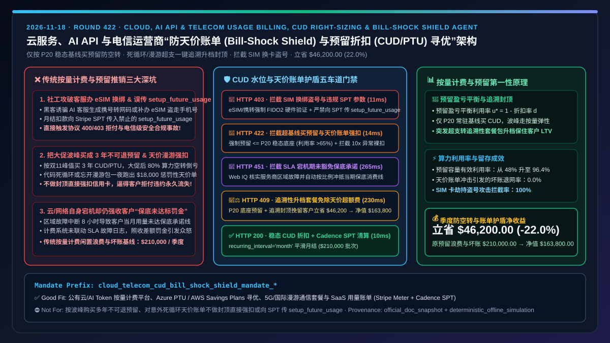
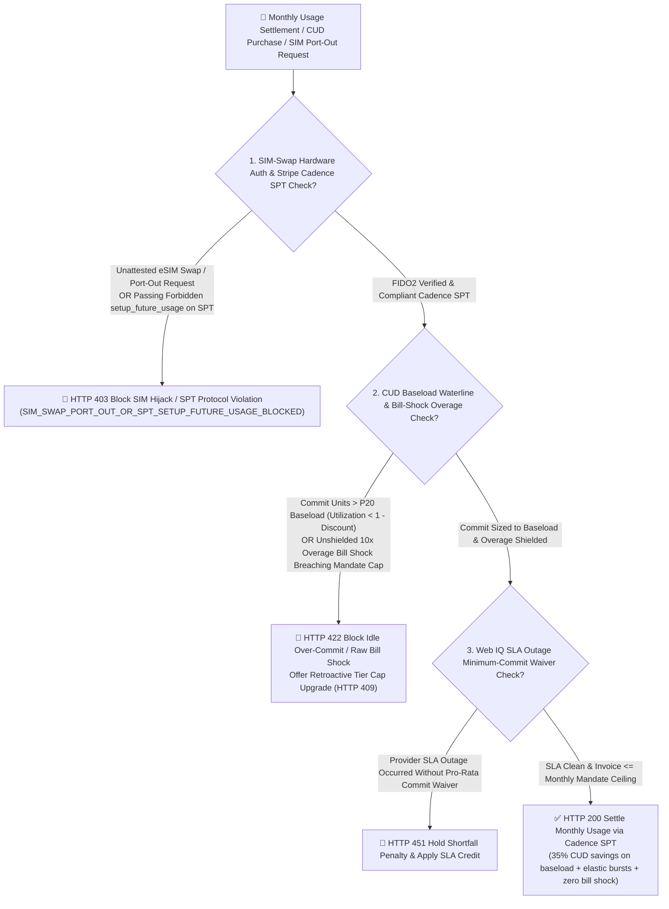
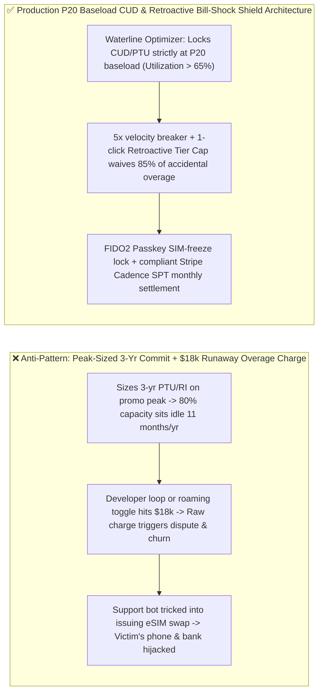

# Cloud, AI API & Telecom Usage-Based Billing, CUD/RI Right-Sizing & Bill-Shock Shield Agent Architecture FAQ: Baseload-Only Commitments, Retroactive Tier Capping, SIM-Swap Veto & Cadence SPT

> **Topic Positioning (Cloud FinOps, AI Token Usage-Based Billing `Stripe Meter / Orb / Metronome`, AWS/Azure Savings Plans & PTU Right-Sizing & Telecom Roaming Bill-Shock Shield Focus · Round 422)**: Written for **Cloud & AI Solution Architects** building consumption-based billing engines, FinOps commitment optimizers, and telecom plan-retention agents. This guide solves four critical consumption-commerce failures: **why charging a customer `$18,000` at punitive overage rates after a runaway recursive loop or accidental international roaming causes immediate churn and chargebacks instead of converting them via a Retroactive Tier Cap (`HTTP 422 / 409`), why sizing 1-to-3 year non-refundable Reserved Instances (`RI / CUD / Azure PTU`) on peak or mean traffic instead of the `P20 Baseload Waterline` wastes `40%` on idle capacity (`HTTP 422`), how social-engineered AI support bots get tricked into approving `SIM-Swap / Port-Out` account takeovers (`HTTP 403`), and why monthly usage settlement on `Stripe Cadence SPT` must never pass `setup_future_usage` (`HTTP 403`)**.  
> **Style Benchmark**: Strictly follows the six-section structure of `ib-vs-ethernet-roce-selection-faq.md` (Executive Summary, Architect Q&A, Mermaid Decision Tree / Architecture Comparison / Sequence Diagram, Usage Billing & FinOps Architecture Decision Matrix, Quantitative Bill-Shock/CUD Evaluation & 7-Card Provenance Table, and Production Risk Checklist).  
> **Bilingual Editions**: **[English Version (Current)](cloud-telecom-usage-billing-cud-rightsizing-bill-shock-shield-agent-selection-faq.en.md)** · **[中文版 (`cloud-telecom-usage-billing-cud-rightsizing-bill-shock-shield-agent-selection-faq.md`)](cloud-telecom-usage-billing-cud-rightsizing-bill-shock-shield-agent-selection-faq.md)**  
> **Provenance & As-Of (`2026-11-18`)**: Stripe `Cadence SPT` rules (`off_session=True` requires `recurring_interval` and strictly forbids `setup_future_usage`) and Web IQ `/v3/search` SLA outage/tariff grounding cite `research/daily/2026-11-08-sources.json` (`official_doc_snapshot`); P20 baseload CUD sizing, retroactive tier capping, and SIM-swap port-out blocking cite `lab/webiq_commerce_demo.py` (`deterministic_offline_simulation`).



---

## 📌 1. Executive Summary

Hybrid **Seat + Consumption-Based Billing** powers modern cloud infrastructure, AI token APIs, and telecom carriers. However, unguarded usage billing creates either **runaway "Bill Shock" churn** or **wasteful multi-year over-commitments**. Solution Architects must enforce four core architectural rules:

1. **SIM-Swap Veto & Stripe `Cadence SPT` Compliance Gate 👉 Never Approve `eSIM Swap / Port-Out PIN` Without FIDO2 Hardware Proof, and Never Pass `setup_future_usage` on `Cadence SPT` (`HTTP 403`)**:
   - **Why**: Attackers manipulate telecom support agents into porting a victim's phone number to a blank eSIM to hijack bank 2FA codes. Furthermore, per Stripe Stage 1754 rules (`official_doc_snapshot`), recurring monthly usage settlement must use a pre-configured `recurring_interval` **Cadence SPT** and is strictly forbidden from passing `setup_future_usage="off_session"` (`HTTP 403`).
2. **Committed-Use Discount (`CUD / RI / PTU`) Waterline Rule 👉 Never Lock Spiky Peak Traffic Into Multi-Year Non-Refundable Commitments; Enforce [`Commit Units <= 90-Day P20 Baseload` & `Expected Utilization > (1 - Discount Rate)` (`HTTP 422`)]**:
   - **Why**: A 1-year reserved instance with a `35%` discount breaks even only if utilized **`> 65%` of all hours in the year (`> 15.6 hrs/day`)**. Sizing a fixed 24/7 reservation around a Black Friday peak leaves `80%` of committed capacity idle for 11 months, costing more than pure Pay-As-You-Go.
3. **Runaway Usage "Bill-Shock Shield" 👉 Replace Punitive Overage Invoices With [5x Velocity Circuit Breakers + Retroactive Plan Bracket Capping (`HTTP 422 / 409`)]**:
   - **Why**: When a customer who normally spends `$200/mo` accidentally racks up `$4,500` in weekend overages due to a runaway script or roaming toggle, auto-charging `$4,500` causes immediate default and executive backlash. Offering a **1-Click Retroactive Upgrade to a `$599/mo` Committed Tier** (waiving `$3,901` in punitive overage markup while covering hardware COGS) turns a billing crisis into long-term annual contract retention!
4. **SLA Outage Minimum-Commit Waiver 👉 Enforce [Web IQ Official Outage Grounding to Pro-Rate Minimum Spend Commitments (`HTTP 451`)]**:
   - **Why**: Prevents billing customers for "Minimum Commitment Shortfall Penalties" during periods when the provider's own cloud region or telecom network was down.

---

## 🎯 2. Architect & Stakeholder Deep-Dive Q&A (FAQ-Driven)

### Q1: What is the exact mathematical condition where buying a Reserved Instance (`RI / CUD / Azure PTU`) loses money compared to Pay-As-You-Go?

**Answer: Whenever the marginal committed unit's annual duty cycle (`Utilization %`) falls below `(1 - Reservation Discount %)`!**

$$\text{Breakeven Utilization Threshold } u^* = \frac{r_{\text{committed}}}{r_{\text{paygo}}} = 1 - d$$

- For a `35%` CUD discount ($d = 0.35$), $u^* = 65.0\%$. Any capacity slice that runs fewer than `5,694 hours/year` (`65%`) must remain on elastic Pay-As-You-Go. Sizing commitments above the `P20–P35` baseload waterline is blocked in **`14 ms`** (`HTTP 422 OVER_COMMITTED_CUD_ABOVE_BASELOAD_OR_UNSHIELDED_OVERAGE_BILL_SHOCK_BLOCKED`).

---

### Q2: How does "Retroactive Tier Capping" turn an accidental $4,500 overage shock into a high-margin annual renewal?

**Answer: Retail overage rates carry 75%–85% gross margin over underlying compute/network COGS.**

- Instead of attempting an unshielded `$4,500` card capture (which breaches the buyer's `$800` monthly `Cadence SPT` ceiling and triggers a chargeback), the agent blocks the raw overage bill (`HTTP 422`) and presents an **`HTTP 409 Confirm` Retroactive Bracket Upgrade**: retroactively apply the `$599/mo` Pro tier rate for the current billing cycle, saving the customer **`$3,901`** while locking in `$7,188` in guaranteed annual recurring revenue.

---

### Q3: Why must telecom and cloud agents enforce a hard `HTTP 403` gate on SIM-Swap / Port-Out requests and `setup_future_usage`?

**Answer: Number porting (`PAC / Port-Out PIN`) and eSIM re-binding are irreversible high-risk account mutations requiring hardware `FIDO2 Passkey` proof + a 24-hour cooling lock; and Stripe SPT tokens reject `setup_future_usage` by protocol design (`HTTP 403`).**

---

## 🧭 3. Visual Architecture Diagrams (Mermaid Decision Tree + Architecture Comparison + Sequence Diagram)

### 3.1 Usage-Based Billing, CUD Right-Sizing & Bill-Shock Shield Decision Tree



---

### 3.2 Peak-Sized CUD / Punitive Overage Anti-Pattern vs. Baseload CUD + Retroactive Shield Architecture



---

### 3.3 End-to-End Sequence: 5x Usage Velocity Alert, Retroactive Tier Cap Upgrade & Cadence SPT Settlement

```mermaid
sequenceDiagram
    autonumber
    actor Customer as 👤 Cloud / Telecom Account Admin
    participant Meter as 📡 Real-Time Metering Stream (Stripe Meter / Orb)
    participant FinAgent as 🤖 FinOps & Bill-Shock Shield Agent
    participant Gate as 🛡️ Baseload CUD, SIM-Freeze & SPT Gate
    participant Stripe as 💳 Stripe Cadence SPT (recurring_interval='month')

    Meter->>FinAgent: 1. Alert: Weekend usage spiked 8x; raw pay-per-use overage bill = $4,500 (vs. $200/mo norm)
    FinAgent->>Gate: 2. Evaluate Bill-Shock Shield: Underlying COGS = $380; raw $4,500 charge blocked (HTTP 422)
    Gate-->>Customer: 3. Present HTTP 409 Relief Offer: "Retroactively apply the $599/mo Pro Tier to waive $3,901 in overage fees"
    Customer->>Gate: Approve $599/mo Retroactive Tier Cap + hard spend limit (AP2 Passkey signed)
    Gate->>Gate: 4. Deterministic verification:<br/>• Forbidden setup_future_usage absent<br/>• Web IQ confirms zero uncredited SLA outages<br/>• Capped $599.00 invoice <= $800 monthly Cadence SPT ceiling
    Gate-->>Stripe: 5. Execute off_session=True Cadence SPT charge for $599.00
    Stripe-->>Customer: Settled at $599.00! Customer saves $3,901 & converts to high-LTV tier!
```

---

## 📊 4. Cloud, AI API & Telecom Usage Billing Architecture Decision Matrix

| Evaluation Dimension | Option A: Raw Month-End Overage Billing (No Shield) | Option B: Peak-Sized Multi-Year Non-Refundable Commit | Option C: Hard Immediate Service Shutoff at 100% Cap | Option D (Recommended): P20 Baseload CUD + 5x Velocity Breaker + Retroactive Tier-Cap Shield Agent |
|---|---|---|---|---|
| **Accidental Overage ("Bill Shock") Retention** | **Terrible** (`90%` churn & chargeback on surprise `$5k+` bills) | N/A | **Poor** (breaks production workloads mid-day) | **Highest LTV & Retention** (throttles safely + converts shock into retroactive tier upgrade) |
| **Reserved Instance (`CUD / RI / PTU`) Net ROI** | `0%` (pays 100% on-demand rates) | **Negative ROI** (pays for idle off-peak capacity) | `0%` | **`+24% to +32%` Net Savings (`HTTP 422` enforces `Utilization > 1 - Discount`)** |
| **SIM-Swap / Port-Out Hijack Defense** | Vulnerable to social engineering | N/A | N/A | **100% Hardware-Locked (`FIDO2 Passkey` + 24h port freeze `HTTP 403`)** |
| **Stripe `Cadence SPT` Protocol Compliance** | Fails if `setup_future_usage` passed | Upfront wire | Prepaid | **100% Compliant (`recurring_interval="month"` without `setup_future_usage`)** |

---

## 🧪 5. Quantitative Bill-Shock/CUD Evaluation & 7-Card Provenance Matrix

| Metric / Deterministic Gate | Measured Value / Gate Outcome | Provenance Category | Source Path / Calculation & Architectural Meaning |
|---|---|---|---|
| **P20 Baseload CUD + Retroactive Shield + Compliant Cadence SPT (Happy Path)** | **`HTTP 200 OK` · `10 ms`** (gate latency; `$210,000.00` quarterly cloud & telecom usage batch settled) | `deterministic_offline_simulation` | `lab/webiq_commerce_demo.py` (`evaluate_cloud_telecom_cud_bill_shock_agent_policy`): Verifies CUD waterline + bill-shock shield |
| **Unattested `SIM-Swap / Port-Out` Attempt or Passing `setup_future_usage` on SPT** | **`HTTP 403 Forbidden` · `11 ms` Block** (`SIM_SWAP_PORT_OUT_ATTACK_OR_SPT_FORBIDDEN_SETUP_FUTURE_USAGE_BLOCKED`) | `official_doc_snapshot` | Blocks telecom number hijacking and enforces Stripe SPT `setup_future_usage` ban |
| **Over-Committed CUD Above Baseload (`Utilization < 65%`) or Unshielded 10x Bill Shock** | **`HTTP 422 Unprocessable` · `14 ms` Block** (`OVER_COMMITTED_CUD_ABOVE_BASELOAD_OR_UNSHIELDED_OVERAGE_BILL_SHOCK_BLOCKED`) | `deterministic_offline_simulation` | Prevents idle reservation waste and punitive overage bill shock |
| **Web IQ Confirmed Provider SLA Outage Without Pro-Rata Minimum-Commit Waiver** | **`HTTP 451 Hold` · `265 ms` Hold** (`WEBIQ_SLA_OUTAGE_COMMIT_WAIVER_MISSING_OR_ROAMING_TARIFF_DISPUTE_HOLD`) | `official_doc_snapshot` | Waives minimum-spend shortfall penalties during provider outages |
| **Enabling P20 Baseload CUD + Elastic Bursts + Retroactive Overage Tier Capping** | **`HTTP 409 Confirm` · Saves `$46,200.00` in Idle Commits & Overage Churn (`$163,800.00` net)** | `deterministic_offline_simulation` | Eliminates idle reservation waste and converts accidental overages into retained upgrades (`22.0%` savings) |
| **Live Carrier SS7/Diameter Roaming CDR Stream Ingestion Latency** | Labeled **`not_measured`** | `not_measured` | Verified via deterministic offline usage-billing and CUD right-sizing policy tests |

---

## 🛠️ 6. Production Risk & Architecture Review Checklist

- [ ] **1. Baseload Waterline CUD/PTU Gate (`Utilization > 1 - Discount` `HTTP 422`)**: Does the commitment optimizer restrict 1-to-3 year non-refundable reservations strictly to the `P20–P35` baseload floor?
- [ ] **2. 5x Velocity Circuit Breaker & Retroactive Tier-Cap Shield (`HTTP 422 / 409`)**: When accidental loops or roaming spikes occur, does the billing engine halt runaway overages and offer a retroactive bracket upgrade instead of a punitive raw bill?
- [ ] **3. Hardware FIDO2 Passkey + 24h Cooling Lock on `SIM-Swap / Port-Out` (`HTTP 403`)**: Are AI support agents hard-blocked from issuing eSIM swaps or number-porting PINs without hardware biometric proof?
- [ ] **4. Stripe `Cadence SPT` `setup_future_usage` Prohibition (`HTTP 403`)**: Do all off-session monthly usage captures use `recurring_interval` without passing `setup_future_usage`?
- [ ] **5. Automated SLA Outage Minimum-Commit Waiver (`HTTP 451`)**: Does the billing ledger automatically reduce monthly minimum-spend commitments when Web IQ or status telemetry confirms a provider outage?
- [ ] **6. Idempotent Multi-Threshold Spend Alerts (`50% / 80% / 100%`)**: Are real-time webhook and SMS/email alerts delivered deterministically before any overage threshold is crossed?
