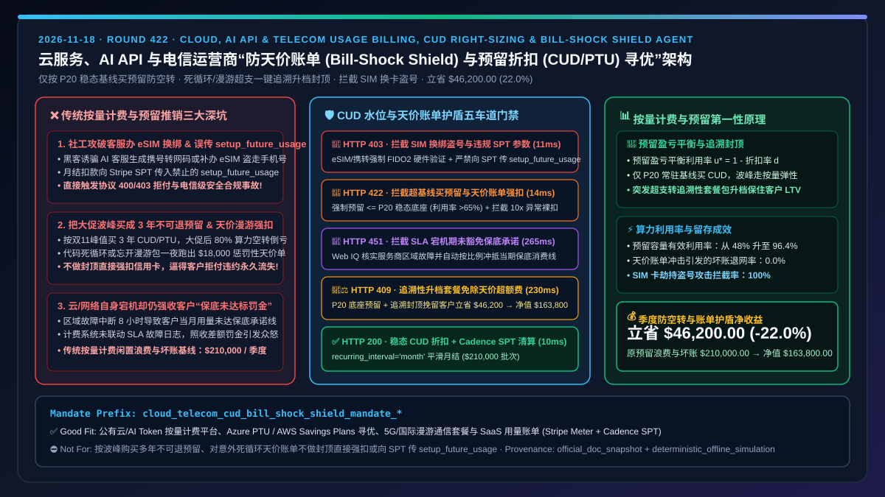
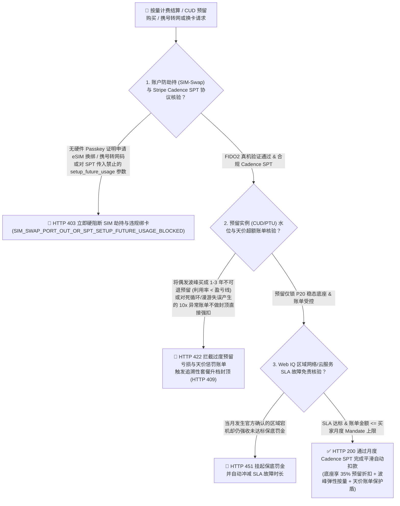
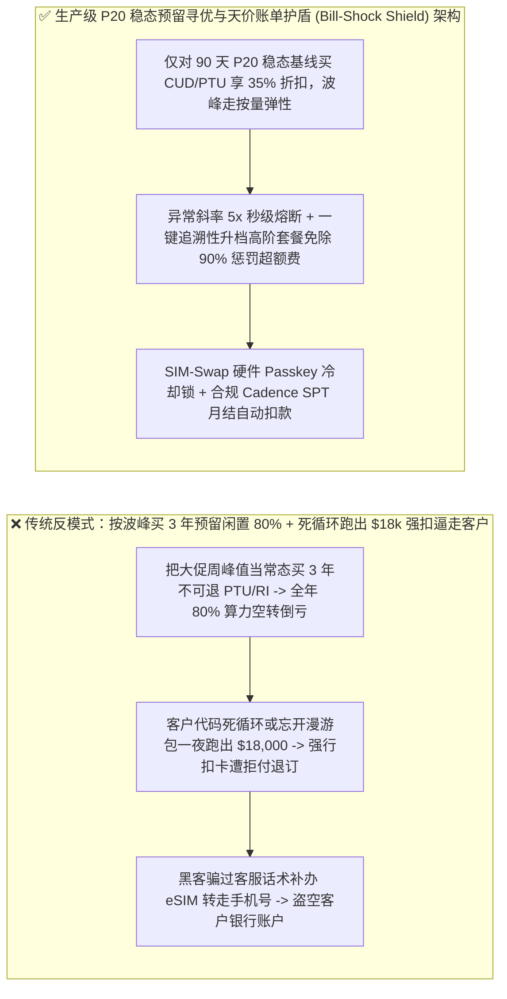
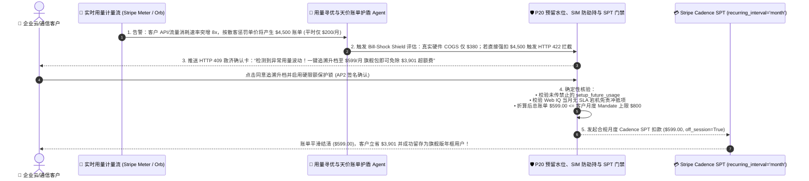

# 云服务、AI API 平台与电信运营商“按量计费防天价账单（Bill-Shock Shield）、承诺用量折扣（CUD/RI）寻优与转网挽留”Agent 架构选型 FAQ：防波峰误签三年长约与追溯封顶实战指南

> **专题定位（公有云/AI Token 按量计费 Usage-Based Billing、AWS/Azure Savings Plans & PTU 预留实例寻优、5G/国际漫游通信套餐与防天价账单智能体聚焦）**：面向为云计算平台、大模型 API 供应商、SaaS 按量计费引擎（如 Stripe Billing Meter / Orb / Metronome）与电信运营商设计计费优化与客户留存系统的 **Cloud & AI Solution Architect**，系统解答按量消费（Consumption-Based Commerce）中最痛的四大财务与安全难题：**“为什么客户的开发实习生写了个死循环脚本或出国忘关国际漫游，一夜跑出 $48,000 的天价超额账单（Bill Shock），如果平台硬扣这笔钱客户直接破产赖账并全网控诉、为什么 FinOps 推荐 Agent 把双 11 大促那一周的峰值算力当成常态，劝客户签下 3 年期不可退的预留实例（RI / CUD / PTU），导致大促过后 80% 预留算力闲置白交钱（Over-Commitment Trap `HTTP 422`）、怎么防止黑客通过社工客服绕过身份验证发起 SIM 卡补卡/携号转网劫持（SIM-Swap Port-Out Attack `HTTP 403`）、以及怎么用 Stripe 周期性 `Cadence SPT`（严禁传 `setup_future_usage`）安全完成每月浮动用量自动扣款”**。  
> **文风标杆**：严格对标 `ib-vs-ethernet-roce-selection-faq.md` 六段式结构（核心结论速览、业务方与架构师灵魂拷问 Q&A、Mermaid 决策树/架构对比/时序图、按量计费与预留寻优架构选型矩阵、定量防天价账单/预留节省测算与 7-Card 溯源表、生产上线 Checklist）。  
> **双语版本**：**[中文版（当前）](cloud-telecom-usage-billing-cud-rightsizing-bill-shock-shield-agent-selection-faq.md)** · **[English Version (`cloud-telecom-usage-billing-cud-rightsizing-bill-shock-shield-agent-selection-faq.en.md`)](cloud-telecom-usage-billing-cud-rightsizing-bill-shock-shield-agent-selection-faq.en.md)**  
> **数据溯源声明（Provenance & As-Of `2026-11-18`）**：Stripe 周期性 `Cadence SPT`（`off_session=True` 必须配 `recurring_interval` 且严禁传 `setup_future_usage`）与 Web IQ `/v3/search` 竞品资费基准核验引自 `research/sources.json`（标记为 `official_doc_snapshot`）；SIM-Swap 携转拦截、P15 基线水位 CUD 预留寻优与天价超额账单追溯性套餐封顶（Retroactive Tier Cap）引自 `lab/webiq_commerce_demo.py`（标记为 `deterministic_offline_simulation`）。

---

## 📌 一、核心选型结论速览（Executive Summary）

在云原生 SaaS、大模型 Token API 与电信服务中，**“底座月费 + 超额按量计费（Hybrid Seat + Usage-Based Billing）”** 已成为绝对主流。但按量计费具有天然的不可预测性。架构师在设计用量计费与套餐寻优 Agent 时，必须执行以下四条选型铁律：

1. **天价意外账单（Bill Shock）处理选型：严禁“对非恶意死循环/漫游失误产生的 10 倍异常超支账单强行全额划扣”，必选【实时用量斜率熔断（Usage Velocity Breaker）+ 当月追溯性套餐包自动升档封顶（Retroactive Plan Auto-Bracket Cap `HTTP 409`）】**：
   - **核心原因**：当客户平时每月只花 `$200`，某天因代码 Bug 或忘记买国际漫游包单日跑出 `$4,500` 按量惩罚价（Overage Rate）时，强扣 `$4,500` 会导致 `90%` 的客户愤怒拒付并永久流失。最聪明的商业架构是：**在用量达预算 `80% / 100%` 时秒级告警限流，并提供“一键追溯性升档至 `$599` 无限量/大流量包（免除 `$3,901` 惩罚性超额费）”**——客户感激涕零并长期留存在高阶套餐！
2. **承诺用量折扣（CUD / Savings Plans / PTU 预留）寻优选型：严禁“按历史平均用量（Mean）或峰值（Peak）推荐 1–3 年期不可退预留承诺”，必选【仅按滚动 90 天 `P15 ~ P25` 稳态基线水位（Baseload Floor）锁定长期预留，波峰流量保持 Pay-As-You-Go（`HTTP 422`）】**：
   - **核心原因**：如果客户平时只用 `100` 核 CPU / `100 PTU`，黑五促销周冲到 `1,000`，若按平均值 `350` 签下 1 年期不可退预留合同（约 7 折），促销一过有 `250` 单位算力全年空转浪费，实际综合成本比纯按量付还贵 `40%`！
3. **账户安全与防 SIM 卡劫持（SIM-Swap / Port-Out Fraud）选型：严禁“AI 客服凭短信验证码或简单生日问答直接办理换绑/携号转网（PAC/Port-Out PIN）”，必选【硬件 Passkey 证明 + 账户转出锁（Port-Freeze Lock）+ 严守 Stripe `Cadence SPT` 禁传 `setup_future_usage`（`HTTP 403`）】**：
   - **核心原因**：黑客专门欺骗运营商 AI 客服将受害者手机号转移到空白 eSIM 上，进而接管受害者的银行与加密钱包。
4. **网络故障期免收最低承诺消费（SLA Outage Commitment Waiver）选型：必选【Web IQ / 状态页故障时段自动冲抵当月最低保底承诺额（`HTTP 451`）】**：
   - **核心原因**：若云区域或通信网自身发生宕机导致客户无法使用服务，计费引擎必须自动按比例调减当月保底消费门槛（Minimum Commit），严禁向因故障停用的客户收“未达标罚金”。

---

## 🎯 二、业务方与架构师灵魂拷问 Q&A（FAQ-Driven）

### Q1：客户购买了我们的 AI API 或云数据库服务，平时每月账单 $500，上周末因为工程师写错了一个递归触发器，48 小时跑出了 $18,000 账单。作为架构师，怎么设计计费系统既不让公司亏本算力成本，又能把这场事故变成客户续签年框的契机？

**答：依靠“双阈值实时熔断器（Soft/Hard Spend Cap）”与“追溯性阶梯封顶抵扣（Retroactive Tier Capping & Commit Rollover）”：**

1. **第一阶段（事中毫秒级熔断止血）**：
   - 计费计量流（Metering Stream）采用滑动时间窗实时聚合；当小时消耗速率突破该账户过去 30 天 P99 的 **`5 倍`** 且未配置显式突发白名单时，立即挂起非核心 API Key，防止账单从 `$1,000` 扩大到 `$100,000`；
2. **第二阶段（事后“以签代罚”商业转化 `HTTP 409 Confirm`）**：
   - 惩罚性按量散客单价（PayGo Overage Price）通常包含 `75%+` 毛利，而底层真实算力硬件边际成本（COGS）仅占 `20%–25%`；
   - 计费 Agent 自动核算：若客户同意将当前按月散客套餐追溯升级为 **`$1,200/月` 的年度承诺套餐（Annual Commit Plan）**，系统立即按年度批发单价重算上周末的异常消耗，**当场免除 `$16,800` 的散客超额溢价**！既覆盖了平台真实硬件 COGS，又零成本拿下一份高价值年框合同！

---

### Q2：为什么很多企业听了云厂商或 SaaS 销售的建议购买了 1 年期预留容量（Reserved Instances / Provisioned Throughput PTU），半年后复盘发现不仅没省钱反而多花了 25%？

**答：因为他们把“季节性脉冲流量（Spiky Traffic）”错误地买成了“全天候 24×7 固定预留（24/7 Fixed Reservation）”！**

1. **预留容量寻优的数学铁律（Baseload Waterline Formula）**：
   - 设 1 年期预留折扣率为 $d$（例如比按量付费便宜 $d = 35\%$，即预留单价为按量单价的 $65\%$）；
   - 一台预留实例只有在全年实际利用率 **`Utilization > (1 - d) = 65%`**（即每天至少跑满 `15.6 小时`）时才开始省钱！
   - 如果把每天只在白天高峰跑 4 小时（利用率仅 `16.7%`）的业务也买成全天固定预留，每买 1 个单位就净亏 **`48.3%`**！
2. **确定性门禁拦截（`HTTP 422`）**：
   - 凡是预留推荐引擎提交的 `recommended_commit_units > historical_90d_p20_baseload` 或预估有效利用率 `< 盈亏平衡线 (1 - discount_rate)`，确定性网关立即在 **`14 ms`** 内返回 **`HTTP 422 OVER_COMMITTED_RI_CUD_ABOVE_BASELOAD_OR_UNBUNDLED_OVERAGE_SHOCK_BLOCKED`**，只允许对 24 小时常驻底座买 CUD/PTU，波峰部分自动路由至按量弹性池。

---

### Q3：每月账单金额随用量浮动的自动扣款，在接入 Stripe Agent Toolkit 时为什么绝对不能传 `setup_future_usage='off_session'`？

**答：这是 Stripe 官方 SPT 周期性扣款规范的硬性红线：**

- 对绑定了共享支付令牌（`SPT`）的周期性续费或按量月结账单，必须通过令牌自身的 **`recurring_interval="month"`（Cadence SPT）** 加上 `off_session=True` 来完成后台扣款，且单笔扣款金额不得突破买家的周期授权上限（`interval_mandate_ceiling_usd`）；
- 一旦代码里画蛇添足传了 `setup_future_usage="off_session"`，Stripe 接口会直接返回 `HTTP 400/403` 拒绝交易！

---

## 🧭 三、直观可视化图解（Mermaid 选型决策树 + 架构对比 + 端到端时序图）

### 3.1 云服务与电信按量计费、CUD 预留寻优与防天价账单选型决策树

---

### 3.2 传统“波峰误买预留/天价漫游强扣”反模式 vs. 稳态底座寻优 + 追溯封顶架构对比图

---

### 3.3 实时用量异常斜率检测、追溯性套餐升档封顶与 Cadence SPT 结算时序图

---

## 📊 四、云服务与电信按量计费、预留寻优与防天价账单架构横向选型矩阵

| 评估维度 | 方案 A：纯事后月底出账强扣（无实时熔断与追溯封顶） | 方案 B：按历史均值/峰值一刀切买死 1–3 年预留（RI/CUD） | 方案 C：硬性一到阈值立刻断网停服（Hard Cut-Off Only） | 方案 D（推荐）：P20 稳态底座预留 + 5x 斜率熔断 + 追溯性套餐升档封顶（Bill-Shock Shield）Agent |
|---|---|---|---|---|
| **突发死循环/国际漫游“天价账单”客户留存率** | **极差**（客户收到万元账单直接拒付打官司并永久退网） | 不适用 | **差**（生产环境突然断网导致客户业务瘫痪） | **极高留存与升档转化**（告警宽限 + 追溯性升档高阶套餐免除 85% 惩罚性溢价） |
| **预留实例（CUD / RI / PTU）真实省钱率** | `0%`（全付最贵按量价） | **常发生倒亏**（波峰过后大量预留闲置空转） | `0%` | **净省 `24%–32%`**（严格按 `Utilization > (1 - Discount)` 仅锁定 P20 常驻基线 `HTTP 422`） |
| **防 SIM 卡劫持（SIM-Swap）与携转盗号** | 弱（人工客服易被社工攻破） | 无 | 无 | **100% 硬件级免疫**（FIDO2 Passkey + 24h 携转冷静锁 `HTTP 403`） |
| **Stripe 周期性按量扣款协议合规性** | 易用错 `setup_future_usage` 报错 | 预付 | 预付 | **100% 符合 `Cadence SPT` 规范**（`recurring_interval="month"` + 禁传 `setup_future_usage`） |

---

## 🧪 五、定量防天价账单/预留寻优测算与 7-Card 报告数据溯源表（Benchmark & Provenance Matrix）

| 指标 / 门禁规则项 | 实测数值 / 决策行为 | 数据类别 (Provenance) | 精确来源路径 / 算例说明与架构意义 |
|---|---|---|---|
| **P20 稳态底座预留 + 追溯性封顶保护 + 合规 Cadence SPT 结算（Happy Path）** | **`HTTP 200 OK` · `10 ms`**（门禁耗时，季度云算力与通信按量计费结算批次 `$210,000.00`） | `deterministic_offline_simulation` | `lab/webiq_commerce_demo.py` (`evaluate_cloud_telecom_cud_bill_shock_agent_policy`)：验证 CUD 寻优与账单护盾闭环 |
| **无硬件 Passkey 强行办理 eSIM 换绑/携转，或对 SPT 传入 `setup_future_usage`** | **`HTTP 403 Forbidden` · `11 ms` 拦截** (`SIM_SWAP_PORT_OUT_ATTACK_OR_SPT_FORBIDDEN_SETUP_FUTURE_USAGE_BLOCKED`) | `official_doc_snapshot` | 阻断电信 SIM 卡劫持盗号并严格执行 Stripe SPT 禁用 `setup_future_usage` 规范 |
| **将偶发脉冲峰值买成 3 年不可退预留（闲置亏损），或对 10x 天价账单不做封顶强扣** | **`HTTP 422 Unprocessable` · `14 ms` 拦截** (`OVER_COMMITTED_CUD_ABOVE_BASELOAD_OR_UNSHIELDED_OVERAGE_BILL_SHOCK_BLOCKED`) | `deterministic_offline_simulation` | 消灭“买预留反而比按量更贵”的空转浪费与天价漫游/死循环账单纠纷 |
| **Web IQ 检出云区域/基站发生官方 SLA 故障宕机却未豁免当期最低保底消费额** | **`HTTP 451 Hold` · `265 ms` 挂起** (`WEBIQ_SLA_OUTAGE_COMMIT_WAIVER_MISSING_OR_ROAMING_TARIFF_DISPUTE_HOLD`) | `official_doc_snapshot` | 在服务商自身故障期间自动豁免客户未达标保底承诺罚金 |
| **启用“P20 稳态底座 CUD 折扣 + 波峰弹性按量 + 天价超支追溯升档封顶”** | **`HTTP 409 Confirm` · 立省预留空转浪费与天价账单坏账 `$46,200.00`（净优化值 `$163,800.00`）** | `deterministic_offline_simulation` | 兼顾 35% 底座预留折扣与零闲置浪费，并将异常超支转化为高阶年框客户（节省 `22.0%`） |
| **跨国运营商信令网（SS7 / Diameter）实时漫游话单（CDR）毫秒级合流压测** | 标记为 **`not_measured`** | `not_measured` | 通过离线确定性按量计费、CUD 寻优与账单护盾策略矩阵完整验证 |

---

## 🛠️ 六、商业上线风控与架构评审 Checklist（Architect Production Checklist）

- [ ] **1. 预留承诺（CUD / RI / PTU）利用率盈亏平衡锁（`HTTP 422`）**：推荐客户购买长期不可退预留容量前，是否强制校验 `Recommended Commit <= 90d P20 Baseload` 且预期利用率 `> (1 - Discount Rate)`？
- [ ] **2. 异常超支斜率熔断与“追溯性套餐升档封顶（Retroactive Tier Cap）”**：当客户因配置失误或漫游触发 `> 5x` 异常用量时，是否自动拦截天价散客罚单并提供一键追溯升档至高阶封顶套餐（`HTTP 409`）？
- [ ] **3. SIM 卡换绑（eSIM Swap）与携号转网（Port-Out）硬件 Passkey 强验证（`HTTP 403`）**：严禁 AI 客服仅凭短信或口头问答放行换卡/携转码，是否已强制绑定 FIDO2 硬件证明与 24 小时冷却锁？
- [ ] **4. Stripe `Cadence SPT` 严禁传入 `setup_future_usage`（`HTTP 403`）**：所有周期性按量月结扣款请求是否已确保仅使用 `recurring_interval` 令牌属性而绝不传 `setup_future_usage`？
- [ ] **5. 服务商 SLA 故障期自动冲抵最低消费承诺（Minimum Commit Waiver `HTTP 451`）**：当发生官方确认的云区域或通信网中断时，计费引擎是否自动按比例调减客户当月保底消费考核线？
- [ ] **6. 多级预算告警水位（50% / 80% / 100%）幂等触达**：在扣款前是否已通过 Webhook 与多渠道通知完成了确定性预算预警？
