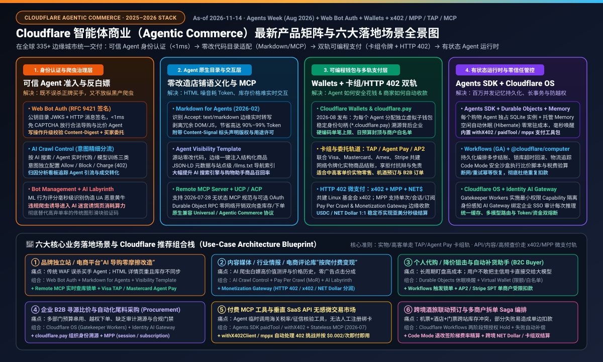
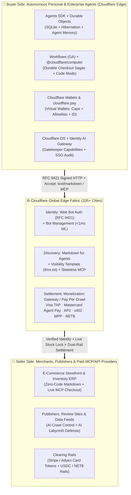
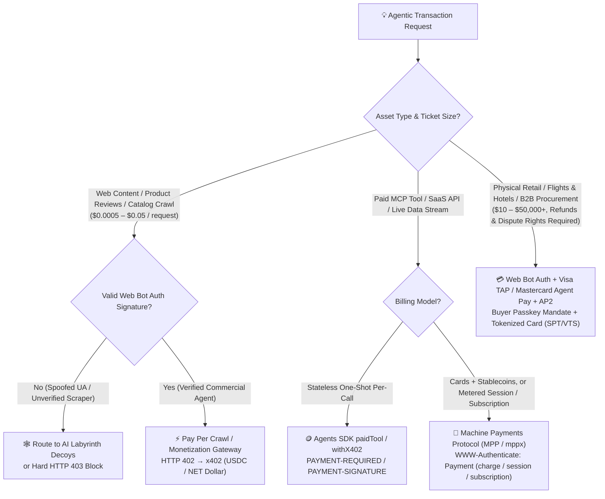

# Cloudflare Latest Products & Agentic Commerce Full-Stack Architecture & Scenario Selection FAQ

> **Target Audience**: AI Solution Architects, Retail & E-Commerce CTOs, Payments & Fraud Risk Leads, and Agent Application Builders  
> **Coverage Horizon**: Complete 2025–November 2026 Cloudflare stack — covering the **Cloudflare Agentic Commerce Solution Suite**, **`Markdown for Agents` (Feb 2026)**, **Linux Foundation `x402 Foundation` & Stateless `MCP 2026-07-28` (Jul 2026)**, and **`Cloudflare Agents Week` (Aug 2026)** launches including **`Cloudflare Wallets` / `cloudflare.pay`**, **`Monetization Gateway`**, **`Machine Payments Protocol (MPP)`**, **`Cloudflare OS` (`Gatekeeper Workers`)**, and **`Identity-Aware AI Gateway`**  
> **Bilingual Editions**: **[中文版 (`cloudflare-agentic-commerce-fullstack-architecture-faq.md`)](cloudflare-agentic-commerce-fullstack-architecture-faq.md)** · **[English Version (Current)](cloudflare-agentic-commerce-fullstack-architecture-faq.en.md)**  
> **Executable Reference Module**: `lab/cloudflare_agentic_commerce.py` · `tests/test_cloudflare_agentic_commerce.py`  
> **Provenance & As-Of (`2026-11-14`)**: Product capabilities, HTTP headers (RFC 9421, `x402`, `MPP`, `Accept: text/markdown`), and payment network partnerships (Visa, Mastercard, Amex, Stripe, Coinbase) are sourced from official Cloudflare documentation, press releases, and engineering blog posts (`cloudflare.com/solutions/agentic-commerce/`, `developers.cloudflare.com/agents/tools/payments/`, `blog.cloudflare.com`); edge policy and wallet guardrail checks are verified by the deterministic Python reference suite in this repository.

---

## 📌 1. Executive Summary

As web traffic shifts from humans clicking browsers to autonomous AI agents discovering, comparing, negotiating, and paying on behalf of users or enterprises, legacy e-commerce and digital publishing stacks hit three structural walls:
1. **The Access Wall**: Legacy WAFs and CAPTCHAs block legitimate shopping agents alongside scrapers (killing agent-channel conversion), whereas naive `User-Agent` or cloud IP allowlists let scalper bots drain limited inventory in seconds.
2. **The Storefront & Context Wall**: Multi-megabyte HTML/DOM pages burn tens of thousands of tokens per product check, expose agents to hidden-DOM indirect prompt injection, and lack live two-way inventory locking.
3. **The Settlement Wall**: Human checkouts rely on card forms and 3DS popups, whereas machine-to-machine (M2M) commerce needs **both** consumer-protected card network tokens for physical retail **and** sub-cent HTTP 402 micropayments for API/data calls — governed by hard programmatic spend limits.

Across 2025–2026 (culminating in **Agents Week, August 2026**), **Cloudflare assembled a two-sided edge platform across 335+ cities** — acting simultaneously as the **merchant's agent-ready storefront & cashier** and the **buyer agent's stateful runtime, cryptographic passport, and programmable wallet**:

| Architectural Layer | Key Cloudflare Products & Protocols (2025–2026) | Core Architectural Value |
|---|---|---|
| **1. Identity & Traffic Governance** | **`Web Bot Auth` (RFC 9421)** + **`Bot Management`** + **`AI Crawl Control`** + **`AI Labyrinth`** | `<1ms` cryptographic agent verification without CAPTCHAs; granular policies across Search / Agentic Use / Training; decoy labyrinths for rogue scrapers |
| **2. Agent-Native Discovery & Interop** | **`Markdown for Agents`** + **`Agent Visibility Template` (`llms.txt` / JSON-LD)** + **`Remote MCP Server`** | Zero origin code changes: `Accept: text/markdown` cuts payload tokens by 90%+, injects structured metadata, and runs stateless MCP for live inventory & checkout |
| **3. Programmable Wallets & Multi-Rail Payments** | **`Cloudflare Wallets` (`cloudflare.pay`)** + **`Visa TAP` / `Mastercard Agent Pay` / `AP2`** + **`x402` / `MPP` / `NET Dollar`** + **`Pay Per Crawl` / `Monetization Gateway`** | Per-agent Virtual Wallets with traceable web handles, spend caps & merchant allowlists; card tokens for retail goods + HTTP 402 stablecoin rails for micropayments |
| **4. Stateful Edge Agent Runtime** | **`Agents SDK`** + **`Durable Objects` (SQLite + Hibernation)** + **`Agent Memory`** + **`Workflows` (GA)** + **`@cloudflare/computer` (`Code Mode`)** | Millions of stateful shopping agents with zero idle compute cost, managed cross-session memory, durable multi-step checkout sagas, and sandboxed math/script execution |
| **5. Zero-Trust Governance & Observability** | **`Cloudflare OS` (`Gatekeeper Workers`)** + **`Identity-Aware AI Gateway`** + **`Workers AI` / `AutoRAG`** | Capability-scoped zero-trust execution preventing scope creep, plus SSO-linked auditability across every model call and transaction |

---

## 🧩 2. Deep Dive into Core Capabilities (5 Technical Pillars)

### Pillar 1: Cryptographic Agent Identity & Bot Governance ("Who Enters the Store")

1. **`Web Bot Auth` (IETF RFC 9421 HTTP Message Signatures)**
   - **How It Works**: Registered AI agent operators publish Ed25519/ECDSA public keys at a discoverable JWKS directory and sign requests via `Signature-Input`, `Signature`, and `Signature-Agent` headers covering `@authority`, `@method`, `@path`, timestamps/nonce, and `content-digest` (for state-mutating payloads).
   - **Impact**: Merchants verify legitimate agents at the Cloudflare edge in **under 1ms**, eliminating brittle IP allowlists and zero-conversion CAPTCHA walls.
2. **`AI Crawl Control` (Intent-Separated Policies & Attribution)**
   - Separates automated traffic by intent — **AI Search**, **Live Agentic Action**, and **Model Training** — with per-operator `Allow`, `Charge` (`HTTP 402`), or `Block` rules and conversion attribution analytics.
3. **`Bot Management` + `AI Labyrinth` (Sub-ms ML Scoring & Active Deception)**
   - Scores behavioral signals in `<1ms`; unauthorized scrapers ignoring policy are silently routed into **`AI Labyrinth`** — dynamically generated decoy pages that waste scraper compute and fingerprint bad actors without tipping them off via immediate `403` responses.

---

### Pillar 2: Agent-Native Browsing & Live Storefront Interoperability ("How Agents Read & Transact")

1. **`Markdown for Agents` (Launched Feb 2026 — Edge Content Negotiation)**
   - **Mechanism**: When an AI agent sends `Accept: text/markdown`, Cloudflare converts origin HTML into clean Markdown on the fly at the edge (stripping navbars, scripts, and CSS), preserving cache/CORS headers and attaching `Content-Signal` usage policies.
   - **Gain & Guardrail**: Cuts payload and LLM token overhead by **90%–99%** with zero origin refactoring. Architects must enforce strict price/terms parity between HTML and Markdown outputs to avoid search-engine cloaking penalties or hidden prompt-injection discrepancies.
2. **`Agent Visibility Template` (One-Click Structured Catalog & `llms.txt`)**
   - Automatically injects structured product JSON-LD and domain-level `/llms.txt` discovery manifests at the edge with no backend code changes.
3. **`Remote MCP Servers` & Commerce Protocol Interop (`MCP 2026-07-28` + `UCP` / `ACP`)**
   - **Stateless MCP (July 2026 Spec)**: Cloudflare's Agents SDK supports the fully stateless `2026-07-28` MCP specification alongside legacy clients, **optional on-demand OAuth 2.1**, and zero-network-overhead **Durable Object RPC transport** so shopping agents can check live stock, compare SKUs, and execute checkouts compatible with **UCP (Universal Commerce Protocol)** and **ACP (Agentic Commerce Protocol)**.

---

### Pillar 3: Programmable Wallets, Dual Payment Rails & Monetization ("How Agents Pay & Merchants Collect")

Cloudflare addresses both macro-retail and micro-API economics through a **dual-rail payment architecture**:

1. **`Cloudflare Wallets` & `cloudflare.pay` (August 2026 Agents Week Flagship)**
   - **Account + Virtual Sub-Wallets**: Humans or enterprises fund a central **Account Wallet** and provision isolated **Virtual Wallets** per autonomous agent.
   - **Verifiable Identity & Deterministic Guardrails**: Each agent receives a stable web identity handle (e.g., `agent.example.cloudflare.pay`) proving human/organizational backing, paired with platform-enforced **per-transaction limits, periodic spending caps, and merchant allowlists**.
2. **Card & Delegated Mandate Rails: `Visa Trusted Agent Protocol (TAP)` + `Mastercard Agent Pay` + `Amex` + `Stripe` + `AP2`**
   - Built atop Cloudflare **`Web Bot Auth` (RFC 9421)** as an identity wrapper, binding agent authenticity with buyer passkey mandates (`AP2` Agent Payments Protocol) and network tokens (`Stripe SPT` / Visa VTS).
   - Preserves chargeback dispute rights, consumer protections, tax invoicing, and **fraud liability shift** for physical goods, flights, hotels, and B2B orders.
3. **HTTP 402 Machine Micropayment Rails: `x402` + `Machine Payments Protocol (MPP)` + `NET Dollar`**
   - **`x402` Standard**: Co-founded by Coinbase and Cloudflare and stewarded under the **Linux Foundation `x402 Foundation` (July 2026, 40+ members)**. Uses `PAYMENT-REQUIRED`, `PAYMENT-SIGNATURE`, and `PAYMENT-RESPONSE` headers for instant sub-cent stablecoin (`USDC`) settlement via SDK primitives `withX402`, `paidTool`, `x402-hono`, and `withX402Client`.
   - **`MPP (Machine Payments Protocol)`**: Payment-method agnostic HTTP 402 standard (`WWW-Authenticate: Payment` / `Authorization: Payment`) via the `mppx` SDK supporting **`charge` (one-time)**, **`session` (usage-metered)**, and **`subscription` (recurring)** intents across Stripe cards and stablecoins, with built-in client backwards compatibility for `x402` servers.
   - **`NET Dollar`, `Pay Per Crawl` & `Monetization Gateway`**: 1:1 USD-backed programmable settlement token paired with edge monetization gateways (with Cloudflare optionally acting as Merchant of Record for Pay Per Crawl) so publishers and API providers charge per page read or tool invocation.

---

### Pillars 4 & 5: Stateful Edge Runtime & Zero-Trust Enterprise Governance ("How Agents Scale Safely")

1. **`Cloudflare Agents SDK` + `Durable Objects` + `Agent Memory` + `Workflows (GA)` + `@cloudflare/computer`**
   - Every personal or enterprise procurement agent runs as a globally addressable **Durable Object** with embedded **SQLite** storage, managed cross-session **Agent Memory**, and **WebSocket hibernation** (zero compute cost while waiting for price drops or restocks).
   - **`Workflows (GA)`** orchestrates durable multi-step checkout sagas with step-level idempotency; **`Code Mode` (`@cloudflare/computer`)** runs sandboxed code for landed-cost tariff math and bundle optimization.
2. **`Cloudflare OS` (`Gatekeeper Workers`) + `Identity-Aware AI Gateway`**
   - **`Cloudflare OS`** enforces zero-trust capability isolation via **Gatekeeper Workers** — agents never hold raw master credentials and can only invoke explicitly granted capabilities.
   - **`Identity-Aware AI Gateway`** unifies Workers AI and external LLMs with enterprise IdP identity tracing, caching, rate limits, and audit logs.

---

## 🎯 3. High-Frequency Architect Q&A (FAQ-Driven)

### Q1: How can an existing e-commerce merchant enable AI shopping agents in days without rewriting its monolithic backend?

**Answer: Roll out Cloudflare's 3-step zero-origin-change edge pattern:**
1. **Day 1 (Access & Agent-Readable Catalog)**: Enable **`Web Bot Auth`** (skip CAPTCHAs for cryptographically verified shopping agents) + toggle **`Markdown for Agents`** and **`Agent Visibility Template`** (serve token-lean Markdown, JSON-LD, and `llms.txt` at the edge with zero origin code edits).
2. **Week 1 (Live Inventory & Cart via Stateless MCP)**: Deploy a lightweight **Remote MCP Server** on Cloudflare Workers wrapping existing inventory and cart REST endpoints.
3. **Week 2 (Programmatic Card Checkout)**: Turn on **`Visa TAP` / `Mastercard Agent Pay`** verification at the edge in front of Stripe/Adyen checkout endpoints to accept tokenized agentic payments with fraud liability protection.

---

### Q2: When should an architect choose `Visa TAP / Mastercard Agent Pay` vs. `x402` vs. `MPP`?

**Answer: Route by ticket size, reversibility requirements, and billing cadence:**
- **`Visa TAP` / `Mastercard Agent Pay` + `AP2`**: Mandatory for **`$10–$50,000+` physical goods, travel bookings, and B2B invoices** where buyer dispute protection, returns/refunds, corporate card controls, and fraud liability shift are non-negotiable.
- **`x402`**: Optimal for **stateless sub-dollar (`$0.0005–$0.10`) pay-per-crawl content reads and one-shot MCP tool calls**, where `$0.30` card fixed fees are economically unviable and instant `USDC` / `NET Dollar` finality eliminates account signup friction.
- **`MPP (`mppx`)`**: Ideal when an API or SaaS platform wants **one unified HTTP 402 interface** supporting **cards + stablecoins** as well as **metered streaming sessions (`session`) and recurring plans (`subscription`)**, while remaining backwards-compatible with `x402`.

---

### Q3: What stops a prompt-injected shopping agent from draining its `Cloudflare Wallet` to an attacker's domain?

**Answer: Three deterministic infrastructure guardrails outside the LLM's context:**
1. **Scoped `Virtual Wallets`**: Agents receive isolated sub-wallets with hard platform-enforced **`max_tx_amount`**, **`daily_spend_cap`**, and **`merchant_allowlist`** constraints — non-allowlisted payees fail closed at `cloudflare.pay` signing time.
2. **`Cloudflare OS` Gatekeeper Workers**: Raw keys never enter the agent sandbox; signing is mediated by capability-bound Gatekeeper Workers.
3. **Human-in-the-Loop Escalation**: `withX402Client` and `Workflows` pause execution and request human passkey approval whenever an order crosses a configured threshold or targets a new merchant.

---

## 🧭 4. Visual Architecture Diagrams (Mermaid)

### 4.1 Five-Layer Two-Sided Reference Architecture

---

### 4.2 Payment & Monetization Protocol Decision Tree

---

## 📊 5. Six High-Value Use Cases & Solution Matrix

| Use Case | Target Persona | Core Pain Point | Recommended Cloudflare Stack | Key Architectural Outcome |
|---|---|---|---|---|
| **1. Frictionless AI Storefront Enablement** | Retail Brands & E-Commerce Platforms | WAFs block buyer agents; bloated HTML wastes tokens and hides live stock | `Web Bot Auth` + `Markdown for Agents` + `Agent Visibility Template` + `Remote MCP` + `Visa TAP` / `Mastercard Agent Pay` | `<1ms` edge verification, `90%+` token reduction, zero CAPTCHA friction, zero origin code changes to start |
| **2. Publisher & Review Data Pay-Per-Crawl Monetization** | Media Publishers, Review Sites, Price Feeds | AI crawlers scrape high-value reviews/data with zero ad clicks | `AI Crawl Control` + `Pay Per Crawl` (MoR) + `Monetization Gateway` (`x402` / `NET$`) + `AI Labyrinth` | Free allow for search referral, automated HTTP 402 revenue from commercial agents, decoy traps for bad bots |
| **3. Personal Price-Drop & Auto-Replenishment Shopper** | Consumer AI Apps & OS Assistants | High cost of 24/7 polling containers; fear of exposing primary cards to LLMs | `Agents SDK` + `Durable Objects` (Hibernate + SQLite) + `Agent Memory` + `Virtual Wallets` + `Workflows` | `$0` idle compute while hibernating; hard sub-wallet caps & merchant allowlists block unauthorized spend |
| **4. Enterprise B2B Tail-Spend Sourcing & Procurement** | Enterprise Procurement & ERP/SRM Teams | Manual RFQ overhead; multi-agent budget overruns and weak audit trails | `Cloudflare OS` (`Gatekeeper Workers`) + `Identity-Aware AI Gateway` + `cloudflare.pay` Org Handle + `MPP` / `TAP` | Every inference and payment traced to an enterprise SSO identity under capability-scoped zero trust |
| **5. Zero-Signup Paid MCP Tool & API Marketplace** | Vertical SaaS, Customs/Tax/KYC APIs | Agents cannot pause to fill human SaaS signup forms for a single tool call | `Agents SDK` (`paidTool` / `withX402` / `mppx`) + `Stateless MCP (2026-07-28)` + Optional OAuth | `withX402Client` resolves HTTP 402 challenges in milliseconds for instant per-call micro-monetization |
| **6. Cross-Border Travel & Multi-Merchant Split-Cart Sagas** | OTAs, Corporate Travel & Multi-Brand Agents | Partial booking failures across flights/hotels risk orphaned charges | `Workflows (GA)` 2-Phase Hold Sagas + `@cloudflare/computer` (`Code Mode` fee math) + `NET Dollar` / Card Rails | Durable step idempotency prevents double charges and auto-releases holds on partial leg failure |

---

## 🛠️ 6. Production Architect Pre-Flight Checklist

- [ ] **1. Separate Read vs. Write Identity Gates**: Allow verified `Web Bot Auth` (`Signature-Agent`) for read-only catalog discovery; require `Content-Digest` + `Visa TAP / Mastercard Agent Pay` buyer mandates for cart locks and checkout.
- [ ] **2. Retire Plaintext `User-Agent` Allowlists & Enable `AI Labyrinth`**: Block or deceive unverified bots spoofing AI agent user-agents.
- [ ] **3. Enforce Semantic Parity on `Markdown for Agents`**: Guarantee prices, stock status, and return policies in `Accept: text/markdown` responses match human HTML identically.
- [ ] **4. Adopt Stateless `MCP 2026-07-28` with Optional Step-Up OAuth**: Keep public catalog MCP tools auth-free for speed; require OAuth 2.1 only when accessing user accounts or executing orders.
- [ ] **5. Dual-Rail Routing by Economics**: Route `<$1` API/crawl microtransactions to `x402` / `MPP` (`USDC` / `NET Dollar`) and physical/high-ticket orders to `Visa TAP` / `Mastercard Agent Pay` / `Stripe SPT`.
- [ ] **6. Isolate Every Agent with a Scoped `Virtual Wallet`**: Enforce per-tx ceilings, daily caps, and explicit merchant allowlists on `*.cloudflare.pay` sub-wallets.
- [ ] **7. Mediate Signing via `Cloudflare OS` Gatekeeper Workers**: Never expose master wallet keys or unscoped API tokens inside agent prompt/code contexts.
- [ ] **8. Wrap Multi-Step Checkouts in `Cloudflare Workflows`**: Persist idempotency keys across inventory hold, human approval, capture, and compensation steps.
