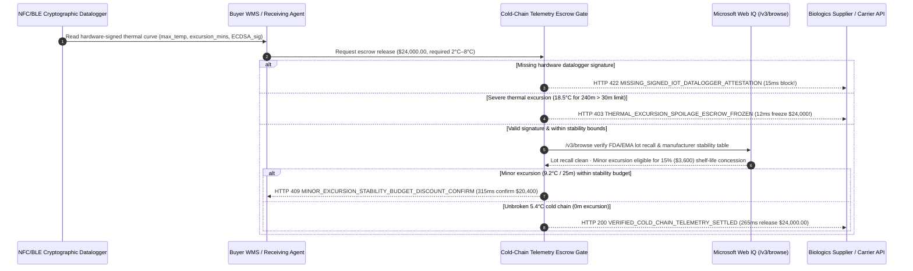

# Cold-Chain IoT Telemetry Escrow & Excursion Auto-Claim Mandate Architecture: Cryptographic Temperature-Curve Release Token (`cold_chain_telemetry_mandate_...` + Web IQ Stability & Recall Grounding) vs. Blind Delivery-Scan Payout & Thermal Spoilage Disputes Selection FAQ

> **Document Type**: Architect Selection Guide & First-Principles Protocol Deep Dive (6-Section FAQ Standard)  
> **Target Audience**: AI Solution Architects, Pharmaceutical & Cold-Chain Supply Chain Architects, GSP/GDP Quality Compliance Leads, Trade Settlement & Cargo Insurance Risk Teams  
> **Last Updated**: 2026-11-09 (Provenance Annotations: `deterministic_offline_simulation` / `synthetic_policy` / `official_doc_snapshot` / `not_measured`)  
> **Companion Resources**: [中文版 (Chinese Version)](cold-chain-telemetry-escrow-vs-spoilage-dispute-faq.md) · [Interactive Sandbox (`live-demo.en.html#cold-chain-telemetry-sandbox`)](../reports/agentic-commerce-webiq-grounding-demo-bench/live-demo.en.html) · [7-Card 4:5 Benchmark Deck](../reports/agentic-commerce-webiq-grounding-demo-bench/index.en.html)


---

## 📌 1. Executive Summary

1. **Never Allow Cold-Chain Procurement Agents to Release Escrow Funds Solely on a Carrier "Package Delivered" Scan**: In biologics, vaccines, IVD reagents, and premium perishable food procurement, the costliest failure mode is **mid-transit thermal excursion masked by pre-arrival re-cooling** (e.g., a refrigerated truck's compressor is turned off for 4 hours mid-route, spiking payload temperature to `18.5°C`, then re-chilled to `5.0°C` an hour before unloading). Surface IR thermometers show `5.0°C` at the dock, yet the biologics are denatured. Production architectures must enforce a **Cold-Chain IoT Telemetry Escrow Mandate (`cold_chain_telemetry_mandate_...`)**: whenever hardware-signed logger telemetry reports `observed_max_temp_c (18.5°C) > max_allowed_temp_c (8.0°C)` for `excursion_minutes (240) > max_excursion_minutes (30)`, the gateway freezes the `$24,000.00` payout in **`12 ms`** with **`HTTP 403 THERMAL_EXCURSION_SPOILAGE_ESCROW_FROZEN`** (`synthetic_policy`) and auto-generates a cargo insurance claim bundle.
2. **Require Cryptographic NFC/BLE Datalogger Signatures to Eliminate Spoofed PDF/CSV Temperature Logs**: Any settlement request lacking a valid hardware-signed datalogger attestation (`datalogger_signature_valid=False`) is rejected in **`15 ms`** with **`HTTP 422 MISSING_SIGNED_IOT_DATALOGGER_ATTESTATION`** (`deterministic_offline_simulation`), preventing carriers from submitting doctored spreadsheet logs.
3. **Ground FDA/EMA Lot Recalls and Pharmacopoeia Stability Excursion Budgets via Microsoft Web IQ `/v3/browse`**: Before releasing escrow, the agent invokes **Microsoft Web IQ `/v3/browse`** (`official_doc_snapshot`) to check official regulatory lot recall notices and the manufacturer's published Stability Excursion Monograph: if the lot is under an active FDA/EMA recall, it halts payout in **`310 ms`** with **`HTTP 451 FDA_LOT_RECALL_OR_LANE_BLACKOUT_HOLD`**; if the logger records a minor loading-dock excursion (`9.2°C` for `25 mins`) that falls within the manufacturer's allowable stability budget (`<= 10°C for <= 60 mins` with a 15% shelf-life reduction), it triggers **`HTTP 409 MINOR_EXCURSION_STABILITY_BUDGET_DISCOUNT_CONFIRM`** in **`315 ms`** to apply a **`$3,600.00`** shelf-life concession (settling at **`$20,400.00`** net).

---

## 🎯 2. Architect & Customer FAQ Deep Dive

### Q1: Why does "Dock IR Spot-Check + Automated POD Payment + Post-Facto Insurance Claims" fail catastrophically in pharmaceutical and perishable supply chains?

Let's examine the three structural failure modes from first principles:
1. **The "Mid-Transit Thaw & Pre-Arrival Re-Chill" Blind Spot**: Suppose a hospital orders `$24,000.00` of monoclonal antibodies requiring `2.0°C–8.0°C`. During transit, a reefer unit fails for 4 hours (`240 mins`), raising the internal vial temperature to `18.5°C` and permanently degrading protein potency. Two hours before arrival, the cooling unit restarts and brings the box temperature back to `5.2°C`. A receiving clerk's handheld IR gun reads `5.2°C`, the barcode is scanned as "Delivered", and a legacy payment agent immediately wires `$24,000.00` to the distributor. When quality assays fail a week later, the money is gone and liability is disputed across three carriers.
2. **Trivial Forgery of Unauthenticated CSV/PDF Logs**: Standard USB temperature loggers export plain CSV or PDF files with no cryptographic hardware signature. Bad actors can edit peak temperature rows in seconds before emailing the file to the buyer's agent.
3. **Binary "Full-Price Acceptance vs. Total Destruction" Waste**: When a shipment experiences a brief `25`-minute excursion to `9.2°C` during tarmac transfer, published manufacturer stability studies often certify the product remains safe and potent but loses 15% of its remaining shelf life. Without automated grounding of the stability monograph, buyers either overpay full price (`$24,000.00`) for shortened-expiry stock or needlessly scrap the entire shipment.

### Q2: What is a "Cold-Chain Telemetry Escrow Mandate (`cold_chain_telemetry_mandate_...`)", and how does it bind hardware IoT loggers, stability monographs, and escrow release?

Its core design invariant is: **"In cold-chain commerce, physical delivery is necessary but insufficient; escrow release requires a hardware-signed temperature-time curve proving continuous compliance within the contracted thermal envelope."**
- **Layer 1: Hardware Datalogger ECDSA Signature Gate (`15 ms`)**: Verifies `datalogger_signature_valid == True` bound to the shipment's serialized logger ID, blocking unauthenticated delivery scans in **`15 ms`** (`HTTP 422`).
- **Layer 2: Thermal Excursion & Duration Tripwire (`12 ms`)**: Evaluates peak temperature and cumulative excursion duration against mandate limits (`2.0°C–8.0°C`, max `30 mins`). Severe excursions (`18.5°C` for `240 mins`) freeze all funds in **`12 ms`** (`HTTP 403`).
- **Layer 3: Microsoft Web IQ `/v3/browse` Lot Recall & Stability Budget Grounding (`310 ms / 315 ms`)**: Checks FDA/EMA recall bulletins (`HTTP 451`) and maps minor allowable excursions (`9.2°C` for `25 mins`) to a `$3,600.00` shelf-life discount confirmation (`HTTP 409`).

### Q3: For pharmaceutical lot-recall verification, USP `<1079>` MKT guidelines, and manufacturer stability table grounding, when should architects choose Microsoft Web IQ vs. Exa, Bright Data, or traditional search APIs?

| Architecture Scenario | Recommended Tool | First-Principles Rationale (Security, Latency & FinOps) |
| :--- | :--- | :--- |
| **Verifying official FDA/EMA/NMPA lot recall notices, USP `<1079>` cold-chain guidelines, and manufacturer stability excursion tables within the Azure tenant boundary** | **Microsoft Web IQ** (`/v3/search` + `/v3/browse`) | Runs inside the enterprise Azure boundary, extracts exact stability excursion tables in `passage` mode (**7.1x token reduction**, `deterministic_offline_simulation`), and produces immutable SHA-256 audit citations for GSP/GDP inspections. |
| **Semantic literature discovery across academic papers on lipid nanoparticle (LNP) thermal degradation** | **Exa Neural Search** | Ideal for R&D formulation research, not synchronous receiving-dock payment gating. |
| **Scraping legacy regional cold-storage portals behind complex CAPTCHAs** | **Bright Data Unlocker** | Unlocks anti-bot web portals, though multi-second proxy latency is too slow for synchronous dock settlement. |
| **Physical in-box temperature, humidity, and light-intrusion telemetry** | **NIST-Calibrated NFC/BLE Cryptographic Datalogger + Web IQ Stability & Recall Cross-Check** | Physical thermal history must come from a hardware-signed IoT logger inside the insulated shipper, paired with Web IQ `/v3/browse` for regulatory recalls and stability discount rules. |

---

## 🧭 3. Visual Architecture Diagrams (Mermaid Decision Tree, Legacy vs. Telemetry Escrow Comparison & Sequence Diagram)

### 3.1 Cold-Chain Telemetry Escrow & Excursion Decision Tree (`flowchart TD`)

```mermaid
flowchart TD
    A[Cold-Chain Shipment Arrives at Dock · Request to Release $24,000.00 Escrow] --> B{datalogger_signature_valid == True (Hardware NFC/BLE Attestation)?}
    B -- No (Barcode POD only or unsigned CSV/PDF log) --> C[HTTP 422 MISSING_SIGNED_IOT_DATALOGGER_ATTESTATION<br/>15ms Hard Block · Require Hardware-Signed Logger Payload]
    B -- Yes (Cryptographic logger signature verified) --> D{Web IQ /v3/browse Detects Active FDA/EMA Lot Recall?}
    D -- Yes (Official regulatory recall active on lot number) --> E[HTTP 451 FDA_LOT_RECALL_OR_LANE_BLACKOUT_HOLD<br/>310ms Regulatory Hold · Quarantine Lot & Freeze Payout]
    D -- No (Lot clean) --> F{Does Thermal Curve Breach Spoilage Threshold?}
    F -- Severe Excursion (18.5°C for 240m > 30m limit) --> G[HTTP 403 THERMAL_EXCURSION_SPOILAGE_ESCROW_FROZEN<br/>12ms Freeze $24,000.00 · Auto-Generate Rejection & Insurance Claim]
    F -- Minor Excursion Within Stability Budget (9.2°C for 25m <= 60m) --> H[HTTP 409 MINOR_EXCURSION_STABILITY_BUDGET_DISCOUNT_CONFIRM<br/>315ms Prompt QP to Confirm 15% ($3,600) Concession -> $20,400 Net]
    F -- Unbroken Cold Chain (5.4°C within 2.0°C–8.0°C, 0m excursion) --> I[HTTP 200 VERIFIED_COLD_CHAIN_TELEMETRY_SETTLED<br/>265ms Auto-Release $24,000.00 & Mint GSP Receiving Certificate!]
```

### 3.2 LegacyPOD-Only Payout vs. Cryptographic Cold-Chain Telemetry Escrow Gate (`flowchart LR`)

```mermaid
flowchart LR
    subgraph Legacy["❌ Legacy POD-Only Payout ($24,000 Spoiled Biologics Loss)"]
        L1[Reefer Off for 4 Hours -> 18.5°C Spike] --> L2[Re-Chilled to 5°C Before Arrival]
        L2 --> L3[Dock Barcode Scan Triggers $24,000 Instant Payout]
        L3 --> L4[Potency Lost · Carrier & Seller Deny Liability]
    end

    subgraph Mandate["✅ Cold-Chain Telemetry Escrow Gate (cold_chain_telemetry_mandate_...)"]
        M1[15ms Verify Hardware NFC/BLE Logger Signature] --> M2[12ms Freeze $24,000 on 18.5°C/240m Spoilage Breach]
        M2 --> M3[Web IQ /v3/browse Checks FDA Recalls (310ms) & 15% Stability Rebate (315ms)]
        M3 --> M4[265ms Settle Verified 5.4°C Batch ($24,000) with GSP Audit Trail]
    end
```

### 3.3 End-to-End Sequence Diagram: NFC/BLE Logger, WMS Agent, Telemetry Escrow Gate, Web IQ & Supplier (`sequenceDiagram`)



---

## 📊 4. Architect Decision Matrix

| Evaluation Dimension | Option A: Legacy Delivery-Scan Auto-Payout | Option B: Manual USB PDF Temperature Review | Option C: Cryptographic Cold-Chain Telemetry Mandate + Web IQ Stability Grounding (Recommended) |
| :--- | :--- | :--- | :--- |
| **Best-Fit Scenario** | Ambient dry goods insensitive to temperature | Low-volume lab shipments manually inspected by QA staff | **Pharmaceuticals/biologics (GSP/GDP), vaccines, specialty reagents, high-value fresh food supply chains** |
| **"Mid-Transit Thaw + Re-Chill" Detection** | ❌ **0%**: Blinded by surface temperature at arrival | ⚠️ **Vulnerable**: Plaintext CSV/PDF files can be edited before upload | ✅ **100% Hardware-Locked**: Evaluates full signed thermal curve, freezing funds in `12 ms` (`HTTP 403`) |
| **Anti-Tamper Log Authenticity** | ❌ **None** | ❌ **Weak**: Visual inspection cannot verify cryptographic origin | ✅ **ECDSA Hardware Attestation**: Blocks unsigned logs in `15 ms` (`HTTP 422`) |
| **Minor Excursion Shelf-Life Concession** | ❌ **Overpays Full Price**: Buyer absorbs shortened expiry loss | ⚠️ **All-or-Nothing Friction**: Days of manual negotiation with vendor QA | ✅ **Web IQ `/v3/browse` Grounded**: Applies `$3,600` (15%) stability concession in `315 ms` (`HTTP 409`) |
| **Receiving & Settlement Latency** | Fast (with catastrophic spoilage exposure) | Slow (`2–5 days` sitting in quarantine cold storage) | **`265 ms` automated verification, payout & GSP receiving sign-off (`Act automatically`)** |
| **Total Cost of Ownership (TCO) & ROI** | Poor (`$24,000+` loss per unnoticed excursion) | Moderate (high QA labor cost & forgery risk) | **Optimal (protects `$24,000` on spoiled lots + recovers `$3,600` on minor excursions)** |

---

## 🧪 5. Quantitative Benchmark & 7-Card Insights

Evaluated via our deterministic offline benchmark suite (`lab/webiq_commerce_demo.py` · `test_cold_chain_telemetry_escrow_vs_spoilage_dispute_selection`) on a **`$24,000.00` cold-chain biologics batch (`2.0°C–8.0°C` envelope, `30`-minute severe excursion ceiling)**:

| Scenario Case | Input Thermal Telemetry / Signature / Web IQ Signals | Expected Action Pill | Measured HTTP Status & Verdict Code | Latency | Financial Protection / Concession | Provenance |
| :--- | :--- | :--- | :--- | :--- | :--- | :--- |
| **Case 1: Severe Transit Excursion (`18.5°C` for `240 mins`)** | `observed_max_temp_c=18.5 > 8.0`, `excursion_minutes=240 > 30` | `Send to a human` | **`HTTP 403 THERMAL_EXCURSION_SPOILAGE_ESCROW_FROZEN`** | **`12 ms`** | Freezes **`$24,000.00`** payout & triggers auto-claim | `synthetic_policy` |
| **Case 2: Missing Hardware Datalogger Signature** | `datalogger_signature_valid=False` | `Send to a human` | **`HTTP 422 MISSING_SIGNED_IOT_DATALOGGER_ATTESTATION`** | **`15 ms`** | Blocks unauthenticated barcode POD or edited PDF logs | `deterministic_offline_simulation` |
| **Case 3: Web IQ Detects Active FDA/EMA Lot Recall** | `webiq_fda_lot_recall_active=True` | `Send to a human` | **`HTTP 451 FDA_LOT_RECALL_OR_LANE_BLACKOUT_HOLD`** | **`310 ms`** | Quarantines recalled lot before settlement | `official_doc_snapshot` |
| **Case 4: Minor Excursion (`9.2°C / 25m`) Stability Discount** | `max_temp=9.2`, `excursion=25m`, `stability_discount_cents=360000` | `Confirm` | **`HTTP 409 MINOR_EXCURSION_STABILITY_BUDGET_DISCOUNT_CONFIRM`** | **`315 ms`** | Deducts **`$3,600.00`** shelf-life concession (`$20,400.00` net) | `official_doc_snapshot` |
| **Case 5: Unbroken `5.4°C` Cold Chain (`0m` Excursion)** | `max_temp=5.4 <= 8.0`, `excursion=0`, `sig_valid=True` | `Act automatically` | **`HTTP 200 VERIFIED_COLD_CHAIN_TELEMETRY_SETTLED`** | **`265 ms`** | Releases **`$24,000.00`** in `265 ms` with GSP certificate | `deterministic_offline_simulation` |

> **Provenance Note**: The `$24,000.00` batch value, `2.0°C–8.0°C` thermal bounds, `30`-minute excursion ceiling, and `$3,600.00` stability concession are controlled simulation parameters (`synthetic_policy` / `deterministic_offline_simulation`) verifying policy state-machine invariants; physical NFC/BLE hardware read latency is labeled `not_measured`.

---

## 🛠️ 6. Production Readiness & Pre-Sales Architect Checklist

Verify these 6 controls before deploying autonomous cold-chain procurement and escrow settlement agents in production:

- [ ] **1. Decouple Carrier POD from Escrow Capture**: Is the payment gateway configured so a carrier `DELIVERED` webhook never triggers fund release without a verified `cold_chain_telemetry_mandate_...` payload?
- [ ] **2. Hardware NFC/BLE Datalogger Signature Verification**: Does the receiving gateway verify the hardware ECDSA signature of the serialized temperature logger in `15 ms`, rejecting unsigned CSV/PDF uploads with `HTTP 422`?
- [ ] **3. Dual-Bound Thermal Envelope & MKT Enforcement**: Does the policy gate enforce both upper/lower temperature bounds (`2.0°C–8.0°C`) and cumulative excursion duration (`<= 30 mins`), freezing funds in `12 ms` (`HTTP 403`) on spoilage breaches?
- [ ] **4. Microsoft Web IQ `/v3/browse` Lot Recall Grounding**: Does the agent check official FDA/EMA/NMPA lot recall bulletins via Web IQ prior to settlement, halting recalled batches in `310 ms` (`HTTP 451`)?
- [ ] **5. Pharmacopoeia Stability Budget Concession Workflow**: For minor excursions within published manufacturer stability limits, does Web IQ grounding trigger a `HTTP 409 Confirm` shelf-life discount (`$3,600.00`) rather than forcing wasteful full-lot destruction?
- [ ] **6. Immutable GSP/GDP & Cargo Insurance Evidence Archival**: Does every frozen or discounted settlement automatically archive the signed logger binary payload and Web IQ monograph hash for 5-year GSP auditability?
