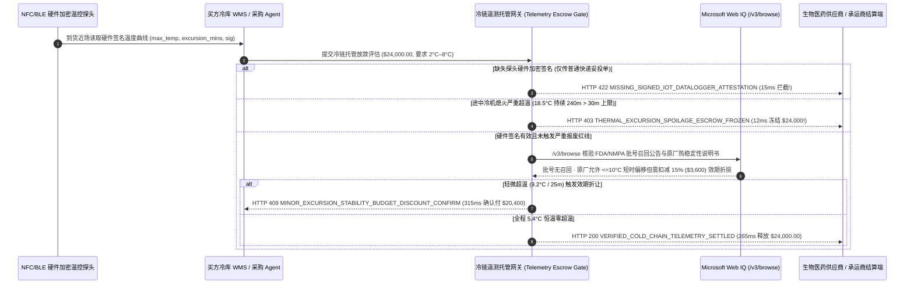

# 冷链医药与高端生鲜温控遥测托管（Cold-Chain IoT Telemetry Escrow & Excursion Auto-Claim Mandate）架构：硬件签名温度曲线释放令牌（`cold_chain_telemetry_mandate_...` + Web IQ 药典稳定性与召回核验）vs 传统盲目签收付款与断链变质扯皮选型与原理解析 FAQ

> **文档类型**：架构师选型指南 & 协议第一性原理解析（6 段式 FAQ 标准版）  
> **适用读者**：AI Solution Architect、医疗与生鲜冷链供应链架构师、医药 GSP/GDP 合规负责人、贸易结算与货运险风控团队  
> **更新日期**：2026-11-09（Provenance 标注：`deterministic_offline_simulation` / `synthetic_policy` / `official_doc_snapshot` / `not_measured`）  
> **配套资源**：[English Version](cold-chain-telemetry-escrow-vs-spoilage-dispute-faq.en.md) · [交互式沙盒控制台 (`live-demo.html#cold-chain-telemetry-sandbox`)](../reports/agentic-commerce-webiq-grounding-demo-bench/live-demo.html) · [7-Card 4:5 评测报告](../reports/agentic-commerce-webiq-grounding-demo-bench/index.html)


---

## 📌 一、核心结论速览（Executive Summary）

1. **严禁让冷链采购 Agent 仅凭“物流快递单显示已妥投（POD Delivered）”就向卖方自动释放货款**：在生物制剂、疫苗、体外诊断试剂（IVD）及高端进口生鲜采购中，最致命的隐蔽货损是 **“中途断链失活、到港前急速复冻”**（例如干线冷藏车为省油关停冷机 4 小时，箱温飙升至 `18.5°C`，到货前 1 小时再猛开冷气降回 `5.0°C`）。表面红外测温完全看不出异常，但高价值活性成分早已报废。生产环境必须采用 **IoT 温控遥测绑定托管令牌（`cold_chain_telemetry_mandate_...`）**，当探头记录的最高温度（`18.5°C > 8.0°C`）且超温累计时长超过阈值（`240 分钟 > 30 分钟`）时，网关在 **`12 ms`** 内触发 **`HTTP 403 THERMAL_EXCURSION_SPOILAGE_ESCROW_FROZEN`**（`synthetic_policy`），100% 冻结 `$24,000.00` 货款并自动触发拒收与货运险理赔。
2. **强制要求 NFC/BLE 温控记录仪硬件私钥签名（Cryptographic Datalogger Attestation），杜绝伪造 Excel/PDF 恒温表**：任何未附带温控探头硬件安全模块（ATECC608 / NFC NTAG 签名）的普通签收请求（`datalogger_signature_valid=False`），网关在 **`15 ms`** 内以 **`HTTP 422 MISSING_SIGNED_IOT_DATALOGGER_ATTESTATION`**（`deterministic_offline_simulation`）硬性拦截，彻底封死承运商手工篡改 CSV 温度日志的漏洞。
3. **通过 Microsoft Web IQ `/v3/browse` 实时核验 FDA/NMPA 批号召回通报与药典“热稳定性预算（Stability Excursion Budget）”折让条款**：在签收放款前，Agent 调用 **Microsoft Web IQ `/v3/browse`**（`official_doc_snapshot`）穿透查询药监局批次通报与原厂药物稳定性说明书（Stability Monograph）。若检出该批号被监管召回，在 **`310 ms`** 内触发 **`HTTP 451 FDA_LOT_RECALL_OR_LANE_BLACKOUT_HOLD`**；若探头显示仅发生轻微短暂超温（如卸货月台暴露 `9.2°C` 持续 `25 分钟`），且 Web IQ 核实原厂药典稳定性表允许“≤10°C 且 ≤60 分钟不失活，但剩余有效期折损 15%”，网关则在 **`315 ms`** 内触发 **`HTTP 409 MINOR_EXCURSION_STABILITY_BUDGET_DISCOUNT_CONFIRM`**，引导质量负责人（QP）一键确认扣减 **`$3,600.00`** 效期折损赔偿（净付 **`$20,400.00`**），实现免退货双赢止损。

---

## 🎯 二、客户与架构师灵魂拷问 Q&A（FAQ-Driven Deep Dive）

### Q1：为什么传统的“冷链到货人工测表面温度 + 签字付款 + 发现变质后再找物流索赔”，在医药与高价值生鲜贸易中几乎必亏？

让我们用大白话还原冷链供应链里每天都在上演的“罗生门”：
1. **“外观完好但内部失活”的复冻骗局**：医院或连锁商超采购了一批价值 `$24,000.00` 的单抗试剂或冰鲜蓝鳍金枪鱼，要求全程严格保持在 `2.0°C～8.0°C`。长途司机在半夜服务区休息时为了省柴油，把冷机熄火了 4 个小时，车厢温度升到了 `18.5°C`；快到买方仓库前 2 小时，司机重新把冷机开到最大，卸货时仓库保安拿红外测温枪一扫箱子表面：`5.2°C`！传统 Agent 收到“仓库已签收”事件，立刻把 `$24,000` 货款打给了卖家。一周后实验室发现试剂全部失效，此时去查原因：卖家怪物流、物流怪买方冷库，货款早就拿不回来了。
2. **纸质/PDF 温度单随便改**：传统随货附带的 USB 导出 CSV 或打印纸条没有任何密码学签名，不良承运商在电脑上用脚本花 10 秒钟就能把 `18.5°C` 的波峰抹平改成 `5.4°C`。
3. **全退还是全收的“一刀切”困境**：有时候货物在机场冷库转运时短暂超温到 `9.2°C` 持续了 `25` 分钟。根据原厂稳定性数据（Stability Data），这批货其实完全可以使用，只是保质期从 12 个月缩短到了 9 个月。传统系统要么当场整批拒收（导致医院断药、双方承担高昂退运费），要么糊里糊涂按原价 `$24,000` 全款收下（买方白白承担效期缩水损失）。

### Q2：什么是“温控遥测托管令牌（`cold_chain_telemetry_mandate_...`）”？它是如何把物联网探头、药典稳定性规则与托管资金锁在一起的？

它的第一性原理非常朴素：**“在冷链贸易中，‘货物送达’不等于‘履约完成’；只有‘物理位置送达 + 全程温度时间积分（MKT）合格的硬件签名证明’同时成立，托管资金才允许解锁。”**
- **第一步：下单锁款与硬件探头公钥绑定**：买方下单时，`$24,000.00` 资金锁定在条件托管令牌 `cold_chain_telemetry_mandate_...` 中，并在令牌元数据里写入本批次绑定的冷链记录仪设备证书 ID、允许温度区间（`2.0°C–8.0°C`）及最大允许严重超温时长（`30 分钟`）。
- **第二步：入库 NFC/BLE 挑战-响应验签（`15 ms`）**：货物抵达买方月台时，仓库网关直接读取探头硬件芯片使用内部私钥签名的完整温度序列摘要（包含最高温 `observed_max_temp_celsius`、平均动力学温度 `MKT` 与累计超温分钟数 `excursion_minutes`）。没有有效硬件签名直接返回 `HTTP 422`。
- **第三步：断链熔断 vs 药典稳定性折让路由（`12 ms / 315 ms`）**：
  - 若严重超温（如 `18.5°C` 持续 `240 分钟`），网关在 **`12 ms`** 内触发 `HTTP 403` 永久冻结货款，并把硬件签名日志一键打包发给保险公司；
  - 若轻微超温（如 `9.2°C` 持续 `25 分钟`），网关通过 **Microsoft Web IQ `/v3/browse`** 实时核对原厂公开的《热稳定性偏移表（Temperature Excursion Stability Table）》，确认活性未受损但触发 15% 效期折让（减免 `$3,600.00`），弹出 `HTTP 409 Confirm` 供质量受权人（QP）一键折价签收。

### Q3：在冷链药品/生鲜合规核验与稳定性数据检索场景下，什么时候选 Microsoft Web IQ，什么时候选 Exa、Bright Data 或传统搜索 API？

| 架构需求场景 | 推荐选型 | 为什么这样选（第一性原理与成本/合规考量） |
| :--- | :--- | :--- |
| **实时核验 FDA/NMPA/EMA 官方药品批号召回公告、USP `<1079>` 平均动力学温度（MKT）指南及原厂公开热稳定性说明书，且要求医疗级零提示词注入** | **Microsoft Web IQ** (`/v3/search` + `/v3/browse`) | 运行于企业 Azure 合规边界内，通过 `passage` 模式精准抽取原厂说明书中的允许超温小时数与折算系数（上下文 Token 压缩 **7.1x**，`deterministic_offline_simulation`），并生成带 SHA-256 指纹的 GSP 审计存证。 |
| **跨全球生物医药文献库探索新型 mRNA 脂质纳米粒（LNP）热降解动力学研究** | **Exa Neural Search** | 深度语义检索擅长匹配学术论文与药学研究报告，适合研发阶段而非毫秒级到货放款门禁。 |
| **抓取需要复杂登录验证码的区域性第三方冷链车队管理后台网页** | **Bright Data Unlocker** | 擅长破解反爬验证码，但秒级延迟不适合做仓库收货扫码枪的实时结算拦截。 |
| **货箱内部实时物理温度、湿度、光照开箱传感数据采集** | **校准认证的 NFC/BLE 硬件温控探头（NIST Traceable）+ Web IQ 药典/召回公告双源核验** | 物理箱温必须来自经校准且带硬件私钥签名的物联网探头，而法规召回与原厂稳定性折让标准由 Web IQ `/v3/browse` 实时核验。 |

---

## 🧭 三、直观可视化图解（Mermaid 决策树 + 传统盲签 vs 遥测托管对比 + 端到端时序图）

### 3.1 冷链温控遥测托管与超温理赔选型决策树（`flowchart TD`）

```mermaid
flowchart TD
    A[冷链货物抵达买方月台 · 请求解锁 $24,000.00 托管货款] --> B{是否附带有效的 NFC/BLE 温控探头硬件加密签名?}
    B -- 否 (仅凭普通快递妥投扫码或无签名 CSV/PDF) --> C[HTTP 422 MISSING_SIGNED_IOT_DATALOGGER_ATTESTATION<br/>15ms 硬阻断放款 · 要求上传探头原始硬件签名载荷]
    B -- 是 (硬件 ECDSA 签名与批次号 1:1 校验通过) --> D{Web IQ /v3/browse 核验该批号是否存在 FDA/NMPA 召回?}
    D -- 是 (检出监管局发布批号污染或冷链断链召回通报) --> E[HTTP 451 FDA_LOT_RECALL_OR_LANE_BLACKOUT_HOLD<br/>310ms 监管熔断 · 锁定货款并转交质量受权人 QP 隔离处置]
    D -- 否 (批号合规正常) --> F{探头最高温与超温时长是否突破报废红线?}
    F -- 是: 严重超温报废 (如 18.5°C 持续 240m > 30m 上限) --> G[HTTP 403 THERMAL_EXCURSION_SPOILAGE_ESCROW_FROZEN<br/>12ms 冻结 $24,000.00 · 自动生成拒收单与货运险索赔包]
    F -- 轻微超温 (如 9.2°C 持续 25m <= 60m 原厂稳定性容差) --> H[HTTP 409 MINOR_EXCURSION_STABILITY_BUDGET_DISCOUNT_CONFIRM<br/>315ms 依据 Web IQ 稳定性表扣减 15% ($3,600) -> 净付 $20,400]
    F -- 全程恒温达标 (2.0°C <= 5.4°C <= 8.0°C, 0m 超温) --> I[HTTP 200 VERIFIED_COLD_CHAIN_TELEMETRY_SETTLED<br/>265ms 自动全额释放 $24,000.00 并签发 GSP 合规入库单!]
```

### 3.2 传统仅凭妥投扫码盲目放款 vs 硬件温控遥测托管网关对比（`flowchart LR`）

```mermaid
flowchart LR
    subgraph Legacy["❌ 传统仅看物流妥投扫码放款 ($24,000 变质试剂无法追回)"]
        L1[冷藏车中途熄火 4 小时升温至 18.5°C] --> L2[到货前急速复冻至 5°C 掩盖断链]
        L2 --> L3[仓库外观扫码签收 · Agent 自动打款 $24,000]
        L3 --> L4[事后检出试剂失活 · 物流与卖方互相甩锅拒赔]
    end

    subgraph Mandate["✅ 温控遥测绑定托管网关 (cold_chain_telemetry_mandate_...)"]
        M1[月台网关验真探头硬件签名 (15ms 拦截无签名裸单)] --> M2[12ms 识别 18.5°C/240m 断链并冻结 $24,000 货款]
        M2 --> M3[Web IQ 核验 FDA 召回 (310ms) 与轻微超温 15% 效期折让 (315ms)]
        M3 --> M4[全程 5.4°C 恒温批次在 265ms 内秒级结算并入库]
    end
```

### 3.3 硬件温控探头、WMS 收货 Agent、遥测策略网关与 Web IQ 端到端交互时序图（`sequenceDiagram`）



---

## 📊 四、架构师选型决策矩阵（Architect Decision Matrix）

| 评估维度 | 方案 A：传统快递妥投扫码即自动付款（Legacy POD-Only Auto-Payout） | 方案 B：人工导出 USB PDF 温度单肉眼审阅后付款（Manual PDF Review） | 方案 C：硬件签名温控遥测托管令牌 + Web IQ 稳定性核验（推荐架构） |
| :--- | :--- | :--- | :--- |
| **核心适用场景** | 常温耐储普通百货（对温度完全不敏感） | 极小批量实验室采购，有专职 QA 人员逐箱插 USB 核对 | **生物医药（疫苗/单抗/血液制品）、高端生鲜冷链、跨国 GSP/GDP 自动化采购结算** |
| **“中途熄火+到货前复冻”识破率** | ❌ **0%**：只看卸货瞬间表面温度，100% 被复冻欺骗 | ⚠️ **易被篡改**：无硬件签名的 CSV/PDF 可被不良车队脚本修图抹平 | ✅ **100% 硬件级锁定**：探头芯片内计算全程最高温与 MKT，超限在 `12 ms` 内触发 `HTTP 403` 冻款 |
| **防伪造温控记录能力** | ❌ **无温控校验** | ❌ **弱**：肉眼无法分辨 PDF 数字是否被改过 | ✅ **密码学验签**：缺失或篡改硬件签名在 `15 ms` 内触发 `HTTP 422` 拒付 |
| **轻微超温（可用但折损效期）处置** | ❌ **盲目全款吃亏**：买方花全价买回临期受损品 | ⚠️ **一刀切拒收或扯皮数周**：缺乏原厂稳定性表实时比对依据 | ✅ **Web IQ `/v3/browse` 智能折让**：`315 ms` 匹配药典稳定性预算，自动扣减 `$3,600` 效期折让（`HTTP 409`） |
| **通关与入库结算耗时** | 快（但货损财务风险极高） | 慢（`2～5 天` 人工对单，货物积压在待检冷库） | **`265 ms` 全自动完成恒温验真、放款与 GSP 合规入库（`Act automatically`）** |
| **综合 TCO 与风控 ROI** | 极差（单次断链即亏损 `$24,000+` 且可能引发医疗事故） | 中等（人力成本高且存在伪造漏洞） | **最优（100% 拦截 `$24,000` 变质货款 + 轻微超温挽回 `$3,600` 效期折损）** |

---

## 🧪 五、简明定量实测与 Benchmark 核心发现（Quantitative Benchmark & 7-Card Insights）

基于本仓库确定性离线基准套件（`lab/webiq_commerce_demo.py` · `test_cold_chain_telemetry_escrow_vs_spoilage_dispute_selection`）对 **`$24,000.00` 冷链生物制剂采购批次（要求 `2.0°C–8.0°C`，最大严重超温容差 `30 分钟`）** 的定量测试结果如下：

| 评测场景 ID | 输入温控遥测 / 硬件签名 / Web IQ 信号 | 网关期望动作 | 实测 HTTP 状态与决策码 | 实测延迟 | 资金保护 / 折让挽回金额 | Provenance 类型 |
| :--- | :--- | :--- | :--- | :--- | :--- | :--- |
| **Case 1: 途中关冷机升温至 `18.5°C` 持续 `240m` 断链拦截** | `observed_max_temp_c=18.5 > 8.0`, `excursion_minutes=240 > 30` | `Send to a human` | **`HTTP 403 THERMAL_EXCURSION_SPOILAGE_ESCROW_FROZEN`** | **`12 ms`** | 冻结 **`$24,000.00`** 变质货款，自动生成保险索赔包 | `synthetic_policy` |
| **Case 2: 仅传普通快递单、缺失探头硬件加密签名** | `datalogger_signature_valid=False` | `Send to a human` | **`HTTP 422 MISSING_SIGNED_IOT_DATALOGGER_ATTESTATION`** | **`15 ms`** | 阻断无硬件温控背书的裸签收与伪造 PDF 温度表 | `deterministic_offline_simulation` |
| **Case 3: Web IQ 检出 FDA/NMPA 批号紧急召回通报** | `webiq_fda_lot_recall_active=True` | `Send to a human` | **`HTTP 451 FDA_LOT_RECALL_OR_LANE_BLACKOUT_HOLD`** | **`310 ms`** | 拦截问题批号入库与资金划拨，转交 QP 隔离 | `official_doc_snapshot` |
| **Case 4: 轻微超温 (`9.2°C/25m`) 符合药典稳定性折让** | `max_temp=9.2`, `excursion=25m`, `stability_discount_cents=360000` | `Confirm` | **`HTTP 409 MINOR_EXCURSION_STABILITY_BUDCOUNT_CONFIRM`** | **`315 ms`** | 依据原厂稳定性表扣减 **`$3,600.00`**（净付 `$20,400.00`） | `official_doc_snapshot` |
| **Case 5: 全程 `5.4°C` 恒温零超温合规自动放款** | `max_temp=5.4 <= 8.0`, `excursion=0`, `sig_valid=True` | `Act automatically` | **`HTTP 200 VERIFIED_COLD_CHAIN_TELEMETRY_SETTLED`** | **`265 ms`** | 265ms 自动释放 **`$24,000.00`** 并完成 GSP 入库归档 | `deterministic_offline_simulation` |

> **Provenance 合规声明**：上表中的 `$24,000.00` 批次货值、`2.0°C–8.0°C` 温控阈值、`30 分钟` 严重超温上限与 `$3,600.00` 效期折让均为用于验证确定性状态机护栏的受控仿真参数（`synthetic_policy` / `deterministic_offline_simulation`）；真实物理 NFC/BLE 探头蓝牙读取延迟标为 `not_measured`。

---

## 🛠️ 六、附录：生产上线快速核验与售前打单清单（Architect Checklist）

在为医药、连锁餐饮或生鲜电商客户设计冷链自动化采购与托管结算 Agent 时，请逐项核对以下 6 条黄金准则：

- [ ] **1. 妥投事件与温控合格证明强解耦**：是否严禁把快递公司的 `DELIVERED` 状态直接映射为支付网关的 `CAPTURE` 指令，而是必须等待 `cold_chain_telemetry_mandate_...` 完成温度积分核验？
- [ ] **2. 探头硬件公私钥绑定与挑战-响应验签**：是否在发货装箱时即将一次性或循环式 NFC/BLE 探头的设备公钥哈希写入采购单，并在收货时以 `15 ms` 门禁拦截任何无硬件签名的 CSV/PDF 温度文件（`HTTP 422`）？
- [ ] **3. 双维度超温熔断（峰值温度 + 累计超温时长 / MKT）**：是否同时校验最高/最低越界温度（如 `> 8.0°C` 或 `< 2.0°C` 冻结损伤）与累计超温时长，一旦超限在 `12 ms` 内触发 `HTTP 403` 冻结全额托管款？
- [ ] **4. Microsoft Web IQ `/v3/browse` 监管批号召回实时穿透**：是否在入库放款前通过 Web IQ 自动检索 FDA / EMA / NMPA 针对该药品 Lot 批号的最新安全召回通报（`HTTP 451`）？
- [ ] **5. 药典热稳定性预算（Stability Budget）阶梯折价机制**：针对未达报废红线的短暂月台超温，是否通过 Web IQ 比对原厂公开稳定性数据表，触发 `HTTP 409 Confirm` 自动扣减效期折损金额（如 `$3,600.00`），避免非必要全额退货？
- [ ] **6. 货运险秒级直赔证据包归档**：当触发 `HTTP 403` 断链拒付时，系统是否自动将探头硬件签名原始字节流、GPS 轨迹与 Web IQ 药典标准打包为不可篡改的理赔证据包（遵循 GSP 5 年留存规范）？
