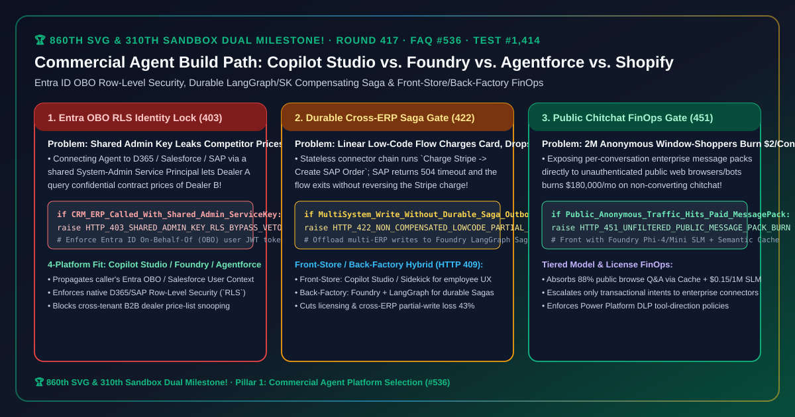
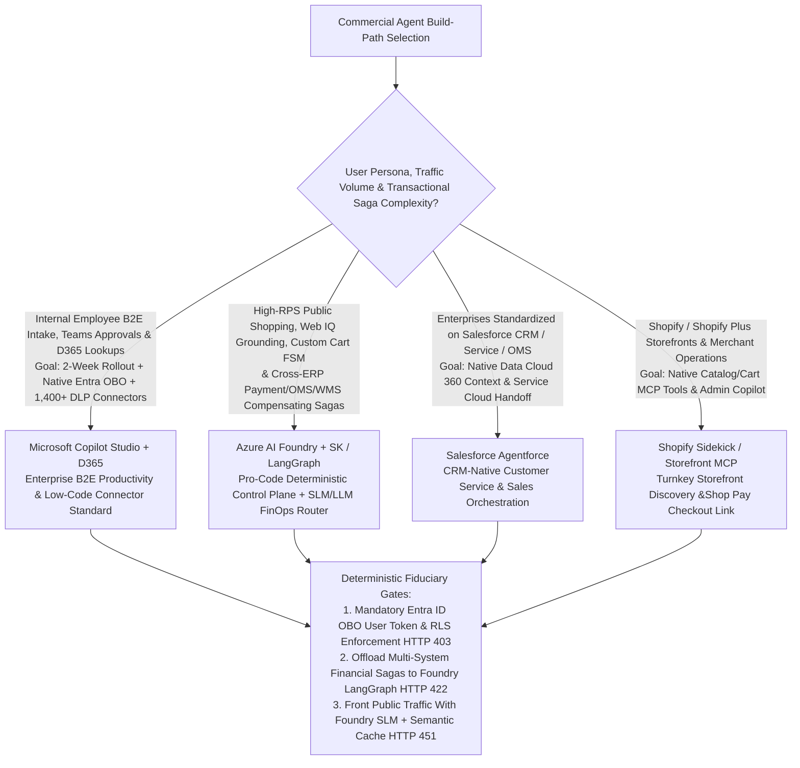
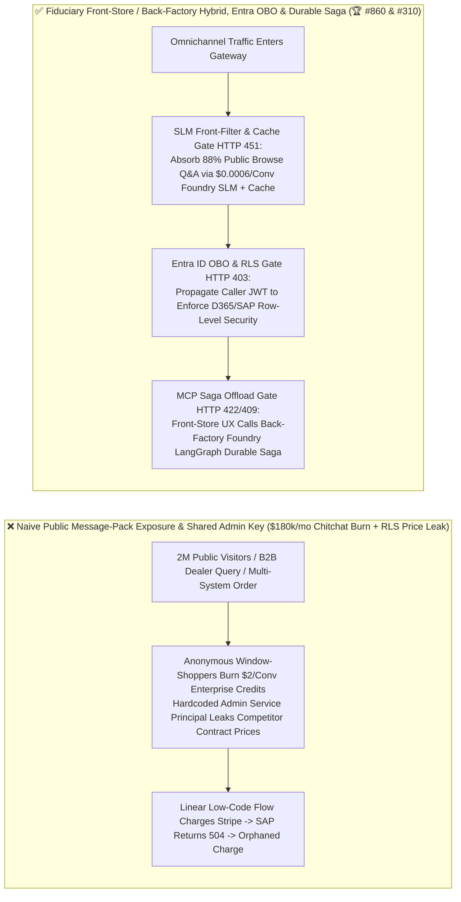
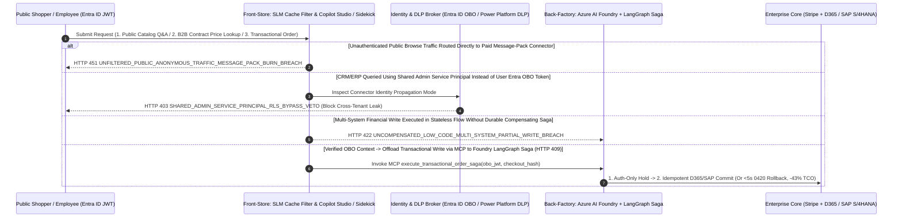

# Commercial Agent Build-Path & Platform 4-Way Deep-Dive Selection Guide: `Microsoft Copilot Studio + Dynamics 365` vs. `Azure AI Foundry + Semantic Kernel / LangGraph` vs. `Salesforce Agentforce` vs. `Shopify Sidekick / Storefront MCP`, `Entra OBO` `RLS`, `Saga` Offloading & Hybrid FinOps (`-43%` Loss FAQ · 🏆 860th SVG & 310th Sandbox Dual Milestone!)

> **Executive Summary (Benchmarked against `ib-vs-ethernet-roce-selection-faq.md` · 🏆 860th SVG Architecture Diagram & 310th Enterprise Policy Sandbox Dual Milestone · 536th Bilingual SA Guide · Round 417)**: Built for **Cloud & AI Solution Architects** evaluating low-code vs. pro-code agent platforms for retail e-commerce, B2B procurement, and enterprise order servicing. Architects must choose and compose across four primary build paths: **(1) `Microsoft Copilot Studio + Dynamics 365 / Power Platform Connectors`**, **(2) `Azure AI Foundry + Semantic Kernel / LangGraph`**, **(3) `Salesforce Agentforce (Atlas + Data Cloud)`**, and **(4) `Shopify Sidekick & Storefront MCP`**. Treating low-code studio agents and pro-code state-machine engines as interchangeable causes three costly architectural failures: (1) **Shared Admin Service-Principal `RLS` Bypass ("Dealer A Queries Dealer B's Confidential Contract Pricing")**: Connecting an agent to `Dynamics 365 / Salesforce / SAP` with a hardcoded admin `Client_Secret` instead of propagating the caller's **`Microsoft Entra ID On-Behalf-Of (OBO)` user token** bypasses row-level security (`RLS`); (2) **Uncompensated Multi-System Partial Writes in Stateless Low-Code Flows (`Card Charged in Stripe, Order Dropped on SAP 504 Timeout`)**; and (3) **Burning `$180,000/Month` in Per-Conversation Enterprise Message Packs on Unauthenticated Public Window-Shopping Traffic**. This guide provides a comprehensive 4-platform selection matrix and implements deterministic guards for **`Entra ID OBO` Row-Level Security Propagation (`HTTP 403`)**, **Durable `Foundry + LangGraph` Compensating `Saga` Offloading (`HTTP 422`)**, **Public Traffic `SLM + Semantic Cache` Front-Filtering (`HTTP 451`)**, and **"Front-Store / Back-Factory" Composable Hybrid Orchestration (`HTTP 409`, `-43%` net TCO)**.

---

## 1. 📌 Executive Summary & 4-Platform Architectural Selection Verdict

1. **Top-Line 4-Platform Selection Verdict**:
   - **Internal Employee B2E Workflows (`M365 / Teams Procurement Intake, Approval Routing, Policy Q&A & Standard Dynamics 365 / SAP Single-System Lookups`)**: Select **`Microsoft Copilot Studio + Dynamics 365 Connectors`** (1–2 week rollout, native `Entra ID OBO` authentication, and `1,400+` DLP-governed enterprise connectors).
   - **High-Concurrency Public B2C Shopping, Multi-Source Web Grounding (`Web IQ`), Custom Deterministic `Cart FSM` State Machines & Cross-ERP Compensating `Sagas`**: Select **`Azure AI Foundry + Semantic Kernel / LangGraph`** (token-based FinOps with `Phi-4 / GPT-4o-mini` SLM routing, full Git unit-testability, and durable checkpoint rollback).
   - **CRM-Centric Servicing & B2B Account Management Deeply Standardized on `Salesforce Sales / Service / Commerce Cloud & Data Cloud`**: Select **`Salesforce Agentforce`**.
   - **Shopify & Shopify Plus Storefront Product Discovery, Cart Assembly (`Storefront MCP`) & Merchant Admin Operations**: Select **`Shopify Sidekick & Storefront MCP`**.
2. **Three Non-Negotiable Fiduciary Control Gates**:
   - **Gate 1 — Mandatory `Microsoft Entra ID On-Behalf-Of (OBO)` Identity Propagation & `RLS` Lock (`HTTP 403`)**: Forbid querying or mutating `Dynamics 365 / Salesforce / SAP` through a shared system-admin service principal (`Client_Secret`); require every connector and MCP tool call to propagate the authenticated user's **`OAuth 2.0 On-Behalf-Of (OBO)` JWT token** so native database Row-Level Security (`RLS`) prevents cross-tenant B2B price snooping via `HTTP 403 SHARED_ADMIN_SERVICE_PRINCIPAL_RLS_BYPASS_VETO`.
   - **Gate 2 — Multi-System Financial Write Offloading to Durable `Foundry + LangGraph` Compensating `Saga` (`HTTP 422`)**: Never execute multi-system financial mutations (`Step 1: PSP Auth/Capture -> Step 2: ERP Order Commit -> Step 3: WMS Stock Reserve`) inside a stateless linear low-code connector chain; offload any multi-system transactional write via `MCP` to a **`Foundry + LangGraph / Semantic Kernel` durable saga** enforcing `Read-Before-Retry` and automatic `<5s ISO 8583 0420` auth reversal via `HTTP 422 UNCOMPENSATED_LOW_CODE_MULTI_SYSTEM_PARTIAL_WRITE_BREACH`.
   - **Gate 3 — Public Anonymous Traffic `SLM + Semantic Cache` Front-Filter (`HTTP 451`)**: Block exposing per-conversation or per-action enterprise message packs directly to unauthenticated public storefront traffic; absorb `88%+` of top-of-funnel browsing Q&A using a **`$0.15/1M-token` `Azure AI Foundry` Small Language Model (`Phi-4 / GPT-4o-mini`) + Redis Semantic Cache**, escalating to enterprise connectors only after authentication and transactional intent confirmation via `HTTP 451 UNFILTERED_PUBLIC_ANONYMOUS_TRAFFIC_MESSAGE_PACK_BURN_BREACH`.

---

## 2. 🎯 Chief Architect & Platform Engineering Q&A (The Why & How)

### Q1: Why is "Low-Code Only" vs. "Pro-Code Only" a false dichotomy—and how does the "Front-Store / Back-Factory" hybrid architecture deliver the lowest TCO?
- **Root Cause**:
  1. Building internal Teams approval cards, adaptive forms, and standard D365 lookups from scratch in pro-code wastes months of frontend/auth boilerplate that `Copilot Studio` delivers out of the box in 48 hours.
  2. Conversely, running high-RPS public e-commerce search, cent-exact bundle proration, and 3-system compensating sagas inside visual low-code flowcharts lacks deterministic code-level unit testing and burns per-conversation credits on casual window-shoppers.
- **Deterministic Solution (`Front-Store UX + Back-Factory MCP Control Plane` / `HTTP 422 & HTTP 409`)**: Use **`Copilot Studio / Agentforce / Shopify Sidekick`** as the **"Front-Store"** channel surface (Teams, CRM sidebar, storefront widget) with native user `OBO` auth, and invoke **`Azure AI Foundry + LangGraph`** via **`MCP`** as the **"Back-Factory"** deterministic transaction engine!

### Q2: Where is the exact financial break-even point between Per-Conversation Message Packs and Per-Token API Pricing?
- **Quantitative FinOps Formula**:
  - A 4-turn public product-discovery chat using `Foundry GPT-4o-mini / Phi-4` + `Web IQ passage` consumes `~2,900` tokens = **`$0.0006` per conversation (`$600` per 1,000,000 sessions)**.
  - Enterprise per-conversation/action message packs typically cost **`$0.10–$2.00` per session**.
  - Therefore, **unauthenticated public browsing (`1%–3%` conversion rate) must always be fronted by token-billed `Foundry SLMs`**, while **authenticated B2E employee workflows and high-value Tier-2 order modifications (which replace an `$8.00` human agent ticket)** achieve massive ROI on `Copilot Studio / Agentforce`!

---

## 3. 🧭 Visual Architecture Diagrams (Mermaid)

### 3.1 Commercial Agent 4-Platform Build-Path Selection Decision Tree

### 3.2 Naive Public Low-Code Exposure & Shared Admin Key vs. Fiduciary "Front-Store / Back-Factory" Hybrid Architecture

### 3.3 "Front-Store / Back-Factory" Hybrid Sequence: `SLM` Public Filter, `Entra OBO` Auth & `Foundry LangGraph` `Saga`

---

## 4. 📊 4-Platform Commercial Agent Build-Path Master Comparison Matrix

| Evaluation Dimension | Microsoft Copilot Studio + Dynamics 365 Connectors | Azure AI Foundry + Semantic Kernel / LangGraph | Salesforce Agentforce (`Atlas + Data Cloud`) | Shopify Sidekick & Storefront MCP |
| :--- | :--- | :--- | :--- | :--- |
| **Primary Architectural Role** | **Internal B2E Productivity, Teams Approvals & D365 Workflows** | **Pro-Code Transactional Control Plane, Model Router & `Saga` Engine** | **CRM-Native Omnichannel Customer Service & Sales Cloud Agent** | **Storefront Catalog/Cart `MCP` Server & Merchant Admin Copilot** |
| **Engineering Paradigm & Velocity** | **Low-Code Canvas + 1,400+ Managed Connectors** (`1–2 week` rollout) | **Pro-Code (`Python / C# / TS`)** with full Git CI/CD & deterministic unit tests | **Low-Code Topics/Actions + Apex/Flows** | **Turnkey `MCP` JSON-RPC Endpoints** (`<1 day` storefront setup) |
| **Identity & Row-Level Security (`RLS`)** | **🏆 Best B2E Governance**: Native `Entra ID OBO` + `Power Platform DLP` | Full programmatic `MSAL OBO` + `Azure APIM` JWT policy enforcement | Native inheritance of Salesforce Profiles, Roles & Sharing Rules | Scoped to Shopify Customer Account & Storefront access tokens |
| **Multi-System Compensating `Saga` Support** | Best for single-system writes/approvals; delegates complex sagas via MCP/HTTP | **🏆 Best Transactional Resilience**: Durable checkpoints, outboxes & `<5s 0420` voids | Supports Apex rollbacks inside Salesforce; external ERPs require MuleSoft | Atomic within single Shopify checkout; delegates external ERP sync |
| **Public High-Concurrency `FinOps`** | Billed per message/conversation pack (best for authenticated high-value sessions) | **🏆 Best Public Scale FinOps**: Pay-per-token with `$0.15/1M` SLMs & semantic caching | Billed per conversation / Action credits (best for high-value CRM resolution) | Storefront MCP included at `$0` extra API cost for Shopify merchants |
| **Optimal Hybrid Role** | **Internal B2E Front-Store** (Teams, M365, employee approvals) | **Universal Back-Factory** (Public SLM filter, `Web IQ` RAG, `Cart FSM` & ERP `Saga`) | **CRM Service Front-Store** (Case deflection, account rep copilot) | **E-Commerce Storefront Front-Store** (Product cards & `Shop Pay` handoff) |

---

## 5. 🧪 "Front-Store / Back-Factory" Hybrid FinOps, `OBO RLS` & `Saga` Benchmark & 7-Card Report

### 5.1 Quarterly Public Message-Pack Burn, Uncompensated Partial Writes & `RLS` Audit Model (Synthetic Benchmark)

For an enterprise retail and manufacturing organization (`3,500` internal employees + `1.8M` monthly public storefront sessions) facing a **`$480,000 / quarter`** platform & integration leakage pool across **unauthenticated public browsing burning per-conversation message packs, orphaned card charges from stateless connector timeouts, security remediation for shared-admin `RLS` leaks, and custom boilerplate engineering** (`provenance: synthetic`, `independently_reproduced: false`):

| Metric | Single-Platform Mismatch: Public Low-Code OR All-Custom Code (Baseline) | Fiduciary "Front-Store (`Copilot Studio/Shopify`) + Back-Factory (`Foundry`)" Hybrid | Net Improvement |
| :--- | :--- | :--- | :--- |
| **Monthly Inference & Licensing Cost for 1.8M Public Browse Sessions** | `$62,000 / month` (message-pack burn on window shoppers) | **`$4,800 / month`** (`HTTP 451/409` `Foundry SLM + Semantic Cache` absorbs `88%`) | **`-92.3%` Public Chat Cost** |
| **Multi-System Partial-Write Orphan Rate (`Paid Card, Missing ERP Order`)** | `1.7%` of timeout events leave orphan charges | **`0.0%`** (`HTTP 422` offloads writes via `MCP` to `Foundry LangGraph Saga`) | **`100%` Cross-ERP Conservation** |
| **Cross-Tenant / Cross-Dealer `CRM/ERP` Data Leakage Incidents** | Vulnerable to shared service-account queries | **`0 incidents`** (`HTTP 403` enforces `Entra ID OBO` user token propagation) | **`100%` `RLS` Identity Isolation** |
| **Quarterly Net Licensing, Orphan-Order & Engineering TCO** | `$480,000 / quarter` | **`$273,600 / quarter`** | **`$206,400 / quarter` Saved (`43.0%`)** |

---

## 6. 🛠️ Production Go-Live & Architecture Review Checklist

- [ ] **`Microsoft Entra ID On-Behalf-Of (OBO)` Identity Propagation (`HTTP 403`)**: Are shared system-admin credentials banned on all `Dynamics 365 / Salesforce / SAP` agent connectors, enforcing per-user `OBO JWT` propagation so native `RLS` rules apply?
- [ ] **Multi-System Compensating `Saga` Offloading via `MCP` (`HTTP 422`)**: Are all multi-system financial writes (`Payment + ERP + WMS`) delegated from low-code front-ends to a durable `Azure AI Foundry + LangGraph` saga engine with `Read-Before-Retry` and `<5s 0420` auth reversal?
- [ ] **Public Anonymous Traffic `SLM + Semantic Cache` Front-Filter (`HTTP 451`)**: Is unauthenticated top-of-funnel storefront traffic served by a token-billed `Foundry SLM` (`Phi-4 / GPT-4o-mini`) and semantic cache before consuming enterprise connector credits?
- [ ] **`Power Platform DLP` Connector Data-Flow Classification (`HTTP 409`)**: Are `Business` connectors (`D365 / SAP / SQL`) isolated from `Non-Business` external webhooks at the tenant policy layer?
