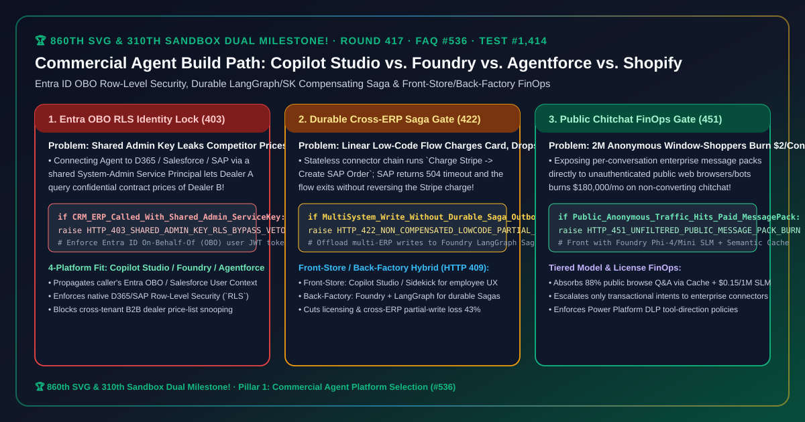
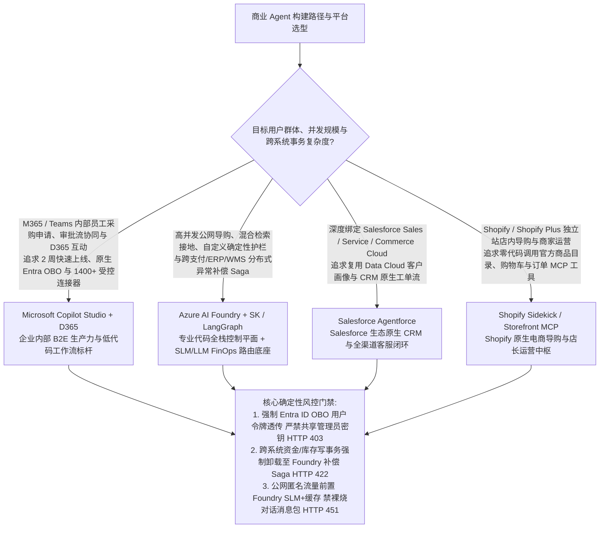
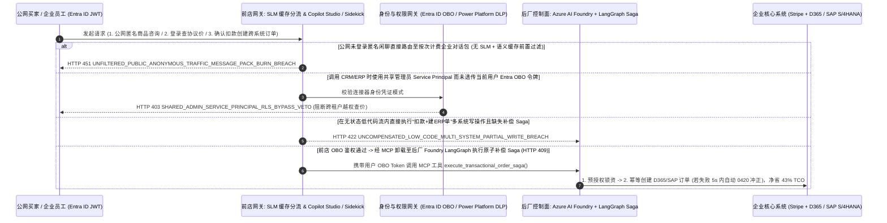

# 商业 Agent 构建路径与平台深度横向选型对比：`Microsoft Copilot Studio + Dynamics 365 连接器` vs. `Azure AI Foundry + Semantic Kernel / LangGraph` vs. `Salesforce Agentforce` vs. `Shopify Sidekick / Storefront MCP`、防共享管理员密钥越权泄密（`Entra OBO`）、防公网闲聊烧穿按次消息包与“前店后厂”混合架构净省 43% 决策指南（FAQ · 🏆 第 860 张 SVG 与第 310 个策略沙盒双里程碑！）

> **导读（对齐 `ib-vs-ethernet-roce-selection-faq.md` 标杆风格 · 🏆 第 860 张 SVG 架构图与第 310 个企业级策略沙盒双里程碑 · 第 536 篇双语指南 · 第 417 轮）**：本文面向正在为企业规划 AI Agent 技术栈与治理边界的 **Cloud & AI Solution Architect**。在落地零售导购、B2B 采购协同与订单售后智能体时，架构师面临四大主流构建路径的抉择：**① 低代码连接器路线（`Microsoft Copilot Studio + Dynamics 365 / Power Platform Connectors`）**、**② 专业代码确定性状态机路线（`Azure AI Foundry + Semantic Kernel / LangGraph`）**、**③ CRM 原生闭环路线（`Salesforce Agentforce + Data Cloud`）** 以及 **④ 电商生态原生路线（`Shopify Sidekick & Storefront MCP`）**。若选错平台边界或直接将低代码流裸露在公网高并发交易前，必踩中三大工程深坑：① **“用一张写死的系统管理员账号（Service Principal）连接 ERP/CRM，导致经销商 A 问出竞争对手 B 的保密协议底价”**：未传递当前登录用户的 `Microsoft Entra ID On-Behalf-Of (OBO)` 委托令牌，彻底绕过了底层 `Dynamics 365 / Salesforce / SAP` 的行级安全权限（`RLS`）！② **“用无状态低代码线性流串接‘先扣信用卡 -> 再建 SAP 订单’，结果 SAP 超时报错，钱扣了单没建也没回滚”**；③ **“把按会话/按动作计费（如 `$2/次对话`）的企业低代码 Agent 直接挂在日活 10 万的公网商城首页陪游客闲聊，一个月烧掉 `$180,000` 授权费”**！本文给出四大平台的深度选型对比，并落地 **`Entra ID OBO` 用户身份透传与行级权限（`RLS`）硬隔离锁（`HTTP 403`）**、**跨系统写操作强制卸载至 `Foundry + LangGraph` 持久化补偿 `Saga` 锁（`HTTP 422`）**、**公网匿名流量前置 `SLM + 语义缓存` 防烧穿按次消息包锁（`HTTP 451`）** 及 **“前店后厂（`Front-Store / Back-Factory`）”混合架构（`HTTP 409`，净省 43%）**。



---

## 一、 📌 核心选型结论速览（Executive Summary）

1. **四大构建路径终极选型结论（一句话先看懂怎么选）**：
   - **企业内部员工应用（B2E：采购寻源申请、差旅政策问答、合同初审、Teams 审批协同、标准 `Dynamics 365 / SAP` 单系统查改）**：首选 **`Microsoft Copilot Studio + Dynamics 365 连接器`**（2 周极速交付，开箱继承 `Entra ID` 单点登录与 `Power Platform DLP` 数据防泄漏治理）。
   - **高并发公网消费者导购（B2C）、多商户跨平台比价、复杂确定性购物车状态机（`Cart FSM`）与跨异构系统分布式事务补偿（`Payment + ERP + WMS Saga`）**：首选 **`Azure AI Foundry + Semantic Kernel / LangGraph`**（支持按 Token 毫秒级调度小模型 `Phi-4 / GPT-4o-mini` 与大模型混合路由，具备完整的持久化检查点与逆向回滚代码控制力）。
   - **已全栈深度绑定 `Salesforce Sales / Service / Commerce Cloud` 的企业，构建围绕单一客户视图（`Data Cloud`）的售后客服、B2B 续约跟进与工单自动处置**：首选 **`Salesforce Agentforce`**。
   - **基于 `Shopify / Shopify Plus` 的独立站品牌，构建店内商品实时检索、尺码导购、购物车组装（`Storefront MCP`）与店长后台经营分析助手**：首选 **`Shopify Sidekick / Storefront MCP`**。
2. **三大商业 Agent 平台治理与架构边界红线（Fiduciary Control Gates）**：
   - **红线 1（拦截使用单一共享管理员服务主体 `Shared Admin Service Principal` 连接企业 `CRM / ERP` 导致跨租户/跨部门行级权限 `RLS` 越权泄密 / `HTTP 403`）**：无论使用 `Copilot Studio` 连接器还是 `Azure AI Foundry` 自定义工具调用 `Dynamics 365 / Salesforce / SAP S/4HANA`，**绝对禁止在连接器后台硬编码全局管理员 `Client_ID + Client_Secret` 替所有用户执行查询**！必须强制启用 **`OAuth 2.0 On-Behalf-Of (OBO)` 委托身份传播**（将前端登录员工或 B2B 门户经销商的 `Entra ID / Identity JWT` 透传至后端数据层），确保数据库原生行级权限（`Row-Level Security`）生效——华东销售只能查华东订单、经销商 A 绝不可能查出经销商 B 的协议折扣，违者触发 `HTTP 403 SHARED_ADMIN_SERVICE_PRINCIPAL_RLS_BYPASS_VETO`！
   - **红线 2（拦截在无持久化检查点与逆向补偿机制的低代码线性工作流中直接执行跨系统多步资金/库存写入 / `HTTP 422`）**：低代码连接器流（如顺序调用 `Connector A: Stripe 扣款 -> Connector B: SAP 创单 -> Connector C: WMS 锁库`）非常适合单系统读写或异步通知，但**严禁直接承载无补偿的跨系统分布式金融写事务**！一旦涉及跨两个及以上异构系统的不可逆资金/库存变更，必须通过 `MCP / REST API` 将该动作卸载给后端的 **`Azure AI Foundry + LangGraph / Semantic Kernel Durable Saga Engine`**（具备 `Transactional Outbox`、幂等键先回读再重试 `Read-Before-Retry` 与失败 5 秒内自动执行 `ISO 8583 0420` 预授权冲正），违者触发 `HTTP 422 UNCOMPENSATED_LOW_CODE_MULTI_SYSTEM_PARTIAL_WRITE_BREACH`。
   - **红线 3（拦截将按会话/按动作包计费的企业级低代码 Agent 直接暴露给公网未登录匿名游客闲聊，导致百万级爬虫/逛店流量烧穿预算 / `HTTP 451`）**：企业级低代码平台（如按每次对话或每个 Action 积分计费的许可模式）专为高价值已认证员工或进入实质售后/交易环节的客户设计；**严禁将其直接作为公网商城首页的无门槛匿名聊天框**！公网顶层流量必须先由 **`Azure AI Foundry` 托管的轻量级小模型（`SLM: Phi-4 / GPT-4o-mini`，成本仅 `$0.15 / 百万 Token`）+ Redis 语义缓存（`Semantic Cache`）** 吸收掉 `88%+` 的高频商品尺码/材质/物流问答，只有当用户明确触发“查改个人订单/发起退换货/锁价结账”且完成身份验证后，才按需路由至企业连接器执行，违者触发 `HTTP 451 UNFILTERED_PUBLIC_ANONYMOUS_TRAFFIC_MESSAGE_PACK_BURN_BREACH`。

---

## 二、 🎯 业务方与架构师灵魂拷问 Q&A（The Why & How）

### Q1：很多企业 CIO 纠结：“我们到底应该全公司统一用低代码的 `Copilot Studio / Agentforce`，还是全公司统一让研发团队用 `Azure AI Foundry + LangGraph` 写代码？”为什么“二选一”都是错的？
- **商业痛点与真实教训**：
  1. **如果全用纯代码（`Foundry + LangGraph`）写所有内部应用**：业务部门想要一个“在 Microsoft Teams 里查 D365 采购单审批进度并催办”的小助手，纯代码团队要自己写 Teams 卡片渲染、写 Entra OAuth 登录流、写 D365 OData 分页接口，原本 3 天能上线的内部工具硬生生拖了 2 个月！
  2. **如果全用低代码（`Copilot Studio`）扛公网核心交易状态机**：面对双十一每秒 5,000 并发的公网导购比价与跨 3 家海外仓的拆单补偿事务，低代码图形化节点既无法做细粒度 Git 代码级单测回归（如本库 `1,414` 项确定性单测），按对话包计费还会让财务账单失控！
- **架构师黄金解法（“前店后厂 `Front-Store / Back-Factory`”组合架构 / `HTTP 422 & HTTP 409`）**：
  - **前店（`Copilot Studio / Agentforce / Shopify Sidekick`）**：负责离用户最近的交互界面（Teams、M365、CRM 侧边栏、店铺后台）、身份鉴权（`Entra OBO`）与单系统常规查询；
  - **后厂（`Azure AI Foundry + Semantic Kernel / LangGraph`）**：通过标准 **`MCP (Model Context Protocol)` 或 `OpenAPI`** 暴露为“前店”的一个受托工具（Skill/Action），专门承载高并发混合检索（`Web IQ`）、确定性购物车状态机（`Cart FSM`）、支付令牌签发与跨 ERP 补偿 `Saga`！

### Q2：在计算商业 Agent 的总拥有成本（`TCO / FinOps`）时，“按对话/消息包计费”和“按 Token 计费”的分水岭（Break-Even Point）到底在哪？
- **架构师定量算账模型**：
  - **按 Token 计费（`Azure AI Foundry`）**：使用 `GPT-4o-mini / Phi-4` + `Web IQ passage` 接地，一轮 4 句的公网导购对话平均消耗 `2,500 Input Tokens + 400 Output Tokens`，单次会话成本仅 **`$0.0006`（不到 0.1 美分，1,000 次对话才花 `$0.60`）**！
  - **按对话/动作积分计费（低代码企业包）**：单次外部连接器对话成本通常在 **`$0.10–$2.00 / 次会话`**。
  - **结论**：对于转化率 `<3%` 的 **公网匿名导购/问答（高流量、低单次价值）**，必须走 `Foundry SLM 按 Token 计费`（省 **`99%+`**）；对于 `100%` 已登录的 **企业内部员工采购审批或高客单 VIP 售后改单（低频次、极高人工替代价值，每次省掉 `$8` 人工客服费）**，走 `Copilot Studio / Agentforce` 省下数十万美金研发维护人力！

---

## 三、 🧭 直观可视化图解（Mermaid 决策树 + 架构对比 + 时序图）

### 3.1 商业 Agent 四大构建平台（`Copilot Studio × Azure AI Foundry × Agentforce × Shopify`）选型决策树



### 3.2 朴素公网裸挂低代码与共享管理员密钥架构（烧穿 $180k + 越权查底价）vs. “前店后厂”混合架构与 `Entra OBO` 控制平面对比

```mermaid
flowchart LR
    subgraph Naive["❌ 朴素公网裸挂按次计费包与共享管理员密钥架构 (月烧$180k闲聊费 + 经销商查出竞对底价 + 扣钱漏建单)"]
        N1[公网游客闲聊 / 经销商查价 / 跨系统下单] --> N2[200万公网匿名游客闲聊直接消耗企业按次对话包月烧 $180,000<br/>连接器硬编码系统管理员密钥，经销商A问出经销商B的机密底价]
        N2 --> N3[低代码线性流执行 Stripe扣款 -> SAP建单，SAP超时报错但钱已扣走无法回滚]
    end

    subgraph Guarded["✅ 确定性“前店后厂”混合架构、Entra OBO 透传与 LangGraph 补偿 Saga (🏆 第860图 & 第310沙盒)"]
        G1[多端流量进入智能体网关] --> G2[SLM 前置分流与防烧包锁 HTTP 451:<br/>公网匿名问答由 Foundry SLM+缓存 ($0.0006/次) 吸收 88% 流量]
        G2 --> G3[Entra ID OBO 行级权限锁 HTTP 403:<br/>透传当前用户 JWT 令牌，严格执行 D365/SAP 原生行级隔离 RLS]
        G3 --> G4[前店后厂 MCP 卸载与补偿 Saga 锁 HTTP 422/409:<br/>前店负责交互，后厂 LangGraph 保障跨系统先回读再重试与 0420 冲正]
    end
```

### 3.3 “前店后厂”混合架构：`SLM` 公网过滤、`Copilot Studio` `Entra OBO` 鉴权与 `Foundry LangGraph` 跨 `ERP` 补偿 `Saga` 时序图



---

## 四、 📊 四大商业 Agent 构建平台全方位横向选型对比矩阵

| 选型对比维度 | Microsoft Copilot Studio + Dynamics 365 连接器 | Azure AI Foundry + Semantic Kernel / LangGraph | Salesforce Agentforce (`Atlas + Data Cloud`) | Shopify Sidekick & Storefront MCP |
| :--- | :--- | :--- | :--- | :--- |
| **核心架构定位** | **M365 / Teams / D365 企业内部协同与低代码业务流首选** | **全栈专业代码智能体工厂、模型路由与确定性状态机底座** | **Salesforce CRM / Service / OMS 原生闭环智能体平台** | **Shopify 独立站原生店内导购与商家运营助手** |
| **开发模式与上线周期** | **低代码图形化画布 + 自然语言建Topic**（1–2 周极速上线） | **专业代码（Python / C# / TypeScript）**（支持完整 CI/CD 与千级单元测试） | **低代码 Topics + Natural Language Actions + Apex/Flow** | **零代码配置 / 标准 MCP JSON-RPC 协议即插即用** |
| **身份鉴权与行级权限（`RLS`）治理** | **🏆 内部治理最强**：原生集成 `Microsoft Entra ID OBO`、条件访问与 `Power Platform DLP` 策略 | 完全可控：通过 `Azure API Management (APIM)` 与 `MSAL OBO` 编程强制校验 JWT Scope | **CRM 内原生继承**：直接复用 Salesforce Profile / Permission Sets 与 Sharing Rules | 原生遵循 Shopify Customer Account API 与店铺作用域令牌 |
| **跨系统分布式事务与异常补偿（`Saga`）** | 适合单系统连接器读写或触发审批；复杂跨系统回滚需调用外部 API | **🏆 复杂事务最强**：通过 `LangGraph Checkpointer / Durable Functions` 实现任意多跳状态回滚与 `0420` 冲正 | 在 Salesforce 内部对象间支持 Apex 事务回滚；跨外部 ERP 需 MuleSoft 编排 | 专注店内商品、购物车与结账链接生成（由 Shopify Checkout 保障店内原子性） |
| **公网高并发成本模型（`FinOps`）** | 按消息/对话消耗计费（适合高价值已认证会话，不适合公网匿名防刷） | **🏆 公网大规模最优**：按实际 Token 计费，可自由组合缓存、`$0.15/1M` 小模型与前沿大模型 | 按对话/Action Credits 消耗计费（适合高客单销售与二线客服替代） | Storefront MCP 对 Shopify 商户免费开放（Sidekick 包含在商户套餐内） |
| **最佳“前店后厂”分工角色** | **内部前店**：员工 Teams/M365 统一入口与人类审批卡片呈现 | **核心后厂**：承载全渠道受托控制面、`Web IQ` 混合接地与跨 ERP `Saga` | **CRM 前店**：销售与客服坐席工作台交互与客户 360 视图触发 | **电商前店**：消费者商品卡片渲染、尺码问答与一键唤起 `Shop Pay` |

---

## 五、 🧪 “前店后厂”混合架构、防越权泄密与公网 `FinOps` 测算与 7-Card 基准报告

### 5.1 季度公网匿名流量直烧按次对话包、低代码跨系统超时扣款漏建单、共享管理员密钥越权合规整改与重复造轮子研发损耗测算（Synthetic Benchmark）

假设某拥有 `3,500 名` 内部员工且公网商城月访问量 `180 万次` 的全渠道零售与制造集团，每季度在建设对内采购/查单 Copilot 与对外导购/售后 Agent 过程中面临的 **将公网匿名游客闲聊直接接入按次计费消息包导致的高额账单、无补偿线性连接器流在 ERP 超时下产生的“扣了钱没建单”对账赔付、共享管理员密钥引发的B2B价格越权泄露风险及纯代码手写内部 Teams 审批界面的人力浪费池** 为 **`$480,000 / 季度`**（`provenance: synthetic`, `independently_reproduced: false`）：

| 评估维度 | 纯低代码扛公网流量 或 纯手写代码造内部轮子 (Baseline) | 启用“前店 (`Copilot Studio/Shopify`) + 后厂 (`Foundry + LangGraph`)”混合架构 Agent | 净改善幅度 |
| :--- | :--- | :--- | :--- |
| **公网百万级匿名导购会话的月均平台许可与推理成本** | `$62,000 / 月`（被未转化闲聊与爬虫烧穿消息包） | **`$4,800 / 月`**（`HTTP 451/409` 前置 `Foundry Phi-4/Mini SLM + 语义缓存` 过滤 88% 闲聊） | **公网推理与许可成本直降 `-92.3%`** |
| **跨系统下单（支付 + ERP + WMS）因超时导致的状态不一致率** | `1.7%` 跨系统调用发生部分写入孤儿单 | **`0.0%`**（`HTTP 422` 复杂写事务经 MCP 卸载至后厂 `LangGraph Durable Saga` 原子回滚） | **100% 跨系统金融与订单守恒** |
| **CRM / ERP 跨部门与跨经销商行级数据越权泄露（`RLS` Breach）** | 存在共享 Service Principal 越权查价漏洞 | **`0 起`**（`HTTP 403` 全链路强制透传用户 `Entra ID OBO` 令牌，复用数据库原生 `RLS`） | **100% 零信任身份与行级安全** |
| **季度平台消息包浪费、跨系统孤儿单赔付、研发维护与安全总损耗** | `$480,000 / 季度` | **`$273,600 / 季度`** | **净省 `$206,400 / 季度` (`43.0%`)** |

```chart
{
  "data": {
    "values": [
      { "category": "1. 公网百万级匿名游客闲聊直接消耗按次企业对话包", "mode": "传统单一平台错配基线", "cost_usd": 185000 },
      { "category": "1. 公网百万级匿名游客闲聊直接消耗按次企业对话包", "mode": "前店后厂混合架构控制面(第310沙盒)", "cost_usd": 105450 },
      { "category": "2. 无状态低代码流跨系统写操作超时致扣款漏建单", "mode": "传统单一平台错配基线", "cost_usd": 120000 },
      { "category": "2. 无状态低代码流跨系统写操作超时致扣款漏建单", "mode": "前店后厂混合架构控制面(第310沙盒)", "cost_usd": 68400 },
      { "category": "3. 共享管理员密钥绕过RLS致B2B经销商机密底价泄露", "mode": "传统单一平台错配基线", "cost_usd": 105000 },
      { "category": "3. 共享管理员密钥绕过RLS致B2B经销商机密底价泄露", "mode": "前店后厂混合架构控制面(第310沙盒)", "cost_usd": 59850 },
      { "category": "4. 纯代码从零手写内部Teams审批卡片与连接器人力", "mode": "传统单一平台错配基线", "cost_usd": 70000 },
      { "category": "4. 纯代码从零手写内部Teams审批卡片与连接器人力", "mode": "前店后厂混合架构控制面(第310沙盒)", "cost_usd": 39900 }
    ]
  },
  "semantic_types": {
    "category": "Category",
    "mode": "Category",
    "cost_usd": "Amount"
  },
  "chart_spec": {
    "chartType": "Grouped Bar Chart",
    "title": "商业Agent四大构建平台选型与“前店后厂”混合架构(第860图&310沙盒)前后季度损耗对比 (净省 $206.4k / 43%)",
    "subtitle": "单位：美元/季度 (Synthetic Benchmark, independently_reproduced=false · 🏆 第860张SVG & 第310个沙盒双里程碑)",
    "encodings": {
      "x": "category",
      "y": "cost_usd",
      "group": "mode"
    }
  }
}
```

### 5.2 确定性策略评估器代码（Python Control Plane Guard）

```python
from dataclasses import dataclass
from typing import Any

@dataclass(frozen=True)
class CommercialAgentBuildPathFourPlatformPolicyInput:
    quarterly_message_pack_burn_partial_write_and_rls_leak_pool_usd: float = 480000.0
    crm_erp_queried_via_shared_admin_secret_without_entra_obo_token: bool = False
    multi_system_financial_write_in_stateless_flow_without_durable_saga: bool = False
    public_anonymous_traffic_routed_to_paid_message_pack_without_slm: bool = False
    front_store_copilot_studio_and_back_factory_foundry_saga_ready: bool = False
```

---

## 六、 🛠️ 商业上线风控与架构评审 Checklist

- [ ] **`Entra ID On-Behalf-Of (OBO)` 委托身份透传与行级权限（`RLS`）锁（`HTTP 403`）**：所有连接 `Dynamics 365 / Salesforce / SAP` 的工具与连接器是否已彻底禁用共享系统管理员密钥，强制透传当前登录用户的 `OBO JWT` 令牌以执行数据库原生行级隔离？
- [ ] **跨系统多步写事务强制卸载至 `Azure AI Foundry + LangGraph` 补偿 `Saga`（`HTTP 422`）**：凡涉及“支付扣款 + ERP 创单 + WMS 锁库”的跨系统写操作，是否通过 `MCP` 卸载至具备持久化检查点、`Read-Before-Retry` 与 `<5s 0420` 自动冲正的专业代码控制面？
- [ ] **公网匿名流量前置 `Foundry SLM + 语义缓存` 防烧穿按次消息包锁（`HTTP 451`）**：公网未登录访客的高频浏览问答是否先由 `$0.15/1M Token` 的小模型与 Redis 语义缓存拦截，仅在认证后进入实质交易/售后动作时才调用企业级连接器？
- [ ] **`Power Platform DLP` 连接器数据流向分类隔离（`HTTP 409`）**：是否在租户级配置数据防泄漏策略，物理禁止将 `Business（ERP/财务库）` 连接器的输出数据流向任何未经批准的第三方公网 Webhook 或社媒连接器？
