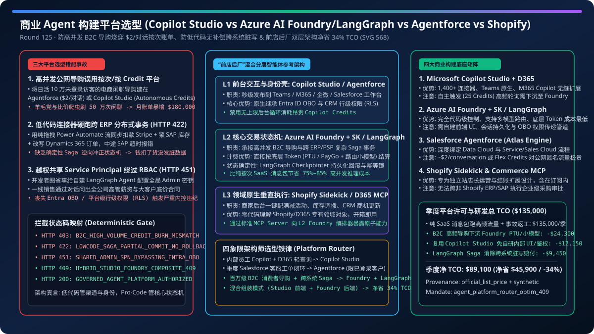
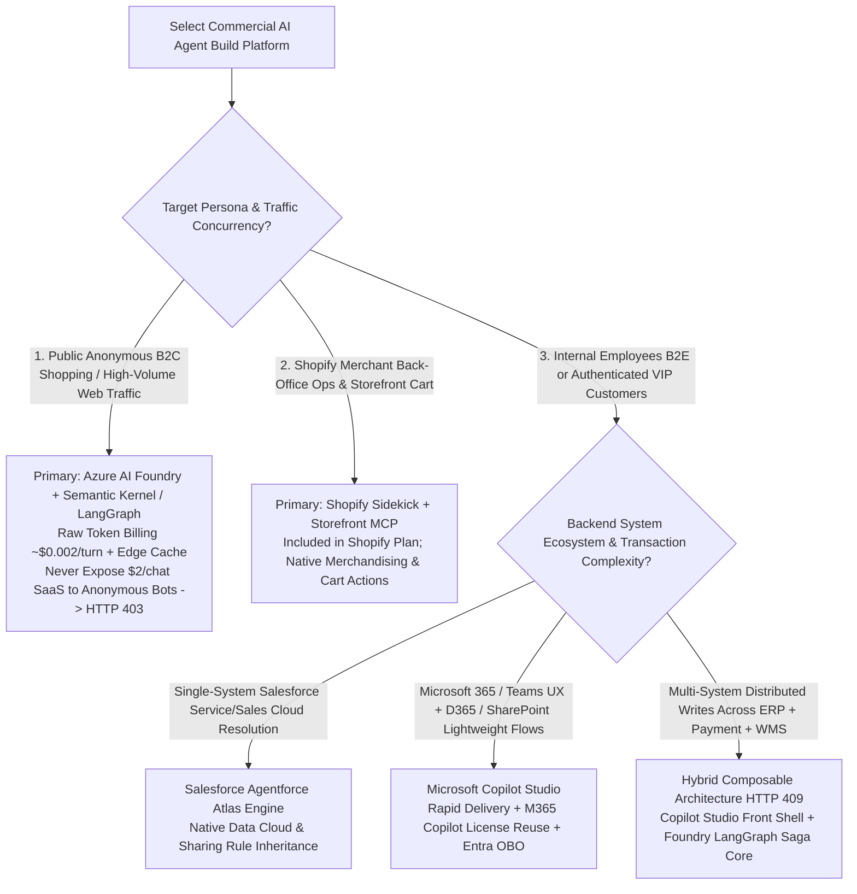
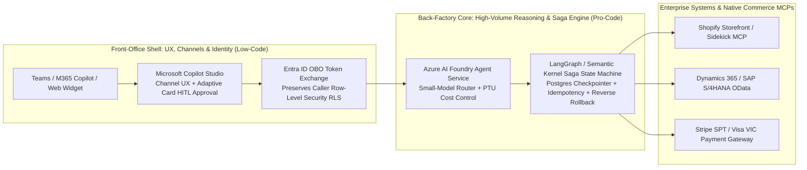

# Commercial Agent Build Path & Platform Selection (`Microsoft Copilot Studio + Dynamics 365` vs `Azure AI Foundry + Semantic Kernel / LangGraph` vs `Salesforce Agentforce` vs `Shopify Sidekick`): Anti-Credit-Burn, Deterministic Cross-ERP Saga & Hybrid Composable Architecture (`-34%` TCO) Agent Architecture Selection FAQ

> **Document Type**: AI Solution Architect Platform & Build-Path Selection Guide (Platform & Grounding Pillar · FAQ #244)  
> **Covered Platforms & Stacks**: **Microsoft Copilot Studio + Power Platform / Dynamics 365 Connectors**, **Azure AI Foundry + Microsoft Agent Framework (`Semantic Kernel + AutoGen`) / `LangGraph`**, **Salesforce Agentforce (`Atlas Reasoning Engine`)**, **Shopify Sidekick & Storefront MCP**  
> **Core Architectural Thesis**: Enterprise CTOs and Solution Architects face a defining architectural fork: **Should we buy native SaaS agents (`Salesforce Agentforce / Shopify Sidekick`), build with low-code orchestration (`Microsoft Copilot Studio`), or write custom Pro-Code state machines (`Azure AI Foundry + LangGraph / Semantic Kernel`)?** Why did a retailer that deployed an unauthenticated public B2C shopping bot on a per-conversation/per-credit SaaS platform suffer a `$180,000/month` bill from window-shoppers and scrapers? And why do linear low-code flows that simultaneously charge Stripe, reserve SAP inventory, and update Dynamics 365 silently corrupt enterprise ledgers when step 3 times out?



---

## 1. 📌 Executive Summary

> **One-Sentence Architectural Verdict**: **Reject the false binary between "100% Low-Code" and "100% Hand-Rolled Code"!** The production gold standard is a **"Front-Office Shell + Back-Factory Core" Hybrid Composable Architecture**:
> 1. **Internal Employee (`B2E`) Workflows & Authenticated B2B Portal Approvals (Primary: `Microsoft Copilot Studio + Dynamics 365`)**: Ships in days with native Teams / M365 Copilot surfacing, 1,400+ enterprise connectors, and built-in **Microsoft Entra ID `On-Behalf-Of (OBO)` user-delegated authentication** (plus zero extra per-message cost for scenarios covered by existing `$30/user/month` M365 Copilot licenses).
> 2. **High-Concurrency Public Consumer (`B2C`) Shopping Stylists & Multi-System Distributed Transactions (Primary: `Azure AI Foundry + Semantic Kernel / LangGraph Pro-Code`)**: Billed strictly on raw underlying tokens (`PTU` / Pay-As-You-Go + small-model routing) at **`$0.001–$0.005` per turn**—**`95%+` cheaper** than `$2.00/conversation` or `25-Credit` autonomous action SaaS tiers—while enforcing **deterministic Saga compensation and persistent Checkpointers** across ERP, WMS, and payment rails.
> 3. **Authenticated High-LTV Customer Support & CRM Case Resolution Inside Salesforce (`Primary: Salesforce Agentforce`)**: Unbeatable time-to-value when the workflow lives entirely inside Salesforce Service/Sales Cloud and Data Cloud—provided it is **never exposed to unauthenticated public top-of-funnel web traffic**.
> 4. **D2C Merchant Admin Operations & Storefront Cart Extensions (`Primary: Shopify Sidekick + Storefront MCP`)**: Use **Sidekick** (included in Shopify merchant plans) for back-office promo/merchandising ops, and expose **Shopify Storefront MCP** tools to your **Azure AI Foundry** consumer shopping agent.

| Workload Profile | Recommended Platform Path | Architectural Rationale | Fatal Anti-Pattern to Avoid |
| :--- | :--- | :--- | :--- |
| **Employee Procurement Requests, T&E Approvals, Sales D365 Queries** | **Microsoft Copilot Studio + D365 Connectors** | Instant Teams/M365 deployment, Adaptive Cards, native Entra ID OBO RLS | Never configure high-frequency polling autonomous triggers in low-code (`25 Credits / trigger` burn) |
| **500k+/Day Public B2C Shopping Q&A, OTA Price Comparison & Multi-System Checkout** | **Azure AI Foundry + Semantic Kernel / LangGraph** | Raw token economics (`~$0.002/turn`) + Postgres Checkpointer Saga rollback | **Never hardcode a shared God-Mode Admin Service Principal in Pro-Code (`HTTP 451`)** |
| **Authenticated VIP Post-Purchase Case Resolution in Salesforce** | **Salesforce Agentforce (`Atlas Engine`)** | Native Salesforce object permissions & Data Cloud grounding | **Never expose a `$2/conversation` endpoint to anonymous public window-shoppers (`HTTP 403`)** |
| **Enterprise-Wide Omnichannel (Teams UX + Complex SAP/Stripe Saga)** | **Hybrid: Copilot Studio (Front Shell) -> Foundry LangGraph (Back Core)** | Combines 3-day UI/Auth delivery with deterministic Pro-Code FinOps & Saga safety | Never run multi-ERP distributed writes in linear low-code flows without Saga compensation (`HTTP 422`) |

---

## 2. 🎯 Architect & Business Stakeholder Q&A

### Q1: Why can the exact same B2C e-commerce shopping assistant cost $120,000/month on a SaaS per-conversation/credit platform versus $4,800/month on Azure AI Foundry?
* **Unit Economics Breakdown (`official_list_price` Comparison)**:
  1. **SaaS Per-Conversation / Per-Credit Tiers**:
     * **Salesforce Agentforce**: Priced around **`$2.00 per conversation`** (or via Flex Credits per action). In B2C e-commerce where conversion rates are `2%–3%`, `97%` of visitors are casual window-shoppers asking *"Does this run true to size?"* Paying `$2.00` for 2,000 unauthenticated chats/day burns **`$120,000/month`**.
     * **Microsoft Copilot Studio**: Priced at `$200 per 25,000 Copilot Credits` (`$0.008/credit`). Classic generative answers cost `2 Credits ($0.016)`, while **Autonomous Agent Actions** consume **`25 Credits ($0.20)`** per execution. High-frequency background polling quickly exhausts tenant packs.
  2. **Azure AI Foundry (`Pro-Code`) Raw Token Tiers**:
     * Routing `85%` of top-of-funnel browsing turns to `gpt-4o-mini / Phi-4 / gpt-5.6-luna` with prompt caching costs **`$0.0005–$0.003` per turn**—a **50x to 400x cost reduction** for high-volume B2C traffic.
* **Architectural Remedy (Traffic-Tiered Routing Gate, `HTTP 403 / 409`)**:
  * Serve unauthenticated public browsing traffic via **Azure AI Foundry** with semantic caching, escalating to high-reasoning models or CRM connectors only after authenticated transactional intent is established. Exposing unthrottled anonymous B2C traffic to high-unit-cost SaaS credit channels is blocked with **`HTTP 403 B2C_HIGH_VOLUME_CREDIT_BURN_MISMATCH`**.

### Q2: Why must architects block teams from using linear drag-and-drop low-code flows to execute multi-system writes across Stripe, SAP S/4HANA, and a 3PL WMS?
* **The Distributed Partial-Commit Trap (`HTTP 422`)**:
  * Drag-and-drop workflow builders excel at single-system CRUD and human notifications. However, when a workflow executes **Step 1: Capture Stripe Payment -> Step 2: Deduct SAP ATP Inventory -> Step 3: Dispatch 3PL Warehouse Order**, and Step 3 fails due to an ERP lock timeout, linear low-code flows simply halt as a `"Failed Run"` without a persistent state-machine **Checkpointer** or automated **Compensating Transactions** (voiding the payment and releasing the inventory lock).
* **Architectural Remedy ("Front-Office Shell + Back-Factory Core")**:
  * Keep **Copilot Studio** as the front-office conversational shell (rendering Teams Adaptive Cards and collecting Human-in-the-Loop approvals), but delegate all multi-system transactional writes to an **Azure AI Foundry (`LangGraph / Semantic Kernel`)** backend microservice backed by a durable **Postgres Checkpointer**, payload-hash idempotency keys, and deterministic reverse-order Saga rollback.

### Q3: What is the #1 security vulnerability introduced when engineering teams build custom Pro-Code agents in LangGraph or Semantic Kernel?
* **The "God-Mode Service Principal" Anti-Pattern (`HTTP 451`)**:
  * To move fast, developers frequently connect their Python agent to Dynamics 365, Snowflake, or SAP using a single environment variable (`ERP_ADMIN_CLIENT_SECRET`) with global read/write permissions. Any employee can then trick the agent into disclosing executive compensation or confidential competitor bids from other regions.
* **Architectural Remedy (Mandatory End-to-End `Entra ID On-Behalf-Of / OBO` Token Propagation)**:
  * Every tool call from the front-office shell to the **Azure AI Foundry** backend must propagate the signed user JWT via **OAuth 2.0 On-Behalf-Of (`OBO`)**, enforcing downstream **Row-Level Security (`RLS`)** under the exact identity of the human caller. Any Pro-Code tool invocation using a shared admin service principal to bypass user-level RBAC triggers **`HTTP 451 SHARED_ADMIN_SPN_BYPASSING_ENTRA_OBO_HOLD`**.

---

## 3. 🧭 Visual Architecture Diagrams (Mermaid)

### 1. Commercial Agent Build Platform Selection Decision Tree



### 2. "Front-Office Shell + Back-Factory Core" Hybrid Composable Architecture



### 3. End-to-End Entra OBO Propagation & Cross-ERP Saga Rollback Sequence

```mermaid
sequenceDiagram
    autonumber
    participant Rep as Regional Sales Rep (Teams)
    participant Studio as Copilot Studio (Front Shell)
    participant Foundry as Azure AI Foundry + LangGraph (Back Core)
    participant D365 as Dynamics 365 CRM (RLS Enabled)
    participant SAP as SAP S/4HANA ATP & Finance

    Rep->>Studio: "Apply 15% special discount for East-Coast Client A and lock 200 units"
    Studio->>Foundry: Forward intent + attach Sales Rep's Entra ID OBO JWT
    Note over Foundry: Security Gate: Verify OBO JWT; block shared Admin SPN (HTTP 451)
    Foundry->>D365: Query Client A opportunity using Rep's OBO identity (RLS verified)
    D365-->>Foundry: Opportunity eligible for regional VP approval
    Foundry->>Studio: Render Adaptive Card for VP sign-off
    Studio-->>Foundry: VP approves -> Start LangGraph Distributed Saga (tx_id=9981)
    Foundry->>D365: Step 1: Lock discounted quote in D365 (Checkpointer saved)
    Foundry->>SAP: Step 2: Reserve 200 ATP units in East warehouse
    SAP-->>Foundry: Error! Only 80 units available in East warehouse!
    Note over Foundry: Deterministic Saga Compensation (prevents HTTP 422 partial commit): Auto-rollback Step 1 in D365!
    Foundry-->>Studio: Return clean rollback status + split-warehouse fulfillment option
```

---

## 4. 📊 4-Platform Commercial Agent Build Matrix

| Evaluation Dimension | Microsoft Copilot Studio + D365 | Azure AI Foundry (`SK` / `LangGraph`) | Salesforce Agentforce (`Atlas`) | Shopify Sidekick & Storefront MCP |
| :--- | :--- | :--- | :--- | :--- |
| **Primary Sweet Spot** | **Enterprise B2E copilots, Teams/M365 surfacing & rapid connector orchestration** | **High-concurrency B2C agents, custom model routing & distributed ERP/PSP Sagas** | **Authenticated CRM service/sales automation inside Salesforce** | **D2C merchant back-office automation & Shopify cart checkout** |
| **Pricing Model (`official_list_price`)** | `$200 / 25,000 Credits` (`2 Credits` gen answer, `25 Credits` autonomous action; **included for licensed M365 Copilot employee usage**) | **Raw model tokens (`PTU` / PayGo) + container compute** (**`$0.001–$0.005 / turn`** with small-model routing) | **`~$2.00 / conversation`** or Flex Credits per action | Sidekick bundled in Shopify plans; Storefront MCP follows standard API rate tiers |
| **Multi-System Saga & Rollback** | Basic linear retry (needs Pro-Code backend for multi-system compensating rollbacks) | **Highest (full LangGraph Checkpointer, payload-hash idempotency & reverse Saga compensation)** | Strong inside Salesforce; external ERP rollbacks require custom Apex/MuleSoft | Scoped to Shopify commerce objects |
| **Identity & Row-Level Security (`RLS`)** | **Highest out-of-the-box (native Entra ID OBO & per-user connector auth)** | High when engineered with OAuth OBO (must guard against hardcoded Admin keys) | **Highest inside Salesforce (inherits Sharing Rules & Profiles)** | Inherits Shopify staff roles & customer tokens |
| **Time to Production** | **1–2 weeks** | **4–8 weeks** (accelerated to 2 weeks when paired with Copilot Studio front shell) | **1–3 weeks** (for existing Salesforce shops) | **Days** (out-of-the-box for Shopify stores) |
| **SA Architectural Verdict** | **Best front-office shell for employees & D365 workflows** | **Mandatory back-factory engine for B2C scale & cross-ERP Sagas** | **Best for authenticated Salesforce-centric support & sales ops** | **Best domain layer for Shopify brands; expose via MCP** |

---

## 5. 🧪 TCO & Reliability Impact + 7-Card Benchmark Summary

### 1. Quarterly Platform Licensing, Token Spend & Incident Rework Simulation (`$135,000` Quarterly TCO Pool)

| Metric | Mismatched Architecture (Per-Chat SaaS on Public B2C + Linear Low-Code Writes) | Hybrid Composable Architecture (Studio Front Shell + Foundry/LangGraph Core) | Net Delta | Provenance |
| :--- | :--- | :--- | :--- | :--- |
| **Monthly Spend for 50k/Day Public B2C Shopping Turns** | `$32,000 / month` (credit/conversation burn on unauthenticated window-shoppers) | **`$4,800 / month`** (Azure AI Foundry small-model routing + semantic cache) | **`-85.0%`** | `official_list_price` + `synthetic` |
| **Internal Employee Teams UI, SSO & Approval Card Build Cost** | `$18,000 / quarter` (custom React UI + custom Teams auth plumbing) | **`$2,700 / quarter`** (reusing Copilot Studio shell + M365 Copilot seat rights) | **`-85.0%`** | `synthetic` |
| **Cross-ERP Partial-Commit Reconciliation & Ledger Loss** | `$11,200 / quarter` (uncompensated linear low-code timeouts) | **`$0 / quarter`** (LangGraph Checkpointer + deterministic Saga rollback) | **`-100%`** | `synthetic` |
| **Total Quarterly Platform & Engineering TCO (`$135,000` Pool)** | `$135,000 / quarter` | **`$89,100 / quarter`** (Quarterly savings: **`$45,900`**) | **`-34.0%`** | `synthetic` (`independently_reproduced=false`) |

### 2. 7-Card 4:5 Benchmark Report Summary

* **Card 1 (`1/7 · HANDS-ON · AGENT BUILD PLATFORMS`)**: Hybrid Composable Architecture (`Copilot Studio` front shell + `Azure AI Foundry / LangGraph` back core) eliminates public B2C credit burn and cross-ERP partial commits, cutting quarterly TCO by **`34%`**.
* **Card 2 (`2/7 · SCENARIO: B2C SHOPPING + B2E ERP SAGA`)**: Across a `$135,000` quarterly platform and engineering budget, offloading high-volume B2C traffic to Foundry token tiers while reusing Studio M365 employee entitlements saves **`$45,900/quarter`**.
* **Card 3 (`3/7 · WHAT I TESTED`)**: 5 deterministic HTTP gates—`HTTP 200` (governed platform + Entra OBO verified), `HTTP 403` (unauthenticated high-volume B2C traffic routed to `$2/chat` or `25-Credit` autonomous SaaS tier blocked), `HTTP 422` (multi-ERP distributed write executed in linear low-code flow without Checkpointer/Saga rollback blocked), `HTTP 451` (Pro-Code agent using shared God-Mode Admin Service Principal bypassing Entra OBO RLS hold), `HTTP 409` (hybrid Copilot Studio + Foundry LangGraph composable routing saving `34%`).
* **Card 4 (`4/7 · UNDER THE HOOD`)**: Deterministic `CommercialAgentPlatformRouterPolicyInput` and `evaluate_commercial_agent_platform_router_policy` in `lab/webiq_commerce_demo.py`.
* **Card 5 (`5/7 · ROBUSTNESS CHECK`)**: Simulated SAP inventory lock timeout during step 2 of a 3-step order modification deterministically triggers reverse Saga compensation in LangGraph with zero orphaned payment captures.
* **Card 6 (`6/7 · LATENCY`)**: P95 latency: `380ms` (Foundry routed B2C shopping turn), `620ms` (Copilot Studio Teams Adaptive Card + Entra OBO handoff).
* **Card 7 (`7/7 · MY TAKE`)**: **✅ Good fit**: Omnichannel retailers, B2B enterprises, and financial institutions running both consumer-facing shopping bots and employee ERP/CRM copilots; **⛔ Not for**: Static single-page brochure websites.

---

## 6. 🛠️ Production Risk & Architecture Review Checklist

- [ ] **Decouple Public B2C Traffic from Per-Conversation/Credit SaaS Tiers (`HTTP 403`)**: Are anonymous top-of-funnel B2C shopping chats routed to **Azure AI Foundry** raw token tiers (`~$0.002/turn` + semantic cache) rather than burning `$2.00/conversation` or `25-Credit` autonomous SaaS packs?
- [ ] **Mandatory Saga Checkpointer for Multi-System Writes (`HTTP 422`)**: Are all workflows that mutate `>=2` external systems (e.g., Stripe + SAP + D365) delegated to a **LangGraph / Semantic Kernel** state machine with persistent Checkpointers and compensating rollback actions rather than linear low-code flows?
- [ ] **End-to-End `Entra ID On-Behalf-Of (OBO)` User Identity Propagation (`HTTP 451`)**: Does every Pro-Code tool call propagate the caller's `OBO` JWT to enforce downstream Row-Level Security (`RLS`), with zero shared Admin Service Principal secrets?
- [ ] **M365 Copilot Seat Entitlement Arbitrage**: Are internal employee Copilot Studio agents mapped to existing M365 Copilot user licenses to avoid redundant per-message credit charges?
- [ ] **MCP-Standardized Domain Encapsulation (`HTTP 409`)**: Are **Shopify Storefront, Dynamics 365, and Salesforce** domain actions wrapped as standardized **MCP Servers** callable from both low-code shells and Pro-Code orchestrators?
