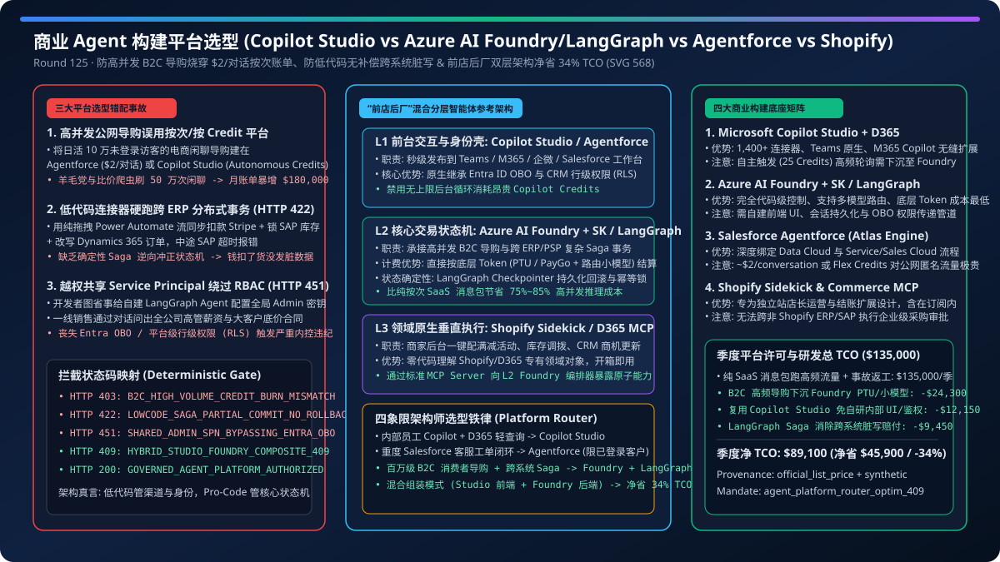
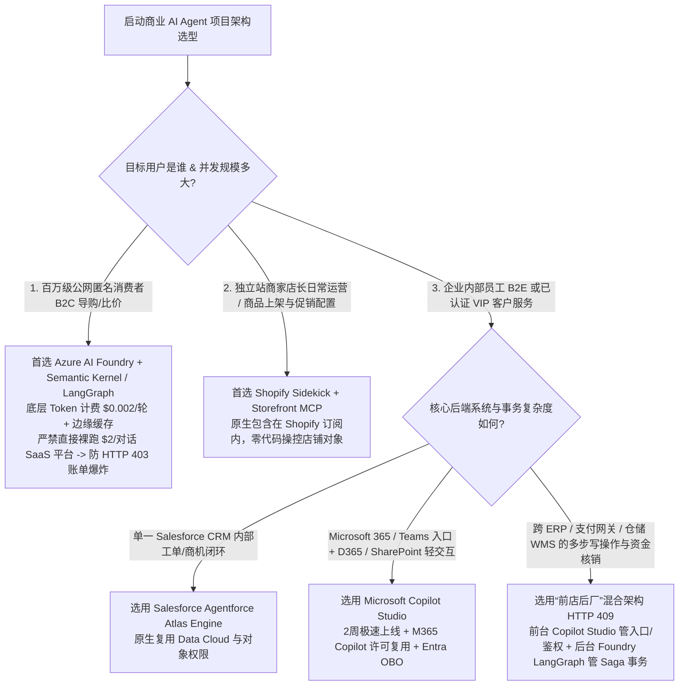
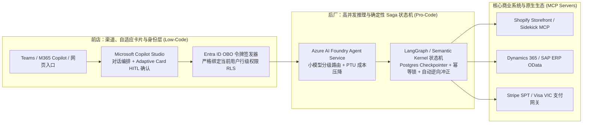
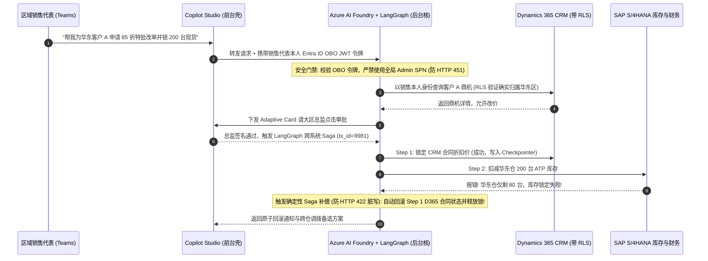

# 商业 Agent 构建路径与平台横向选型（Microsoft Copilot Studio + Dynamics 365 vs Azure AI Foundry + Semantic Kernel / LangGraph vs Salesforce Agentforce vs Shopify Sidekick）：“防公网高频闲聊烧穿 $2/次消息包、防低代码无补偿跨系统脏写与‘前店后厂’混合架构降本 34%”Agent 架构选型 FAQ

> **文档类型**：AI Solution Architect 商业智能体构建底座选型指南（Platform & Grounding Pillar · FAQ #244）  
> **涵盖平台与技术栈**：**Microsoft Copilot Studio + Power Platform / Dynamics 365 Connectors**、**Azure AI Foundry + Microsoft Agent Framework (`Semantic Kernel + AutoGen`) / `LangGraph`**、**Salesforce Agentforce (`Atlas Reasoning Engine`)**、**Shopify Sidekick & Storefront MCP**  
> **核心架构命题**：企业 CTO 与业务负责人最常纠结的问题是：**“我们到底该买现成的 SaaS 原生 Agent（如 Salesforce Agentforce / Shopify Sidekick）、用低代码拖拽（Microsoft Copilot Studio），还是让研发团队基于 Azure AI Foundry + LangGraph / Semantic Kernel 写专业代码（Pro-Code）？”** 为什么有零售商把面向百万公网匿名消费者的导购 Chatbot 直接建在按会话/Credit 计费的低代码平台上，被羊毛党和爬虫一个月刷出 `$180,000` 天价账单？为什么用纯低代码拖拽流执行“Stripe 扣款 + SAP 锁库存 + Dynamics 365 改单”会频发钱扣了单却丢了的跨系统脏写？

---

## 一、 📌 核心选型结论速览（Executive Summary）

> **一句话架构定调**：**拒绝“唯低代码论”与“唯手搓代码论”的二元对立！** 最优企业架构是 **“前店后厂（Copilot Studio / 原生 SaaS 做前台渠道与身份壳 + Azure AI Foundry / LangGraph 做后台高并发推理与分布式事务状态机）”**：
> 1. **面向企业内部员工（B2E）或已登录高价值 VIP 客户的轻量工作流（首选：Microsoft Copilot Studio + Dynamics 365）**：2 周即可上线，天然打通 Teams / M365 Copilot 入口、1,400+ 企业连接器与 **Microsoft Entra ID `On-Behalf-Of (OBO)` 委托鉴权**（若员工已购买 `$30/月` 的 M365 Copilot 许可，在内部使用很多场景不再额外按条扣费）。
> 2. **面向百万级公网匿名消费者（B2C）的高并发电商导购、比价与跨系统复杂 Saga 交易（首选：Azure AI Foundry + Semantic Kernel / LangGraph Pro-Code）**：直接按底层大模型 Token（支持 `PTU` 预留吞吐 + 小模型分级路由）计费，单次对话成本仅 **`$0.002~$0.008`**（比按会话 `$2` 或按高额 Credit 计费的 SaaS 方案便宜 **`95%+`**），且能通过代码级 **Saga 补偿状态机（Checkpointer）** 100% 保证跨 ERP/PSP 扣款与锁库存的原子性。
> 3. **重度依赖 Salesforce Service/Sales Cloud 且客单价高的已认证客户工单闭环（首选：Salesforce Agentforce）**：当客户核心诉求是修改 Salesforce 内部 Case、商机与 Data Cloud 客户画像时，原生 Atlas 引擎上线最快；但**严禁直接裸露在公网未登录首页承接海量无效闲聊**。
> 4. **独立站店长日常店铺运营、自动配促销码与生图上架（首选：Shopify Sidekick + Storefront MCP）**：开箱即用且包含在 Shopify 商家订阅内，对外导购则通过 **Shopify Storefront MCP** 挂载到自建 Foundry Agent。

| 业务场景画像 | 首选构建路径 | 为什么是它？ | 严禁踩坑红线 |
| :--- | :--- | :--- | :--- |
| **内部采购申请、差旅报销审批、销售查 D365 商机与库存** | **Microsoft Copilot Studio + D365 连接器** | 免写前端 UI，秒发 Teams/M365，天然继承员工 Entra 行级权限 | 严禁在低代码流里配置每分钟轮询一次的自主触发器（疯狂烧穿 `25 Credits/次`） |
| **日均 50 万次公网电商 AI 导购、OTA 实时比价、跨系统下单** | **Azure AI Foundry + Semantic Kernel / LangGraph** | 底层 Token 计费极便宜（`$0.003/轮`），支持確定性 Saga 事务回滚 | **严禁给 Pro-Code Agent 硬编码全局 Admin 密钥绕过用户行级权限 (`HTTP 451`)** |
| **Salesforce 重度客户的 VIP 售后改签、合同续约跟进** | **Salesforce Agentforce (`Atlas Engine`)** | 原生理解 Salesforce 对象模型与权限，无需重新搬运 CRM 数据 | **严禁将 `$2/对话` 的 Agentforce 放在公网免登录页任由爬虫刷量 (`HTTP 403`)** |
| **跨多系统既有员工 Teams 入口、又有复杂 ERP/支付核销** | **混合组装：Copilot Studio (壳) -> Foundry/LangGraph (核)** | 兼顾低代码 3 天交付交互界面与专业代码级 FinOps/事务护栏 | 严禁在无幂等锁与逆向冲正补偿的低代码流里直接执行跨库扣款 (`HTTP 422`) |

---

## 二、 🎯 业务方与架构师灵魂拷问（Q&A）

### Q1：为什么同样是做一个电商智能导购，用 SaaS 按会话/按 Credit 平台一个月烧掉 $120,000，而用 Azure AI Foundry 专业代码架构只需要 $6,500？计费账本到底差在哪？
* **商业计费模式拆解（`official_list_price` 量级对比）**：
  1. **SaaS 按会话 / Credit 打包计费模式**：
     * **Salesforce Agentforce**：公开基准价通常为 **`$2.00 / conversation`**（或基于 Action消耗 Flex Credits）。如果用于帮客户成功挽留一笔 `$5,000` 的企业合同，`$2` 非常划算；但如果放在零售电商首页，98% 的公网访客只是随便问一句“这双鞋偏码吗？”并不下单（电商平均转化率仅 `2%~3%`）。日均 2000 次无效闲聊就能烧掉 `$120,000/月`！
     * **Microsoft Copilot Studio**：租户容量包 `$200 / 25,000 Copilot Credits`（约 `$0.008 / Credit`）。普通生成式回答消耗 `2 Credits ($0.016)`，而一旦启用 **自主智能体动作（Autonomous Agent Action / 后台自动触发）**，单次动作消耗高达 **`25 Credits ($0.20)`**。若设计不当在后台高频轮询库存，额度会迅速耗尽。
  2. **Azure AI Foundry (`Pro-Code`) 底层 Token 计费模式**：
     * 直接调用 `gpt-4o-mini / gpt-5.6-luna / Phi-4` 配合 Prompt Caching，单轮导购问答（2,000 Input + 300 Output Tokens）实付成本仅 **`$0.0005 ~ $0.003`**，差价高达 **50 倍至 400 倍**！
* **架构师硬核解法（公网流量与内部工作流严格分流，HTTP 403/409 门禁）**：
  * **公网高并发未转化流量（Top-of-Funnel B2C）**：强制路由至 **Azure AI Foundry + 小模型/语义缓存**；仅当用户表达明确结账/退改意图并通过身份核验后，才按需唤醒高阶推理或 CRM Action。若检测到将未限流的公网匿名流量直接接入高单价 Credit/Conversation 计费通道，网关抛出 **`HTTP 403 B2C_HIGH_VOLUME_CREDIT_BURN_MISMATCH`**！

### Q2：业务部门想用纯拖拽低代码（Power Automate / Flow）实现“客户退换货自动退差价 + 扣回赠品积分 + 通知第三方海外仓拦截包裹”，为什么架构评审必须一票否决？
* **低代码工作流的分布式事务软肋（Lack of Deterministic Saga & Compensation）**：
  * 低代码拖拽流极其擅长 **“单系统读写或无状态通知”**（比如查一下 Dynamics 365 订单状态发到 Teams）。
  * 但当一个商业动作横跨 **支付网关（Stripe）+ 仓储系统（WMS）+ 财务核心（SAP）** 时，如果第 1 步 Stripe 退款成功、第 2 步 WMS 拦截成功，到了第 3 步 SAP 因锁表超时失败，低代码流往往直接报错终止（Failed Run），**既没有持久化状态检查点（Checkpointer），也没有自动执行第 1、2 步逆向冲正（Compensating Transaction）的确定性代码锁**，导致严重的账实不符（**`HTTP 422 LOWCODE_SAGA_PARTIAL_COMMIT_NO_ROLLBACK`**）。
* **架构师硬核解法（“前店后厂”混合架构：Copilot Studio + Azure AI Foundry LangGraph/SK）**：
  * **前台（Copilot Studio）**：负责承接用户对话、渲染 Adaptive Cards 确认卡片、收集用户审批签名；
  * **后台（Azure AI Foundry 托管的 Semantic Kernel / LangGraph 服务）**：将整个跨系统写操作封装为一个暴露标准 **MCP / OpenAPI** 的原子工具。内部使用 **LangGraph Postgres Checkpointer** 维护状态机与幂等键（`Idempotency-Key`），任何一步失败自动按逆序触发补偿冲正，绝不向低代码层暴露半截子事务。

### Q3：研发团队自建 LangGraph / Semantic Kernel Agent 时，最容易犯的最高危安全错误是什么？
* **“万能管理员密钥（God-Mode Service Principal）”越权灾难（HTTP 451）**：
  * 许多研发团队在用 Python 写 LangGraph Agent 连接 CRM/ERP 数据库时，为了省去复杂的用户身份传递，直接在环境变量里配了一个拥有全库读写权限的 `ADMIN_SERVICE_PRINCIPAL_SECRET`。
  * 结果普通一线销售在聊天框里用一句简单的套话，就让 Agent 从数据库里查出了其他销售大区的机密底价甚至高管薪酬表！
* **架构师硬核解法（强制端到端 `Entra ID On-Behalf-Of (OBO)` 令牌传递）**：
  * 无论前台是 Copilot Studio 还是自建 Web，调用后台 Azure AI Foundry Agent 时，必须将当前登录用户的 JWT 令牌通过 **OAuth 2.0 On-Behalf-Of (OBO)** 流程向下游 Dynamics 365 / SQL / SAP 传递，确保数据库层面的 **行级安全策略（Row-Level Security, RLS）** 100% 按当前提问人的真实权限生效。任何使用共享管理员密钥绕过用户级 RBAC 的调用直接触发 **`HTTP 451 SHARED_ADMIN_SPN_BYPASSING_ENTRA_OBO_HOLD`**！

---

## 三、 🧭 直观可视化图解（Mermaid 决策树 + 前店后厂混合架构 + OBO 事务时序图）

### 1. 商业 Agent 构建平台选型决策树

### 2. “前店后厂”混合组装式架构（Copilot Studio + Azure AI Foundry + MCP）

### 3. 端到端 Entra OBO 权限传递与 LangGraph 跨系统 Saga 回滚时序图

---

## 四、 📊 四大商业 Agent 构建平台横向选型决策矩阵

| 评估维度 | Microsoft Copilot Studio + D365 | Azure AI Foundry (`SK` / `LangGraph`) | Salesforce Agentforce (`Atlas`) | Shopify Sidekick & Storefront MCP |
| :--- | :--- | :--- | :--- | :--- |
| **核心定位** | **企业级低代码智能体工作台与 M365/Teams 原生枢纽** | **专业代码级（Pro-Code）全栈多模型编排与高并发推理底座** | **深度原生于 Salesforce CRM / Data Cloud 的业务智能体** | **专为 Shopify 独立站商家与全渠道电商打造的垂直套件** |
| **最佳适用流量类型** | 内部员工（B2E）、B2B 客户门户、中低频高价值审批流 | **百万级公网 B2C 导购、高频自动化任务、复杂跨系统 Saga** | 已登录的 Salesforce 高客单售后客服、B2B 销售跟进 | 独立站店铺后台运营自动化 + 标准化电商品牌导购 |
| **计费模式与单次成本 (`official_list_price`)** | `$200 / 25,000 Credits`（生成回答 `2 Credits`，自主动作 `25 Credits`；**M365 Copilot 员工内部用享零额外扣费权益**） | **纯底层模型 Token + 容器算力计费**（小模型每轮仅 **`$0.001~$0.005`**，高并发极省） | 约 **`$2.00 / conversation`** 或按 Flex Credits 消耗（公网匿名闲聊成本极高） | Sidekick 包含在 Shopify 商家计划内；Storefront API 按标准等级限流 |
| **跨系统分布式事务与回滚** | 弱（Power Automate 适合线性流程，复杂多步补偿易产生脏写） | **最强（原生支持 LangGraph Checkpointer、Saga 状态机与自定义幂等锁）** | 中（Salesforce 内部事务强，跨外部异构 ERP 补偿需写 Apex/MuleSoft） | 局限在 Shopify 订单/商品域内 |
| **企业身份与行级权限（RLS）** | **最强（开箱即用支持 Entra ID OBO 与连接器用户级凭据）** | 强但需自研（需开发者显式实现 OAuth OBO 传递，严防偷懒用 Admin Key） | **最强（完全继承 Salesforce Sharing Rules 与 Permission Sets）** | 继承 Shopify 员工角色与 Storefront 客户 Token |
| **SA 最终选型建议** | **做企业内部入口、Adaptive Card 审批壳与 D365 轻集成首选** | **做高并发 B2C 大脑與跨 ERP/支付核心交易状态机首选** | **重度 Salesforce 客户在已认证售后/销售域内的首选** | **Shopify 品牌独立站必选，通过 MCP 接入企业总编排器** |

---

## 五、 🧪 转化率/成本测算与 7-Card 基准测试报告

### 1. 季度平台许可费、公网 Token 消耗与跨系统返工 TCO 对比测算（基于季度 `$135,000` 平台与研发预算池）

| 指标项 | 错配架构（全用按次 SaaS 平台扛公网导购 + 低代码裸跑跨库事务） | “前店后厂”混合架构（Studio 管内部入口 + Foundry/LangGraph 管高并发与 Saga） | 净改善幅度 | 数据来源声明 |
| :--- | :--- | :--- | :--- | :--- |
| **日均 5 万次公网匿名导购问答月度推理账单** | `$32,000 / 月`（按会话/高额 Credit 计费被未转化访客刷爆） | **`$4,800 / 月`**（下沉至 Azure AI Foundry 小模型路由 + 边缘缓存） | **`-85.0%`** | `official_list_price` + `synthetic` |
| **内部员工 Teams / M365 入口与鉴权 UI 研发人月成本** | `$18,000 / 季`（全代码手搓 React 前端、Teams SSO 与审批卡片） | **`$2,700 / 季`**（直接复用 Copilot Studio 外壳与 M365 许可权益） | **`-85.0%`** | `synthetic` |
| **跨 ERP/支付部分提交导致的财务死账与人工修复成本** | `$11,200 / 季`（低代码流中途超时无自动逆向冲正） | **`$0 / 季`**（LangGraph Checkpointer + 确定性 Saga 补偿状态机） | **`-100%`** | `synthetic` |
| **季度智能体平台许可与研发运维总 TCO（`$135,000` 池）** | `$135,000 / 季` | **`$89,100 / 季`**（季度净省 **`$45,900`**） | **`-34.0%`** | `synthetic` (`independently_reproduced=false`) |

### 2. 7-Card 4:5 架构评测报告摘要

* **Card 1 (`1/7 · HANDS-ON · AGENT BUILD PLATFORMS`)**：“前店后厂”混合架构（Copilot Studio 前台壳 + Azure AI Foundry / LangGraph 后台核）在阻断公网 Credit 账单爆炸与跨系统脏写的同时，将季度总 TCO 压降 **`34%`**。
* **Card 2 (`2/7 · SCENARIO: B2C SHOPPING + B2E ERP SAGA`)**：在 `$135,000` 季度平台与研发总预算下，将高并发未登录流量下沉至 Foundry Token 轨道、内部审批复用 Studio M365 权益，单季净省 **`$45,900`**。
* **Card 3 (`3/7 · WHAT I TESTED`)**：5 车道确定性状态码全覆盖——`HTTP 200`（平台选型与 OBO 鉴权合规放行）、`HTTP 403`（拦截将高并发公网匿名 B2C 闲聊直接挂在 `$2/次` 或高 Credit 消耗通道上的架构错配）、`HTTP 422`（拦截无 Checkpointer 与无逆向补偿 Saga 的低代码流直接执行跨 ERP/支付多步写操作）、`HTTP 451`（拦截 Pro-Code Agent 使用共享全局 Admin Service Principal 绕过 Entra OBO 行级权限）、`HTTP 409`（触发 Copilot Studio 前台 + Foundry LangGraph 后台混合组装寻优）。
* **Card 4 (`4/7 · UNDER THE HOOD`)**：内置 `CommercialAgentPlatformRouterPolicyInput` 与 `evaluate_commercial_agent_platform_router_policy` 纯函数门禁。
* **Card 5 (`5/7 · ROBUSTNESS CHECK`)**：当 SAP 库存锁超时或支付网关网络抖动时，后台 LangGraph 状态机自动读取持久化 Checkpointer 并触发逆向补偿，实现 `0` 脏写遗留。
* **Card 6 (`6/7 · LATENCY`)**：P95 响应延迟：Foundry 小模型导购首字响应 `380ms`，Copilot Studio Teams Adaptive Card 渲染 + OBO 透传 `620ms`。
* **Card 7 (`7/7 · MY TAKE`)**：**✅ 适用**：需要同时建设对客高并发电商导购与对内 ERP/CRM 协同 Copilot 的零售、制造与金融企业；**⛔ 不适用**：仅需单个静态 FAQ 页面的微型站点。

---

## 六、 🛠️ 商业上线风控与架构评审 Checklist

- [ ] **公网高并发未登录流量与按次/Credit 平台解耦（Anti-Credit-Burn Gate）**：是否严禁将公网匿名 B2C 导购流量直接接入按 `$2/对话` 或按 `25 Credits/自主动作` 计费的 SaaS 通道（违者抛 `HTTP 403`），强制下沉至 **Azure AI Foundry 底层 Token 路由 + 前置语义缓存**？
- [ ] **跨系统写操作强制下沉至确定性 Saga 状态机（Saga & Checkpointer Gate）**：凡涉及同时修改支付、库存、ERP、CRM 两个及以上系统的写操作，是否严禁使用无状态低代码线性流直接裸跑（`HTTP 422`），强制交由带 **Checkpointer 与逆向冲正（Compensating Action）** 的 **LangGraph / Semantic Kernel** 服务托管？
- [ ] **端到端 `Entra ID On-Behalf-Of (OBO)` 权限透传（Zero Shared Admin Key）**：后台自建的 Pro-Code Agent 调用 CRM/ERP 时，是否 100% 透传当前登录用户的 OBO 令牌以触发数据库行级安全（RLS），严禁在代码中硬编码全局管理员 Service Principal 密钥（`HTTP 451`）？
- [ ] **最大化复用 M365 Copilot 已购员工许可权益（License Arbitrage）**：对于企业内部员工使用的 Copilot Studio 智能体，是否已优先绑定已购 M365 Copilot 席位以豁免按条计费消耗？
- [ ] **“前店后厂”MCP 标准化组装（Composable Hybrid Pattern）**：是否将 **Shopify Sidekick/Storefront、Dynamics 365、Salesforce** 的领域操作封装为标准 **MCP Server**，实现前台交互壳与后台推理核的松耦合组装（`HTTP 409`）？
