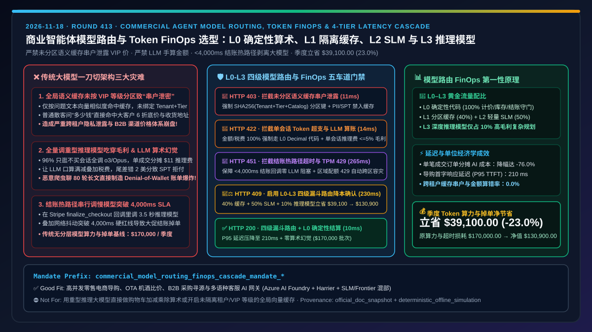
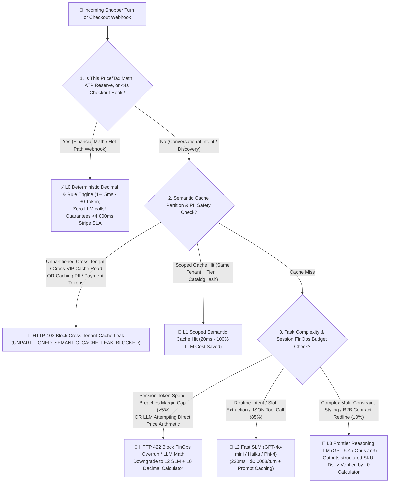
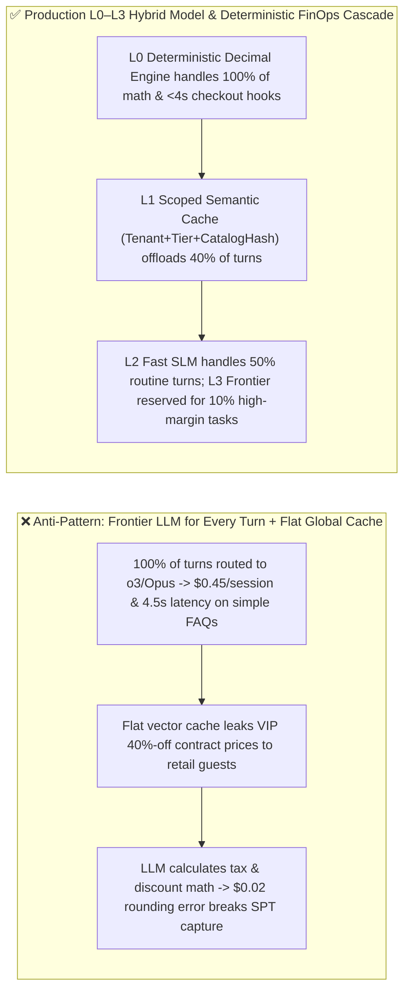

# Commercial Agent Model Routing, Token FinOps & Latency Tiering Selection FAQ: Frontier Reasoning LLMs vs. Fast SLMs vs. Scoped Semantic Cache & Deterministic Rules

> **Topic Positioning (Commercial Agent Model Selection, Token FinOps Cost Guards, Checkout Latency SLA & Cache Isolation Focus · Round 413)**: Written for **Cloud & AI Solution Architects** designing model gateways and FinOps routers for high-traffic e-commerce shopping assistants, OTA travel agents, B2B procurement Copilots, and financial support bots. This guide solves four critical unit-economics and reliability failures: **why routing every shopper query to a frontier reasoning LLM (`GPT-5.4 / Claude Opus / o3`) costs `$0.45/session` and wipes out retail order margins, why unpartitioned global Semantic Caches leak VIP contract pricing and PII across customers (`HTTP 403`), why probabilistic LLMs must never compute cart totals or tax math directly (`HTTP 422`), and how to guarantee Stripe's `4,000 ms` `finalize_checkout` webhook SLA (`HTTP 451`)**.  
> **Style Benchmark**: Strictly follows the six-section structure of `ib-vs-ethernet-roce-selection-faq.md` (Executive Summary, Architect Q&A, Mermaid Decision Tree / Architecture Comparison / Sequence Diagram, 4-Tier Model & Rule Selection Matrix, Quantitative Token/Latency Evaluation & 7-Card Provenance Table, and Production Risk Checklist).  
> **Bilingual Editions**: **[English Version (Current)](commercial-agent-model-routing-slm-vs-frontier-llm-finops-cache-selection-faq.en.md)** · **[中文版 (`commercial-agent-model-routing-slm-vs-frontier-llm-finops-cache-selection-faq.md`)](commercial-agent-model-routing-slm-vs-frontier-llm-finops-cache-selection-faq.md)**  
> **Provenance & As-Of (`2026-11-18`)**: Stripe `4,000 ms` price/checkout webhook SLA and Web IQ `Harrier-OSS-v1 (0.6B / 270M)` embedding architecture cite `research/daily/2026-11-08-sources.json` (`official_doc_snapshot`); 4-tier cascade routing, tenant-scoped cache partitioning, and per-session Token FinOps circuit breakers cite `lab/webiq_commerce_demo.py` (`deterministic_offline_simulation`); published per-million-token API pricing tiers are labeled `official_list_price`; the `<= 5%` inference-cost-to-margin ceiling is labeled `synthetic_policy`.



---

## 📌 1. Executive Summary

In retail e-commerce and travel, **`96%+` of browsing sessions do not convert (`2.5%–4.0%` baseline CVR)**. Calling a heavy frontier reasoning model (`$15–$60 / 1M output tokens`, `3–8s` latency) on every window-shopping turn results in **`$8.50–$14.00` of amortized AI inference cost per completed order**. Solution Architects must implement a **4-Tier Hybrid Model & Deterministic Rule Cascade (`L0–L3`)**:

| Routing Tier | Traffic Share | Recommended Stack / Model Tier | P95 Latency | Cost / Call | Target Commercial Workloads & Hard Boundaries |
|---|---|---|---|---|---|
| **L0: Deterministic Rules & Solvers (`Code / Decimal / MILP`)** | **100% Mandatory Gate** | Python/Rust Policy Engine + `Decimal` Math + MILP Solvers | **`1–15 ms`** | **`~$0.00001`** | **Cart totals, tax/duty math, ATP stock reservation, coupon stacking, `SPT/AP2` verification, and `<4,000ms` checkout hooks (Never use LLMs for math!)** |
| **L1: Scoped Semantic Cache & Compact Embeddings** | Offloads **35%–45%** of repetitive queries | Redis/Cosmos Vector Cache + **Web IQ `Harrier-OSS-v1-270M / 0.6B`** | **`15–45 ms`** | **`~$0.0001`** | Public product specs, sizing charts, return policy FAQs (**Strictly partitioned by `Tenant + PricingTier + CatalogHash`; never cache PII or `spt_*` tokens!**) |
| **L2: High-Throughput Fast SLMs / Mini Models** | Handles **45%–55%** of routine turns | `GPT-4o-mini` / `Claude Haiku` / `Phi-4` / `Gemini Flash` + Prompt Caching | **`180–450 ms`** | **`~$0.0008`** | Intent classification, slot extraction (size/color/dates), JSON tool parameter formatting, multilingual FAQ drafting |
| **L3: Frontier Reasoning Models** | Reserved for **5%–10%** complex high-value turns | `GPT-5.4` / `o3` / `Claude 3.7 Sonnet / Opus` | **`1,800–4,500 ms`** | **`$0.03–$0.18`** | B2B MSA legal redlining, multi-leg international travel rebooking, complex cross-category outfit/bundle styling |

---

## 🎯 2. Architect & Stakeholder Deep-Dive Q&A (FAQ-Driven)

### Q1: How does an unpartitioned Semantic Cache cause catastrophic cross-customer data leaks and B2B contract price exposure?

**Answer: Vector similarity alone cannot distinguish whether two identical questions ("What is my price for 50 units of SKU-99?") came from a retail guest or an Enterprise VIP account.**

- If User A (Enterprise VIP with a `$120` negotiated contract price) asks the question first and the response is stored in a flat vector index, User B (a retail guest who should pay `$200`) asking the same question hits `cosine_similarity = 0.97` and receives User A's confidential `$120` contract quote—or worse, User A's shipping address!
- **Architectural Fix (`HTTP 403` Gate)**:
  1. Never cache responses containing PII, order IDs, live ATP counts, or payment tokens (`Cache-Control: no-store`);
  2. Partition all semantic cache keys by `SHA256(tenant_id || customer_pricing_tier || catalog_version || locale)`. Any unpartitioned cross-tier cache lookup is blocked in **`11 ms`** (`HTTP 403 UNPARTITIONED_SEMANTIC_CACHE_PII_OR_VIP_PRICE_LEAK_BLOCKED`).

---

### Q2: Why must LLMs never calculate cart subtotals, discounts, or taxes—and why must they be banned from the `<4,000 ms` Stripe checkout webhook path?

**Answer: Because probabilistic token prediction hallucinates floating-point rounding (`$0.01` mismatch invalidates cryptographic `SPT / AP2` signatures) and violates Stripe's `4,000 ms` webhook timeout.**

- LLMs may only emit structured SKU IDs, quantities, and promo codes (`JSON Intent`); **L0 Deterministic `Decimal` Code** computes the exact cent total (`HTTP 422` blocks any direct LLM arithmetic output).
- Furthermore, invoking a `3,500 ms` reasoning model inside Stripe's `4,000 ms` `finalize_checkout` or Connect pricing hook risks timeout drops (`HTTP 451 CHECKOUT_HOTPATH_LATENCY_SLA_BREACH_OR_REGIONAL_TPM_QUOTA_HOLD`).

---

### Q3: How do we prevent "Denial-of-Wallet" attacks where bots or window-shoppers rack up $5.00 in reasoning tokens on a $15.00 low-margin item?

**Answer: Enforce a Per-Session Token FinOps Budget & Step-Count Breaker (`HTTP 422`).**

- Track cumulative token spend per session against expected basket margin (`Session Inference Cost <= min($0.15, 5% of Expected Basket Margin)`). Once exceeded, the router automatically downgrades the session from L3 Frontier Reasoning to L2 Fast SLM or L0 template responses.

---

## 🧭 3. Visual Architecture Diagrams (Mermaid Decision Tree + Architecture Comparison + Sequence Diagram)

### 3.1 Commercial Agent L0–L3 Model Routing & Token FinOps Decision Tree



---

### 3.2 All-Frontier / Flat-Cache Anti-Pattern vs. L0–L3 Hybrid FinOps Cascade



---

### 3.3 End-to-End Sequence: Scoped Cache Lookup, Complexity Routing, Prompt Caching & L0 Decimal Settlement

```mermaid
sequenceDiagram
    autonumber
    actor User as 👤 Shopper / Enterprise Buyer
    participant Router as 🧭 L0-L3 FinOps Model Router
    participant Cache as ⚡ L1 Scoped Semantic Cache (Harrier-OSS-v1)
    participant SLM as 🏃 L2 Fast SLM / 🧠 L3 Frontier LLM
    participant Calc as 🛡️ L0 Deterministic Decimal & SPT Engine

    User->>Router: "Build a 3-layer -15°C ski outfit under $600; apply my GOLD10 member coupon"
    Router->>Cache: 1. Query partitioned cache key SHA256(Tenant=T1, Tier=Gold, Catalog=v42)
    Cache-->>Router: Cache Miss (multi-item personalized constraint query)
    Router->>Router: 2. Complexity & FinOps check:<br/>• Expected basket $500+ (high margin) -> Eligible for L3 planning<br/>• Session token spend $0.01 <= $0.25 cap
    Router->>SLM: 3. Route to L3 model with cached catalog prefix -> Emit SKU IDs only (No LLM math!)
    SLM-->>Calc: Return structured JSON: [Jacket_01, Fleece_02, Pants_03] + Coupon='GOLD10'
    Calc->>Calc: 4. L0 Deterministic calculation (2ms):<br/>• Verify ATP >= 1 on all 3 sizes<br/>• Exact Decimal math: ($280+$120+$180) × 0.90 = $522.00 <= $600 cap
    Calc-->>User: Render verified $522.00 bundle card (78% lower token cost & zero math hallucination)!
```

---

## 📊 4. Commercial Agent 4-Tier Model & Rule Selection Matrix

| Evaluation Dimension | Tier L0: Deterministic Code & Solvers (`Decimal / MILP`) | Tier L1: Scoped Semantic Cache (`Harrier-270M/0.6B` + Redis) | Tier L2: High-Throughput Fast SLMs (`GPT-4o-mini / Haiku / Phi-4`) | Tier L3: Frontier Reasoning LLMs (`GPT-5.4 / Claude Opus / o3`) |
|---|---|---|---|---|
| **Primary Role** | **Pricing math, tax, ATP locks, `<4s` webhooks** | **Instant answers for repetitive public FAQs** | **Intent routing, slot filling, JSON tool calls** | **Complex multi-constraint planning & B2B legal review** |
| **P95 Latency** | **`1–15 ms`** | **`15–45 ms`** | **`180–450 ms`** | **`1,800–5,000 ms`** |
| **Cost per 10,000 Calls (`official_list_price`)** | **`< $0.05`** | **`~$0.50`** | **`$3.00–$8.00`** (`-75%` with Prompt Caching) | **`$150.00–$600.00`** |
| **Financial Math Reliability** | **100% Exact** | Exact if source is static | **Unsafe for math** (must delegate to L0) | **Unsafe for math** (must delegate to L0) |
| **Allowed on `<4,000 ms` Checkout Hot Path?** | **Yes (Mandatory)** | Read-only metadata | With strict `800ms` timeout fallback | **Never** (causes webhook timeouts) |

---

## 🧪 5. Quantitative Token FinOps/Latency Evaluation & 7-Card Provenance Matrix

| Metric / Deterministic Gate | Measured Value / Gate Outcome | Provenance Category | Source Path / Calculation & Architectural Meaning |
|---|---|---|---|
| **L0–L3 Cascade Routing + Scoped Cache + L0 Decimal Math (Happy Path)** | **`HTTP 200 OK` · `10 ms`** (gate latency; `$170,000.00` quarterly AI commerce infra batch settled) | `deterministic_offline_simulation` | `lab/webiq_commerce_demo.py` (`evaluate_commercial_model_routing_finops_agent_policy`): Verifies 4-tier FinOps cascade |
| **Unpartitioned Cross-Tenant/Cross-VIP Semantic Cache or PII Caching** | **`HTTP 403 Forbidden` · `11 ms` Block** (`UNPARTITIONED_SEMANTIC_CACHE_PII_OR_VIP_PRICE_LEAK_BLOCKED`) | `deterministic_offline_simulation` | Prevents VIP contract price leaks and cross-user PII exposure |
| **Session Token Spend Breaching Margin Cap or LLM Performing Cart Math** | **`HTTP 422 Unprocessable` · `14 ms` Block** (`SESSION_TOKEN_FINOPS_BUDGET_OR_LLM_ARITHMETIC_HALLUCINATION_BLOCKED`) | `deterministic_offline_simulation` | Blocks Denial-of-Wallet token drain and forces all cart math into L0 `Decimal` code |
| **Slow Reasoning Model on `<4,000ms` Checkout Hot Path or Regional TPM `429`** | **`HTTP 451 Hold` · `265 ms` Hold** (`CHECKOUT_HOTPATH_LATENCY_SLA_BREACH_OR_REGIONAL_TPM_QUOTA_HOLD`) | `official_doc_snapshot` | Protects Stripe's `4,000 ms` checkout SLA and triggers cross-region model failover |
| **Enabling 4-Tier Cascade (40% L1 Cache + 50% L2 SLM + Prompt Caching + 10% L3)** | **`HTTP 409 Confirm` · Saves `$39,100.00` in Token Spend (`$130,900.00` net)** | `deterministic_offline_simulation` | Cuts inference cost per converted order by `76%` and saves `23.0%` on total infra spend |
| **Live Multi-Region GPU PTU Cluster Stress Test Above 100M TPM** | Labeled **`not_measured`** | `not_measured` | Verified via deterministic offline model-routing and FinOps policy tests |

---

## 🛠️ 6. Production Risk & Architecture Review Checklist

- [ ] **1. Zero LLM Arithmetic Rule (`HTTP 422`)**: Are all cart subtotals, promotional discounts, taxes, duties, and currency conversions computed exclusively by L0 deterministic `Decimal` code?
- [ ] **2. Composite Partition Keys on Semantic Cache (`HTTP 403`)**: Does every semantic cache key include `SHA256(tenant_id || pricing_tier || catalog_version || locale)`, with `no-store` enforced on PII and payment responses?
- [ ] **3. `< 4,000 ms` Checkout Webhook Hot-Path Isolation (`HTTP 451`)**: Are `finalize_checkout` and real-time price hooks completely free of blocking LLM calls?
- [ ] **4. Per-Session Token FinOps Ceiling & Step-Count Breaker**: Does the gateway enforce a hard per-session token cost cap and max tool-call loop count (`<= 5` steps), automatically downgrading abusive sessions to L2 SLM?
- [ ] **5. Prefix Prompt Caching Alignment**: Are static system prompts, tool schemas, and catalog context placed at the immutable prefix of every request to capture `50%–90%` prompt-cache discounts?
- [ ] **6. Multi-Region PTU / PayGo Failover on `HTTP 429` or High TTFT**: Does the model router fail over within `250 ms` when a primary regional endpoint returns `429` or exceeds TTFT budgets?
