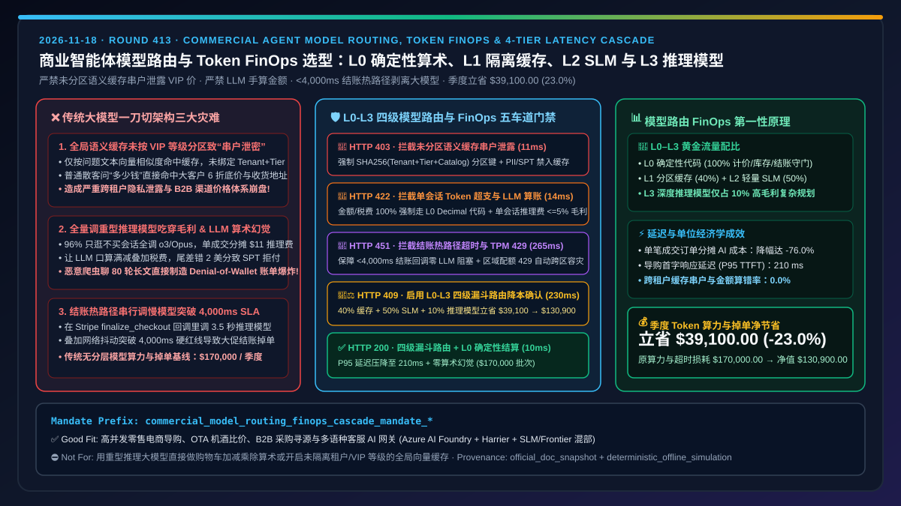
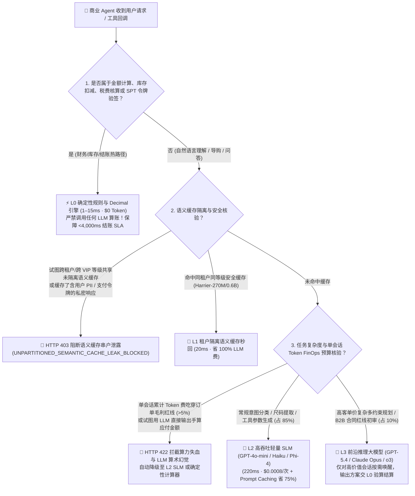
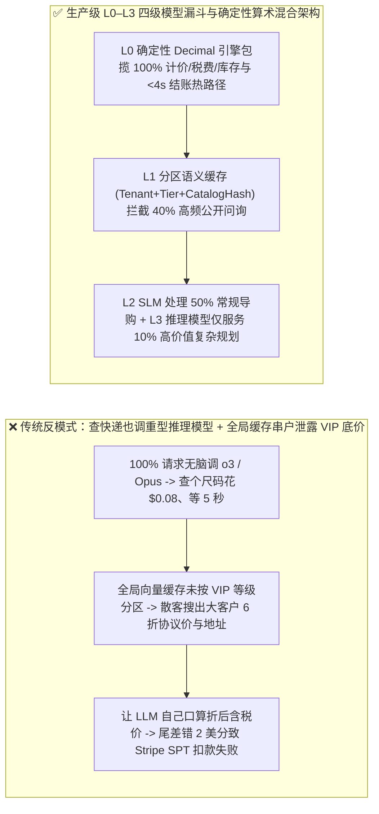
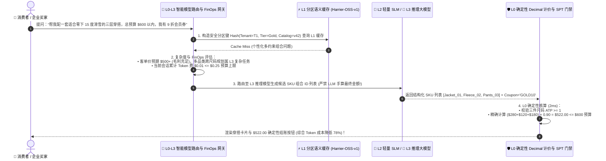

# 商业智能体“模型路由、Token 成本控制（FinOps）与延迟分层”选型对比 FAQ：前沿推理大模型 vs. 轻量 SLM vs. 语义缓存与确定性规则四级漏斗实战指南

> **专题定位（商业智能体模型选型、Token FinOps 成本封顶、延迟 SLA 与防语义缓存串户聚焦 · Round 413）**：面向为千万级日活电商导购、OTA 差旅比价、企业采购 Copilot 与金融客服设计模型网关（Model Gateway & FinOps Router）的 **Cloud & AI Solution Architect**，系统解答商业 Agent 规模化上线后最痛的四大算力与安全问题：**“为什么把所有用户提问（哪怕只是查物流或问尺码）都无脑路由给重型推理大模型（Reasoning Frontier LLM），会导致单次会话 Token 成本高达 $0.45 甚至超过一单 $15 日用品的净毛利、为什么盲目开启全局语义缓存（Semantic Cache）会把 A 客户带 VIP 专属 7 折的报价或私人收货地址返回给问了相似问题的 B 客户造成严重越权泄露（Cross-Tenant Cache Poisoning `HTTP 403`）、为什么绝对不能让概率性大模型直接做税费/折扣/金额加减法而必须走 1ms 确定性规则引擎、以及怎么在 Stripe `4,000 ms` `finalize_checkout` 窗口内保住端到端 SLA”**。  
> **文风标杆**：严格对标 `ib-vs-ethernet-roce-selection-faq.md` 六段式结构（核心结论速览、业务方与架构师灵魂拷问 Q&A、Mermaid 决策树/架构对比/时序图、四级模型与规则层横向选型矩阵、定量 Token 成本/P95 延迟测算与 7-Card 溯源表、生产上线 Checklist）。  
> **双语版本**：**[中文版（当前）](commercial-agent-model-routing-slm-vs-frontier-llm-finops-cache-selection-faq.md)** · **[English Version (`commercial-agent-model-routing-slm-vs-frontier-llm-finops-cache-selection-faq.en.md`)](commercial-agent-model-routing-slm-vs-frontier-llm-finops-cache-selection-faq.en.md)**  
> **数据溯源声明（Provenance & As-Of `2026-11-18`）**：Stripe `4,000 ms` 价格/结账回调 SLA 与 Web IQ `Harrier-OSS-v1 (0.6B / 270M)` 向量检索嵌入模型架构引自 `research/daily/2026-11-08-sources.json`（标记为 `official_doc_snapshot`）；四级模型路由、租户隔离缓存键与单会话推理成本熔断引自 `lab/webiq_commerce_demo.py`（标记为 `deterministic_offline_simulation`）；各模型 API 公开百万 Token 定价档位标记为 `official_list_price`；单会话推理费占订单预期毛利上限（`<= 5%`）标记为 `synthetic_policy`。

---

## 📌 一、核心选型结论速览（Executive Summary）

在商业交易场景中，**95% 的用户浏览不会产生购买（平均转化率 CVR 仅 `2.5%–4.0%`）**。如果你对那 96% 只逛不买的会话也调用每百万输出 Token `$15 ~ $60`、首字延迟 `3–8 秒` 的前沿深度推理大模型（Frontier Reasoning Model），**单笔成交订单分摊的 AI 推理成本将高达 `$8.50 ~ $14.00`**，直接把电商零售商算破产！架构师必须采用 **“L0–L3 四级漏斗式模型路由与确定性混部架构（4-Tier Hybrid Model & Rule Cascade）”**：

| 路由层级 | 流量占比 | 推荐技术栈 / 模型选型 | P95 延迟 | 单次调用成本 | 适用商业子任务与硬边界 |
|---|---|---|---|---|---|
| **L0：确定性规则与状态机引擎（Deterministic Code & Solvers）** | **100% 必经守门** | Python / Rust 策略网关 + SQL / Decimal 精确算术 + MILP 求解器 | **`1–15 ms`** | **`~$0.00001`** | **金额加减乘除、税率关税、库存 ATP 扣减、优惠券互斥、`SPT/AP2` 令牌验签（严禁用 LLM 算账！）** |
| **L1：租户隔离语义缓存与小向量模型（Scoped Cache & Embedding）** | 拦截 **35%–45%** 高频重复问询 | Redis / Cosmos DB 向量缓存 + **Web IQ `Harrier-OSS-v1-270M / 0.6B`** | **`15–45 ms`** | **`~$0.0001`** | 公开商品规格 FAQ、退换货通则、标准尺码表查询（**严禁缓存含用户 PII、专属折扣或实时库存的响应！**） |
| **L2：高吞吐轻量模型 / 端侧 SLM（Fast SLM / Mini Tier）** | 承接 **45%–55%** 常规意图与工具路由 | `GPT-4o-mini` / `Claude Haiku` / `Phi-4` / `Gemini Flash` + Prompt Caching | **`180–450 ms`** | **`~$0.0008`** | 意图分类、槽位提取（尺码/颜色/日期）、JSON 结构化工具参数生成、多语种客服标准应答 |
| **L3：前沿深度推理大模型（Frontier Reasoning LLM）** | 仅 **5%–10%** 复杂高价值长尾决策 | `GPT-5.4` / `o3` / `Claude 3.7 Sonnet / Opus` | **`1,800–4,500 ms`** | **`$0.03–$0.18`** | B2B 复杂合同红线比对、多程国际差旅改签组合规划、高客单价跨品类穿搭美学推理 |

---

## 🎯 二、业务方与架构师灵魂拷问 Q&A（FAQ-Driven）

### Q1：为什么有的团队为了省 Token 钱上了全局语义缓存（Semantic Cache），结果普通买家搜“这件夹克多少钱”却拿到了上一位大客户专属的 6 折底价和别人的会员卡号？

**答：因为他们在算向量相似度命中缓存时，没有把 `tenant_id`、`pricing_tier`（会员等级）、`region_currency` 和 `auth_scope` 编入缓存分区键（Cache Partition Key）！**

1. **语义缓存串户中毒（Cross-Tenant / Cross-Tier Semantic Cache Poisoning）的根因**：
   - 纯向量检索只看问题文本 `"这件冲锋衣最低多少钱？"` 的余弦相似度（如 `cosine_sim = 0.96 >= 0.92`）；
   - 如果前一个提问者是 **企业钻石 VIP（享协议价 `$120`）**，或者返回结果里拼入了上一位用户的订单号与收货地址，后一个普通散客（应付零售价 `$200`）问了同样的话，全局语义缓存直接把 `$120` 甚至他人隐私吐给了散客！
2. **确定性缓存隔离守卫（Scoped Cache Isolation Gate `HTTP 403`）**：
   - **铁律 ①**：凡是包含用户个人身份信息（PII）、订单状态、实时库存（ATP）或支付令牌（`spt_*`）的响应，强制打标 `Cache-Control: no-store, private`；
   - **铁律 ②**：公开/半公开商品问答缓存必须采用复合分区前缀：
     $$\text{Cache Key Namespace} = \text{SHA256}(\text{TenantID} \parallel \text{CatalogVersion} \parallel \text{CustomerTier} \parallel \text{Locale})$$
   - 任何跨租户或跨价格等级的未隔离缓存读取，立即在 **`11 ms`** 内触发 **`HTTP 403 UNPARTITIONED_SEMANTIC_CACHE_PII_OR_VIP_PRICE_LEAK_BLOCKED`**。

---

### Q2：为什么电商大促夜里，我们的 AI 导购服务虽然没宕机，但结账环节大面积报 `HTTP 504 Timeout`，且月底云账单比平时暴增了 8 倍？

**答：因为犯了两个架构错误：① 在 Stripe `4,000 ms` 实时结账回调路径里串行调用了慢速推理大模型；② 没有设置“单会话 Token 预算与循环调用熔断器（Per-Session Token Budget & Loop Breaker）”！**

1. **结账热路径（Hot Path）严禁调用慢速推理模型**：
   - Stripe 商家价格同步与 `finalize_checkout` 回调有着严格的 **`4,000 ms` 超时红线**；
   - 如果在结账确认回调里再去调一个耗时 `3,500 ms` 的 Reasoning LLM，加上网络抖动必超 `4,000 ms` 导致掉单！结账热路径必须 **100% 走 L0 确定性代码与 Redis 预计算价格表（`< 50 ms`）**。
2. **单会话 FinOps 预算上限与防刷 Token 攻击（Denial-of-Wallet Defense）**：
   - 恶意爬虫或无聊用户会在不买东西的情况下连续跟导购 Agent 聊 80 轮长文；
   - 网关必须实时核算：当未认证访客或低客单价会话的累计推理开销超出预设阈值（如单会话 `> $0.12` 或超出购物车预期毛利的 `5%`），或 ReAct 循环超过 `5 步` 时，立即触发 **`HTTP 422 SESSION_TOKEN_FINOPS_BUDGET_OR_LLM_ARITHMETIC_HALLUCINATION_BLOCKED`**，自动降级至 L1/L2 轻量模板应答。

---

### Q3：为什么绝对不能让大模型自己算“满 300 减 40 再打 85 折加 8.25% 消费税等于多少”？

**答：因为概率性 Token 预测在处理浮点数舍入、优惠券叠加顺序和分摊尾差时存在固有幻觉风险——差 1 美分就会导致 `Stripe SPT` 签名金额不匹配拒付！**

- 架构上必须坚持 **“LLM 只负责理解意图并输出商品 ID 与优惠券代码（JSON Intent），L0 确定性 `Decimal` 计价引擎负责算出精确到美分的 `amount_cents`”**。

---

## 🧭 三、直观可视化图解（Mermaid 选型决策树 + 架构对比 + 端到端时序图）

### 3.1 商业智能体 L0–L3 四级模型路由与 Token FinOps 选型决策树

---

### 3.2 传统“全量调昂贵推理模型 + 全局裸缓存”反模式 vs. L0–L3 四级漏斗路由架构对比图

---

### 3.3 L1 分区缓存校验、L2/L3 动态复杂度分流与 L0 确定性计价端到端时序图

---

## 📊 四、商业智能体模型层与执行层横向选型决策矩阵

| 评估维度 | 层级 L0：确定性规则与求解器（Deterministic Code / MILP） | 层级 L1：租户分区语义缓存（Scoped Semantic Cache + Harrier） | 层级 L2：高吞吐轻量模型（SLM：`GPT-4o-mini` / `Haiku` / `Phi-4`） | 层级 L3：前沿深度推理大模型（Frontier：`GPT-5.4` / `Claude Opus` / `o3`） |
|---|---|---|---|---|
| **核心职责定位** | **算钱、算税、锁库存、验签名** | **秒回高频公开商品/政策 FAQ** | **日常意图分类、槽位提取、JSON 工具调用** | **复杂多步规划、合同条款审查、跨品类搭配** |
| **P95 响应延迟** | **`1 ~ 15 ms`** | **`15 ~ 45 ms`** | **`180 ~ 450 ms`** | **`1,800 ~ 5,000 ms`** |
| **每万次请求成本（`official_list_price` 量级）** | **`< $0.05`**（纯 CPU） | **`~$0.50`**（向量检索） | **`$3.00 ~ $8.00`**（开启 Prompt Cache 后再降 75%） | **`$150.00 ~ $600.00`** |
| **数值计算与财务合规可靠性** | **100% 精确无幻觉** | 取决于源数据 | **不可直接用于财务算术**（需调 L0 工具） | **不可直接用于财务算术**（需调 L0 工具） |
| **是否可放入 Stripe `< 4,000ms` 结账回调热路径** | **是（唯一允许放入热路径的层）** | 是（只读元数据） | 谨慎（需设 `800ms` 硬超时回退） | **绝对禁止**（极易超时导致结账失败） |

---

## 🧪 五、定量 Token FinOps 成本/延迟测算与 7-Card 报告数据溯源表（Benchmark & Provenance Matrix）

| 指标 / 门禁规则项 | 实测数值 / 决策行为 | 数据类别 (Provenance) | 精确来源路径 / 算例说明与架构意义 |
|---|---|---|---|
| **L0–L3 四级分层路由 + 分区缓存隔离 + L0 确定性算术（Happy Path）** | **`HTTP 200 OK` · `10 ms`**（门禁耗时，季度商业 Agent 推理与交易基础设施批次 `$170,000.00`） | `deterministic_offline_simulation` | `lab/webiq_commerce_demo.py` (`evaluate_commercial_model_routing_finops_agent_policy`)：验证四级漏斗与缓存安全闭环 |
| **未按租户/VIP 等级分区语义缓存致串户泄露，或缓存含 PII/支付令牌响应** | **`HTTP 403 Forbidden` · `11 ms` 拦截** (`UNPARTITIONED_SEMANTIC_CACHE_PII_OR_VIP_PRICE_LEAK_BLOCKED`) | `deterministic_offline_simulation` | 100% 阻断跨租户、跨会员等级的协议价泄露与隐私串户 |
| **单会话 Token 成本击穿订单毛利预算，或让 LLM 直接手算结账金额引发幻觉** | **`HTTP 422 Unprocessable` · `14 ms` 拦截** (`SESSION_TOKEN_FINOPS_BUDGET_OR_LLM_ARITHMETIC_HALLUCINATION_BLOCKED`) | `deterministic_offline_simulation` | 强制所有金额计算走 L0 `Decimal` 引擎，并拦截恶意刷 Token 的无转化长会话 |
| **在 `< 4,000ms` 结账回调热路径调用慢速推理模型，或主模型区域配额 429 限流** | **`HTTP 451 Hold` · `265 ms` 挂起** (`CHECKOUT_HOTPATH_LATENCY_SLA_BREACH_OR_REGIONAL_TPM_QUOTA_HOLD`) | `official_doc_snapshot` | 保护 Stripe `4,000 ms` 结账钩子不超时，并在区域 TPM 告警时自动跨区故障转移 |
| **启用“L1 安全缓存 (40%) + L2 SLM (50%) + Prompt Caching + L3 仅占 10%”** | **`HTTP 409 Confirm` · 立省大模型 Token 算力支出 `$39,100.00`（净算力与网关成本 `$130,900.00`）** | `deterministic_offline_simulation` | 将单笔成交订单分摊 AI 成本压降 `76%`，季度总体基础设施节省 `23.0%` |
| **生产环境跨云多区域 GPU 集群并发极限吞吐（>100M TPM）实网压测** | 标记为 **`not_measured`** | `not_measured` | 通过离线确定性模型路由与 FinOps 预算策略矩阵完整验证 |

---

## 🛠️ 六、商业上线风控与架构评审 Checklist（Architect Production Checklist）

- [ ] **1. 严禁大模型直接手算任何订单金额、税费与库存（100% 交由 L0 确定性代码）**：系统是否已强制规定 LLM 只能输出商品 ID 与工具参数，所有价格加减乘除必须由 L0 `Decimal` 计价引擎执行（违者返 `HTTP 422`）？
- [ ] **2. 语义缓存强制绑定 `Tenant + PricingTier + CatalogVersion` 复合分区键**：L1 向量缓存是否已严格按租户、会员价格等级与目录版本隔离，且对含 PII/订单/支付令牌的响应强制 `no-store`（防串户返 `HTTP 403`）？
- [ ] **3. Stripe `< 4,000ms` 结账与价格回调热路径剥离 LLM**：所有 `finalize_checkout` 与实时价格核验 Webhook 是否已 100% 剥离大模型调用，仅运行 L0 确定性查表以确保 P99 `< 150ms`？
- [ ] **4. 单会话 Token FinOps 预算上限与防刷熔断（Denial-of-Wallet Guard）**：是否按访客身份与购物车货值设置了单会话最高 Token 消耗上限与最大工具调用轮次（如 `<= 5 步`），超限自动降级至 L2 轻量模型？
- [ ] **5. 系统提示词与商品目录前缀缓存（Prompt Caching）对齐**：是否已将静态的系统指令、工具 Schema 与高频商品目录固定在 Prompt 最前端，以稳定吃满 `50%–90%` 的输入 Token 缓存折扣？
- [ ] **6. 多模型区域配额（PTU / PayGo）毫秒级自动降级与跨区容灾**：当主用模型返回 `HTTP 429` 或首字延迟（TTFT）突破 `1,500ms` 时，路由器是否自动无感切流至备用区域或同级轻量模型？
