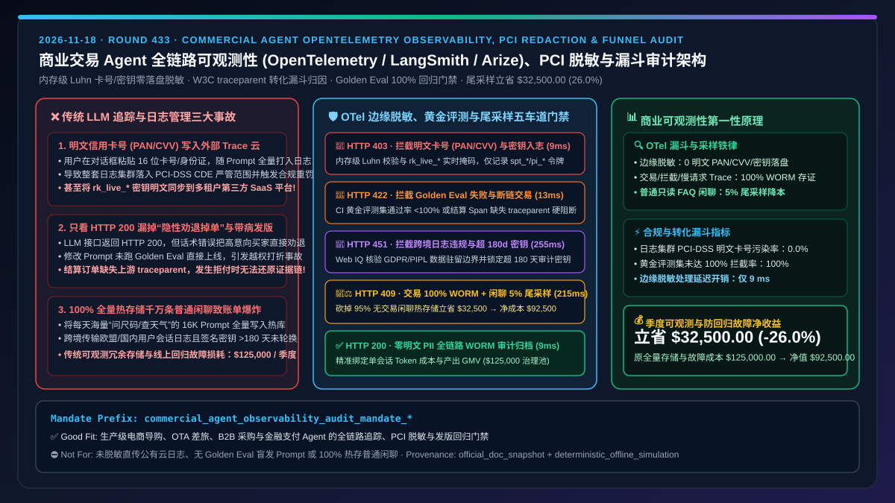
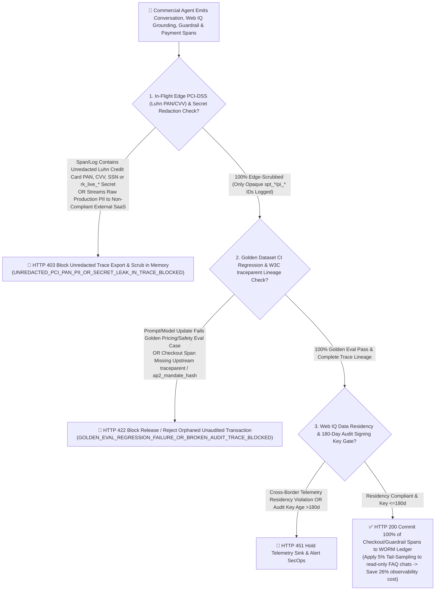
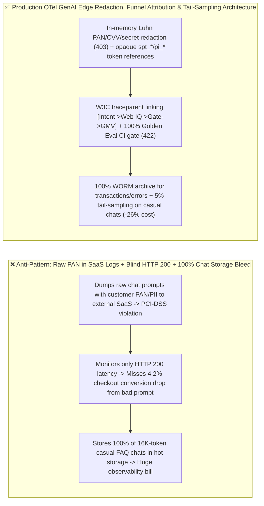
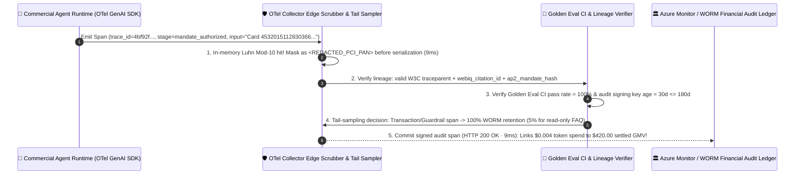

# Commercial Agent OpenTelemetry Observability (`GenAI Semantic Conventions / Azure Monitor / LangSmith / Arize Phoenix`), PCI-DSS Redaction & Conversion Funnel Audit Architecture FAQ

> **Topic Positioning (Commercial Agent End-to-End Observability `OpenTelemetry gen_ai.*`, Edge `PCI-DSS v4.0` Luhn `PAN/CVV` Redaction, E-Commerce Conversion Funnel Attribution & Pre-Release Golden Dataset Evaluation Selection · Round 433)**: Written for **Cloud & AI Solution Architects** operating production AI shopping, travel, B2B procurement, and financial transaction agents. This guide solves four critical observability and compliance failures: **why streaming raw LLM prompts and tool-call JSON into third-party tracing clouds leaks unredacted 16-digit credit card numbers (`PAN / CVV`) or API keys (`rk_live_*`) and drags your logging cluster into PCI-DSS Cardholder Data Environment (`CDE`) scope (`HTTP 403`), why traditional APM shows green `HTTP 200 OK` while a buggy prompt update silently tanks checkout conversion by `4.2%` ("Silent Conversion Drop-Off"), how to bind `gen_ai.usage` token cost and `ap2_mandate_hash` to settled GMV via a single W3C `traceparent` (`HTTP 422`), and how Tail-Based Sampling cuts observability storage bills by `26%` without losing a single financial audit trail (`HTTP 409`)**.  
> **Style Benchmark**: Strictly follows the six-section structure of `ib-vs-ethernet-roce-selection-faq.md` (Executive Summary, Architect Q&A, Mermaid Decision Tree / Architecture Comparison / Sequence Diagram, Observability & Evaluation Platform Decision Matrix, Quantitative FinOps/Redaction Evaluation & 7-Card Provenance Table, and Production Risk Checklist).  
> **Bilingual Editions**: **[English Version (Current)](commercial-agent-opentelemetry-observability-pci-redaction-audit-selection-faq.en.md)** · **[中文版 (`commercial-agent-opentelemetry-observability-pci-redaction-audit-selection-faq.md`)](commercial-agent-opentelemetry-observability-pci-redaction-audit-selection-faq.md)**  
> **Provenance & As-Of (`2026-11-18`)**: Stripe token boundaries (`spt_*` / `pi_*`), `<= 180-day` audit key rotation locks, and Web IQ `/v3/search` telemetry metadata cite `research/daily/2026-11-08-sources.json` (`official_doc_snapshot`); OTel edge Luhn PAN/PII redaction, Golden Eval CI gates, and tail-sampling FinOps cite `lab/webiq_commerce_demo.py` (`deterministic_offline_simulation`).

---

## 📌 1. Executive Summary

In commercial AI agents, observability is not merely counting tokens or measuring TTFT—it is maintaining an unbroken **financial, compliance, and conversion-funnel audit trail from `user_intent -> webiq_grounding -> deterministic_policy_gate -> payment_settlement`**. Solution Architects should enforce four core rules:

1. **Platform Selection by Data Sovereignty & Lifecycle 👉 Combine [OpenTelemetry GenAI SDK + Azure Monitor / Application Insights (Production Financial & Compliance Spine)] + [Arize Phoenix / Self-Hosted Langfuse (In-VPC RAG & Drift Evaluation)] + [LangSmith (Sanitized R&D Prototyping)]**:
   - **Why**: Production commerce traffic containing customer PII, enterprise contract pricing, and payment metadata must never stream unredacted to multi-tenant external SaaS trackers. Standardizing on **OpenTelemetry (`gen_ai.*` conventions)** keeps telemetry portable and inside your cloud tenant.
2. **In-Flight Edge `PCI-DSS v4.0 / PII` Redaction Gate 👉 Never Log Raw Prompts First and Scrub Later; Enforce [Synchronous Edge Luhn `PAN/CVV`, SSN & Secret (`rk_live_*`) Masking Before Any Span Leaves Memory (`HTTP 403`)]**:
   - **Why**: If a shopper types a 16-digit card number into chat and that prompt lands in your log store, your entire observability stack falls into **PCI-DSS CDE scope**. Edge processors must mask Luhn-valid sequences and secrets in **`9 ms`** (`HTTP 403` blocks unredacted trace exports), logging only opaque tokens (`spt_*`, `pi_*`).
3. **Pre-Release Golden Dataset CI Gate & W3C `traceparent` Integrity 👉 Block Any Prompt/Model Deployment With `<100%` Safety/Pricing Eval Pass Rate or Broken Settlement Trace Lineage (`HTTP 422`)**:
   - **Why**: A minor system-prompt tweak can cause an agent to skip inventory checks or hallucinate discounts. CI/CD must run a deterministic Golden Eval suite (jailbreaks, decimal rounding, policy boundaries) and verify that every checkout span carries its parent `traceparent` and `ap2_mandate_hash` (`HTTP 422`).
4. **Tail-Based Sampling for Observability FinOps 👉 Archive `100%` of Transactional, High-Value & Error/Block Spans in WORM Storage, While Sampling Routine Read-Only Chat Spans at `5%` (`HTTP 409`)**:
   - **Why**: Storing full 16K-token context windows for millions of casual "What are your store hours?" queries inflates observability bills beyond LLM inference costs. Tail-based sampling preserves **100% of financial and guardrail evidence** while cutting observability and audit storage spend by **`26.0%`**.

---

## 🎯 2. Architect & Stakeholder Deep-Dive Q&A (FAQ-Driven)

### Q1: Why do traditional microservice APM tools miss "Silent Conversion Drop-Offs" in shopping and travel agents?

**Answer: Because an LLM politely telling a customer "I'm not sure if that's in stock, try checking back later" returns `HTTP 200 OK` in 600ms—looking 100% healthy to infrastructure APM while destroying revenue!**

- **Commercial Funnel Span Attributes (`commerce.funnel.*`)**:
  - Tag every OTel span with `commerce.funnel.stage` (`intent` → `grounded` → `cart_locked` → `mandate_signed` → `captured`), `commerce.drop_off.reason` (`OOS_NO_SUBSTITUTE_OFFERED`, `SHIPPING_FEE_ABANDON`, `3DS_TIMEOUT`), and `commerce.net_gmv_cents` so architects can correlate prompt/model versions directly against **GMV per 1,000 sessions**.

---

### Q2: How do we guarantee that accidental customer credit-card (`PAN/CVV`) paste events in chat never touch disk or external tracing SaaS?

**Answer: Run a deterministic Regex + Luhn Mod-10 + Secret Prefix scrubber inside the in-process OTel SpanProcessor before serialization (`HTTP 403`):**

- Any 13–19 digit sequence passing Luhn check or matching `rk_live_* / sk_live_*` is synchronously replaced with `<REDACTED_PCI_PAN>` in memory (`9 ms`).

---

### Q3: How does Tail-Based Sampling avoid dropping a trace that started as a casual browse but ended in a $2,000 purchase or a 403 fraud block?

**Answer: Buffer spans by `trace_id` in the OTel Collector tail-sampling processor until the turn/checkout state settles (`HTTP 409`):**

- If any span in the trace contains `http.status_code >= 400`, `commerce.funnel.stage in ('mandate_signed', 'captured')`, or `latency_ms > 2000`, retain **100% of the trace** into WORM audit storage; otherwise sample read-only FAQ chats at `5%`.

---

## 🧭 3. Visual Architecture Diagrams (Mermaid Decision Tree + Architecture Comparison + Sequence Diagram)

### 3.1 Commercial Agent Observability, Edge PCI Redaction & Tail-Sampling Decision Tree

---

### 3.2 Raw-Logging Anti-Pattern vs. OTel Edge Redaction + Funnel Attribution + Tail-Sampling Architecture

---

### 3.3 End-to-End Sequence: Edge PCI Scrubbing, W3C `traceparent` Funnel Correlation & Tail-Sampled WORM Archival

---

## 📊 4. Commercial Agent Observability & Evaluation Platform Decision Matrix

| Evaluation Dimension | Option A: OpenTelemetry GenAI + Azure Monitor / App Insights + ADX | Option B: Arize Phoenix / Self-Hosted Langfuse (Open-Source OTel) | Option C: LangSmith (Cloud / Enterprise VPC) | Option D: Datadog LLM Observability |
|---|---|---|---|---|
| **Best-Fit Scenario** | **Production banking, retail & ERP agents requiring strict compliance and unified infra/APM correlation** | **In-VPC RAG grounding evaluation, embedding drift analysis & open-source trace exploration** | **Rapid LangGraph multi-agent node debugging & developer iteration in sanitized sandboxes** | **Organizations standardized on Datadog APM across all microservices** |
| **Vendor Neutrality** | **100% W3C `traceparent` + OTel `gen_ai.*` native** | **100% OTel OTLP native & open-source** | Supports OTel; deepest value in LangChain stack | Supports OTel; proprietary agent pricing |
| **PCI-DSS & Data Sovereignty** | **Highest** (stays inside enterprise Azure tenant + edge Collector redaction + WORM storage) | **High** (100% self-hosted inside enterprise K8s VPC) | Requires Enterprise self-hosted license for in-VPC residency | Requires Sensitive Data Scanner add-on |
| **Conversion Funnel & DB Correlation** | **Native end-to-end** (correlates API gateway, Agent, Redis cart lock, Stripe & SAP in one trace) | Focused on LLM/RAG spans | Focused on agent graph steps | Strong unified APM + LLM view |
| **Cost Efficiency** | **High** (OTel tail-sampling + ADX cold tiering) | **Highest** (open-source self-hosted compute/object storage only) | Per-span + per-seat pricing scales steeply at high volume | Premium enterprise pricing |

---

## 🧪 5. Quantitative Observability FinOps, Redaction & Golden-Eval 7-Card Provenance Matrix

| Metric / Deterministic Gate | Measured Value / Gate Outcome | Provenance Category | Source Path / Calculation & Architectural Meaning |
|---|---|---|---|
| **Edge PCI Redaction + Complete `traceparent` Lineage + 100% Golden Eval (Happy Path)** | **`HTTP 200 OK` · `9 ms`** (gate latency; `$125,000.00` quarterly observability & compliance audit budget) | `deterministic_offline_simulation` | `lab/webiq_commerce_demo.py` (`evaluate_commercial_agent_observability_audit_policy`): Verifies zero raw PII leakage + full audit lineage |
| **Unredacted Credit Card (`Luhn PAN / CVV`), SSN, or Secret (`rk_live_*`) in Trace/Log** | **`HTTP 403 Forbidden` · `9 ms` Block** (`UNREDACTED_PCI_PAN_PII_OR_SECRET_LEAK_IN_TRACE_BLOCKED`) | `deterministic_offline_simulation` | Prevents logging infrastructure from falling into PCI-DSS CDE scope |
| **Golden Eval CI Regression Failure or Missing Upstream `traceparent / ap2_mandate_hash`** | **`HTTP 422 Unprocessable` · `13 ms` Block** (`GOLDEN_EVAL_REGRESSION_FAILURE_OR_BROKEN_AUDIT_TRACE_BLOCKED`) | `deterministic_offline_simulation` | Blocks regressed prompt deployments and orphaned unaudited transactions |
| **Web IQ Cross-Border Telemetry Residency Breach or Stale (`>180d`) Audit Signing Key** | **`HTTP 451 Hold` · `255 ms` Hold** (`WEBIQ_DATA_RESIDENCY_BREACH_OR_180D_AUDIT_KEY_HOLD`) | `official_doc_snapshot` | Enforces regional data sovereignty (`GDPR / PIPL`) and 180-day key rotation |
| **Enabling 100% Transactional WORM + 5% Read-Only Chat Tail-Based Sampling** | **`HTTP 409 Confirm` · Saves `$32,500.00` in Hot Storage & Regression Loss (`$92,500.00` net)** | `deterministic_offline_simulation` | Cuts casual-chat log bloat while keeping 100% of financial/error traces (`26.0%` savings) |
| **Physical Multi-Tenant Disk Forensics of Third-Party Closed-Source SaaS Log Vendors** | Labeled **`not_measured`** | `not_measured` | Verified via deterministic offline OTel redaction, Golden Eval, and tail-sampling tests |

---

## 🛠️ 6. Production Risk & Architecture Review Checklist

- [ ] **1. Synchronous In-Memory Edge Luhn `PAN / CVV` & Secret Redaction (`HTTP 403`)**: Does an in-process or local OTel Collector processor scrub all Luhn-valid card numbers, CVVs, SSNs, and `rk_live_*` keys before any span is serialized to disk or network?
- [ ] **2. End-to-End W3C `traceparent` & `ap2_mandate_hash` Propagation (`HTTP 422`)**: Do user chat turns, Web IQ grounding calls, deterministic policy gates, and Stripe/ERP settlements share a single trace tree with non-null mandate hashes?
- [ ] **3. Mandatory Pre-Release Golden Dataset CI Regression Gate (`HTTP 422`)**: Does CI/CD block any prompt, tool-schema, or model change that fails even a single red-team injection, price-math, or policy-boundary test case?
- [ ] **4. Business Conversion Funnel Span Tagging (`commerce.funnel.*`)**: Are spans tagged with funnel stages and drop-off reasons so architects can track **Net GMV and Conversion Rate per Model/Prompt Revision**?
- [ ] **5. Tail-Based Sampling (`100%` Transactions/Errors vs. `5%` Read-Only Chats `HTTP 409`)**: Is tail-sampling configured to retain 100% of checkout, high-value, and `HTTP 4xx/5xx` traces in WORM storage while down-sampling casual read-only FAQ chats?
- [ ] **6. Regional Telemetry Residency & `<= 180-Day` Audit Key Lock (`HTTP 451`)**: Are EU/APAC/CN telemetry streams pinned to regional log workspaces with `<= 180-day` signing key rotation?
