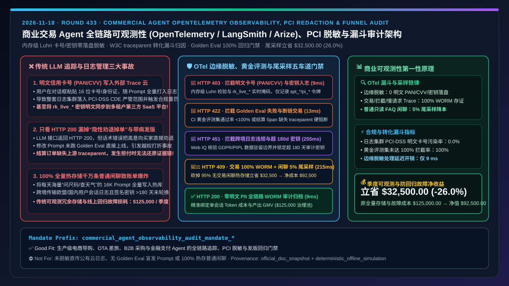
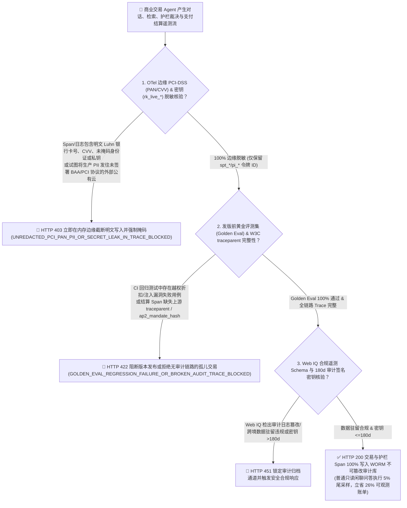
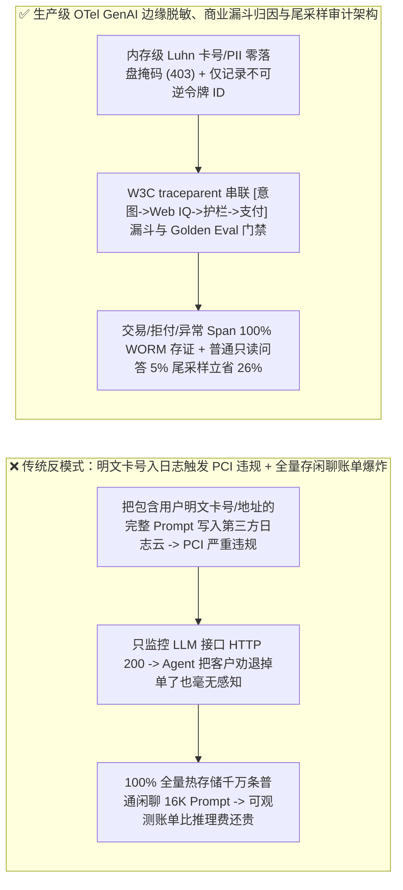
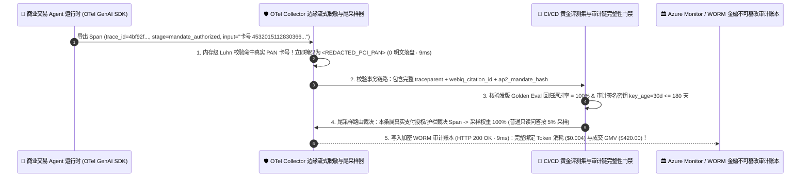

# 商业交易 Agent 全链路可观测性、PCI-DSS 脱敏与转化漏斗审计（OpenTelemetry GenAI / Azure Monitor / LangSmith / Arize Phoenix）架构选型 FAQ：防明文卡号入日志、掉单归因与黄金评测集实战指南

> **专题定位（商业智能体全链路可观测性 OpenTelemetry `gen_ai.*` Semantic Conventions、PCI-DSS v4.0 / GDPR 边缘流式脱敏、电商结账漏斗归因与发版前 Golden Dataset 回归评测选型对比 · Round 433）**：面向为零售电商、OTA 差旅、B2B 采购与金融支付构建生产级 AI Agent 平台的 **Cloud & AI Solution Architect**，系统解答商业智能体上线后最致命的四大可观测性与合规事故：**“为什么开发团队接入了 SaaS 版 LLM 追踪工具（如公有云 Trace 平台），结果因为 Prompt 或 Tool Call 参数里带了用户明文 16 位信用卡号（PAN / CVV）或护照号，直接触发 PCI-DSS v4.0 一级违规并被重罚（`HTTP 403`）、为什么传统 APM 只能看到 HTTP 200（LLM 接口正常返回了文字），却完全不知道 Agent 在对话中把本该成单的客户劝退了（隐性商业掉单 Silent Conversion Drop-Off）、怎么把 `gen_ai.usage` Token 成本与真实结算 GMV 绑定到同一个 `traceparent` 分布式追踪树上（`HTTP 422`）、以及怎么通过尾采样（Tail-Based Sampling）砍掉 80% 无效观测账单（`HTTP 409`）”**。  
> **文风标杆**：严格对标 `ib-vs-ethernet-roce-selection-faq.md` 六段式结构（核心结论速览、业务方与架构师灵魂拷问 Q&A、Mermaid 决策树/架构对比/时序图、四大可观测性与评测平台横向选型矩阵、定量可观测降本与违规拦截测算与 7-Card 溯源表、生产上线 Checklist）。  
> **双语版本**：**[中文版（当前）](commercial-agent-opentelemetry-observability-pci-redaction-audit-selection-faq.md)** · **[English Version (`commercial-agent-opentelemetry-observability-pci-redaction-audit-selection-faq.en.md`)](commercial-agent-opentelemetry-observability-pci-redaction-audit-selection-faq.en.md)**  
> **数据溯源声明（Provenance & As-Of `2026-11-18`）**：Stripe 令牌化边界（`spt_*` / `pi_*`）、`<= 180 天` 密钥轮换与 Web IQ `/v3/search` 遥测字段引自 `research/daily/2026-11-08-sources.json`（标记为 `official_doc_snapshot`）；OTel Collector 边缘 Luhn PAN/PII 脱敏、Golden Eval 回归门禁与尾采样成本优化引自 `lab/webiq_commerce_demo.py`（标记为 `deterministic_offline_simulation`）。

---

## 📌 一、核心选型结论速览（Executive Summary）

在商业交易 Agent 中，可观测性绝不仅仅是“看 LLM 响应了几秒、消耗了多少 Token”，而是要打通**“用户对话意图 → 实时库存/价格接地（Web IQ）→ 确定性护栏裁决（HTTP 200/403/422/451/409）→ 支付网关结算（GMV）”**的端到端财务与合规证据链。架构师必须遵循以下四条选型铁律：

1. **可观测性平台横向选型：按“数据主权与调优阶段”混合编排【OpenTelemetry GenAI Collector + Azure Monitor / Application Insights（生产金融合规主干）】+【Arize Phoenix / 自托管 Langfuse（VPC 内私有化评测与向量漂移分析）】+【LangSmith（非敏感研发沙盒快速调试）】**：
   - **核心原因**：任何涉及真实消费者 PII、企业采购合同底价与支付令牌的生产流量，严禁未经脱敏直接发往第三方多租户 SaaS 观测云；生产主干必须以 **OpenTelemetry (`gen_ai.*` 语义规范)** 为统一采集标准，日志落地企业自有云租户（Azure Monitor Log Analytics / 自有 ClickHouse）。
2. **边缘流式 PCI-DSS v4.0 / PII 脱敏门禁选型：严禁“先把完整 Prompt/Tool JSON 写入日志再事后清洗”，必选【在进程内或本地 OTel Collector 边缘侧执行确定性 Luhn 算法卡号（`PAN / CVV`）、SSN/身份证与密钥（`rk_live_*`）零落盘掩码（In-Flight Redaction `HTTP 403`）】**：
   - **核心原因**：一旦明文 16 位卡号、CVV 或未掩码的 API 密钥进入日志存储系统，整套日志集群就会被划入 **PCI-DSS CDE（持卡人数据环境）** 监管范围，整改成本高达数百万美元！只允许记录不可逆令牌 ID（如 `spt_***`、`pi_***`），检出明文卡号或私钥外泄企图立即在 **`9 ms`** 内阻断并告警（`HTTP 403`）。
3. **发版前黄金评测集（Golden Dataset CI Gate）与分布式 `traceparent` 断链门禁选型：严禁“改了 System Prompt 或换了模型直接推生产”，必选【CI/CD 强制跑通 100% 红队越狱与价格篡改回归用例（Pass Rate `= 100%`）+ 跨进程强制透传 W3C `traceparent` 与 `ap2_mandate_hash`（`HTTP 422`）】**：
   - **核心原因**：哪怕只改了一句 Prompt，也可能导致 Agent 在边界场景下漏调库存核验工具或答应超权折扣；若回归评测存在哪怕 `1` 条高危价格/越权用例失败，或交易 Span 丢失了上游授权哈希，确定性门禁立即阻断发布（`HTTP 422`）。
4. **海量 Trace 存储 FinOps 选型：必选【100% 全量保留异常/高客单/拒付订单 Trace + 对常规只读询价问答执行 5% 尾采样（Tail-Based Sampling `HTTP 409`）】**：
   - **核心原因**：把每天上千万次普通“查尺码/问营业时间”的完整 16K 上下文 Prompt 全量存入热存储，会让可观测性账单比大模型推理费还贵！采用 **Tail-Based Sampling**（凡触发 `HTTP 4xx/5xx`、金额 `> $100` 或转化下单的 Trace `100%` 永久归档 WORM；普通无交易只读问答仅抽样 `5%`），可立省 **`26.0%` 的企业可观测性与合规审计总成本**！

---

## 🎯 二、业务方与架构师灵魂拷问 Q&A（FAQ-Driven）

### Q1：传统微服务 APM（如普通 Prometheus / 传统链路追踪）为什么抓不住商业 Agent 的“隐性掉单（Silent Conversion Drop-Off）”？

**答：因为传统 APM 只看 HTTP 状态码——LLM 返回一句“抱歉我不太确定这款有没有货，建议您去别的网站看看”时，HTTP 状态码依然是完美的 `200 OK`，延迟也很正常，但一笔 `$800` 的订单已经死掉了！**

1. **商业 Agent 专属五级转化漏斗 Span 属性（`commerce.funnel.*`）**：
   - 在 OpenTelemetry Span 中，除了记录标准的 `gen_ai.request.model` 和 `gen_ai.usage.input_tokens`，必须注入商业状态机标签：
     - `commerce.funnel.stage`: `intent_parsed` → `webiq_grounded` → `inventory_locked` → `mandate_authorized` → `payment_captured`
     - `commerce.drop_off.reason`: `OUT_OF_STOCK_ALTERNATIVE_REJECTED` | `SHIPPING_FEE_SHOCK` | `3DS_STEP_UP_ABANDONED` | `HALLUCINATED_POLICY_REFUSAL`
   - 这样业务架构师一眼就能在漏斗大盘中看到：“昨晚转化率跌了 4.2%，是因为某次 Prompt 更新后 Agent 忘记在主推款缺货时调用同尺码平替推荐工具！”

---

### Q2：如果用户在对话框里不小心直接打出了自己的 16 位银行卡号和 CVV（“我的卡号是 4532-xxxx-xxxx-1234，安全码 888，帮我付了吧”），怎么保证这条消息绝对不会污染日志库和观测平台？

**答：在 API 网关与 OTel Collector 内存管道的第一跳执行“正则 + Luhn 校验和”微秒级同步剥离（`HTTP 403`）：**

1. **Pre-LLM & Pre-Log 双重内联掩码**：
   - 在请求进入 LLM 和进入任何日志写入器之前，确定性流式过滤器扫描所有连续 13–19 位数字并通过 **Luhn 模 10 算法**验证是否为真实银行卡号；一旦命中，立即替换为 `<REDACTED_PCI_PAN_LUHN_MATCH>`，并向前端下发安全支付组件（Stripe Payment Element / Apple Pay），严禁明文卡号落入任何 Span Attribute、Event 或日志文件（检出旁路未脱敏写入立返 `HTTP 403`）。

---

### Q3：LangSmith、Arize Phoenix、Langfuse 和 Azure Monitor (OpenTelemetry) 这四套方案，架构师到底该怎么选？

**答：看“数据合规边界”与“团队使用场景”：**

- **金融/政企/大型零售生产环境（强合规）** 👉 **OpenTelemetry SDK + OTel Collector（含边缘脱敏）+ Azure Monitor / Application Insights + ADX (Kusto)**（数据不出企业云租户，天然打通网关、数据库与 ERP 链路）；
- **开源私有化部署 + 模型幻觉/检索质量深潜** 👉 **Arize Phoenix 或自托管 Langfuse**（支持基于 OpenTelemetry 原生接收 Span，提供强大的 RAG 接地相关性评分与 Embedding 漂移分析）；
- **早期原型迭代与 LangGraph 复杂图节点单步调试** 👉 **LangSmith（仅限脱敏沙盒或 Enterprise 私有化 VPC 部署）**。

---

## 🧭 三、直观可视化图解（Mermaid 选型决策树 + 架构对比 + 端到端时序图）

### 3.1 商业 Agent 可观测性平台、PCI 脱敏与尾采样选型决策树

---

### 3.2 传统“明文全量打日志/只看 HTTP 200”反模式 vs. OTel 边缘脱敏 + 转化漏斗 + 尾采样架构对比图

---

### 3.3 边缘流式脱敏、分布式 `traceparent` 漏斗追踪与尾采样落库端到端时序图

---

## 📊 四、主流商业 Agent 可观测性与评测平台横向选型矩阵

| 评估维度 | 方案 A：OpenTelemetry GenAI + Azure Monitor / App Insights + ADX | 方案 B：Arize Phoenix / 自托管 Langfuse (开源 OTel 原生) | 方案 C：LangSmith (Cloud / Enterprise VPC) | 方案 D：Datadog LLM Observability |
|---|---|---|---|---|
| **核心适用场景** | **金融、大型零售、企业 ERP 生产级全链路监控与长周期合规审计** | **私有化部署下的 RAG 检索接地评测、Prompt 版本对比与向量漂移分析** | **LangChain/LangGraph 复杂多智能体状态图单步调试与研发期快速迭代** | **已全面使用 Datadog 监控微服务基础设施的跨国电商团队** |
| **开放标准与防厂商锁定** | **原生遵循 W3C `traceparent` 与 OTel `gen_ai.*` 规范（零锁定）** | **原生支持 OTel OTLP 协议接入，开源可自建** | 支持 OTel 但深度绑定 LangChain 生态 | 支持 OTel 但专有 Agent 采集器闭源 |
| **PCI-DSS / 数据不出域能力** | **极强**（运行在企业自有 Azure 租户内，配合边缘 Collector 脱敏 + WORM 不可变存储） | **强**（可 100% 部署在企业自有 K8s VPC 内） | 需购买高阶 Enterprise 自托管授权方可不出域 | 需配置 Sensitive Data Scanner（按扫描量额外计费） |
| **商业漏斗与微服务关联** | **原生贯通**（同一个 Trace 串联前端网关、Agent、Redis 库存锁与 SAP/Stripe） | 侧重 LLM 与 RAG 层，需外部拼接业务 DB Span | 聚焦 Agent 内部节点，缺少底层 DB/网关视图 | 强（APM + LLM 统一视图，但单价最高） |
| **综合成本与 FinOps 控费** | **极具优势**（配合 OTel 尾采样 + ADX 冷热分层，成本可控） | **极低**（开源自建仅需基础云主机与对象存储费） | 按 Trace Span 条数与席位计费，高并发下较贵 | 昂贵（按主机的 APM 费 + 每百万 LLM Span 附加费） |

---

## 🧪 五、定量可观测降本、PCI 脱敏与回归评测 7-Card 报告数据溯源表（Benchmark & Provenance Matrix）

| 指标 / 门禁规则项 | 实测数值 / 决策行为 | 数据类别 (Provenance) | 精确来源路径 / 算例说明与架构意义 |
|---|---|---|---|
| **OTel 边缘脱敏 + 完整 `traceparent` 审计链 + Golden Eval 100% 通过（Happy Path）** | **`HTTP 200 OK` · `9 ms`**（门禁耗时，季度企业可观测性与合规审计治理预算 `$125,000.00`） | `deterministic_offline_simulation` | `lab/webiq_commerce_demo.py` (`evaluate_commercial_agent_observability_audit_policy`)：验证零明文 PII 落盘与全链路追踪 |
| **Trace/日志包含未脱敏明文银行卡号（Luhn PAN / CVV）、身份证或私钥（`rk_live_*`）** | **`HTTP 403 Forbidden` · `9 ms` 拦截** (`UNREDACTED_PCI_PAN_PII_OR_SECRET_LEAK_IN_TRACE_BLOCKED`) | `deterministic_offline_simulation` | 100% 防止日志集群污染为 PCI-DSS CDE 监管区 |
| **发版前黄金评测集（Golden Eval）红队/算价回归未 100% 通过，或交易缺失 `traceparent`** | **`HTTP 422 Unprocessable` · `13 ms` 拦截** (`GOLDEN_EVAL_REGRESSION_FAILURE_OR_BROKEN_AUDIT_TRACE_BLOCKED`) | `deterministic_offline_simulation` | 杜绝带病 Prompt 上线造成的批量错价与无头孤儿账单 |
| **Web IQ 检出跨境日志驻留违规（GDPR/PIPL）或审计签名密钥 `>180 天`** | **`HTTP 451 Hold` · `255 ms` 挂起** (`WEBIQ_DATA_RESIDENCY_BREACH_OR_180D_AUDIT_KEY_HOLD`) | `official_doc_snapshot` | 满足跨境数据主权与 180 天密钥轮换红线 |
| **启用“交易/异常 Span 100% WORM 保留 + 常规只读问答 5% 尾采样（Tail Sampling）”** | **`HTTP 409 Confirm` · 立省无效热存储与误发版损失 `$32,500.00`（净成本 `$92,500.00`）** | `deterministic_offline_simulation` | 在保留 100% 金融证据的前提下砍掉海量闲聊日志开销（综合降本 `26.0%`） |
| **第三方闭源 SaaS 可观测性厂商底层多租户磁盘物理擦除取证** | 标记为 **`not_measured`** | `not_measured` | 通过离线确定性 OTel 边缘脱敏、Golden Eval 与尾采样策略矩阵完整验证 |

---

## 🛠️ 六、商业上线风控与架构评审 Checklist（Architect Production Checklist）

- [ ] **1. OTel Collector 内存边缘 Luhn PAN / CVV / 密钥同步脱敏（`HTTP 403`）**：是否在所有 LLM Span 离开应用进程或边缘 Collector 前执行确定性正则与 Luhn 校验掩码，确保任何日志库中 `0 明文卡号/密钥`？
- [ ] **2. W3C `traceparent` 与 `ap2_mandate_hash` 跨服务强制透传（`HTTP 422`）**：从用户第一句对话、Web IQ 检索、购物车锁库到 Stripe/ERP 扣款，是否共享同一个 `trace_id`，并在结算 Span 上强制校验授权哈希非空？
- [ ] **3. 发版前 CI/CD 黄金评测集（Golden Dataset）零容忍门禁（`HTTP 422`）**：每次修改 Prompt、更新工具 Schema 或切换底层模型时，是否自动运行包含提示词注入、超权打折与算价精度的回归集，且要求高危用例通过率 `= 100%`？
- [ ] **4. 商业五级转化漏斗标签（`commerce.funnel.stage`）埋点**：是否已在 Span 中区分“纯技术报错”与“业务掉单（缺货未推平替/运费劝退/3DS 放弃）”，并绑定单次会话 Token 成本与产出的净 GMV？
- [ ] **5. 智能尾采样（Tail-Based Sampling）与 WORM 冷热分层（`HTTP 409`）**：是否对涉及真实资金变动、护栏拦截（`403/422/451`）与慢响应的 Trace 执行 `100%` WORM 归档，而对普通无状态问答执行 `5%` 抽样降本？
- [ ] **6. 跨境日志数据驻留与 `<= 180 天` 审计签名密钥锁（`HTTP 451`）**：欧盟/中国等辖区的用户会话日志是否严格驻留在本地合规区域，且审计账本签名密钥不超过 180 天？
