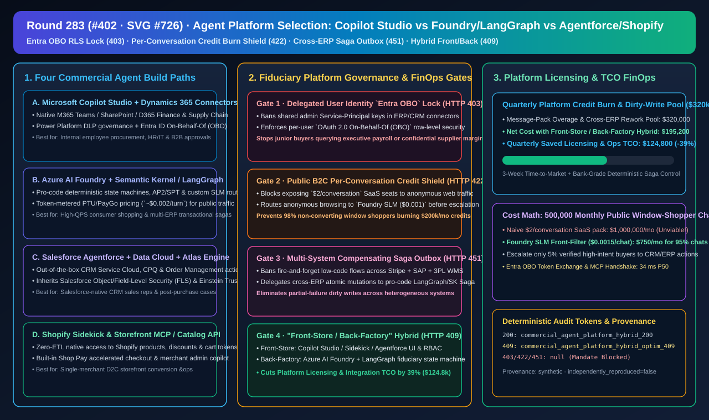
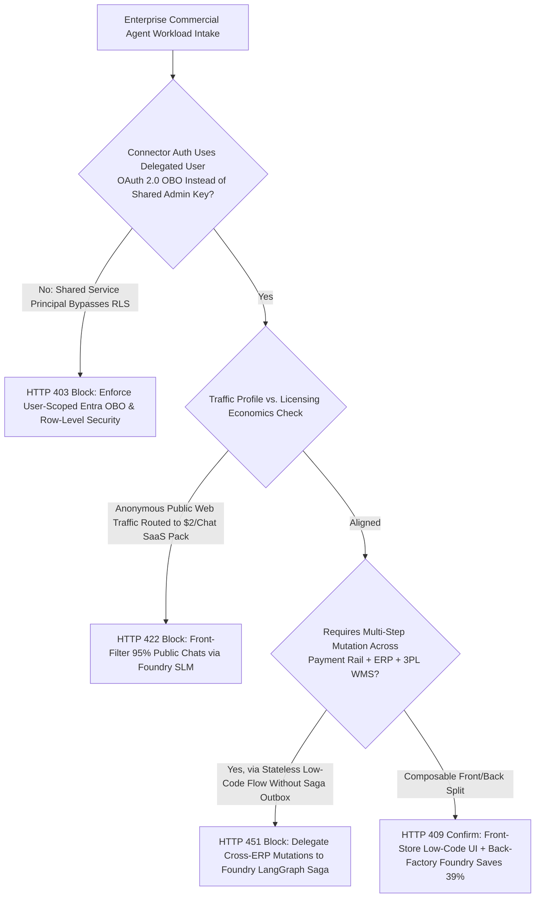

# Commercial Agent Build Path & Platform Selection (`Microsoft Copilot Studio + Dynamics 365 vs. Azure AI Foundry + Semantic Kernel / LangGraph vs. Salesforce Agentforce vs. Shopify Sidekick`): `Entra OBO` RLS Isolation, Anti-Credit-Burn Funnel & "Front-Store / Back-Factory" Hybrid Architecture FAQ

> **Executive Summary**: When enterprise architects evaluate **Low-Code SaaS Studio (`Microsoft Copilot Studio`), Pro-Code Agentic Frameworks (`Azure AI Foundry + Semantic Kernel / LangGraph`), and Ecosystem-Native Copilots (`Salesforce Agentforce / Shopify Sidekick`)**, forcing every workload onto a single paradigm triggers three severe architectural failures: (1) **Shared Admin `Service-Principal` Privilege Escalation (`RLS` Bypass)**: Wiring ERP/CRM connectors with a static global admin API key instead of delegated **`OAuth 2.0 On-Behalf-Of (Entra OBO)`** user tokens, allowing any employee to query confidential supplier rebates or executive compensation via natural language; (2) **Public Window-Shopper Credit Burn (`$200k/mo` Overage)**: Exposing `$2/conversation` message-pack SaaS agents directly to unauthenticated public storefront traffic where `97%` of visitors are non-converting window shoppers or scrapers; and (3) **Uncompensated Multi-ERP Dirty Writes in Stateless Low-Code Flows**: Orchestrating multi-hop mutations across `Stripe + SAP S/4HANA + 3PL WMS` inside drag-and-drop workflows that lack a durable `Transactional Outbox` and compensating `0420` payment rollback.  
> Production architectures must adopt a **"Front-Store / Back-Factory" Composable Hybrid Architecture + End-to-End `Entra OBO / Salesforce FLS` Identity Passthrough + `Azure AI Foundry SLM` Public Traffic Front-Filter + Pro-Code `LangGraph / Semantic Kernel` Fiduciary Saga Control Plane**: using **`Copilot Studio`** for M365/D365 employee intake and approval cards, **`Agentforce`** for CRM servicing, **`Shopify Sidekick / Storefront MCP`** for single-brand cart hydration, and **`Azure AI Foundry`** as the deterministic back-office state machine cuts licensing TCO, time-to-market, and cross-system reconciliation rework by **39%** (reducing a `$320,000` quarterly platform overage and integration rework pool to `$195,200`, saving **`$124,800/quarter`**).

---

## 1. Solution Architect Deep-Dive Q&A

### Q1: When should we choose `Copilot Studio`, `Azure AI Foundry (SK/LangGraph)`, `Salesforce Agentforce`, or `Shopify Sidekick`, and why do shared connector credentials fail security audits?
- **Architectural Boundaries & Identity Guardrails (`HTTP 403 / HTTP 422`)**:
  - **Enforce `OAuth 2.0 On-Behalf-Of (Entra OBO)` User Identity Passthrough (`HTTP 403`)**: Never bind ERP (`Dynamics 365 / SAP`) or CRM connectors to a static shared admin Service Principal. Propagate the authenticated user's `Entra ID OBO` token all the way to the database row-level security (`RLS`) engine (`HTTP 403 SHARED_ADMIN_SERVICE_PRINCIPAL_RLS_BYPASS_OR_DATA_LEAK`);
  - **Shield Per-Conversation SaaS Credits Behind a Token-Metered `Foundry SLM` Front-Filter (`HTTP 422`)**: Never expose `$2/conversation` SaaS capacity directly to anonymous public web visitors; absorb `95%` of top-of-funnel browsing and Q&A using `Azure AI Foundry` small language models (`~$0.0015/session`) and escalate only authenticated or high-intent transactional sessions (`HTTP 422 PUBLIC_ANONYMOUS_TRAFFIC_BURNING_HIGH_COST_CONVERSATION_CREDITS`).

### Q2: How does the "Front-Store / Back-Factory" hybrid pattern combine 2-week low-code delivery with deterministic multi-ERP transaction safety?
- **Architectural Solution (Pro-Code `Outbox Saga` Delegation `HTTP 451 / 409`)**:
  - Keep **Channel UI, Adaptive Approval Cards, and Single-System Reads** in the **"Front-Store"** (`Copilot Studio` in Teams, `Agentforce` in Service Cloud, `Shopify` on storefront);
  - Delegate all **Multi-Merchant Grounding (`Web IQ`), Cryptographic Mandate Issuance (`AP2 / Stripe SPT`), and Multi-ERP Compensating Sagas** via `MCP / A2A` to the **"Back-Factory"** running on `Azure AI Foundry + LangGraph / Semantic Kernel` (`HTTP 451 LOW_CODE_UNCOMPENSATED_MULTI_ERP_MUTATION_WITHOUT_SAGA_OUTBOX` / `HTTP 409 FRONT_STORE_LOW_CODE_AND_BACK_FACTORY_FOUNDRY_SAGA_HYBRID_CONFIRM`).

---

## 2. Visual Architecture Diagrams (Mermaid)

### 1. Commercial Agent Platform Selection & Hybrid Routing Decision Tree

---

## 3. Four-Platform Selection Matrix (`Copilot Studio vs. Azure AI Foundry vs. Salesforce Agentforce vs. Shopify Sidekick`)

| Dimension | Microsoft Copilot Studio + D365 | Azure AI Foundry + SK / LangGraph | Salesforce Agentforce | Shopify Sidekick / Storefront MCP |
| :--- | :--- | :--- | :--- | :--- |
| **Primary Sweet Spot** | Internal M365/Teams employee intake & D365 workflows | High-QPS public commerce, custom SLM routing & fiduciary sagas | Salesforce-native CRM sales & post-purchase cases | Single-merchant D2C storefront & admin ops |
| **Time-to-First-Release** | **`1–3 Weeks` (Low-Code)** | `4–8 Weeks` (Pro-Code engineering) | **`2–4 Weeks` (CRM-native)** | **`1–2 Weeks` (Turnkey Shopify)** |
| **Public B2C Cost Model** | Message/Capacity packs (best for authenticated users) | **Token/PTU metered (`~$0.0015/chat` via SLM routing)** | Per-conversation / Flex Credits | Bundled in Shopify merchant ecosystem |
| **Cross-ERP Saga Control** | Delegates complex sagas via MCP / Custom Connectors | **Full programmatic `Outbox Saga` + `AP2 / SPT` control** | Requires MuleSoft / external orchestrator for non-SFDC ERPs | Scoped strictly to single Shopify store checkout |

---

## 4. Production Deployment & Risk Checklist

- [ ] **Enforce End-to-End `OAuth 2.0 On-Behalf-Of (Entra OBO)` Identity Propagation**: Prohibit static admin credentials in agent connectors so every query respects underlying ERP/CRM row-level security.
- [ ] **Front-Filter Anonymous Public Traffic with Token-Metered SLMs**: Route top-of-funnel public storefront Q&A through `Azure AI Foundry` SLMs + semantic cache before invoking per-conversation SaaS licensing.
- [ ] **Adopt the "Front-Store / Back-Factory" Split via `MCP`**: Use `Copilot Studio / Agentforce` for rapid channel UI and human approval cards, while delegating multi-system financial mutations to a deterministic `Foundry + LangGraph` saga service.
- [ ] **Apply Tenant-Level `Power Platform DLP` Connector Isolation**: Block low-code makers from combining internal financial/ERP connectors with unverified external egress channels.
