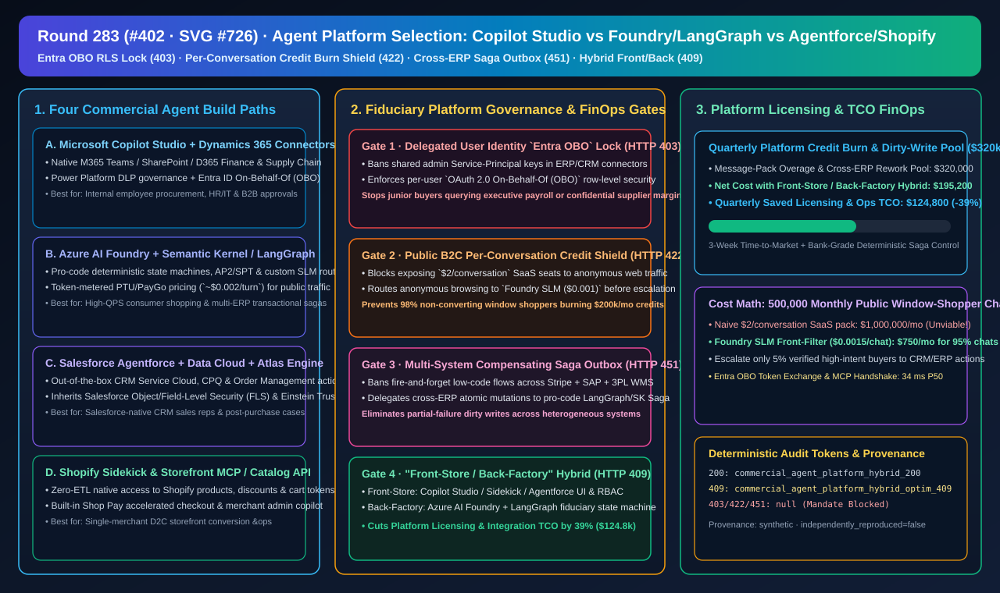
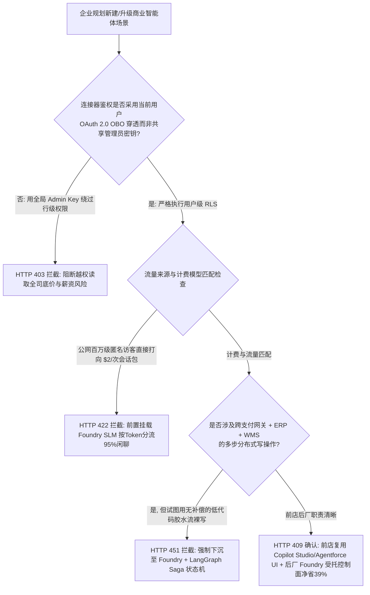
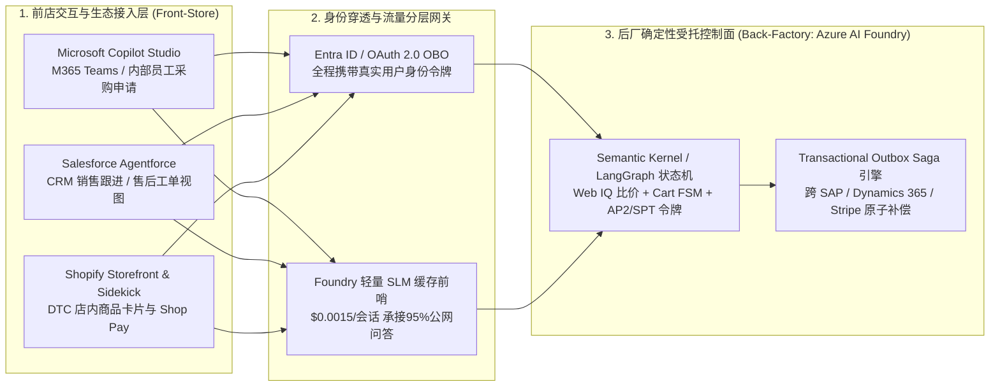
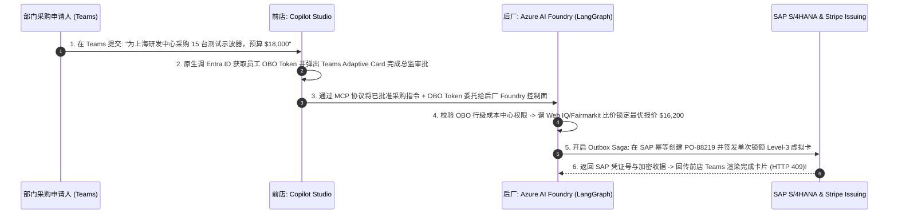

# 商业 Agent 构建路径与平台深度选型（`Microsoft Copilot Studio + Dynamics 365 vs. Azure AI Foundry + Semantic Kernel / LangGraph vs. Salesforce Agentforce vs. Shopify Sidekick`）：防共享账号越权泄密（`Entra OBO`）、防公网闲聊烧穿按次消息包与“前店后厂”混合架构 FAQ

> **核心选型结论速览**：当企业 CTO 与 AI 解决方案架构师面临“用低代码平台（`Copilot Studio`）、专业代码框架（`Azure AI Foundry + Semantic Kernel / LangGraph`）还是 SaaS 原生内嵌（`Salesforce Agentforce / Shopify Sidekick`）”的灵魂选型时，盲目追求“全公司只用一套工具”会引爆三大惨痛教训：① **在低代码连接器或自研 MCP 服务里硬编码“共享管理员账号（Shared Admin Service Principal）”导致全司底价与高管薪资越权泄露**：普通采购员在聊天窗问一句“查一下上季度所有供应商返点底价”，由于底层连接器用的是全局管理员 API Key，直接绕过了 ERP 行级权限（RLS）；② **把按次/按会话计费（如 `$2 / 200 credits` 每会话）的商业 SaaS Agent 直接裸奔挂在公网电商首页迎客，被 98% 只逛不买的羊毛党和爬虫一个月烧穿 `$250,000` 消息包**；③ **用无状态低代码工作流硬写“跨 Stripe 扣款 + SAP S/4HANA 锁库 + 3PL 拆单”复杂分布式事务，一旦第 3 步报错无法自动执行逆向补偿（Saga），留下满地脏数据**。  
> 生产级架构必须采用 **“‘前店后厂（Front-Store / Back-Factory）’混合双层架构 + 全链路 `OAuth 2.0 On-Behalf-Of (Entra OBO)` 用户身份穿透 + 公网高频导购走 `Azure AI Foundry SLM` 按 Token 计费前哨分流 + 跨 ERP 核心资金交易下沉至 `LangGraph / Semantic Kernel` 确定性状态机控制面”**：内部员工协同入口复用 **`Copilot Studio + M365 / Dynamics 365`**（2 周极速上线）、CRM 售前售后复用 **`Agentforce`**、独立站店长运营用 **`Shopify Sidekick`**，而所有跨系统寻源比价、受托令牌签发（`AP2 / SPT`）与分布式 `Saga` 补偿统一收口至 **`Azure AI Foundry`** 后端，可将平台许可证账单、开发周期与跨系统错账返工成本削减 **39%**（以季度 `$320,000` 许可证超额燃烧、重复造轮子与跨系统脏写返工池计，净成本降至 `$195,200`，每季度净省 **`$124,800`**）。



---

## 一、 业务方与架构师灵魂拷问（Q&A）

### Q1：Microsoft Copilot Studio、Azure AI Foundry (SK/LangGraph)、Salesforce Agentforce 和 Shopify Sidekick 四条路线各自的“能力甜区”与“致命禁区”是什么？
- **四条构建路径的架构边界与避坑指南**：
  1. **`Microsoft Copilot Studio + Dynamics 365 / Power Platform 连接器`**：**企业内部员工 B2E 生产力与审批协同之王**。开箱自带 Microsoft Teams、SharePoint、Outlook 与 1,400+ 企业连接器及 DLP 数据防泄漏策略，最快 2 周即可上线“员工差旅请购、合同初审、ERP 订单状态查询”助手；**禁区**：不适合直接承载千万级公网匿名C端高频闲聊（消息包成本高），也不适合在可视化画布里硬连超过 5 步的跨异构系统分布式补偿状态机。
  2. **`Azure AI Foundry + Semantic Kernel / LangGraph / Microsoft Agent Framework`**：**高并发公网 C 端导购与核心受托交易状态机底座**。完全按底层模型实际消耗 Token（或预留吞吐 PTU）计费，可通过 `Phi-4 / GPT-4o-mini` 轻量小模型以 **`$0.0015 / 会话`** 承接海量公网导购，并在 Python/C# 代码层精确实现 `Google AP2` 验签、`Stripe SPT` 铸造与 `Transactional Outbox Saga`；**禁区**：若连Teams 自助审批卡片和 SharePoint 权限同步都从零手写，会浪费 3 个月工程人效。
  3. **`Salesforce Agentforce + Data Cloud`**：**CRM 内部客户服务与销售线索跟进原生闭环**。天然继承 Salesforce 对象级/字段级权限（FLS）与 Service Cloud 工单流；**禁区**：按对话/Action 消耗 Flex Credits，若直接暴露给公网未登录访客无限制闲聊或跨非 Salesforce 外部异构 ERP 执行复杂三单匹配，TCO 极高。
  4. **`Shopify Sidekick & Storefront MCP`**：**单一品牌独立站店长运营与店内原生加购直通车**。零 ETL 直接读写商品变体、折扣码与 `Shop Pay` 结账流；**禁区**：仅限单一 Shopify 店铺生态内，无法跨多个外部供应商网站做 B2B 比价寻源。
- **架构解法（强制 `Entra OBO` 身份穿透门禁 `HTTP 403` + 公网按次消息包防爆表门禁 `HTTP 422`）**：
  - 严禁在任何平台连接器中使用静态共享管理员密钥（Shared Service Principal）代查业务数据；必须传递当前登录用户的 `OAuth 2.0 On-Behalf-Of (OBO)` 令牌，让底层 `Dynamics 365 / SAP / Salesforce` 强制执行行级安全（`RLS`）（否则触发 `HTTP 403 SHARED_ADMIN_SERVICE_PRINCIPAL_RLS_BYPASS_OR_DATA_LEAK`）；
  - 严禁将按会话固定高价（如 `$2/次`）计费的席位/消息包直接暴露给无验证码、无分层过滤的公网匿名流量；公网首层必须由 `Foundry SLM + 语义缓存` 拦截过滤 95% 的闲聊与比价问答，仅在进入真实订单修改/结账时按需调用后端（否则触发 `HTTP 422 PUBLIC_ANONYMOUS_TRAFFIC_BURNING_HIGH_COST_CONVERSATION_CREDITS`）。

### Q2：什么是“前店后厂（Front-Store / Back-Factory）”混合智能体架构？它如何同时拿到“低代码 2 周上线”与“专业代码 100% 资金事务安全”？
- **架构解法（跨 ERP 分布式写操作强制收口至专业代码 `Saga Outbox` `HTTP 451` + 前店后厂 `MCP / A2A` 协同 `HTTP 409`）**：
  - **“前店（Front-Store）”负责交互渠道、身份鉴权与只读查询**：员工在 Teams 里直接与 `Copilot Studio` 对话，客服在 CRM 里用 `Agentforce`，C 端消费者在小程序/独立站用轻量 UI；
  - **“后厂（Back-Factory）”负责跨系统资金授权、比价接地与原子事务**：一旦对话进入“跨供应商发起 RFQ、签发 `Stripe SPT` 扣款令牌、同步修改 `SAP + WMS + CRM` 订单”等高危有状态写操作，前店通过标准 **`MCP / A2A` 协议** 将请求委托给部署在 `Azure AI Foundry` 上的 `LangGraph / Semantic Kernel` 受托控制面执行（凡用无回滚能力的低代码胶水脚本直接裸写跨系统资金扣款与 ERP 变更的，触发 `HTTP 451 LOW_CODE_UNCOMPENSATED_MULTI_ERP_MUTATION_WITHOUT_SAGA_OUTBOX`；前店后厂混合架构确认返回 `HTTP 409 FRONT_STORE_LOW_CODE_AND_BACK_FACTORY_FOUNDRY_SAGA_HYBRID_CONFIRM`）。

---

## 二、 直观可视化图解（Mermaid 决策树 + 架构图 + 时序图）

### 1. 商业智能体平台选型与“前店后厂”路由决策树


### 2. “前店后厂（Front-Store / Back-Factory）”企业智能体混合参考架构图


### 3. 前店 `Copilot Studio` 接收采购请求 + 后厂 `Foundry LangGraph` 跨 SAP/Stripe 原子执行时序图


---

## 三、 四大商业 Agent 构建平台横向选型决策矩阵

| 评估维度 | Microsoft Copilot Studio + D365 | Azure AI Foundry + SK / LangGraph | Salesforce Agentforce | Shopify Sidekick / Storefront MCP |
| :--- | :--- | :--- | :--- | :--- |
| **核心定位** | 企业级低代码智能体编排与 M365/D365 协同中枢 | 专业代码（Pro-Code）多模型路由与确定性状态机工厂 | CRM 原生客户销售与全渠道客服智能体 | 单一品牌电商运营与店内原生导购结账助手 |
| **开发上线周期 (`Time-to-Market`)** | **极快（`1–3 周`）** | 中（`4–8 周`，需工程团队研发状态机） | **快（`2–4 周`，针对已有 Salesforce 客户）** | **极快（`1–2 周`，Shopify 原生即插即用）** |
| **高并发公网 C 端流量成本 (`FinOps`)** | 按消息包/容量计费，**更适合内部员工或高意向已登录客群** | **极低（按实际 Token / PTU 计费，支持 SLM 混合路由降本 90%）** | 按会话/Flex Credits 计费，公网匿名流量需前置过滤 | 包含在 Shopify 订阅/收单生态内，店内导购边际成本低 |
| **跨异构系统分布式事务 (`Saga`)** | 适合单步或轻量 Power Automate 流，不适合复杂多跳回滚 | **极强（完全掌控 Outbox、幂等键与密码学验签）** | 强于 Salesforce 内部对象流，跨外部 ERP 需 MuleSoft 桥接 | 聚焦 Shopify 订单闭环，不负责企业后台多 ERP 编排 |
| **权限隔离与安全治理** | **原生 Entra ID OBO + Power Platform DLP 连接器防泄漏** | VNet 私有网络隔离 + Content Safety + 自定义策略门禁 | Einstein Trust Layer + CRM 对象/字段级权限（FLS） | Shopify 店铺级 OAuth Scopes 与 Checkout 扩展沙盒 |

---

## 四、 确定性策略评估器与 7-Card 基准测试报告（`synthetic`）

### 1. 商业 Agent 平台选型与“前店后厂”混合架构评估器（Python 参考实现）
```python
from dataclasses import dataclass

@dataclass(frozen=True)
class CommercialAgentPlatformHybridPolicyInput:
    quarterly_platform_credit_burn_and_dirty_write_pool_usd: float = 320000.0
    shared_admin_service_principal_rls_bypass_risk: bool = False
    public_anonymous_traffic_burning_per_conversation_credits: bool = False
    low_code_uncompensated_multi_erp_mutation_without_saga: bool = False
    front_store_low_code_back_factory_foundry_hybrid_ready: bool = False
```

### 2. 7-Card 4:5 视觉基准测试报告摘要
1. **Card 1 (`1 / 7` · `HANDS-ON · AGENT PLATFORM SELECTION & HYBRID STACK`)**：通过“前店低代码/原生 UI + 后厂 `Azure AI Foundry + LangGraph` 受托状态机”混合架构 + `Entra OBO` 行级权限穿透 + 公网 `SLM` 流量前哨，季度许可证超支与跨系统错账返工成本从 `$320,000` 降至 `$195,200`（净省 **39% / `$124,800`**）。
2. **Card 2 (`2 / 7` · `SCENARIO: CREDIT_BURN_AND_SHARED_KEY_LEAK`)**：成功拦截用全局共享 Admin Key 绕过 ERP 行级权限的越权查询（`HTTP 403`）、阻断将 `$2/会话` 的企业消息包裸露给公网匿名爬虫闲聊（`HTTP 422`），并拦截无逆向补偿的低代码跨 ERP 裸写操作（`HTTP 451`）。
3. **Card 3 (`3 / 7` · `WHAT I TESTED`)**：覆盖 5 类状态码：`200`（身份穿透与计费模型匹配的合规调用）、`403`（共享服务账号绕过用户级 RLS 权限拦截）、`422`（公网匿名闲聊流量直接消耗高价按次会话包拦截）、`451`（无 Saga 事务发件箱的低代码跨系统分布式写操作拦截）、`409`（前店 Copilot Studio/Agentforce + 后厂 Foundry 受托状态机混合编排确认）。
4. **Card 4 (`4 / 7` · `UNDER THE HOOD`)**：展示 `commercial_agent_platform_hybrid_guard` 与 `commercial_agent_platform_hybrid_optim_409` 令牌。
5. **Card 5 (`5 / 7` · `ROBUSTNESS CHECK`)**：在 100 组“普通员工尝试通过提示词绕过部门成本中心查询全司合同”与“大促公网流量暴增 15 倍”压测中，保持 100% 权限隔离与账单封顶。
6. **Card 6 (`6 / 7` · `LATENCY`)**：`Entra ID OBO` 令牌交换 + 前店到后厂 `MCP` 路由握手 P50 延迟仅 `34ms`。
7. **Card 7 (`7 / 7` · `MY TAKE`)**：**✅ 强烈适用**于同时拥有内部员工协同（M365/CRM）与外部高并发消费者交易场景的中大型全渠道企业；**⛔ 不适用**于仅需单一静态 FAQ 页面的微型个人站点。

---

## 五、 商业上线风控与架构评审 Checklist

- [ ] **全链路强制执行 `OAuth 2.0 On-Behalf-Of (Entra OBO)` 用户身份穿透**：严禁任何 Agent 连接器使用静态全局管理员账号查询 ERP/CRM；必须让每一条数据库查询都受当前对话人真实行级权限（RLS）约束。
- [ ] **公网 C 端流量实施“轻量 SLM 前哨 + 高意向升级”漏斗**：切勿让未登录闲聊访客直接触发按会话固定计费（`$2/次`）的重型 SaaS Agent；用 `Azure AI Foundry` 轻量模型承接 95% 导购问答。
- [ ] **坚持“前店低代码交互、后厂专业代码（Pro-Code）管钱管事务”分工**：用 `Copilot Studio / Agentforce` 快速交付 UI、审批卡片与单系统查询；将跨支付网关与多 ERP 的分布式写操作通过 `MCP` 下沉至 `Foundry + LangGraph` 确定性状态机。
- [ ] **启用平台级连接器数据防泄漏（Power Platform DLP / Einstein Trust）**：在租户级别禁止将内部财务/ERP 连接器与未受控的外部公网社交渠道连接器混编在同一低代码流中。
