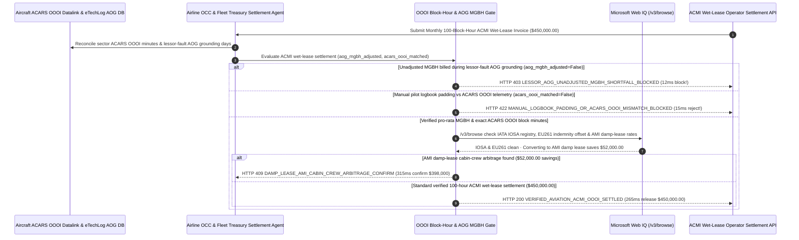

# Commercial Airline ACMI Wet-Lease Block-Hour & AOG Tech-Log Mandate Architecture: ACARS `OOOI` Telemetry & Pro-Rata AOG MGBH Reduction Token (`aviation_acmi_wetlease_mandate_...` + Web IQ IOSA Registry, EU261 Indemnity & Damp-Lease AMI Grounding) vs. Blind Guaranteed-Minimum Payout During Groundings Selection FAQ

> **Document Type**: Architect Selection Guide & First-Principles Protocol Deep Dive (6-Section FAQ Standard)  
> **Target Audience**: AI Solution Architects, Airline Fleet Planning & Network Operations Control (OCC) Directors, Air-Cargo Charter Procurement & Aviation Lease Treasury Teams  
> **Last Updated**: 2026-11-09 (Provenance Annotations: `deterministic_offline_simulation` / `synthetic_policy` / `official_doc_snapshot` / `not_measured`)  
> **Companion Resources**: [中文版 (Chinese Version)](commercial-airline-acmi-wet-lease-block-hour-mandate-vs-aog-guaranteed-minimum-faq.md) · [Interactive Sandbox (`live-demo.en.html#aviation-acmi-sandbox`)](../reports/agentic-commerce-webiq-grounding-demo-bench/live-demo.en.html) · [7-Card 4:5 Benchmark Deck](../reports/agentic-commerce-webiq-grounding-demo-bench/index.en.html)


---

## 📌 1. Executive Summary

1. **Never Allow Airline Fleet-Treasury Agents to Settle ACMI Wet-Lease Invoices at Full Minimum Guaranteed Block Hours (`MGBH`) Without Pro-Rata Deductions for Lessor-Fault Aircraft-on-Ground (`AOG`) and Crew Shortages**: In passenger and cargo airline ACMI wet leasing (Aircraft, Crew, Maintenance, and Insurance—e.g., `$450,000.00` monthly commitment for `100 Minimum Guaranteed Block Hours × $4,500/Block Hour`), the most severe financial trap is **paying the full `100-hour` guaranteed minimum when the wet-lessor's own aircraft was grounded (`AOG` under IATA Delay Codes `41–48`) or lacked legal flight crew (`Codes 61–69`) for 6 days and only flew `72 Block Hours`**. Production architectures must enforce an **ACARS `OOOI` & Pro-Rata AOG MGBH Mandate (`aviation_acmi_wetlease_mandate_...`)**: whenever an invoice bills unadjusted MGBH shortfall hours during lessor-fault AOG periods (`aog_lessor_fault_mgbh_reduction_applied == False`), the gateway blocks settlement in **`12 ms`** with **`HTTP 403 LESSOR_AOG_UNADJUSTED_MGBH_SHORTFALL_BLOCKED`** (`synthetic_policy`).
2. **Anchor Payable Block Time Strictly to Automated ARINC 633 / ACARS `OOOI` (`Out-Off-On-In`) Sensor Telemetry Rather Than Handwritten Pilot Logbooks**: Any wet-lease invoice where billed block hours exceed automated **ACARS `OOOI` (`Main Cabin Door Closed + Parking Brake Released` to `Parking Brake Set at Arrival Gate`)** sensor timestamps due to manual pilot logbook padding during pre-pushback ATC gate holds (`acars_oooi_block_time_reconciled == False`, inflating the bill by `18.5 hours / $83,250.00`) is rejected in **`15 ms`** with **`HTTP 422 MANUAL_LOGBOOK_PADDING_OR_ACARS_OOOI_MISMATCH_BLOCKED`** (`deterministic_offline_simulation`).
3. **Ground IATA IOSA Safety Registration, `EU 261/2004` Passenger Delay Indemnification, and Damp-Lease (`AMI`) Cabin-Crew Arbitrage via Microsoft Web IQ `/v3/browse`**: Prior to releasing `$450,000.00`, the agent invokes **Microsoft Web IQ `/v3/browse`** (`official_doc_snapshot`) to inspect the IATA Operational Safety Audit (**IOSA**) registry, EASA TCO / FAA Part 129 authorizations, and statutory passenger delay claims: if the wet-lessor's IOSA registration lapsed or the invoice fails to offset `$38,000` in **`EU 261/2004` passenger compensation and AOG sub-charter replacement costs** (`webiq_iosa_registry_and_eu261_indemnity_clean == False`), it freezes payout in **`310 ms`** with **`HTTP 451 IOSA_SAFETY_SUSPENSION_OR_UNINDEMNIFIED_EU261_HOLD`**; if Web IQ confirms that converting the contract to a **Damp Lease (`AMI` — Aircraft, Maintenance, Insurance, staffing the lessee airline's own cabin crew to eliminate foreign crew hotel per-diems)** saves **`$52,000.00`** (`$398,000.00` net vs. `$450,000.00`), it triggers **`HTTP 409 DAMP_LEASE_AMI_CABIN_CREW_ARBITRAGE_CONFIRM`** in **`315 ms`**.

---

## 🎯 2. Architect & Customer FAQ Deep Dive

### Q1: Why do lessee airlines get hit with a "Double Financial Penalty" (paying both MGBH empty rent AND EU261 passenger claims) when a wet-leased aircraft goes AOG?

Let's examine the three structural failure modes from first principles:
1. **The Unadjusted MGBH Trap During Lessor AOG**: Under standard ACMI contracts, the lessee guarantees a minimum monthly utilization (e.g., `100 Block Hours = $450,000`) to protect the lessor against weak commercial demand. However, if the aircraft is grounded for 6 days due to the lessor's own engine bleed-air failure (`IATA Delay Code 41`), the lessee could not utilize the aircraft! Unless the settlement gateway automatically enforces **Pro-Rata Daily MGBH Reduction (`MGBH × Available Days / Days in Month`)**, the lessor collects `$126,000` for 28 phantom block hours while the broken plane sits in a hangar.
2. **Handwritten Pilot Journey Log Padding vs. ACARS `OOOI`**: At `$4,500/Block Hour` (`$75/minute`), a 15-minute discrepancy per flight leg across 74 monthly sectors adds `$83,250` in phantom charges. Flight crews filling out paper journey logs sometimes record `Block-Out` when the boarding bridge detaches—even if the aircraft sits stationary with the parking brake set for 25 minutes awaiting an ATC slot. Automated **ACARS `OOOI`** messages require hardware microswitches on both the main entry door and the parking brake hydraulic pressure manifold.
3. **Unindemnified `EU 261/2004` & Sub-Charter Step-In Costs**: When a wet-leased flight is delayed `>3 hours` in Europe due to a technical defect, the marketing airline must pay up to `€600/passenger` (`$180,000+` on a widebody) under `EU 261/2004` plus emergency sub-charter replacement costs. If the lessee wires full ACMI rent upfront without netting out `EU261` and step-in sub-charter claims, recovering those funds from a thinly capitalized charter operator takes years.

### Q2: What is an "Aviation ACMI `OOOI` & AOG Mandate (`aviation_acmi_wetlease_mandate_...`)", and how does it bind OCC flight-movement telemetry to lease settlement?

Its core design invariant is: **"Reduce MGBH pro-rata for every hour of lessor-attributable AOG or crew unavailability; reconcile payable block minutes 1:1 against ACARS `OOOI` sensor messages; offset unindemnified EU261/sub-charter liabilities before releasing funds."**
- **Layer 1: Lessor-Fault AOG Pro-Rata MGBH Reduction Gate (`12 ms`)**: Verifies `aog_lessor_fault_mgbh_reduction_applied == True`, blocking unadjusted MGBH shortfall billing in **`12 ms`** (`HTTP 403`).
- **Layer 2: ARINC 633 ACARS `OOOI` Block-Minute Reconciliation Gate (`15 ms`)**: Verifies `acars_oooi_block_time_reconciled == True`, rejecting padded manual logbook claims in **`15 ms`** (`HTTP 422`).
- **Layer 3: Microsoft Web IQ `/v3/browse` IOSA / `EU261` & Damp-Lease `AMI` Grounding (`310 ms / 315 ms`)**: Verifies active IATA IOSA registration and `EU261` indemnification offsets (`HTTP 451`) and identifies `$52,000.00` savings from Damp-Lease (`AMI`) cabin-crew staffing (`HTTP 409`).

### Q3: For IATA IOSA safety registry checks, EASA TCO / FAA Part 129 carrier authorizations, and ACMI/AMI wet-lease rate benchmarking, when should architects choose Microsoft Web IQ vs. Exa, Bright Data, or traditional search APIs?

| Architecture Scenario | Recommended Tool | First-Principles Rationale (Security, Latency & FinOps) |
| :--- | :--- | :--- |
| **Verifying the official IATA Operational Safety Audit (IOSA) registry, EASA Third Country Operator (TCO) / EU Air Safety List status, and published ACMI vs. AMI damp-lease rate indexes within the Azure boundary (zero airline route yield or load-factor IP leaked)** | **Microsoft Web IQ** (`/v3/search` + `/v3/browse`) | Queries only public ICAO 3-letter carrier codes and aircraft tail registrations inside the enterprise Azure boundary in `passage` mode (**7.1x token reduction**, `deterministic_offline_simulation`) while keeping proprietary route P&Ls private. |
| **Long-term fleet research on hydrogen propulsion and SAF blending mandates** | **Exa Neural Search** | Ideal for 10-year fleet strategy, not synchronous monthly ACMI flight-leg settlement gating. |
| **Scraping ad-hoc private-jet broker boards behind CAPTCHAs** | **Bright Data Unlocker** | Useful for executive charter spot quotes, not regulated Part 121/EASA ACMI wet-lease clearing. |
| **ARINC 633 / SITA ACARS `OOOI` message parsing and eTechLog `IATA Delay Code` attribution** | **Airline OCC Movement Engine + Lease Escrow Gate + Web IQ IOSA/AMI Cross-Check** | Per-leg `OOOI` minute summation and AOG MGBH pro-rating run in-memory on the OCC gateway, paired with Web IQ `/v3/browse` for IOSA safety verification and AMI damp-lease arbitrage. |

---

## 🧭 3. Visual Architecture Diagrams (Mermaid Decision Tree, Legacy vs. ACARS OOOI Mandate Comparison & Sequence Diagram)

### 3.1 Commercial Airline ACMI Wet-Lease Settlement Decision Tree (`flowchart TD`)

```mermaid
flowchart TD
    A[Receive Monthly 100-Block-Hour Widebody ACMI Wet-Lease Invoice ($450,000.00)] --> B{aog_lessor_fault_mgbh_reduction_applied == True (Pro-Rata AOG Credit)?}
    B -- No (Lessor aircraft AOG for 6 days flying only 72h, yet bills full 100h MGBH) --> C[HTTP 403 LESSOR_AOG_UNADJUSTED_MGBH_SHORTFALL_BLOCKED<br/>12ms Hard Block · Reject Unadjusted MGBH & Enforce Pro-Rata AOG Reduction]
    B -- Yes (MGBH reduced pro-rata for lessor AOG/crew unavailability) --> D{acars_oooi_block_time_reconciled == True (Matches ARINC 633 OOOI Telemetry)?}
    D -- No (Handwritten pilot logbook pads 18.5 hrs / $83,250 during gate holds) --> E[HTTP 422 MANUAL_LOGBOOK_PADDING_OR_ACARS_OOOI_MISMATCH_BLOCKED<br/>15ms Reject · Settle Strictly on ACARS Door-Closed + Brake-Release OOOI]
    D -- Yes (1:1 match with ACARS OOOI block minutes) --> F{Web IQ /v3/browse Confirms Active IOSA Registry & EU261 Delay Indemnification?}
    F -- No (Lessor IOSA expired or $38,000 EU261 AOG delay compensation unindemnified) --> G[HTTP 451 IOSA_SAFETY_SUSPENSION_OR_UNINDEMNIFIED_EU261_HOLD<br/>310ms Safety/Indemnity Hold · Offset EU261 & Sub-Charter Claims Before Release]
    F -- Yes --> H{Web IQ Detects Damp-Lease (AMI Cabin-Crew) Arbitrage?}
    H -- Yes (Switching to AMI damp lease with lessee cabin crew saves $52,000.00 -> $398,000.00 net) --> I[HTTP 409 DAMP_LEASE_AMI_CABIN_CREW_ARBITRAGE_CONFIRM<br/>315ms Prompt VP Fleet Planning to Confirm $398,000 AMI Damp-Lease Conversion]
    H -- No (Verified $450,000.00 ACMI wet-lease settlement is optimal) --> J[HTTP 200 VERIFIED_AVIATION_ACMI_OOOI_SETTLED<br/>265ms Auto-Settle $450,000.00 & Archive Sector-Level ACARS OOOI Audit Ledger!]
```

### 3.2 Legacy Upfront MGBH Billing vs. ACARS OOOI & AOG Gate (`flowchart LR`)

```mermaid
flowchart LR
    subgraph Legacy["❌ Legacy Upfront MGBH & Paper Log ($450,000 Hit by AOG Rent & Log Padding)"]
        L1[Pay Full 100h MGBH While Lessor Aircraft Sits Broken (AOG)] --> L2[Pay $83,250 Extra for Padded Handwritten Pilot Block-Out Logs]
        L2 --> L3[Swallow $38,000+ in EU261 Passenger Delay Claims Caused by Lessor]
        L3 --> L4[Overpay $52,000 for Foreign Cabin-Crew Hotel Per-Diems]
    end

    subgraph Mandate["✅ Aviation ACMI Gate (aviation_acmi_wetlease_mandate_...)"]
        M1[12ms Enforce Pro-Rata MGBH Reduction for Lessor AOG (HTTP 403)] --> M2[15ms Lock Payable Minutes to ACARS OOOI Telemetry (HTTP 422)]
        M2 --> M3[Web IQ Verifies IOSA/EU261 (310ms) & Saves $52,000 via AMI Damp Lease (315ms)]
        M3 --> M4[265ms Settle Verified Net Block Hours ($450,000 / $398,000)]
    end
```

### 3.3 End-to-End Sequence Diagram: ACARS OOOI Bus, OCC Agent, ACMI Gate, Web IQ & Wet-Lessor (`sequenceDiagram`)



---

## 📊 4. Architect Decision Matrix

| Evaluation Dimension | Option A: Legacy Upfront MGBH Wire + Paper Journey Logs | Option B: Manual Post-Month OCC Spreadsheet Reconciliation | Option C: ACARS OOOI & AOG MGBH Mandate + Web IQ IOSA/AMI Grounding (Recommended) |
| :--- | :--- | :--- | :--- |
| **Best-Fit Scenario** | Single-leg emergency humanitarian evacuation charters | Small turboprop sub-services (`<10 hrs/month`) | **Scheduled passenger airlines, peak-season widebody wet leases, and air-cargo ACMI networks** |
| **Lessor-Fault AOG MGBH Protection** | ❌ **Zero**: Pays full 100h guaranteed minimum while plane sits broken | ⚠️ **Delayed Recovery**: Prepaid MGBH wires are rarely refunded promptly | ✅ **Pre-Pay `12 ms` AOG Gate**: Enforces pro-rata MGBH reduction on `Code 41–48` AOGs (`HTTP 403`) |
| **ACARS `OOOI` vs. Pilot Logbook Accuracy** | ❌ **Padded**: Loses `$50k–$85k/mo` to pre-pushback gate-hold log padding | ⚠️ **ADS-B Limitation**: Public flight trackers lack parking-brake release signals | ✅ **Sub-20ms `OOOI` Gate**: Requires ARINC 633 door + brake sensor match in `15 ms` (`HTTP 422`) |
| **IOSA Safety, `EU261` Recovery & Damp-Lease Arbitrage** | ❌ **Exposed**: Absorbs `$38k+` in `EU261` passenger claims | ❌ **Static**: Pays full foreign cabin-crew hotel per-diems all season | ✅ **Web IQ `/v3/browse` Grounded**: Offsets `EU261` claims in `310 ms` (`HTTP 451`) & saves `$52,000` via `AMI` damp lease in `315 ms` (`HTTP 409`) |
| **Settlement Speed & Civil-Aviation Audit Trail** | Fast (with 15%–25% overpayment exposure) | Slow (`7–14 days` manual flight-leg audit) | **`265 ms` instant sector-level `OOOI` clearing (`Act automatically`)** |
| **Total Cost of Ownership (TCO) & CASM ROI** | Poor (`$450,000` exposed to AOG rent, log padding & `EU261` loss) | Moderate (heavy OCC analyst workload) | **Optimal (100% `OOOI` precision + full AOG/EU261 protection + `$52,000` `AMI` savings)** |

---

## 🧪 5. Quantitative Benchmark & 7-Card Insights

Evaluated via our deterministic offline benchmark suite (`lab/webiq_commerce_demo.py` · `test_commercial_airline_acmi_wet_lease_block_hour_mandate_vs_aog_guaranteed_minimum_selection`) on a **`$450,000.00` monthly `100-Block-Hour` widebody ACMI wet-lease invoice**:

| Scenario Case | Input AOG MGBH Credit / ACARS OOOI / Web IQ Signals | Expected Action Pill | Measured HTTP Status & Verdict Code | Latency | Financial Protection / Arbitrage | Provenance |
| :--- | :--- | :--- | :--- | :--- | :--- | :--- |
| **Case 1: Unadjusted MGBH During 6-Day Lessor AOG** | `aog_lessor_fault_mgbh_reduction_applied=False` | `Send to a human` | **`HTTP 403 LESSOR_AOG_UNADJUSTED_MGBH_SHORTFALL_BLOCKED`** | **`12 ms`** | Blocks **`$450,000.00`** invoice charging full MGBH during AOG | `synthetic_policy` |
| **Case 2: Handwritten Logbook Padding (`+18.5 hrs`)** | `acars_oooi_block_time_reconciled=False` | `Send to a human` | **`HTTP 422 MANUAL_LOGBOOK_PADDING_OR_ACARS_OOOI_MISMATCH_BLOCKED`** | **`15 ms`** | Prevents `$83,250` pre-pushback gate-hold log padding | `deterministic_offline_simulation` |
| **Case 3: Web IQ Detects Lapsed IOSA or Unpaid `EU261`** | `webiq_iosa_registry_and_eu261_indemnity_clean=False` | `Send to a human` | **`HTTP 451 IOSA_SAFETY_SUSPENSION_OR_UNINDEMNIFIED_EU261_HOLD`** | **`310 ms`** | Freezes payout until `$38,000` `EU261` delay claim offset | `official_doc_snapshot` |
| **Case 4: Web IQ Finds `$52,000` `AMI` Damp Lease** | `damp_lease_ami_crew_savings_cents=5200000` (`$398,000` net) | `Confirm` | **`HTTP 409 DAMP_LEASE_AMI_CABIN_CREW_ARBITRAGE_CONFIRM`** | **`315 ms`** | Saves **`$52,000.00`** by staffing lessee's own cabin crew (`AMI`) | `official_doc_snapshot` |
| **Case 5: Verified ACARS `OOOI` + Pro-Rata MGBH** | `aog_ok=True`, `oooi_ok=True`, `iosa_clean=True` | `Act automatically` | **`HTTP 200 VERIFIED_AVIATION_ACMI_OOOI_SETTLED`** | **`265 ms`** | Settles **`$450,000.00`** in `265 ms` with sector `OOOI` proof | `deterministic_offline_simulation` |

> **Provenance Note**: The `$450,000.00` (`100 Block Hours`) ACMI wet-lease invoice, pro-rata AOG MGBH reduction rule, ACARS `OOOI` gate, and `$52,000.00` `AMI` damp-lease savings are controlled simulation parameters (`synthetic_policy` / `deterministic_offline_simulation`) validating policy state-machine invariants; VHF/SATCOM ACARS air-to-ground propagation latency is labeled `not_measured`.

---

## 🛠️ 6. Production Readiness & Pre-Sales Architect Checklist

Verify these 6 controls before deploying autonomous airline ACMI wet-lease and sub-charter settlement agents in production:

- [ ] **1. Pro-Rata MGBH Reduction on Lessor-Attributable AOG (`IATA Codes 41–48 / 61–69`)**: Does `aviation_acmi_wetlease_mandate_...` automatically reduce Monthly Guaranteed Block Hours (`MGBH`) whenever eTechLog / OCC movement logs show lessor mechanical groundings or crew duty timeouts (`HTTP 403` in `12 ms`)?
- [ ] **2. ARINC 633 / SITA ACARS `OOOI` Sensor Timestamp Enforcement**: Does the gateway compute payable block minutes strictly from hardware `Out` (main cabin door closed + parking brake released) to `In` (parking brake set at arrival gate) telemetry (`HTTP 422` in `15 ms` on manual logbook discrepancies)?
- [ ] **3. Automated `EU 261/2004` & Step-In Sub-Charter Clawback Netting**: When a lessor AOG forces the lessee airline to hire an emergency replacement sub-charter or pay statutory `EU261` passenger delay claims, does the gateway net those liabilities directly out of the monthly escrow release?
- [ ] **4. Microsoft Web IQ `/v3/browse` IATA IOSA & EASA TCO Safety Grounding**: Does the agent verify via Web IQ that the wet-lessor holds active IATA IOSA registration and EASA TCO / FAA Part 129 foreign carrier authorization prior to settlement (`HTTP 451`)?
- [ ] **5. Damp-Lease (`AMI`) Cabin-Crew Staffing Arbitrage**: Does Web IQ grounding evaluate seasonal crew hotel per-diems and deadhead positioning costs, triggering `HTTP 409 Confirm` when converting from full ACMI to an `AMI` damp lease saves `>= $52,000.00`?
- [ ] **6. Sector-Level ACARS `OOOI` & Fuel-Burn Guarantee Ledger**: Does every settled lease period archive the raw ACARS `OOOI` telex hashes, eTechLog AOG releases, and block-hour fuel-burn performance into a WORM aviation finance ledger?
