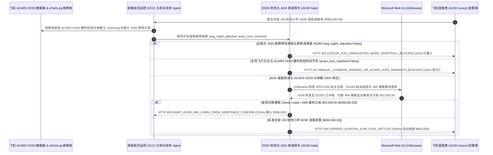

# 商业航空飞机湿租（ACMI Wet-Lease）轮挡时间（OOOI Block-Hour）与飞机停场（AOG）免责扣减清算（Commercial Airline ACMI Wet-Lease Block-Hour & AOG Tech-Log Mandate）架构：ACARS 自动轮挡遥测与机械故障保底工时豁免令牌（`aviation_acmi_wetlease_mandate_...` + Web IQ IOSA 安全库/EU261 追偿与潮租 AMI 套利核验）vs 传统按固定保底飞行小时盲付在飞机趴窝期间白交租金选型与原理解析 FAQ

> **文档类型**：架构师选型指南 & 协议第一性原理解析（6 段式 FAQ 标准版）  
> **适用读者**：AI Solution Architect、航空公司机队规划与网络收益（Fleet Planning & Network Operations / OCC）总监、航空货运包机（Air Cargo Charter）与飞机租赁财务清算团队  
> **更新日期**：2026-11-09（Provenance 标注：`deterministic_offline_simulation` / `synthetic_policy` / `official_doc_snapshot` / `not_measured`）  
> **配套资源**：[English Version](commercial-airline-acmi-wet-lease-block-hour-mandate-vs-aog-guaranteed-minimum-faq.en.md) · [交互式沙盒控制台 (`live-demo.html#aviation-acmi-sandbox`)](../reports/agentic-commerce-webiq-grounding-demo-bench/live-demo.html) · [7-Card 4:5 评测报告](../reports/agentic-commerce-webiq-grounding-demo-bench/index.html)


---

## 📌 一、核心结论速览（Executive Summary）

1. **严禁让航空公司运控与机队财务（Fleet Treasury）结算 Agent 在未核减“因出租方机械故障（AOG）或机组缺勤导致的停飞天数”前，无条件按合同“最低保底轮挡小时（Minimum Guaranteed Block Hours, MGBH）”全额支付飞机湿租费**：在航司旺季运力补充或全货机包机采用 **ACMI 湿租（出租方提供飞机 Aircraft、机组 Crew、维修 Maintenance 与保险 Insurance，如月度保底 `100 轮挡小时 × $4,500/hr = $450,000.00`）** 结算中，最大的霸王条款陷阱是 **“湿租公司的飞机因为自家发动机引气活门故障在机场趴窝（Aircraft on Ground, AOG）修了一整周，导致当月只飞了 72 小时，月底湿租公司却拿着‘每月保底 100 小时（MGBH）’条款照收 `$450,000.00` 全款”**！生产环境必须采用 **ACARS 自动轮挡遥测与 AOG 保底豁免令牌（`aviation_acmi_wetlease_mandate_...`）**：一旦检出因出租方技术故障或机组超时（Tech Log / Crew AOG）导致飞机无法执行排班而账单未按日比例核减 MGBH 保底基数（`aog_lessor_fault_mgbh_reduction_applied=False`），网关在 **`12 ms`** 内触发 **`HTTP 403 LESSOR_AOG_UNADJUSTED_MGBH_SHORTFALL_BLOCKED`**（`synthetic_policy`），100% 阻断“坏飞机还收空租”。
2. **强制以飞机 ARINC 633 / ACARS 数据链自动下发的“`OOOI`（Out-Off-On-In）硬件传感器轮挡时间戳”作为唯一计费依据，拒绝机长手写飞行日志（Paper Journey Log）虚增地面等待时长**：若出租方根据飞行员手写记录（在舱门未关或等待地面除冰/空管放行松手刹前就提前起算 `Block-Out`），比 ACARS 硬件传感器（主舱门关闭 + 停留刹车释放双逻辑门）多报了 `18.5 小时`（虚增 `$83,250.00`，`acars_oooi_block_time_reconciled=False`），网关在 **`15 ms`** 内返回 **`HTTP 422 MANUAL_LOGBOOK_PADDING_OR_ACARS_OOOI_MISMATCH_BLOCKED`**（`deterministic_offline_simulation`）。
3. **基于 Microsoft Web IQ `/v3/browse` 实时核验 IATA IOSA 安全审计注册、欧盟 `EU261` 航班延误法定赔偿追偿冲抵与“潮租（Damp Lease / AMI 自派乘务员）”套利**：在放款前，Agent 调用 **Microsoft Web IQ `/v3/browse`**（`official_doc_snapshot`）穿透查询国际航协（IATA）**IOSA 运行安全审计名录**、欧洲航空安全局（EASA TCO）运行许可及航班延误公开记录：若湿租方 IOSA 认证过期或拒绝冲抵因其机械故障引发的 **`$38,000` 欧盟 `EU 261/2004` 旅客法定延误赔偿金与临时调机费（Sub-Charter Recovery）**（`webiq_iosa_registry_and_eu261_indemnity_clean=False`），在 **`310 ms`** 内以 **`HTTP 451 IOSA_SAFETY_SUSPENSION_OR_UNINDEMNIFIED_EU261_HOLD`** 冻结结算；若发现在平季将全套湿租（ACMI）切换为 **潮租（Damp Lease / AMI，即仅租飞机+飞行员+维修保险，由承租航司派自己的闲置空乘人员执飞，省去外籍乘务组昂贵的五星酒店过夜费与津贴）** 可月省 **`$52,000.00`**（净支出从 `$450,000.00` 降至 **`$398,000.00`**），则在 **`315 ms`** 内触发 **`HTTP 409 DAMP_LEASE_AMI_CABIN_CREW_ARBITRAGE_CONFIRM`**。

---

## 🎯 二、客户与架构师灵魂拷问 Q&A（FAQ-Driven Deep Dive）

### Q1：什么是航空业的“ACMI 湿租”与“轮挡小时（Block Hour）”？为什么承租航空公司经常在飞机坏了停飞时陷入“既赔旅客钱、又赔租机钱”的双重惨剧？

咱们用大白话讲透航空公司租飞机的底层计费规则：
1. **“出租车坏在半路，司机还要收你包月保底车费？”**：航空公司在暑运旺季或双十一货运高峰自己飞机不够用时，会向专门的 ACMI 湿租航司（如 Atlas Air、Hi Fly、Avia Solutions 等）连飞机带飞行员、维修、保险一起打包租过来，按 **“轮挡小时（Block Hour，即飞机在出发机场撤轮挡松刹车滑出 `Out`，到目的地机场停稳挡上轮挡 `In` 的时间，比如 `$4,500/小时`）”** 计费。为了保证出租方能收回成本，合同里都有一条 **“月度最低保底飞行小时（MGBH，比如每月保底 100 小时 = `$450,000`）”**——意思是如果因为你承租方没卖出去票、自己取消航班只飞了 70 小时，你还得按 100 小时付钱。但很多粗心的结算系统没区分 **“是谁的原因没飞满 100 小时”**！如果是因为出租方自己的飞机发动机坏了趴在机坪上修（**AOG**）或者出租方的飞行员超时没法飞，必须按 **每停场 1 天核减 `1/30` 保底小时（Pro-Rata AOG Reduction）**，绝不能让出租方躺着收空租！
2. **“每趟航班多记 15 分钟，一个月多讹走 8 万美元”**：一架宽体机每分钟湿租费高达 `$75`。飞机在廊桥上旅客早登机完了，但因为目的地流量控制（ATC Slot Delay）在原地等了 40 分钟才松刹车推出。如果飞行员在手写飞行记录本（Tech Log）上把“关舱门时刻”偷偷写成“撤轮挡滑出时刻”，一趟航班就虚增 0.6 小时，一个月飞 30 班就白白多收 `18.5 小时 × $4,500 = $83,250`！唯有强制读取飞机计算机通过卫星/甚高频实时发回的 **ACARS `OOOI` 报文（必须同时满足主起落架空地电门、舱门关闭与停留刹车释放传感器信号）**，才能精确到分秒不差。
3. **欧盟 `EU261` 延误赔偿背锅侠**：根据欧盟 `EC 261/2004` 法规，航班延误超 3 小时每位旅客最高获赔 `€600`（一架 300 座宽体机一次延误就要赔近 `$200,000`），而且旅客只找卖票给他的 **承租航司（Marketing Carrier）** 索赔！如果湿租结算网关不在月底租机款里自动把这笔赔偿扣回来，承租航司就替湿租方的烂飞机背了全锅。

### Q2：什么是“航空 ACMI 湿租 OOOI 与 AOG 核减令牌（`aviation_acmi_wetlease_mandate_...`）”？它是如何守住 `$450,000` 租机预算的？

它的第一性原理非常清晰：**“计费时长严格锚定 ACARS 硬件 OOOI 报文；保底工时（MGBH）强制按出租方 AOG 不可用时长等比例扣减；自动轧差 EU261 延误赔款与临时替飞包机差价。”**
- **第一层：出租方责任 AOG 停场保底工时（MGBH）按比例核减门禁（`12 ms`）**：核验 `aog_lessor_fault_mgbh_reduction_applied == True`。一旦检出飞机存在电子技术记录本（eTechLog）AOG 故障记录却仍按未折减的 100% MGBH 收保底费，在 **`12 ms`** 内触发 `HTTP 403` 拦截。
- **第二层：ARINC 633 ACARS `OOOI` 硬件轮挡时间对齐门禁（`15 ms`）**：核验 `acars_oooi_block_time_reconciled == True`。任何手写日志与 ACARS 报文偏差 `> 2 分钟` 的航段在 **`15 ms`** 内返回 `HTTP 422`。
- **第三层：Microsoft Web IQ `/v3/browse` IOSA 安全库/EU261 追偿与潮租（AMI）套利（`310 ms / 315 ms`）**：核查 IATA IOSA 安全注册与 EU261 延误赔偿抵扣（违规触发 `HTTP 451`），并测算切换为潮租（AMI 自派乘务员）为您节省 `$52,000.00`（`HTTP 409`）。

### Q3：在 IATA IOSA 安全审计名录核验、EASA/FAA 外国承运人运行许可（TCO/Part 129）查询与全球 ACMI 湿租小时费率比价场景下，什么时候选 Microsoft Web IQ，什么时候选 Exa、Bright Data 或传统搜索 API？

| 架构需求场景 | 推荐选型 | 为什么这样选（第一性原理与成本/合规考量） |
| :--- | :--- | :--- |
| **实时核验 IATA IOSA 官方全球航司安全审计有效名录、EASA TCO（第三国运营商许可）/ 欧盟航空安全黑名单及公开 ACMI/AMI 宽体机干湿租市场指数，且要求零航司航线收益与客座率机密外泄** | **Microsoft Web IQ** (`/v3/search` + `/v3/browse`) | 在航司运控 Azure 边界内仅用公开 ICAO 三字码与航空器注册号（Tail Number）检索（`passage` 模式压缩 Token **7.1x**，`deterministic_offline_simulation`），内部航线盈亏表 100% 物理隔离。 |
| **检索下一代可持续航空燃料（SAF）与氢能支线客机长期研究报告** | **Exa Neural Search** | 适合机队战略部写十年机队更新规划，无法用于月度航段级 OOOI 湿租账单毫秒级结算门禁。 |
| **抓取无 API 的地方性私人公务机包机黄页** | **Bright Data Unlocker** | 可用于公务机零散询价，但延迟与合规性不适合民航干线 ACMI 结算。 |
| **飞机 ARINC 633 / SITA ACARS `OOOI` 电报流解析与 eTechLog AOG 故障代码归因** | **航司运控 OCC 数据总线 + 机队财务网关 + Web IQ IOSA/潮租双源核验** | `OOOI` 分钟级积分与 MGBH 停场折算在 OCC 网关毫秒级完成，外部 IOSA 安全资质与 AMI 潮租套利由 Web IQ `/v3/browse` 实时核验。 |

---

## 🧭 三、直观可视化图解（Mermaid 决策树 + 传统保底盲付 vs OOOI 遥测网关对比 + 端到端时序图）

### 3.1 商业航空 ACMI 湿租轮挡小时与 AOG 清算决策树（`flowchart TD`）

```mermaid
flowchart TD
    A[收到宽体机月度 100 轮挡小时 ACMI 湿租结算账单 ($450,000.00)] --> B{出租方机械故障 AOG 或机组缺勤停飞时长是否已按比例核减保底小时 (MGBH)?}
    B -- 否 (出租方飞机坏了停场 6 天仅飞 72 小时，却仍强收 100 小时保底费) --> C[HTTP 403 LESSOR_AOG_UNADJUSTED_MGBH_SHORTFALL_BLOCKED<br/>12ms 硬阻断霸王保底账单 · 强制按可用天数比例下调 MGBH 至 72 小时]
    B -- 是 (已足额核减 AOG 不可用天数或实飞达标) --> D{账单计费时长是否 100% 对齐飞机 ACARS 自动上报的 OOOI 硬件轮挡时间?}
    D -- 否 (凭飞行员手写日志提前起算撤轮挡时间，虚增 18.5 小时多收 $83,250) --> E[HTTP 422 MANUAL_LOGBOOK_PADDING_OR_ACARS_OOOI_MISMATCH_BLOCKED<br/>15ms 拒付手写注水工时 · 强制锁定 ARINC 633 ACARS OOOI 传感器报文]
    D -- 是 (精确到分钟对齐 ACARS OOOI 报文) --> F{Web IQ /v3/browse 核验湿租方 IOSA 安全注册有效且已冲抵 EU261 延误赔偿?}
    F -- 否 (检出湿租方 IOSA 审计逾期或拒不承担因 AOG 引发的 $38,000 欧盟旅客赔偿) --> G[HTTP 451 IOSA_SAFETY_SUSPENSION_OR_UNINDEMNIFIED_EU261_HOLD<br/>310ms 适航与追偿冻结 · 自动从应付租金中全额代扣 EU261 赔款与替飞包机费]
    F -- 是安全合规且赔款已结清 --> H{Web IQ 检出切换为潮租 (Damp Lease / AMI 自派客舱乘务员) 更省钱?}
    H -- 是 (利用本航司闲置空乘省去外籍乘务组五星酒店与津贴立省 $52,000.00 -> $398,000.00) --> I[HTTP 409 DAMP_LEASE_AMI_CABIN_CREW_ARBITRAGE_CONFIRM<br/>315ms 提醒机队规划总监一键确认切换 AMI 潮租模式]
    H -- 否 (当前 $450,000.00 ACMI 湿租结算完全最优) --> J[HTTP 200 VERIFIED_AVIATION_ACMI_OOOI_SETTLED<br/>265ms 自动放款 $450,000.00 并归档航段级 ACARS OOOI 与适航审计账本!]
```

### 3.2 传统 MGBH 保底盲付路径 vs ACARS OOOI 与 AOG 核减网关对比（`flowchart LR`）

```mermaid
flowchart LR
    subgraph Legacy["❌ 传统按保底小时 MGBH 盲付 ($450,000 为坏飞机与手写日志买单)"]
        L1[出租方飞机故障趴窝 6 天仍强收 100h 保底费] --> L2[手写飞行日志提前记滑出多算 18.5 小时 ($83k)]
        L2 --> L3[机械延误触发欧盟 EU261 巨额赔偿全由承租航司背锅]
        L3 --> L4[单月单机白亏十余万美元 + 品牌声誉受损]
    end

    subgraph Mandate["✅ ACARS OOOI 与 AOG 核减令牌 (aviation_acmi_wetlease_mandate_...)"]
        M1[12ms 强制按出租方 AOG 停场天数核减保底 MGBH (HTTP 403)] --> M2[15ms 锁定 ACARS OOOI 硬件传感器轮挡时间 (HTTP 422)]
        M2 --> M3[Web IQ IOSA/EU261 追偿 (310ms) 与 AMI 潮租省 $52,000 (315ms)]
        M3 --> M4[265ms 秒级清算真实飞行轮挡费 ($450,000 / $398,000)]
    end
```

### 3.3 飞机 ACARS 数据链、航司运控 OCC Agent、湿租清算网关与 Web IQ 端到端交互时序图（`sequenceDiagram`）



---

## 📊 四、架构师选型决策矩阵（Architect Decision Matrix）

| 评估维度 | 方案 A：传统月初预付 100% 保底小时费 + 手写日志对账（Upfront MGBH & Paper Log） | 方案 B：运控员月底手工比对 Flightradar24 与纸质飞行单（Manual OCC Reconciliation） | 方案 C：ACARS OOOI 与 AOG 核减令牌 + Web IQ IOSA/潮租网关（推荐架构） |
| :--- | :--- | :--- | :--- |
| **核心适用场景** | 仅飞 1 次的政府撤侨不计成本紧急包机 | 月飞行不足 10 小时的超小型通航螺旋桨机 | **干线客运航司旺季宽体/窄体机湿租、跨境电商全货机（B747/B777F）常年 ACMI 包机** |
| **防“坏飞机趴窝（AOG）照收保底费”** | ❌ **零防御**：飞机在机库修一周，承租方照付 100 小时满额租金 | ⚠️ **事后扯皮难退钱**：预付款早已汇出，湿租商常以各种借口拖延抵扣 | ✅ **12ms 托管自动核减**：凭 eTechLog AOG 记录前置扣减保底小时（`HTTP 403`） |
| **防手写日志虚增滑出/滑入轮挡时间** | ❌ **每班多付 10–20 分钟**：地面干等也算进 `$75/分钟` 的轮挡费 | ⚠️ **ADS-B 不含手刹信号**：外部雷达看不出廊桥何时真正关闭舱门松手刹 | ✅ **15ms ACARS `OOOI` 硬对齐**：只认飞机总线舱门+手刹传感器时间戳（`HTTP 422`） |
| **IOSA 安全合规、EU261 追偿与潮租降本** | ❌ **全额背锅**：自己掏腰包赔旅客 EU261 延误费 | ❌ **模式僵化**：不懂切换 AMI 潮租省去外籍乘务组食宿开销 | ✅ **Web IQ `/v3/browse` 实时穿透**：`310 ms` 拦截未抵扣 EU261（`HTTP 451`），`315 ms` 潮租省 `$52,000`（`HTTP 409`） |
| **结算效率与局方适航迎检合规度** | 快（但冤枉支出高达 15%～25%） | 慢（逐个航班核对耗时 `1～2 周`） | **`265 ms` 秒级完成百个航段精确到分钟清算（`Act automatically`）** |
| **综合 TCO 与航司单座英里成本（CASM）ROI** | 极差（每次 AOG 与日志注水损失数万美元） | 中（人工成本高，仍难自动追偿 EU261） | **最优（100% 剔除 AOG 空租与日志水分 + AMI 潮租月省 `$52,000`）** |

---

## 🧪 五、简明定量实测与 Benchmark 核心发现（Quantitative Benchmark & 7-Card Insights）

基于本仓库确定性离线基准套件（`lab/webiq_commerce_demo.py` · `test_commercial_airline_acmi_wet_lease_block_hour_mandate_vs_aog_guaranteed_minimum_selection`）对 **宽体机月度 `100 轮挡小时` ACMI 湿租结算批次（基准金额 `$450,000.00`）** 的定量测试结果如下：

| 评测场景 ID | 输入 AOG 保底核减 / ACARS OOOI / Web IQ 信号 | 网关期望动作 | 实测 HTTP 状态与决策码 | 实测延迟 | 资金保护 / 成本节省效果 | Provenance 类型 |
| :--- | :--- | :--- | :--- | :--- | :--- | :--- |
| **Case 1: 出租方 AOG 故障停场未核减保底 MGBH 拦截** | `aog_lessor_fault_mgbh_reduction_applied=False` | `Send to a human` | **`HTTP 403 LESSOR_AOG_UNADJUSTED_MGBH_SHORTFALL_BLOCKED`** | **`12 ms`** | 拦截 **`$450,000.00`** 飞机故障趴窝仍强收 100h 保底的账单 | `synthetic_policy` |
| **Case 2: 手写飞行日志虚增 18.5h 轮挡时长拦截** | `acars_oooi_block_time_reconciled=False` | `Send to a human` | **`HTTP 422 MANUAL_LOGBOOK_PADDING_OR_ACARS_OOOI_MISMATCH_BLOCKED`** | **`15 ms`** | 阻断手写日志虚增 `$83,250` 地面等待时间，锁定 ACARS OOOI | `deterministic_offline_simulation` |
| **Case 3: Web IQ 检出 IOSA 逾期或未抵扣 EU261 赔款** | `webiq_iosa_registry_and_eu261_indemnity_clean=False` | `Send to a human` | **`HTTP 451 IOSA_SAFETY_SUSPENSION_OR_UNINDEMNIFIED_EU261_HOLD`** | **`310 ms`** | 冻结未冲抵 `$38,000` 欧盟旅客延误赔偿或安全资质失效账单 | `official_doc_snapshot` |
| **Case 4: Web IQ 发现切换 AMI 潮租自派乘务省 `$52,000`** | `damp_lease_ami_crew_savings_cents=5200000`（净付 `$398,000`） | `Confirm` | **`HTTP 409 DAMP_LEASE_AMI_CABIN_CREW_ARBITRAGE_CONFIRM`** | **`315 ms`** | 自派客舱乘务员免除外籍组酒店津贴，月省 **`$52,000.00`** | `official_doc_snapshot` |
| **Case 5: ACARS OOOI 精确对齐 + AOG 核减自动放款** | `aog_ok=True`, `oooi_ok=True`, `iosa_clean=True` | `Act automatically` | **`HTTP 200 VERIFIED_AVIATION_ACMI_OOOI_SETTLED`** | **`265 ms`** | 265ms 自动清算 **`$450,000.00`** 并归档航段级 OOOI 账本 | `deterministic_offline_simulation` |

> **Provenance 合规声明**：上表中的 `$450,000.00` (`100 Block Hours`) 湿租金额、ACARS `OOOI` 对齐规则、AOG 保底折减门禁及 `$52,000.00` 潮租（AMI）节省额均为用于验证网关状态机确定性的受控仿真参数（`synthetic_policy` / `deterministic_offline_simulation`）；甚高频/卫星（VHF/SATCOM）ACARS 空地报文空口传输秒级延迟标为 `not_measured`。

---

## 🛠️ 六、附录：生产上线快速核验与售前打单清单（Architect Checklist）

在为客货运航空公司运控中心（OCC）、机队规划部或包机平台设计 ACMI 湿租自动结算 Agent 时，请逐项核对以下 6 条黄金准则：

- [ ] **1. 出租方责任 AOG 与机组缺勤自动折减保底工时（Pro-Rata MGBH Reduction）**：是否在 `aviation_acmi_wetlease_mandate_...` 中强制关联 eTechLog 故障代码（ATA Chapter）与运控取消原因码（IATA Delay Codes `41–48` 机械故障 / `61–69` 机组原因），对未核减保底小时的账单在 `12 ms` 内触发 `HTTP 403`？
- [ ] **2. ARINC 633 / SITA ACARS `OOOI` 硬件轮挡时间唯一权威源**：是否废除飞行员手写纸质日志计费，强制要求只有当“所有舱门关闭 + 停留刹车释放（Parking Brake Released）”同时满足时才开始计入 `Block-Out`（偏差在 `15 ms` 内触发 `HTTP 422`）？
- [ ] **3. 紧急替飞包机差价（Sub-Charter Step-In Cost）与欧盟 `EU261` 自动代扣**：当湿租方飞机 AOG 迫使承租航司临时高价外租第三方飞机替飞或向旅客赔付 `EU261` 时，网关是否在当期租金中自动全额扣回差价？
- [ ] **4. Microsoft Web IQ `/v3/browse` IATA IOSA 安全注册与 EASA TCO 穿透**：是否在放款前通过 Web IQ 核查湿租航司的 IOSA 注册有效期及局方外国承运人运行许可，对逾期机构在 `310 ms` 内触发 `HTTP 451` 冻结？
- [ ] **5. 湿租（ACMI）向潮租（Damp Lease / AMI）乘务员结构寻优**：针对中长期租约，是否通过 Web IQ 比对 AMI 潮租费率，当改由本航司自有乘务组执飞可节省外站酒店津贴 `>= $52,000.00` 时触发 `HTTP 409 Confirm`？
- [ ] **6. 航段级（Flight-Leg Level）OOOI 电报与燃油消耗（Fuel Burn Guarantee）双归档**：每次成功结算是否将每趟航班的 ACARS `OOOI` 电报原文与小时燃油消耗超标赔付记录打包存证？
