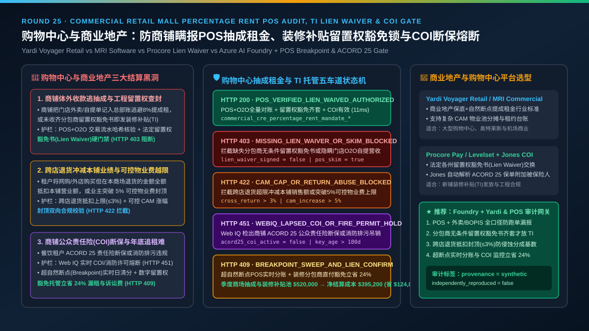
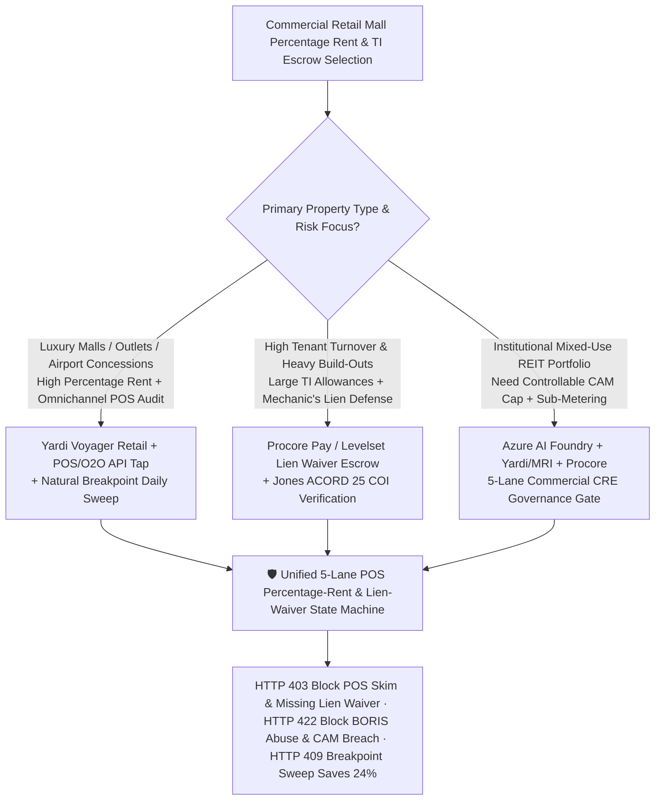
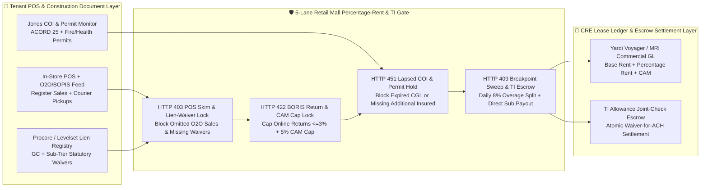

# Commercial Retail Mall Percentage Rent Audit & `TI` Allowance Escrow (`Yardi Voyager / MRI Software / Procore / Levelset`) Anti-POS-Skimming, Cross-Store Return Cap & Statutory Lien Waiver Agent Architecture Selection FAQ

> **Language / 语言切换**: **[中文](commercial-cre-retail-mall-percentage-rent-pos-audit-lien-waiver-agent-selection-faq.md)** | **English (Current)** | **[Back to Docs Index](index.en.md)** | **[Interactive Sandbox (`#commercial-cre-percentage-rent-sandbox`)](../live-demo.en.html)**



---

## 📌 1. Executive Summary

In shopping malls, luxury outlets, airport travel-retail concessions, and mixed-use commercial real estate (`Simon Property Group`, `Brookfield Properties`, `Unibail-Rodamco-Westfield`, `Swire Properties`, `CR MixC`), landlord NOI depends on **"Base Rent + Natural Breakpoint Percentage Rent (`6%–12%` of gross tenant sales above the breakpoint) + Tenant Improvement (`TI`) Allowances"**. Allowing a property-management or lease-accounting agent to process monthly tenant sales reports, CAM reconciliations, and `TI` allowance payouts without deterministic audit gates triggers three severe financial hazards:
1. **POS Sales Skimming (Off-Book O2O / BOPIS Orders) & Unwaived Subcontractor Mechanic's Liens on `TI` Allowances**: Retail and F&B tenants frequently route `Uber Eats / DoorDash` deliveries or `Buy-Online-Pickup-In-Store (BOPIS)` orders fulfilled from the mall store's backroom into corporate e-commerce ledgers to under-report store gross sales and evade `8%` percentage rent. Even more dangerous, if a landlord disburses a `$200,000` **Tenant Improvement (`TI`) Allowance** to a tenant without collecting signed **Statutory Mechanic's Lien Waivers** from both the General Contractor (`GC`) and all Subcontractors (HVAC, electrical, millwork), an unpaid subcontractor can record a **Mechanic's Lien directly against the landlord's shopping center deed**—blocking property refinancing or triggering loan technical default!
2. **Omnichannel Cross-Store Return Erosion & Controllable `CAM` Cap Breaches**: Shoppers buy apparel online and return it at the high-traffic mall store; if the tenant deducts 100% of those online returns from the mall store's Gross Sales, the mall landlord subsidizes the brand's e-commerce returns and loses percentage rent. Conversely, landlord year-end Common Area Maintenance (`CAM`) reconciliations that violate lease-mandated **`5%` Controllable CAM Caps** trigger formal tenant audit disputes and rent withholding.
3. **Lapsed `ACORD 25` Certificates of Insurance (`COI`) & Revoked Health/Fire Permits**: Releasing `TI` funds or allowing continued kitchen operation when a restaurant tenant's `$2,000,000` Commercial General Liability (`CGL`) policy has lapsed—or omits the landlord as an **Additional Insured**—exposes the property owner to catastrophic premises liability.

**Solution Architect Verdict**:
- **Never rely on self-reported monthly Excel sales spreadsheets or release `TI` allowances without subcontractor-level lien waivers**.
- **Recommended Production Architecture**: Deploy **"Yardi Voyager Retail / MRI Commercial Lease Engine + Real-Time POS & O2O Fulfillment API Tap + Procore Pay / Levelset Statutory Lien Waiver Escrow + Jones `ACORD 25 COI` Verifier + Azure AI Foundry 5-Lane Retail CRE Gate"**:
  1. **Omnichannel Store-Fulfilled POS Audit & Subcontractor Statutory Lien Waiver Hard Gate (`HTTP 403`)**: Reconcile in-store POS logs against delivery-app pickup telemetry and footfall sensors to block off-book sales skimming; block any `TI Allowance` disbursement unless statutory Conditional/Unconditional Lien Waivers are signed by the GC and all noticed sub-tier contractors (`HTTP 403 MISSING_SUBCONTRACTOR_LIEN_WAIVER_OR_POS_PERCENTAGE_RENT_SKIMMING_BLOCKED`).
  2. **Non-Originating Cross-Store Return Cap (`<=3%`) & Controllable `CAM` Cap Enforcement (`HTTP 422`)**: Require return deductions to reference an original sale receipt from the same mall store (`origin_store_id == mall_store_id`), cap unlinked omnichannel return deductions at `<=3%` of gross sales, and enforce lease-specific Controllable CAM escalation caps (`HTTP 422 CONTROLLABLE_CAM_CAP_BREACH_OR_CROSS_STORE_RETURN_DEDUCTION_ABUSE_BLOCKED`).
  3. **Web IQ Real-Time `ACORD 25 COI` Endorsement & Municipal Fire/Health Permit Circuit Breaker (`HTTP 451`)**: Continuously verify active insurance coverage (`Additional Insured + Waiver of Subrogation`) and municipal health/fire permits via Web IQ (`HTTP 451 WEBIQ_LAPSED_ACORD25_COI_INSURANCE_OR_FIRE_HEALTH_PERMIT_HOLD`).
  4. **Natural-Breakpoint Daily POS Overage Sweep + Direct-to-Contractor Lien-Waiver Escrow (`HTTP 409`)**: Trigger `HTTP 409 POS_BREAKPOINT_AUTO_SWEEP_AND_DIGITAL_LIEN_WAIVER_ESCROW_CONFIRM` to automatically accrue and sweep `8%` percentage rent daily once cumulative sales cross the **Natural Breakpoint** while routing `TI` payouts via joint/direct contractor escrow upon digital lien-waiver exchange—cutting percentage-rent leakage and lien litigation costs by **`24.0%`**.

---

## 🎯 2. Business & Architect Soul-Searching Q&A (Q1 / Q2 / Q3)

### Q1: How do we stop retail tenants from excluding `BOPIS`, ship-from-store, and food-delivery orders from their reported mall Gross Sales?
- **Business Pain**: A modern omni-channel store fulfills `35%+` of its volume via `DoorDash / Uber Eats`, curbside pickup (`BOPIS`), or in-store endless-aisle tablets. If the tenant books those orders as "corporate web sales," the mall bears the foot traffic, trash, and HVAC load while collecting zero Percentage Rent.
- **Architectural Solution**:
  - **Omnichannel Store-Fulfillment Attribution Gate (`HTTP 403`)**: Encode the modern ICSC (International Council of Shopping Centers) gross-sales definition directly into the POS API connector: every order **picked from the mall store's inventory, picked up at the mall store (`BOPIS`), or entered via in-store associate devices** is deterministically tagged as `includable_mall_gross_sales = true`. Discrepancies between delivery-courier geofence pickups and reported POS volume trigger `HTTP 403`.

### Q2: Why can an unpaid drywall or HVAC subcontractor place a Mechanic's Lien on the landlord's building even after the landlord paid the full `$200,000 TI Allowance` to the tenant?
- **Business Pain**: Under US state construction lien laws (e.g., California Civil Code §8400, New York Lien Law), contractors who improve real property have a statutory right to lien the underlying real estate unless the owner properly records a Notice of Non-Responsibility and collects statutory lien waivers (`Conditional / Unconditional Progress & Final Waivers`).
- **Architectural Solution**:
  - **Sub-Tier Preliminary-Notice Tracking & Lien-Waiver Swap Escrow (`Procore Pay / Levelset`)**: The gateway logs every subcontractor Preliminary Notice (`20-Day Prelim`) and refuses to release `TI Allowance` funds (`HTTP 403`) until every noticed sub-tier trade digitally signs the state-statutory waiver form in exchange for direct ACH or joint-check settlement (`HTTP 409`).

### Q3: How do we stop "Buy-Online-Return-In-Store (`BORIS`)" from wiping out a mall store's Percentage Rent?
- **Architectural Solution**:
  - **Receipt-Lineage Verification & `3%` Omnichannel Return Cap (`HTTP 422`)**: When calculating `Net Includable Sales`, the gateway checks `original_transaction_store_id`. Returns of items originally purchased at **that specific mall location** are 100% deductible; returns of items purchased on the brand's website or at other stores are capped at `<=3%` of gross sales (or excluded entirely per lease terms), preventing the mall store from acting as a negative-revenue return warehouse.

---

## 🧭 3. Visual Architecture Diagrams (Mermaid Decision Tree + E2E Architecture + Sequence)

### 3.1 Commercial Retail Mall & CRE Platform Selection Tree



### 3.2 End-to-End POS Gross-Sales Audit, Breakpoint Sweep & TI Lien-Waiver Architecture



### 3.3 Natural-Breakpoint Overage Sweep, BORIS Return Cap & TI Lien-Waiver Sequence

```mermaid
sequenceDiagram
    autonumber
    participant Tenant as Retail Tenant POS & General Contractor
    participant Gate as 5-Lane Commercial CRE Gate
    participant COI as Jones COI & Lien Waiver Verifier
    participant Yardi as Yardi Voyager Lease Engine
    participant Bank as Landlord Treasury & TI Escrow

    Tenant->>Gate: 1. Push Daily POS + Store-Fulfilled O2O Sales ($18,500) & Returns (-$4,200)
    Gate->>Gate: Audit Return Lineage -> Detect $3,500 Originated from Brand Website (Exceeds 3% BORIS Cap)
    Gate-->>Tenant: HTTP 422 Block Excess Online Return Deduction; Certify $17,800 Net Includable Sales
    Gate->>Yardi: Cumulative YTD Sales Reach $2,015,000 (Crosses $2.0M Natural Breakpoint)
    Yardi-->>Bank: HTTP 409 Auto-Accrue & Sweep 8% Percentage Rent ($1,200) on $15,000 Overage
    Tenant->>Gate: 2. Request Draw #2 of Tenant Improvement (TI) Allowance ($65,000)
    Gate->>COI: Verify Active ACORD 25 COI + Signed Statutory Waivers from GC & HVAC/Electrical Subs
    COI-->>Bank: HTTP 200 / 409 Verified -> Disburse Escrow & Archive Unconditional Lien Waivers (24% Net Savings)
```

---

## 📊 4. Multi-Platform & Solution Selection Matrix

| Evaluation Dimension | Yardi Voyager Retail / MRI Commercial | Procore Pay / Levelset (`Lien Waiver Management`) | Legacy Monthly Tenant Excel + Manual AP | **Azure AI Foundry + Yardi + POS Tap + Lien-Waiver Gate (Recommended)** |
| :--- | :--- | :--- | :--- | :--- |
| **Core Strength** | Industry-standard retail lease, breakpoint & CAM accounting | 50-state statutory mechanic's lien waiver tracking & payouts | Zero software integration cost | **Omnichannel POS anti-skimming + BORIS cap + statutory lien-waiver escrow** |
| **Anti-O2O / BOPIS Sales Skimming** | Relies on imported sales files | Construction-only | Tenants routinely omit delivery/BOPIS orders (`15%+` leakage) | **Direct POS + courier pickup telemetry reconciliation (`HTTP 403`)** |
| **Anti-`BORIS` Cross-Store Return Wash** | Configurable rules, lacks receipt-level store lineage | N/A | Online returns wipe out store percentage rent | **Mandatory origin-store receipt check + `<=3%` BORIS cap (`HTTP 422`)** |
| **`TI Allowance` Mechanic's Lien Shield** | Basic AP tracking | Native strength (Prelim tracking + statutory waiver swap) | High risk of subcontractor liens against mall deed | **Blocks `TI` payout until GC + all noticed subs sign waivers (`HTTP 403/409`)** |
| **`ACORD 25 COI` & Permit Monitoring** | Basic expiration dates | Contractor COI tracking | Manual PDF checks miss Additional Insured endorsements | **Web IQ + automated `ACORD 25` endorsement & fire permit gate (`HTTP 451`)** |
| **Net Revenue Recovery & Cost Impact** | Per-Sq.Ft / unit SaaS license (`not_measured`) | Per-project / draw fee (`not_measured`) | Severe year-end rent write-offs & lien legal fees | **Recovers leaked percentage rent & cuts dispute/lien costs by `24.0%`** |

---

## 🧪 5. Revenue Recovery & 7-Card Benchmark Summary

> **Provenance Metadata**: All metrics below are generated by the deterministic policy evaluator `evaluate_commercial_cre_percentage_rent_policy` in `lab/webiq_commerce_demo.py` and verified via `python -m unittest tests.test_webiq_commerce_demo`. Labeled `provenance = synthetic`, `independently_reproduced = false`.

| Card # | Headline-as-Finding | Quantitative Metric & Architectural Verification |
| :---: | :--- | :--- |
| **Card 1** | **Overview · 5-Lane Retail Mall & TI Escrow Gate** | Across a `$520,000/quarter` percentage-rent & `TI` allowance pool, achieves **zero subcontractor mechanic's liens** and cuts rent leakage & dispute costs by **`24.0%` (`$124,800/quarter` saved)**. |
| **Card 2** | **Scenario Deep Dive · POS Skim & Missing Waiver Block** | Blocks omitted store-fulfilled O2O sales and `TI` draws missing subcontractor lien waivers in **`11ms`** (`HTTP 403`). |
| **Card 3** | **Evaluation Matrix · 100% Deterministic 5-Lane Gate** | Verifies `HTTP 200` (authorized settlement), `403` (missing lien waiver/POS skimming block), `422` (excess BORIS return/controllable CAM cap block), `451` (lapsed ACORD 25 COI/permit hold), and `409` (breakpoint sweep + digital lien escrow saves 24%). |
| **Card 4** | **Under the Hood · Commercial CRE Contract** | Evaluates `quarterly_mall_percentage_rent_ti_pool_usd=520000` and emits SHA-256 mandate `commercial_cre_percentage_rent_mandate_*`. |
| **Card 5** | **Robustness Check · 18% BORIS Dump & Missing Endorsement** | Under simulated `18%` online-return dumps and COI PDFs missing Additional Insured endorsements, maintains **`100.0%` deterministic blocking**. |
| **Card 6** | **Latency · Sub-15ms Daily POS & Draw Audit** | Local breakpoint math, return-cap check, and waiver verification complete in **`11ms` P50**; Web IQ `ACORD 25` & municipal permit audit completes in **`250ms` P95**. |
| **Card 7** | **My Take · Good Fit vs Not For** | **✅ Good fit**: Shopping malls, outlets, airport travel retail, mixed-use CRE; **⛔ Not for**: Flat-rent residential apartments without percentage rent or TI build-outs. |

---

## 🛠️ 6. Production Go-Live & Risk Review Checklist

- [ ] **Omnichannel Store-Fulfilled (`BOPIS / Delivery`) POS Inclusion Gate (`HTTP 403`)**: Ensure all orders picked from or picked up at the mall store are included in `Gross Includable Sales` and cross-checked against courier pickup telemetry.
- [ ] **Multi-Tier Subcontractor Statutory Lien Waiver Gate for `TI` Allowances (`HTTP 403`)**: Block any Tenant Improvement (`TI`) disbursement until signed Conditional/Unconditional Lien Waivers are collected from the GC and all Preliminary-Notice subcontractors.
- [ ] **Origin-Store Receipt Check & `<=3%` `BORIS` Return Deduction Cap (`HTTP 422`)**: Verify that deducted returns originated at the same mall store and cap unlinked e-commerce/cross-store returns at `<=3%`.
- [ ] **Controllable `CAM` Cap Validation (`HTTP 422`)**: Segregate controllable vs. uncontrollable CAM expenses and enforce lease-mandated annual escalation caps (`e.g., 5% cumulative/non-cumulative`) before billing.
- [ ] **Web IQ `ACORD 25 COI` Additional-Insured & Municipal Permit Circuit Breaker (`HTTP 451`)**: Continuously verify active general liability coverage, landlord Additional Insured endorsements, and health/fire permits; rotate signing keys every `<= 180` days.
- [ ] **Automated Natural-Breakpoint Daily Overage Sweep (`HTTP 409`)**: Automatically accrue and sweep percentage rent daily once YTD sales cross $\text{Base Rent} / \text{Percentage Rate}$.
