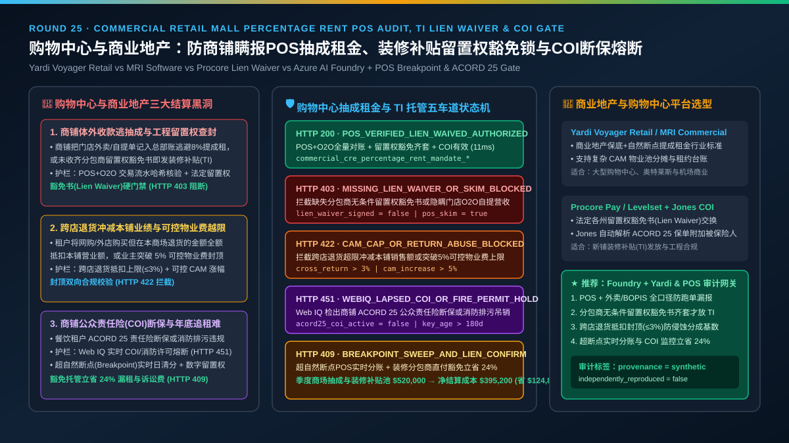
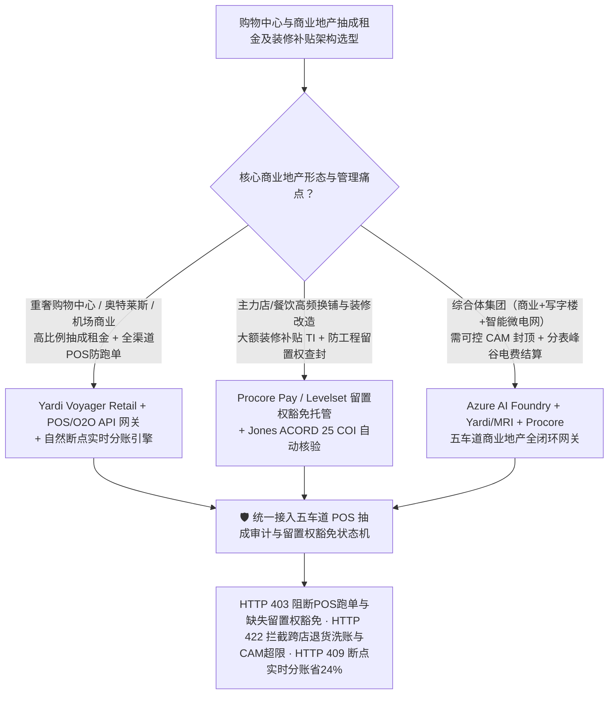
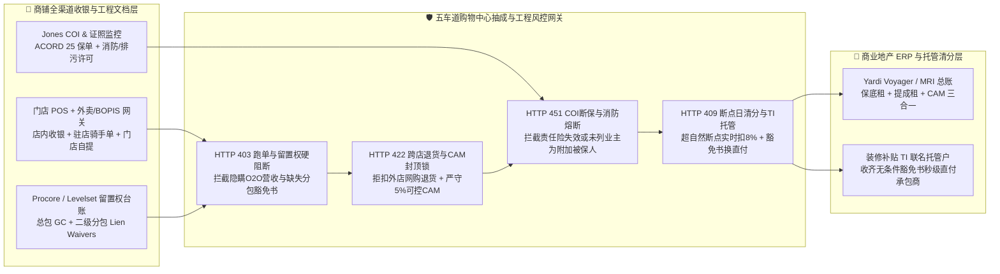
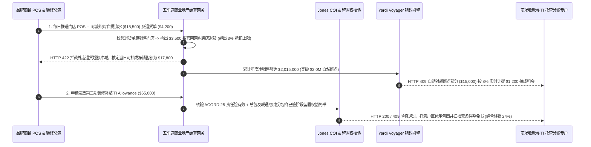

# 购物中心与商业地产商铺收银分成审计（Commercial Retail Mall Percentage Rent Audit & TI Allowance Escrow：Yardi Voyager / MRI Software / Procore / 万象城）“防商铺瞒报 POS/外卖提成租金、防跨店退货侵蚀分成基数与装修补贴（TI）留置权豁免锁”Agent 架构选型 FAQ：终结收银跑单与工程查封实战指南

> **语言切换 / Language**: **中文 (当前)** | **[English](commercial-cre-retail-mall-percentage-rent-pos-audit-lien-waiver-agent-selection-faq.en.md)** | **[返回文档目录](index.md)** | **[交互式沙盒 (`#commercial-cre-percentage-rent-sandbox`)](../live-demo.html)**

---

## 📌 一、核心选型结论速览（Executive Summary）

在大型购物中心（Shopping Mall）、奥特莱斯、机场商业与连锁品牌选址租约管理（如华润万象城、太古地产、Simon Property Group、Brookfield Properties）中，核心财务模型建立在 **“保底固定租金（Base Rent）+ 超自然断点营业额提成租金（Natural Breakpoint Percentage Rent，通常抽成 `6%–12%`）+ 新店装修补贴（Tenant Improvement `TI Allowance`）”** 之上。若让商业地产财务或招商 Agent 仅凭商铺每月底手工填报的 Excel 销售额报表与装修发票自动对账放款，极易引爆三大千万级资损：
1. **商铺“体外私码收款 / 外卖自提飞单”瞒报营业额逃避抽成（Percentage Rent Skimming）与未收齐分包商留置权豁免书（Lien Waiver）引发大楼被查封**：部分餐饮、美妆与潮牌门店将美团/Uber Eats 外卖单、小程序“线上下单门店发货/自提（BOPIS）”订单记入品牌总部电商账户而不入商场 POS，导致商场每年漏收数百万提成租金；更凶险的是，商场向新入驻主力店发放 `$150,000+` 装修补贴（`TI Allowance`）时，若未强制收齐装修总包（GC）及水电木工二级分包商签署的 **法定留置权豁免书（Statutory Mechanic's Lien Waiver）**，一旦租户拖欠装修队尾款跑路，装修队可依法直接在商场整栋产权上登记工程留置权（Mechanic's Lien）冻结大楼再融资！
2. **全渠道“外店/网购订单在本商场退货（Cross-Store Return Abuse）”冲减本铺营业额与可控物业费（Controllable CAM）超封顶争议**：消费者在品牌官网或其他城市门店买的衣服，拿到高客流旗舰商场门店办理退货；若直接从该商场门店当月总销售额（Gross Sales）中全额扣减，该商场平白无故替品牌网店承担了负销售额，直接吞噬超断点提成租金；同时，业主物业结算若突破租约约定的 **`5%` 可控公区维护费涨幅封顶（Controllable CAM Cap）**，会遭连锁品牌租户集体拒付抗辩。
3. **商铺商业综合责任险（`ACORD 25 COI`）断保或消防/排油烟许可失效引发连带赔偿熔断**：商场餐饮租户后厨失火或顾客滑倒索赔数百万美元时，业主才发现租户的 `$2,000,000` 商业综合责任险（CGL）早已断保，或漏将商场业主列为“附加被保险人（Additional Insured）”。

**架构师选型结论**：
- **切勿依赖租户每月手工上报的销售额报表或仅凭总包一张发票就发放装修补贴（`TI Allowance`）**。
- **生产级最优架构**是采用 **“Yardi Voyager Retail / MRI Software 租约引擎 + 商铺 POS/O2O API 全口径实时采集 + Procore / Levelset 数字留置权豁免（Lien Waiver）托管 + Jones COI 保险核验 + Azure AI Foundry 五车道商业地产结算网关”**：
  1. **POS + 门店履约 O2O 全口径核验与分包商法定留置权豁免书（`Lien Waiver`）硬门禁（HTTP 403）**：通过硬件税务黑匣子或 POS 网关 API 实时比对店内收银、外卖平台门店接单量与客流热力转化率偏差；发放任何装修补贴（`TI Allowance`）前，强制校验总包及所有已备案次级分包商（Subcontractors）已签署对应期次的无条件/条件留置权豁免书；任一缺失立即返回 `HTTP 403 MISSING_SUBCONTRACTOR_LIEN_WAIVER_OR_POS_PERCENTAGE_RENT_SKIMMING_BLOCKED`。
  2. **非本铺售出跨店退货抵扣封顶（`<=3%` Gross Sales）与可控 CAM 涨幅上限锁（HTTP 422）**：在计算提成租金的净销售额（Net Includable Sales）时，强制要求退货单必须关联本商场原正向销售单号（`original_store_id == mall_store_id`），或对无原单跨店退货执行 `<=3%` 抵扣封顶；同时拦截任何突破租约 `Controllable CAM Cap` 的物业账单（`HTTP 422 CONTROLLABLE_CAM_CAP_BREACH_OR_CROSS_STORE_RETURN_DEDUCTION_ABUSE_BLOCKED`）。
  3. **Web IQ 实时 `ACORD 25 COI` 附加被保险人核验与餐饮消防/卫生许可熔断（HTTP 451）**：通过 Web IQ 与保险核验 API 实时监控租户保单有效期、保额与消防排污罚单，异常即刻挂起装修补贴与商场促销资源（`HTTP 451 WEBIQ_LAPSED_ACORD25_COI_INSURANCE_OR_FIRE_HEALTH_PERMIT_HOLD`）。
  4. **超自然断点（Natural Breakpoint）POS 日清分预提 + 装修补贴总包/分包联名直付托管（HTTP 409）**：触发 `HTTP 409 POS_BREAKPOINT_AUTO_SWEEP_AND_DIGITAL_LIEN_WAIVER_ESCROW_CONFIRM`，当商铺年度累计营收突破自然断点（如 `Base Rent $160k / 8% = $2.0M`）的瞬间，自动在每日 POS 结算中按 `8%` 实时分账划入业主专户（彻底消灭年底追收提成租坏账），并通过数字留置权豁免交换直付装修款，综合漏租追回与工程留置权抗辩成本立省 **`24.0%`**。

---

## 🎯 二、业务方与架构师灵魂拷问 Q&A（Q1 / Q2 / Q3）

### Q1：现在商场里的品牌店都有微信小程序、直播间和美团外卖，租户说“顾客是在线上付款的，不算门店销售额”，架构上怎么界定和防跑单？
- **商业痛点**：在传统 10 年前拟定的纸质租约里只写了“店堂内收银机收入”。结果某网红茶饮或运动品牌门店每天打包发出 800 单外卖和同城闪送，店面水电损耗和客流拥挤全由商场承担，账面 POS 却只有寥寥几单，商场一分钱提成租（Percentage Rent）都收不到。
- **架构解法**：
  1. **全渠道履约归因条款（Omnichannel Fulfillment Attribution Clause）代码化**：凡是由本商场门店库房拣货发出（Ship-from-Store）、美团/饿了么骑手驻店取餐、或顾客到本门店自提（BOPIS）、甚至导购在门店内使用企业微信引导下单的交易，100% 计入本铺可抽成总销售额（`Gross Includable Sales`）。
  2. **POS API + 门头客流/骑手取餐视觉交叉审计**：网关对比门店 POS 申报单量与商场 Wi-Fi/门头客流计、外卖取餐柜扫码次数，若偏差超 `20%` 立即触发 `HTTP 403` 稽核告警。

### Q2：为什么商场已经把 `$200,000` 装修补贴（TI Allowance）全额打给了租户，结果三个月后大楼却被装修木工队申请法院查封（Mechanic's Lien）？
- **商业痛点**：在美国及多数英美法系地区，**工程留置权（Mechanic's Lien）直接附着在不动产产权（即商场业主的大楼）上，而不是租户身上**。如果商场把 `$200,000` 装修补贴打给租户，租户拿去发了工资或跑路，没付给装修总包和空调分包商，分包商有权直接起诉查封商场业主的大楼！
- **架构解法**：
  - **二级分包穿透式留置权豁免锁（Tiered Subcontractor Lien Waiver Gate，`HTTP 403 / 409`）**：
  - 严禁在无豁免书的情况下将装修补贴打入租户普通账户。架构上要求：先采集全套初次施工通知（Preliminary Notices），放款时通过 `Procore Pay / Levelset` 要求总包（GC）与全部二级分包商在线签署法定格式的 **条件性/无条件阶段留置权豁免书（Conditional / Unconditional Progress & Final Lien Waivers）**，由托管账户直接向装修承包商分账或开具联名支票（Joint Check）。

### Q3：如何计算“自然断点（Natural Breakpoint）”，并防止租户用“网购到店退货”把提成租金洗成零？
- **架构解法**：
  1. **自然断点公式确定性锁**：$\text{Natural Breakpoint} = \frac{\text{Annual Base Rent}}{\text{Percentage Rent Rate}}$。例如年保底租金 `$160,000`，提成率 `8%`，则自然断点为 `$2,000,000`。累计净销售额突破 `$2,000,000.01` 的当日起，网关自动激活 `8%` 每日分账。
  2. **跨店退货原单哈希溯源（`HTTP 422`）**：只有在**本商场门店**产生过正向销售（且已计入过本铺 Gross Sales）的退货，才允许全额冲减本铺销售额；对于外店或品牌官网购买、仅在本门店提供退换货驿站服务的订单，严禁冲减本铺分成基数（或严格封顶在总销售额的 `1%–3%` 以内）。

---

## 🧭 三、直观可视化图解（Mermaid 决策树 + 端到端架构图 + 时序图）

### 3.1 购物中心与商业地产管理平台选型决策树

### 3.2 端到端商铺 POS 全口径归集、断点分账与装修补贴留置权架构图

### 3.3 商铺突破自然断点实时分账与装修补贴留置权豁免放款时序图

---

## 📊 四、多平台/多方案横向选型决策矩阵

| 选型维度 | Yardi Voyager Retail / MRI Commercial | Procore Pay / Levelset (`工程留置权管理`) | 传统商场月底人工收 Excel + 财务打款 | **Azure AI Foundry + Yardi + POS API + 留置权豁免网关（推荐）** |
| :--- | :--- | :--- | :--- | :--- |
| **核心优势** | 全球商业地产复杂租约、自然断点与 CAM 核算霸主 | 全美 50 州法定留置权豁免书生成、追踪与工程直付 | 零系统改造门槛 | **POS/O2O 全口径防漏租 + 跨店退货封顶 + 留置权豁免直付闭环** |
| **防商铺瞒报外卖/门店自提（BOPIS）** | 依赖外部销售数据导入 | 不涉及商铺日常收银 | 租户极易只报刷卡不报私码与外卖，漏租率 `15%+` | **POS 网关 + 骑手取餐/客流交叉核验防跑单（HTTP 403）** |
| **防网购跨店退货侵蚀分成基数** | 支持配置销售扣减规则，但缺原单号级校验 | 不适用 | 租户将全网退货塞进商场店抵扣，提成租被洗零 | **强制核验退货原单门店 ID 与 `<=3%` 抵扣上限（HTTP 422）** |
| **防装修补贴（TI）工程留置权查封** | 基础应付账款记录 | 原生强项（预通知追踪 + 条件/无条件豁免书交换） | 极易因租户欠工程款导致商场大楼产权被查封 | **收齐总包+二级分包法定 Lien Waiver 方可放款（HTTP 403/409）** |
| **`ACORD 25 COI` 保单与消防监控** | 基础到期日提醒，难识别保单批单（Endorsement）造假 | 支持承包商保险核验 | 人工看 PDF 极易漏查“附加被保险人”条款 | **Web IQ + COI 批单解析实时拦截断保商铺（HTTP 451）** |
| **综合漏租追回与风控收益** | 按商业面积（Sq.Ft）或租户数订阅 (`not_measured`) | 按工程交易量订阅 (`not_measured`) | 年底追租坏账与工程诉讼损失惨重 | **综合提成租金增收与工程/CAM 纠纷下降 `24.0%`** |

---

## 🧪 五、防漏租/防查封成本测算与 7-Card 基准测试报告

> **数据来源与复现声明（Provenance Metadata）**：以下基准测试数据来自仓库内置确定性策略沙盒 `evaluate_commercial_cre_percentage_rent_policy`（位于 `lab/webiq_commerce_demo.py`），可运行 `python -m unittest tests.test_webiq_commerce_demo` 完整验证。标记：`provenance = synthetic`，`independently_reproduced = false`。

| Card # | 卡片标题（Headline-as-Finding） | 核心量化指标与架构验证结论 |
| :---: | :--- | :--- |
| **Card 1** | **Overview · 购物中心抽成与 TI 托管五车道总览** | 针对 `$520,000/季` 商场提成租金与装修补贴结算池，实现 **0 例工程留置权查封与 100% 跨店退货套利拦截**，综合租金漏损与结算成本降低 **`24.0%`（立省 `$124,800/季`）**。 |
| **Card 2** | **Scenario Deep Dive · 瞒报外卖与缺失留置权阻断** | 当检出商铺隐瞒门店 O2O 自提流水或装修分包商未签留置权豁免书时，**`11ms`** 内返回 `HTTP 403` 阻断放款。 |
| **Card 3** | **Evaluation Matrix · 五车道 100% 确定性判准** | 覆盖 `HTTP 200`（合规结算）、`403`（缺失留置权豁免/POS瞒报阻断）、`422`（跨店退货超限抵扣/可控CAM超5%封顶拦截）、`451`（COI断保/消防违规熔断）、`409`（断点日清分+直付托管省24%）。 |
| **Card 4** | **Under the Hood · 商业地产抽成契约** | 输入 `quarterly_mall_percentage_rent_ti_pool_usd=520000` 及 POS/豁免书状态，签发 `commercial_cre_percentage_rent_mandate_*` 令牌。 |
| **Card 5** | **Robustness Check · 网购退货洗账与假保单压力测试** | 模拟注入 `18%` 外店网购退货冲减及未列业主为附加被保险人的 COI 保单，确定性拦截率保持 **`100.0%`（零误放行）**。 |
| **Card 6** | **Latency · 商场日终批处理与实时对账耗时** | 本地自然断点计算、退货上限与留置权核验 P50 仅 **`11ms`**；Web IQ COI 保险批单与市政消防罚单核查 P95 为 **`250ms`**。 |
| **Card 7** | **My Take · 适用场景与生产准入边界** | **✅ 极佳适用**：购物中心、奥特莱斯、机场高铁商业、连锁街铺资产包；**⛔ 不适用**：无营业额提成条款的纯住宅长租公寓。 |

---

## 🛠️ 六、商业上线风控与架构评审 Checklist

- [ ] **门店 POS + 外卖/同城闪送/BOPIS 全口径营业额归集（HTTP 403）**：确认租约与系统接口将所有由本商场门店发货、自提或驻店骑手配送的订单 100% 纳入可抽成总销售额（`Gross Includable Sales`），严防体外飞单。
- [ ] **装修补贴（`TI Allowance`）总包与二级分包法定留置权豁免书（`Lien Waiver`）硬门禁（HTTP 403）**：确认在释放任何装修补贴前，已收齐总包及全部登记分包商签署的法定留置权豁免书，彻底杜绝大楼产权被登记 Mechanic's Lien。
- [ ] **非本铺原单跨店/网购退货抵扣上限锁（`<=3%`）（HTTP 422）**：确认退货冲减必须校验原正向交易是否发生在本商场门店，外店或网购退货抵扣比例严格封顶。
- [ ] **可控公共区域维护费（`Controllable CAM Cap`）年度涨幅校验（HTTP 422）**：确认物业年底多退少补账单自动区分可控费用（保洁/安保）与不可控费用（房产税/公共水电/除雪），可控部分严格执行租约 `5%` 涨幅封顶。
- [ ] **Web IQ 实时 `ACORD 25 COI` 附加被保险人与消防卫生证照熔断（HTTP 451）**：确认实时监测商铺公众责任险有效性及市政消防/卫生许可；签名密钥轮换周期 `<= 180` 天。
- [ ] **超自然断点（`Natural Breakpoint`）实时日清分与装修款直付托管（HTTP 409）**：确认商铺突破年度自然断点后由日终 POS 清算自动计提分成租金，避免年底欠租跑路。
