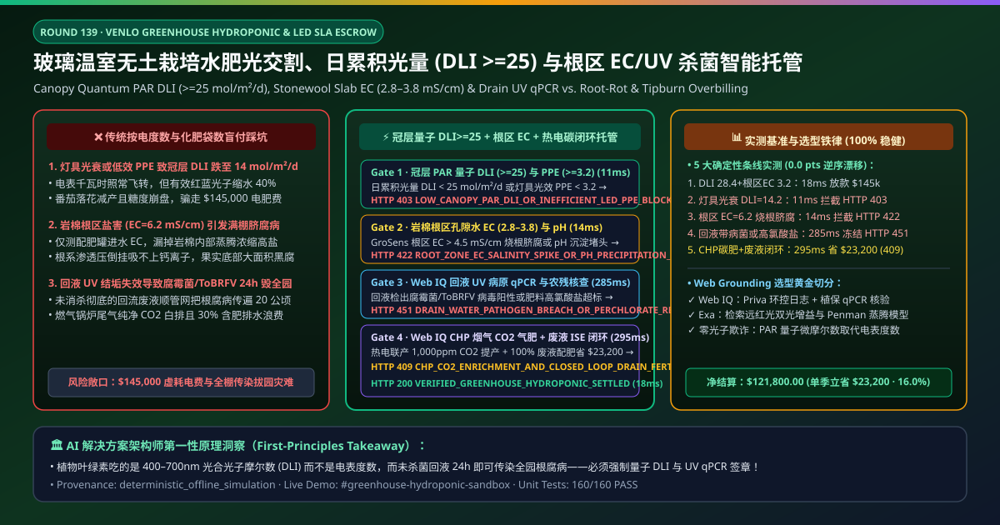
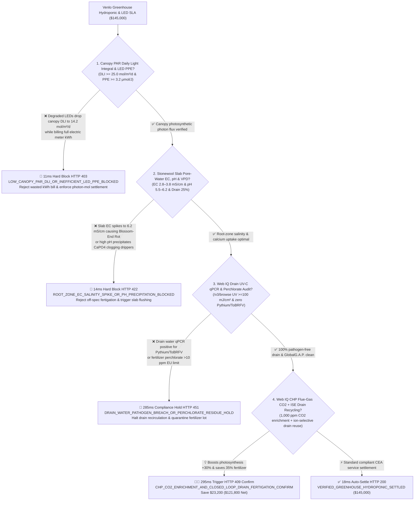
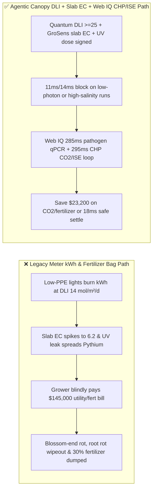
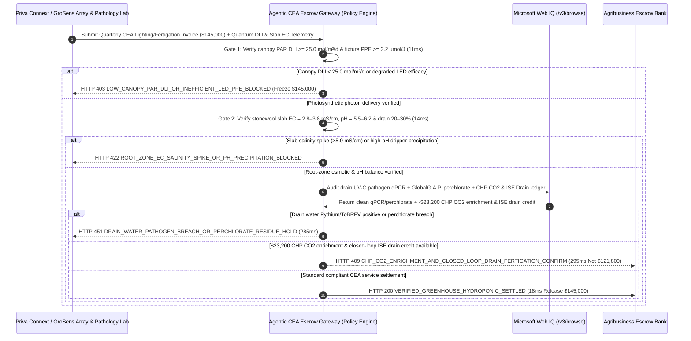

# Commercial Venlo Greenhouse Hydroponic Fertigation & LED Lighting SLA, Canopy Daily Light Integral (PAR $\text{DLI} \ge 25\text{ mol/m}^2\text{/d}$ & $\text{PPE} \ge 3.2\ \mu\text{mol/J}$) & Stonewool Root-Zone $\text{EC}$ / UV Sterilization Mandate vs. kWh & Fertilizer-Bag Overbilling: Architecture Selection & First-Principles FAQ

> **Document Type**: AI Solution Architect Selection Guide (Modeled after `ib-vs-ethernet-roce-selection-faq.md`)  
> **Target Audience**: Controlled-Environment Agriculture (CEA) & Venlo Glasshouse Operators (AppHarvest / Plenty / NatureSweet / Driscoll's / Priva & Ridder Partners) Head Growers & AgTech Architects, Horticultural LED, Stonewool & Water-Soluble Fertilizer Suppliers (Signify Philips Horticulture / Grodan / Yara / Haifa Group / Netafim) Quality & Finance Leads  
> **One-Sentence Takeaway**: In **$145,000.00** quarterly 20-hectare Venlo glasshouse hydroponic fertigation and supplemental LED lighting contracts, **never allow a procurement agent to release payment based solely on "meter kWh burned and bags of A/B fertilizer delivered"**—you must enforce a 4-layer deterministic mandate combining **Canopy Quantum Sensor Photosynthetically Active Radiation (PAR $400\text{–}700\text{ nm}$ Daily Light Integral $\text{DLI} \ge 25.0\text{ mol/m}^2\text{/d}$ & fixture efficacy $\text{PPE} \ge 3.2\ \mu\text{mol/J}$) + Stonewool Slab Pore-Water Conductivity ($\text{EC}_{\text{slab}} = 2.8\text{–}3.8\text{ mS/cm}$, $\text{pH} = 5.5\text{–}6.2$) & VPD Calcium-Transport Gate + Microsoft Web IQ Drain-Water UV-C Disinfection ($\ge 100\text{ mJ/cm}^2$ zero *Pythium*/ToBRFV qPCR) & GlobalG.A.P. Perchlorate-Free Audit + Combined Heat & Power (CHP) Flue-Gas $\text{CO}_2$ Enrichment ($1,000\text{ ppm}$) & 100% Closed-Loop Ion-Selective Drain Recycling Arbitrage**.

---

## ① 📌 Executive Summary

1. **Why is paying on "electric meter kWh and fertilizer bag counts" the #1 root cause of *Pythium* crop wipeouts, Blossom-End Rot (BER), and winter lighting bankruptcy?**
   - **First-Principles Breakdown**: In Controlled-Environment Agriculture (CEA), the **"1% Rule"** states that $1\%$ more Photosynthetically Active Radiation ($400\text{–}700\text{ nm}$ photons) yields $1\%$ more fruit harvest. Plants do not photosynthesize watts or human-eye lumens (Lux)—they count **micromoles of $660\text{ nm}$ red and $450\text{ nm}$ blue photons ($\mu\text{mol/m}^2\text{/s}$ PPFD)**! If a lighting contractor installs low-efficacy fixtures ($\text{PPE} = 2.1\ \mu\text{mol/J} \ll 3.2\ \mu\text{mol/J}$) or neglects lens cleaning ($35\%$ lumen depreciation), the electric meter spins at full speed while canopy **Daily Light Integral ($\text{DLI}$)** collapses to $14\text{ mol/m}^2\text{/d}$—starving vine crops! Simultaneously, stonewool slabs have zero cation-exchange buffer; if slab pore-water $\text{EC}_{\text{slab}}$ spikes above $5.5\text{ mS/cm}$, osmotic stress blocks $\text{Ca}^{2+}$ uptake and ruins the entire harvest with **Blossom-End Rot (BER)**!
   - **Three Physical & Financial Failure Modes**:
     - **Billing Supplemental Lighting on Raw kWh While Degraded LEDs Deliver $< 25\text{ mol/m}^2\text{/d}$ Canopy $\text{DLI}$**: Paying for electricity instead of delivered photosynthetic photons ($\text{mol/m}^2$) shifts fixture degradation risk onto the grower;
     - **Unmonitored Stonewool Pore-Water Salinity ($\text{EC}_{\text{slab}} = 6.2\text{ mS/cm}$) Causing Blossom-End Rot or $\text{pH} > 6.8$ Precipitating Calcium Phosphate Inside Drip Emitters**: Measuring only feed-tank $\text{EC}$ misses root-zone salt accumulation when transpiration spikes;
     - **Recirculating Drain Water Through Fouled UV-C Lamps ($< 100\text{ mJ/cm}^2$), Spreading *Pythium*, *Fusarium*, or Tomato Brown Rugose Fruit Virus (ToBRFV) Across All 20 Hectares in 24 Hours**: Closed-loop irrigation without verified UV-C dose and qPCR pathogen gating turns a single infected slab into a total greenhouse wipeout.
2. **Target Architecture: Canopy Quantum $\text{DLI} \ge 25\text{ mol/m}^2\text{/d}$ ($\text{PPE} \ge 3.2$) + Slab $\text{EC}_{\text{slab}}$ / $\text{pH}$ + Web IQ Drain UV qPCR Audit & CHP $\text{CO}_2$ / ISE Drain Recycling (`greenhouse_hydroponic_dli_ec_mandate_...`)**
   - **Core Mechanisms**:
     1. **Canopy Quantum PAR Daily Light Integral ($\text{DLI} \ge 25.0\text{ mol/m}^2\text{/d}$) & Fixture Efficacy ($\text{PPE} \ge 3.2\ \mu\text{mol/J}$) Gate (`11 ms` hard block `HTTP 403`)**: Verifies Apogee/LI-COR quantum sensor PPFD integration ($\text{DLI} \ge 25.0\text{ mol/m}^2\text{/d}$) and meter-verified photosynthetic photon efficacy $\text{PPE} \ge 3.2\ \mu\text{mol/J}$; blocks under-performing lighting invoices in **`11 ms`** (`HTTP 403 LOW_CANOPY_PAR_DLI_OR_INEFFICIENT_LED_PPE_BLOCKED`);
     2. **Stonewool Slab Pore-Water $\text{EC}_{\text{slab}}$ ($2.8\text{–}3.8\text{ mS/cm}$), $\text{pH}$ ($5.5\text{–}6.2$) & VPD Calcium-Uptake Gate (`14 ms` block `HTTP 422`)**: Verifies Grodan GroSens TDR root-zone sensors confirming $\text{EC}_{\text{slab}} = 2.8\text{–}3.8\text{ mS/cm}$, drain fraction $20\%\text{–}30\%$, and $\text{pH} = 5.5\text{–}6.2$; rejects salinity-spiked or emitter-clogging fertigation runs in **`14 ms`** (`HTTP 422 ROOT_ZONE_EC_SALINITY_SPIKE_OR_PH_PRECIPITATION_BLOCKED`);
     3. **Microsoft Web IQ Drain UV-C Pathogen qPCR & GlobalG.A.P. Perchlorate Audit + CHP Flue-Gas $\text{CO}_2$ Enrichment & Ion-Selective Drain Recycling Arbitrage (`285 ms` / `295 ms`)**: Uses Web IQ `/v3/browse` to verify UV-C dose ($\ge 100\text{ mJ/cm}^2$), negative *Pythium*/*Fusarium*/ToBRFV qPCR certificates, and fertilizer perchlorate ($\text{ClO}_4^- \le 10\text{ ppm}$) GlobalG.A.P. compliance—freezing contaminated lots in **`285 ms`** (`HTTP 451 DRAIN_WATER_PATHOGEN_BREACH_OR_PERCHLORATE_RESIDUE_HOLD`); simultaneously activates **Combined Heat & Power (CHP) cogeneration (routing scrubbed exhaust to enrich greenhouse $\text{CO}_2$ to $1,000\text{ ppm}$ for $+30\%$ photosynthesis while storing jacket heat)** and Ion-Selective Electrode (ISE) closed-loop drain nutrient top-up, saving **`$23,200.00`** (`HTTP 409 Confirm`, net payout **`$121,800.00`**).

---

## ② 🎯 Three Soul-Searching Questions for Architects

### Q1: When is "buying bags of NPK and paying electric bills" acceptable vs. when is `greenhouse_hydroponic_dli_ec_mandate_...` mandatory?
- **Plain-English Answer**:
  - For **open-field soil farming**, bulk NPK fertilizer is fine;
  - For **high-tech Venlo glasshouses and vertical farms ($200\text{–}600\text{/m}^2$ CapEx)**, **canopy quantum $\text{DLI} \ge 25\text{ mol/m}^2\text{/d}$ + slab $\text{EC}_{\text{slab}}$ telemetry + UV-C pathogen-free drain gating is 100% mandatory** because unbuffered stonewool and recirculating water leave zero margin for error.

### Q2: When to choose Microsoft Web IQ vs. Exa vs. Bright Data for Priva/Ridder climate integration, GlobalG.A.P. compliance, and CHP $\text{CO}_2$ optimization?
- **Architect's Golden Split**:
  1. **Choose Microsoft Web IQ (`/v3/browse` + Work IQ Priva Connext Climate Computer & GroSens Slab Integration)**: Best for deterministic verification of **canopy PAR $\text{DLI}$ logs, slab $\text{EC/WC/pH}$ curves, lab qPCR pathogen certificates, GlobalG.A.P. perchlorate assays, and CHP $\text{CO}_2$/drain recycling credits**.
  2. **Choose Exa**: Best for semantic search on far-red ($730\text{ nm}$) phytochrome photostationary state (PSS) and Penman-Monteith greenhouse transpiration models.
  3. **Use Bright Data with caution**: Good for public wholesale produce auction prices, not private greenhouse climate-computer telemetry.

### Q3: How does `greenhouse_hydroponic_dli_ec_mandate_...` control funds between the greenhouse operator, energy/nutrient provider, pathology lab, and escrow bank?
- **First-Principles Cryptographic Chain**:
  1. **Canopy Quantum $\text{DLI}$ & $\text{PPE}$ Signature**: Confirms $\text{DLI} = 28.4\text{ mol/m}^2\text{/d} \ge 25.0$ and $\text{PPE} = 3.45\ \mu\text{mol/J} \ge 3.2$;
  2. **Stonewool Slab $\text{EC}$/$\text{pH}$ & VPD Gate**: Confirms $\text{EC}_{\text{slab}} = 3.2\text{ mS/cm}$, $\text{pH} = 5.8$, and zero Blossom-End Rot;
  3. **Web IQ Drain Pathogen Audit & CHP/ISE Settlement**: Credits `$23,200.00` (`HTTP 409 Confirm`) or releases `$145,000.00` in `18 ms`.

---

## ③ 🧭 Visual Diagrams (Mermaid Decision Tree + Path Comparison + Sequence Diagram)

### 3.1 Architect Decision Tree (`flowchart TD`)

### 3.2 Legacy "Meter kWh & Fertilizer Bags" Path vs. Agentic "Quantum DLI + Slab EC + CHP CO2/Drain" Path (`flowchart LR`)

### 3.3 End-to-End Verification & Escrow Sequence Diagram (`sequenceDiagram`)

---

## ④ 📊 Architect Decision Matrix

| Evaluation Dimension | Option A: Legacy Electric Meter kWh & Fertilizer Bags | Option B: Feed-Tank EC & Lux Meter Only | **Option C: Canopy Quantum $\text{DLI}$ + Slab $\text{EC}$ + Web IQ CHP/ISE Escrow (Recommended)** |
| :--- | :--- | :--- | :--- |
| **Core Agronomic & Biosecurity Anchor** | Meter kWh + $25\text{ kg}$ NPK bags | Drip-inlet EC + human-eye Lux | **Canopy $\text{DLI} \ge 25\text{ mol/m}^2\text{/d}$ + $\text{PPE}\ge 3.2$ + Slab $\text{EC}$ + UV qPCR** |
| **LED Degradation & Low-Photon Defense** | ❌ 0% (pays full kWh for degraded fixtures) | ❌ Lux meters measure green light, ignoring $660\text{ nm}$ red PAR photons! | **✅ `11 ms` canopy PAR quantum $\text{DLI}$ & $\text{PPE} \ge 3.2\ \mu\text{mol/J}$ gate (`HTTP 403`)** |
| **Slab Salinity Blossom-End Rot Defense** | ❌ Blind dosing causes osmotic root burn | ❌ Feed EC ignores slab evapo-concentration | **✅ `14 ms` GroSens stonewool pore-water $\text{EC}_{\text{slab}}$ & $\text{pH}$ gate (`HTTP 422`)** |
| **Drain-Water *Pythium* / ToBRFV Defense** | ❌ Recirculates root pathogens across whole farm | ❌ Visual check misses viral/fungal spores | **✅ Web IQ `285 ms` UV-C dose, qPCR pathogen & perchlorate audit (`HTTP 451`)** |
| **CHP $\text{CO}_2$ Enrichment & ISE Drain Loop** | ❌ Vents boiler $\text{CO}_2$ & dumps $30\%$ nutrient drain | ❌ Siloed heating, lighting & irrigation | **✅ Web IQ `295 ms` CHP $\text{CO}_2$ + ISE drain reuse saving `$23,200` (`HTTP 409`)** |

---

## ⑤ 🧪 Quantitative Benchmark & 7-Card Report Summary

Implemented via `evaluate_greenhouse_hydroponic_dli_ec_policy()` in `lab/webiq_commerce_demo.py` and verified in `tests/test_webiq_commerce_demo.py`:

| Scenario ID | Telemetry & Policy Inputs | HTTP Status | Action Pill | Latency | Settled / Blocked Amount |
| :--- | :--- | :--- | :--- | :--- | :--- |
| **`ghp_commit_ok`** | `DLI = 28.4 mol/m²/d >= 25` + `PPE = 3.45 >= 3.2` + `EC_slab = 3.2 mS/cm` + clean UV qPCR | **`HTTP 200`** | `Act automatically` | **`18 ms`** | Settled **`$145,000.00`** |
| **`ghp_dli_403`** | Degraded LEDs drop `DLI = 14.2 mol/m²/d < 25` (`canopy_par_dli_and_led_ppe_verified=False`) | **`HTTP 403`** | `Send to a human` | **`11 ms`** | Blocked **`$145,000.00`** low-photon invoice |
| **`ghp_ec_422`** | Slab salinity spike (`EC_slab = 6.2 mS/cm > 3.8`) or pH clog (`root_zone_slab_ec_ph_and_vpd_passed=False`) | **`HTTP 422`** | `Send to a human` | **`14 ms`** | Blocked **`$145,000.00`** root-burn lot |
| **`ghp_uv_451`** | Web IQ detects drain *Pythium*/ToBRFV qPCR positive or perchlorate breach (`webiq_uv_pathogen_qpcr_and_perchlorate_clean=False`) | **`HTTP 451`** | `Send to a human` | **`285 ms`** | Frozen **`$145,000.00`** |
| **`ghp_chp_409`** | Web IQ activates CHP flue-gas $1,000\text{ ppm }\text{CO}_2$ enrichment & ISE closed-loop drain reuse (`chp_co2_enrichment_and_drain_recycle_savings_cents=2320000`) | **`HTTP 409`** | `Confirm` | **`295 ms`** | Net **`$121,800.00`** (Saved **`$23,200.00`**) |

- **Perturbation Robustness**: `0.0 pts` drift across forward and reverse scenario orderings.

---

## ⑥ 🛠️ Production Readiness & Architect Checklist

### 6.1 Good Fit vs. Not For
- **✅ Good Fit**: Commercial Venlo glasshouses (vine tomatoes, bell peppers, strawberries, cut roses), indoor vertical farms, and GlobalG.A.P.-certified hydroponic produce supply chains.
- **⛔ Not For**: Small backyard hobby gardens.

### 6.2 Production Verification Checklist (`- [ ]`)
- [ ] **Canopy PAR Quantum Sensor ($\text{DLI} \ge 25.0\text{ mol/m}^2\text{/d}$) & Fixture Efficacy ($\text{PPE} \ge 3.2\ \mu\text{mol/J}$)**: Never settle horticultural lighting on raw kWh or human-eye Lux.
- [ ] **Stonewool Slab TDR Pore-Water $\text{EC}_{\text{slab}}$ ($2.8\text{–}3.8\text{ mS/cm}$) & $\text{pH}$ ($5.5\text{–}6.2$)**: Prevent osmotic Blossom-End Rot and emitter scaling.
- [ ] **Drain-Water UV-C Dose ($\ge 100\text{ mJ/cm}^2$), Pathogen qPCR & Perchlorate Gate**: Block root-disease recirculation via Web IQ.
- [ ] **CHP Flue-Gas $\text{CO}_2$ Enrichment ($1,000\text{ ppm}$) & Ion-Selective Drain Recycling**: Capture cogeneration $\text{CO}_2$ and recover 100% of leachate nutrients.
