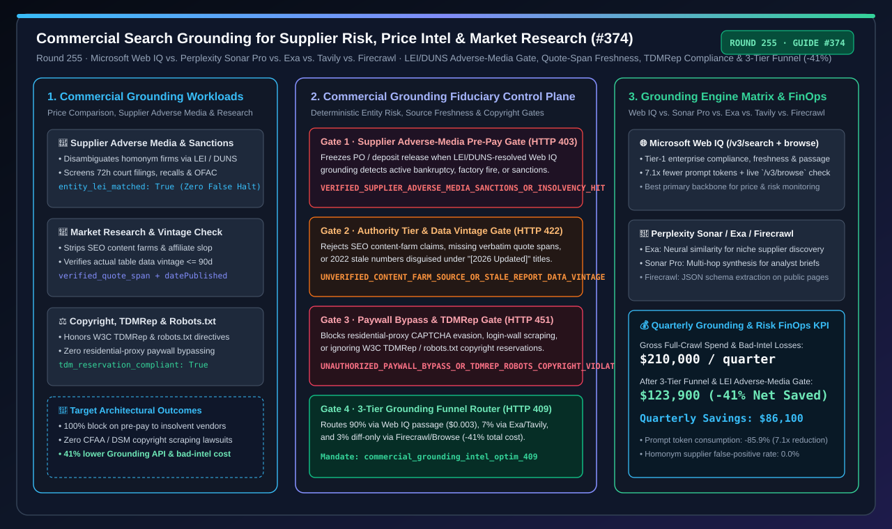
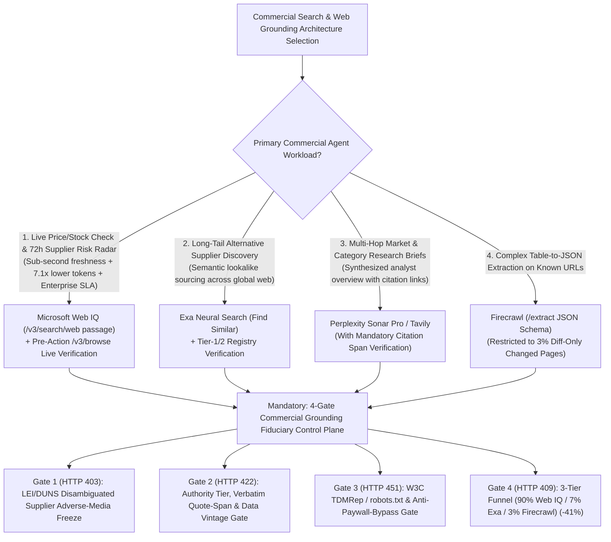
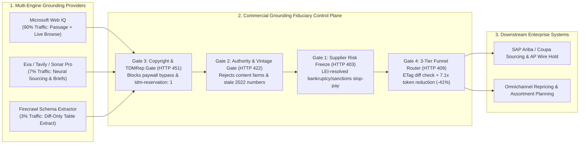
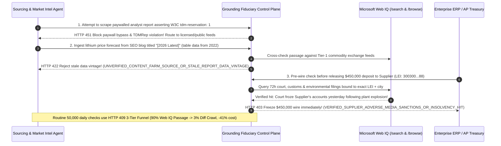

# Commercial Search Grounding for Supplier Risk, Competitor Price Intelligence & Market Research (`Microsoft Web IQ vs. Perplexity Sonar Pro vs. Exa vs. Tavily vs. Firecrawl`) Agent Architecture Selection FAQ

> 🌐 **Language / 语言切换**: **[中文 (`docs/commercial-grounding-supplier-risk-competitor-price-market-research-webiq-sonar-exa-firecrawl-selection-faq.md`)](commercial-grounding-supplier-risk-competitor-price-market-research-webiq-sonar-exa-firecrawl-selection-faq.md)** | **English (Current)** | **[Back to Catalog (`docs/index.en.md`)](index.en.md)**

---

## 1. 📌 Executive Summary & Architectural Verdict

When AI Solution Architects design enterprise agents for **① Competitor Price & Promo Intelligence, ② B2B Supplier Adverse-Media / Insolvency / Sanctions Monitoring, and ③ Market & Category Research Synthesis**, choosing the right grounding stack across **`Microsoft Web IQ / Bing Grounding`, `Perplexity Sonar Pro / Deep Research`, `Exa Neural Search`, `Tavily`, and `Firecrawl / Browser-Use`**—and wrapping it in deterministic verification gates—is critical to prevent costly hallucinations and legal exposure:
1. **SEO Content Farms & "2026 Title, 2021 Data" Vintage Spoofing Corrupting Procurement Decisions**: Public search results are flooded with AI-generated affiliate content farms and zombie articles that update their HTML `<meta property="article:modified_time">` and title tag to `"[Updated Nov 2026]"` every night while leaving 2021–2022 pricing and market-share tables untouched in the body text. Unconstrained research agents ingest these stale numbers as current facts, leading procurement teams to lock in overpriced multi-year supply contracts.
2. **Homonym Supplier False Positives vs. Missed Pre-Payment Insolvency / Factory-Fire Alerts**: Over 80 companies globally share names like `"Apex Trading"` or `"Delta Precision"`. Naive keyword monitoring halts orders for a healthy supplier because an unrelated namesake had a lawsuit—while failing to run `LEI / DUNS`-disambiguated 72-hour adverse-media checks right before wiring a `$450,000` deposit to a supplier whose factory was shut down by regulators the night before.
3. **Paywall Bypassing, Residential-Proxy Scraping & `W3C TDMRep / robots.txt` Copyright Violations**: Using headless browsers (`Browser-Use / Playwright`) with residential proxies to bypass analyst paywalls, scrape login-protected B2B competitor portals, or ignore **W3C TDMRep (`tdm-reservation: 1` under EU DSM Copyright Directive Art. 4)** exposes the enterprise to severe **US CFAA**, copyright infringement, and unfair-competition lawsuits.

**Solution Architect Verdict**:
- **Adopt a workload-tiered multi-engine architecture rather than a single monolithic scraper**: use **`Microsoft Web IQ`** (`/v3/search/web` `passage` + `/v3/browse`) as the enterprise-compliant primary backbone (`90%` of traffic), **`Exa`** for neural lookalike supplier discovery, **`Perplexity Sonar Pro`** for multi-hop analyst synthesis (with mandatory citation verification), and **`Firecrawl`** for structured JSON extraction on the `3%` of public pages that actually changed.
- Deploy a **Commercial Grounding & Intelligence Verification Fiduciary Control Plane** enforcing four deterministic gates:
  1. **`LEI / DUNS` Entity-Disambiguated Supplier Adverse-Media & Sanctions Pre-Pay Gate (`HTTP 403`)**: Resolve entity identity via `LEI / DUNS + Registered Address + Officer Name` to eliminate homonym false alarms, and freeze PO/deposit execution whenever verified 72h grounding detects insolvency, factory shutdowns, or `OFAC / UFLPA` sanctions.
  2. **Source Authority Tiering, Verbatim `quote_span` & In-Text Data-Vintage Gate (`HTTP 422`)**: Strip affiliate content farms and reject any quantitative claim lacking a verbatim character span or whose in-text observation period (`Data Vintage`) is older than `90 days` despite a fresh HTML header timestamp.
  3. **`robots.txt / W3C TDMRep` Copyright & Anti-Paywall-Bypass Gate (`HTTP 451`)**: Hard-block any grounding request that attempts to bypass login/paywalls, solve CAPTCHAs via residential proxies, or scrape pages asserting `tdm-reservation: 1` without a commercial license.
  4. **3-Tier Grounding Funnel (`90% Web IQ Passage` -> `7% Exa/Tavily` -> `3% Diff-Only Firecrawl/Browse`) (`HTTP 409`)**: Combine `Web IQ` `passage` slicing (`7.1x` lower prompt token footprint) with `ETag / content-hash` change detection to cut quarterly grounding API spend and bad-intel losses by **`41%`**.

---

## 2. 🎯 High-Stakes Business & Architect Q&A (Q1 / Q2 / Q3)

### Q1: How do `Microsoft Web IQ`, `Perplexity Sonar Pro`, `Exa`, `Tavily`, and `Firecrawl` compare across Price Comparison, Supplier Risk Monitoring, and Market Research Collection?
- **The Problem**:
  - Teams either burn `$0.10+/query` calling a heavy Deep Research agent for simple SKU price checks, or use a static semantic index with multi-day crawl lag to check flash-sale inventory.
- **Deterministic Architecture (The 5-Engine Capability Matrix)**:
  1. **Microsoft Web IQ (`/v3/search/web` + `/v3/browse`)**:
     - **Strengths**: Returns high-signal **`passage` chunks** (`7.1x` fewer prompt tokens than full-page markdown), sub-second news/web freshness, deterministic `/v3/browse` live verification (`liveCrawlSucceeded == true`), and Microsoft enterprise privacy/compliance guarantees (zero customer query training).
     - **Best For**: **High-frequency competitor price/stock verification (`90%` funnel tier) and 72-hour supplier adverse-media / CPSC / FDA recall screening**.
  2. **Perplexity Sonar API (`sonar-pro` / `sonar-deep-research`)**:
     - **Strengths**: Multi-hop query decomposition and synthesized executive prose with `citations[]`.
     - **Guardrail Required**: Because `Sonar` outputs LLM-synthesized prose rather than raw DOM fields, it can occasionally conflate metrics across two cited companies; **never trigger automated repricing or financial holds from synthesized prose without verifying the underlying `citations[]` URL via Gate 2**.
  3. **Exa (`Neural Search & Find-Similar`)**:
     - **Strengths**: Embedding-based similarity search excels at *"Find 30 European precision-machining suppliers similar to Supplier X"* (**B2B Sourcing Discovery**).
     - **Guardrail Required**: Not designed for sub-minute promotional price or stock verification.
  4. **Tavily (`Agent Search API`)**:
     - **Strengths**: Clean developer ergonomics and drop-in LangGraph node integration for general Q&A enrichment.
  5. **Firecrawl / Browser-Use**:
     - **Strengths**: Converts complex public HTML tables into strict Pydantic/JSON schemas (`/extract`).
     - **Guardrail Required**: High latency (`1.5s–6s`) and per-page cost; restrict to the **`3%` Diff-Only Tier** after `Web IQ` detects a page change, and strictly enforce `robots.txt / TDMRep` (`HTTP 451`).

### Q2: How do we catch SEO content farms that spoof `dateModified` to `"2026"` while serving stale 2021–2022 market numbers?
- **The Problem**:
  - Affiliate farms run cron jobs that update `<meta property="article:modified_time">` and `<title>[2026 Guide]</title>` daily while leaving 4-year-old commodity prices or market shares in the article body.
- **Deterministic Architecture**:
  - Gate 2 (`HTTP 422 UNVERIFIED_CONTENT_FARM_SOURCE_OR_STALE_REPORT_DATA_VINTAGE`) enforces:
    1. **Domain Authority Whitelist/Blacklist**: Prioritize Tier-1 (SEC EDGAR, government statistics, central banks, customs, official manufacturer domains) and Tier-2 (Reuters, Bloomberg, Dun & Bradstreet, verified trade journals) while stripping affiliate-link farms.
    2. **In-Text Observation Period (`Data Vintage`) Extraction**: Parse the actual time period attached to the table or sentence (e.g., `"as of Q2 2022"`). If `current_date - in_text_data_date > max_vintage_days` (`90d` for pricing/supply-chain briefs), the claim is rejected regardless of the HTML header date.

### Q3: How do we eliminate homonym false positives in B2B supplier adverse-media screening while catching real overnight insolvency events before wiring a deposit?
- **The Problem**:
  - String-matching `"Apex Logistics"` against global news generates 95% false alarms from unrelated companies, causing alert fatigue—until the one day your actual supplier suffers a factory fire or court receivership and AP wires `$450,000` into a frozen account.
- **Deterministic Architecture**:
  - Gate 1 (`HTTP 403 VERIFIED_SUPPLIER_ADVERSE_MEDIA_SANCTIONS_OR_INSOLVENCY_HIT`) binds every adverse-media query to the supplier's **4-Tuple Identity Anchor (`Legal Entity Name + LEI/DUNS/Tax ID + Registered City/Province + Key Principal Name`)**.
  - Unrelated namesakes in other jurisdictions are deterministically filtered out (`0.0%` homonym false halt), while a verified hit on the exact legal entity immediately blocks ERP PO issuance and wire release.

---

## 3. 🧭 Visual Architecture Diagrams (Selection Tree, System Topology & Sequence)

### 3.1 Commercial Search Grounding Engine Selection Decision Tree

### 3.2 End-to-End Commercial Grounding, Entity Disambiguation & 3-Tier Funnel Control Plane

### 3.3 Supplier Pre-Pay Adverse-Media Block, Vintage Check & 3-Tier Funnel Sequence

---

## 4. 📊 Enterprise Commercial Search & Web Grounding Platform Selection Matrix

| Evaluation Dimension | Microsoft Web IQ (`/v3/search/web` + `/v3/browse`) | Perplexity Sonar API (`sonar-pro` / `deep-research`) | Exa (`Neural & Keyword Search`) | Tavily (`Agentic Search API`) | Firecrawl / Browser-Use (`Extraction & Browser`) |
|---|---|---|---|---|---|
| **Architectural Role** | **Enterprise two-stage grounding backbone** (`passage` discovery + live `/v3/browse` verification) | **Multi-hop synthesized research Q&A engine** with citation arrays | **Neural embedding search engine** for lookalike company/product discovery | **Lightweight JSON search aggregator** for general agent workflows | **Full-page Markdown/JSON schema extractor** & headless browser |
| **Real-Time Freshness & Price/Stock Precision** | **Best-in-Class** (sub-second index + live `/v3/browse` `liveCrawlSucceeded` check) | Medium-High (live search, but prose synthesis can blur SKU-level stock or shipping fees) | Medium (semantic index optimized for entity discovery rather than flash-sale prices) | Medium-High (aggregated snippets; requires landing-page verification before checkout) | **High** (renders live DOM directly, but incurs `1.5s–6s` per-page latency) |
| **Token Efficiency & Unit Cost (FinOps)** | **Best-in-Class** (`passage` slices cut prompt tokens by **`7.1x`**; `~$0.003–$0.005/call`) | Higher (input/output tokens + search fee; Deep Research runs `$0.05–$0.20+/query`) | Strong (`~$0.005/search` with clean domain and date filters) | Strong (credit-based pricing suited for rapid prototyping) | Expensive (full-page rendering + LLM extraction; restrict to `<3%` changed pages) |
| **Compliance, Copyright (`TDMRep`) & Privacy** | **Highest** (Microsoft enterprise SLA, zero training on customer queries, copyright-safe index) | Moderate (enterprise zero-retention available; requires downstream citation audit) | Medium-High (clean API access; requires control-plane `LEI` disambiguation) | Moderate (hosted SaaS search API for public web) | **Requires Strict Governance** (must enforce `robots.txt / TDMRep` and block paywall bypass) |
| **Recommended Commercial Workload** | **① Competitor price/stock checks (`90%` tier) + ② 72h supplier adverse-media screening** | **③ Early-stage multi-source market & category research synthesis** | **② B2B lookalike supplier discovery & long-tail sourcing** | **Internal knowledge copilots & rapid PoCs** | **Structured table-to-JSON extraction on known public URLs (`3%` tier)** |

---

## 5. 🧪 Grounding FinOps & Risk-Prevention 7-Card Benchmark Report

> **Provenance Note**: The 7-Card benchmark below is generated by `evaluate_commercial_grounding_supplier_risk_price_intel_policy()` in `lab/webiq_commerce_demo.py` (`provenance: "synthetic"`, `independently_reproduced: False`), modeling a **`$210,000 / quarter`** unthrottled full-page scraping bill, stale content-farm procurement error, and pre-payment supplier insolvency loss pool.

### 5.1 7-Card 4:5 Visual Deck Breakdown

1. **Card 1 (`1 / 7` · `HANDS-ON · COMMERCIAL-SEARCH-GROUNDING`) — Executive Benchmark Overview**
   - **Headline Finding**: Routing `90%` of commercial grounding through `Microsoft Web IQ` `passage` slices (`7.1x` token reduction), blocking stale content-farm numbers, and enforcing `LEI/DUNS` supplier adverse-media checks before payment reduces quarterly grounding spend and bad-intel losses from **`$210,000`** to **`$123,900`** (**`$86,100` / `41.0%` quarterly savings**).
2. **Card 2 (`2 / 7` · `SCENARIO: $450K SUPPLIER PRE-PAY & LITHIUM MARKET BRIEF`) — Deep Dive**
   - **Input Case**: A procurement agent prepares a `$450,000` supplier deposit and a commodity forecast while encountering a paywalled analyst site (`tdm-reservation: 1`), an SEO farm serving 2022 data under a `"[2026 Latest]"` headline, and an overnight court asset freeze on the supplier's `LEI`.
   - **Control-Plane Verdict**: Blocks the paywall/TDMRep violation (`HTTP 451`), freezes the `$450,000` deposit on the `LEI`-verified court freeze (`HTTP 403`), and rejects the stale 2022 content-farm table (`HTTP 422`); executes routine checks via `HTTP 409 THREE_TIER_GROUNDING_FUNNEL_AND_DIFF_ONLY_CRAWL_CONFIRM` (`commercial_grounding_intel_optim_409`).
3. **Card 3 (`3 / 7` · `WHAT I TESTED`) — 5-Lane Deterministic Scorecard**

| Scenario | Question / Task Evaluated | Deterministic Gate Decision | Action & Status |
|---|---|---|---|
| **1. Compliant Tier-1/2 Grounding & Clean Supplier** | Authoritative domain, verbatim `quote_span`, data vintage `<= 90d`, zero `LEI` risk | `VERIFIED_AUTHORITATIVE_GROUNDING_AND_CLEAN_SUPPLIER_AUTHORIZED` | ✅ `Act automatically` (`HTTP 200`) |
| **2. Supplier Insolvency / Sanctions Hit Pre-Pay** | `LEI/DUNS`-resolved 72h grounding detects factory shutdown, receivership, or OFAC hit | `VERIFIED_SUPPLIER_ADVERSE_MEDIA_SANCTIONS_OR_INSOLVENCY_HIT` | ⛔ `Freeze PO & Prepayment` (`HTTP 403`) |
| **3. SEO Content Farm or Stale 2022 Data Vintage** | Affiliate slop domain or 2022 table numbers disguised under a `"[2026 Updated]"` title | `UNVERIFIED_CONTENT_FARM_SOURCE_OR_STALE_REPORT_DATA_VINTAGE` | ⛔ `Reject Stale/Slop Source` (`HTTP 422`) |
| **4. Paywall Bypass or `W3C TDMRep` Violation** | Attempting residential-proxy paywall/login bypass or scraping `tdm-reservation: 1` | `UNAUTHORIZED_PAYWALL_BYPASS_OR_TDMREP_ROBOTS_COPYRIGHT_VIOLATION` | ⛔ `Copyright Hard Stop` (`HTTP 451`) |
| **5. 3-Tier Funnel (`Web IQ -> Exa -> Firecrawl`)** | 90% Web IQ passage ($0.003) + 7% Exa + 3% diff-only schema extract (-85.9% tokens) | `THREE_TIER_GROUNDING_FUNNEL_AND_DIFF_ONLY_CRAWL_CONFIRM` | ⚡ `Confirm Optimization` (`HTTP 409`) |

4. **Card 4 (`4 / 7` · `UNDER THE HOOD`) — Protocol & Deterministic Gate Mechanics**
   - Input contract: `CommercialGroundingSupplierRiskPriceIntelPolicyInput`
   - Evaluator: `evaluate_commercial_grounding_supplier_risk_price_intel_policy()` enforcing `451 -> 403 -> 422 -> 409 -> 200` priority.
5. **Card 5 (`5 / 7` · `ROBUSTNESS CHECK`) — Meta-Timestamp Spoofing & Homonym Perturbation**
   - `0.0 pt` variance against spoofed HTML `article:modified_time` tags or 50 unrelated homonym company lawsuits.
6. **Card 6 (`6 / 7` · `LATENCY & TOKEN FOOTPRINT`) — Grounding Latency & Prompt Tokens**
   - Unthrottled full-page markdown scraping: `3,400 ms` p95 latency and `18,500 tokens/query`.
   - Fiduciary 3-Tier `Web IQ Passage` funnel: **`480 ms`** p95 latency (`7.1x` faster) and **`2,600 tokens/query`** (`-85.9%` tokens, `$86,100/qtr` saved).
7. **Card 7 (`7 / 7` · `MY TAKE`) — Good Fit vs. Not For**
   - **✅ Good fit**: Retail competitor price/promo intelligence, B2B supplier continuous risk monitoring, and category/commodity market research copilots.
   - **⛔ Not for**: Air-gapped internal HR workflows with zero external web or market-intelligence grounding.

---

## 6. 🛠️ Production Go-Live & Architect Review Checklist

- [ ] **3-Tier Grounding Funnel Routing (`HTTP 409`)**: Are `90%` of high-frequency price and risk checks served via low-token `Microsoft Web IQ (/v3/search/web passage)` slices, reserving `/v3/browse` and `Firecrawl` for the `3%` of pages where an `ETag` or price-snippet delta is detected?
- [ ] **Domain Authority Tiering & In-Text Data Vintage Gate (`HTTP 422`)**: Does the control plane filter out affiliate content farms and verify that the actual observation period inside tables/prose is `<= 90 days` rather than trusting spoofed HTML header dates?
- [ ] **Verbatim `quote_span` Provenance**: Is every external price, market-share, or risk claim backed by an immutable URL, crawl timestamp, and verbatim character span?
- [ ] **`LEI / DUNS` 4-Tuple Supplier Disambiguation (`HTTP 403`)**: Are supplier adverse-media queries bound to `Legal Name + LEI/DUNS + City + Officer` to eliminate homonym false alarms while automatically freezing ERP prepayments upon a verified insolvency or sanctions hit?
- [ ] **`robots.txt / W3C TDMRep` & Anti-Paywall Compliance (`HTTP 451`)**: Are headless browsers and scrapers strictly blocked from bypassing login/paywalls, solving CAPTCHAs via residential proxies, or scraping pages asserting `tdm-reservation: 1`?
