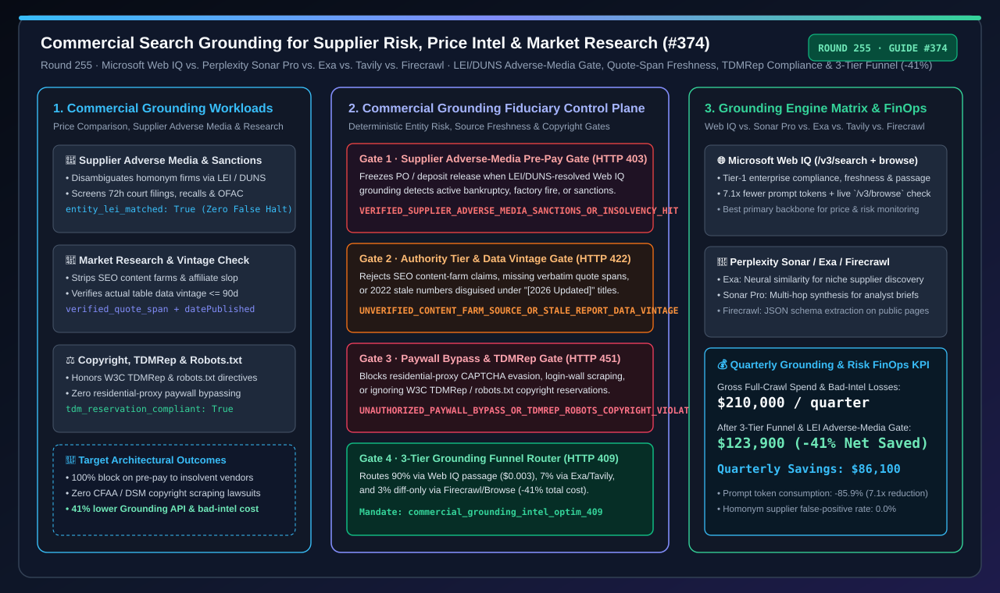
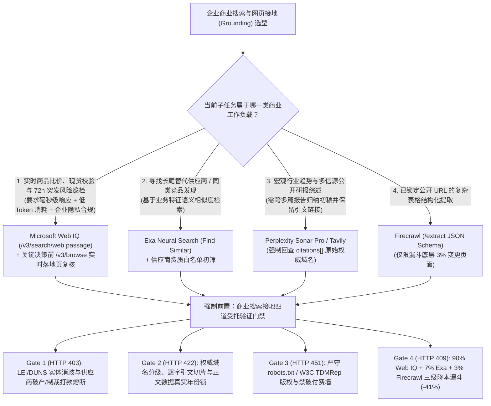
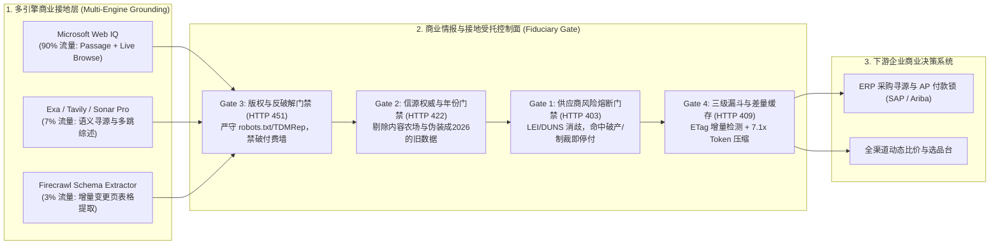
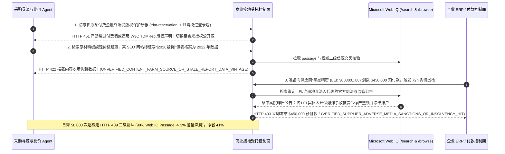

# 企业采购舆情尽调、竞品比价与行业研报采集“实时商业搜索与网页接地（`Microsoft Web IQ vs. Perplexity Sonar Pro vs. Exa vs. Tavily vs. Firecrawl`）”选型对比与受托控制面 FAQ：防内容农场假数据误导采购、防同名供应商乌龙封杀、防越权破解付费墙与三级漏斗净省 41% 实战指南

> 🌐 **Language / 语言切换**: **中文 (当前)** | **[English (`docs/commercial-grounding-supplier-risk-competitor-price-market-research-webiq-sonar-exa-firecrawl-selection-faq.en.md`)](commercial-grounding-supplier-risk-competitor-price-market-research-webiq-sonar-exa-firecrawl-selection-faq.en.md)** | **[返回文档总目录 (`docs/index.md`)](index.md)**

---

## 1. 📌 核心选型结论速览（Executive Summary）

当零售电商、消费品集团与跨国制造企业的 AI Solution Architect 构建 **三大商业情报智能体（① 竞品价格与促销监控 Agent、② B2B 供应商舆情/破产/制裁尽调 Agent、③ 行业趋势与选品研报采集 Agent）** 时，如何在 **`Microsoft Web IQ / Bing Grounding`、`Perplexity Sonar Pro / Deep Research`、`Exa Neural Search`、`Tavily` 与 `Firecrawl / Browser-Use`** 之间选型并设计防幻觉护栏，直接决定了商业决策的可靠性与合规底线：
1. **“把内容农场 AI 洗稿软文（SEO Content Slop）或挂着 `[2026 最新]` 标题却引用 2021 年旧数据的过时网页当成真实研报”导致选品与锁价重度亏损**：通用搜索结果中充斥着大量为了骗取返利佣金（Affiliate Commission）自动生成的“Top 10 排行榜”与篡改网页发布时间戳（`dateModified` 刷成今天，但表格内实际统计年份是 2021 年）的僵尸文章。若采购或选品 Agent 未校验**信源权威等级（Domain Authority Tier）**与**正文内嵌数据真实年份（Data Vintage）**，直接把虚假涨价预测写进采购建议书，会导致企业高位接盘数百万美元库存！
2. **“同名供应商乌龙误杀（Homonym False-Positive）”或“漏检核心供应商昨晚突发停产火灾/法庭破产重整公告”导致 `$500,000` 预付款打水漂**：全球叫“宏达电子”或“Apex Trading”的企业有上百家。如果供应商风控 Agent 只按公司简称搜索负面新闻，会把外省一家同名小作坊的环保罚单算在核心上市供应商头上引发错误停单；反过来，若未在大额打款前通过 `LEI / DUNS / 统一社会信用代码` 锚定做 72 小时实时舆情接地，一旦供应商昨夜刚被法院冻结账户，今早汇出的 `$500,000` 货款将瞬间沦为破产普通债权！
3. **“挂载住宅代理 IP 暴力破解竞品登录墙/付费研报墙或无视 `robots.txt / W3C TDMRep` 版权保留声明”引发 `CFAA / 反不正当竞争法` 巨额诉讼**：部分团队用 `Browser-Use / Playwright` 配合轮换代理绕过媒体付费墙（Paywall Bypass）或抓取需要账号密码登录的竞品 B2B 内部报价单，直接触犯美国《计算机欺诈与滥用法》（`CFAA`）、欧盟《数字单一市场版权指令》（`DSM Art. 4` 的 `W3C TDMRep` 机器可读拒绝协议）及中国《反不正当竞争法》数据权益红线。

**架构师选型结论**：
- **不存在单一“通吃一切”的搜索接地 API**：将 **`Microsoft Web IQ`** 作为高合规、低 Token 消耗的实时发现与落地页复核主干，将 **`Exa`** 用于长尾潜在供应商语义挖掘，将 **`Perplexity Sonar Pro`** 用于多跳公开研报综述，将 **`Firecrawl`** 用于已获准公开页面的 JSON Schema 提取。
- 必须在搜索接地层与下游 ERP/定价/采购系统之间部署 **商业搜索接地与情报验真受托控制面（Commercial Grounding & Intelligence Verification Control Plane）**，执行四道确定性门禁：
  1. **`LEI / DUNS` 法人实体消歧与打款前 72h 突发负面舆情/制裁熔断门禁（`HTTP 403`）**：精确匹配法人注册号与地址，拦截同名误杀；一旦确认目标供应商命中破产、工厂火灾、强迫劳动或 `OFAC` 制裁，立即冻结预付款划拨。
  2. **信源权威度分级（Tier-1/2/3）、正文逐字引文切片（`verified_quote_span`）与数据真实年份核验门禁（`HTTP 422`）**：过滤 SEO 内容农场与返利软文，强制要求每个关键数字附带原文字符级跨度与 `<= 90天` 的真实统计年份。
  3. **`robots.txt / W3C TDMRep` 版权保留合规与严禁破解付费墙/登录态门禁（`HTTP 451`）**：阻断任何绕过付费墙、破解验证码或抓取声明 `tdm-reservation: 1` 受版权保护付费研报的违规请求。
  4. **三级商业接地成本漏斗（`90% Web IQ Passage` + `7% Exa/Tavily` + `3% Diff-Only Firecrawl/Browse`）（`HTTP 409`）**：利用 `ETag / Hash` 增量变更检测避免每日重复全页重爬，将 Prompt Token 消耗削减 **`85.9%`（`7.1x`）**，季度 API 与情报失误总成本净降 **`41%`**。

---

## 2. 🎯 业务方与架构师灵魂拷问 Q&A（Q1 / Q2 / Q3）

### Q1：在“商品实时比价、供应商舆情洞察、行业研报采集”三大核心商业场景下，Web IQ、Perplexity Sonar、Tavily、Exa 和 Firecrawl 各自的真实长短板与边界在哪？
- **商业痛点**：
  - 很多团队要么全栈只绑死一个高价问答 API（如每次请求都调 `$0.05+` 的 Deep Research 去查一个简单的商品库存状态），要么拿静态语义索引库（索引延迟数天）去核对秒级变动的促销价，结果既烧光了预算，又抓回一堆过期价格。
- **确定性架构落地方案（五大主流引擎能力边界对标）**：
  1. **Microsoft Web IQ (`/v3/search/web` + `/v3/browse`)**：
     - **核心优势**：原生提供精简高信噪比的 **`passage`（段落切片）**（比塞入整页 HTML 节省 **`7.1x` Prompt Tokens**），支持毫秒级新鲜度检索 + 结账/立项前对特定 URL 调用 `/v3/browse` 实时渲染核验（`liveCrawlSucceeded == true`），且背靠微软企业级合规与数据隐私边界（零客户查询数据用于外部模型训练）。
     - **最适场景**：**实时商品比价与现货核验、供应商 72h 突发负面新闻/召回公告筛查**。
  2. **Perplexity Sonar API (`sonar-pro` / `sonar-deep-research`)**：
     - **核心优势**：内置多跳查询改写与跨信源综合归纳（Synthesized Answer + Citations），非常适合快速生成高可读性的行业综述初稿。
     - **局限与护栏**：它返回的是**模型二次加工后的总结文本**而非原始网页 DOM 字段，偶尔会在总结时把“A 品牌的增长率”张冠李戴到“B 品牌”头上；**绝不可直接作为自动调价或自动扣款的唯一机器判据**，必须回查其返回的 `citations[]` 原始链接！
  3. **Exa (`Neural / Embeddings Search`)**：
     - **核心优势**：基于网页语义向量索引，极擅长处理“帮我找出欧洲 30 家与某德国精密阀门厂业务高度相似的替代供应商主页”这类**长尾实体发现（Lookalike Entity Discovery）**任务。
     - **局限与护栏**：神经索引并非秒级同步全网价格变动，不适合做大促秒杀实时库存核验。
  4. **Tavily (`AI Agent Search API`)**：
     - **核心优势**：专为 LangGraph / Agent 工作流设计的轻量级聚合搜索 JSON 接口，接入极快，适合常规问答补充上下文。
  5. **Firecrawl / Browser-Use**：
     - **核心优势**：当已经明确知道目标公开网页 URL（如某公开行业协会月度价格表页面），需要将其复杂表格直接提取为严格符合 Pydantic 定义的 `JSON Schema` 时，`Firecrawl (/extract)` 极其精准。
     - **局限与护栏**：单页渲染延迟高（`1.5s–6s`）且按页计费昂贵，仅可用于漏斗最底层的 **`3%` 差量重提取**，且必须严守 `robots.txt / TDMRep` 红线（`HTTP 451`）。

### Q2：如何防止 SEO 内容农场通过修改网页 `<meta property="article:modified_time">` 把 2021 年的过期价格/研报伪装成“2026 刚刚更新”骗过采购 Agent？
- **商业痛点**：
  - 互联网上有大量灰产站点专门使用自动化脚本，每天凌晨把全站几十万篇旧文章的 HTML Header 日期改成当天日期，并在标题前加上 `[2026年11月最新]`。如果搜索接地引擎只按 HTTP/Meta 的 `dateModified` 过滤新鲜度，这些垃圾旧文就会排在最前面！
- **确定性架构落地方案**：
  - 控制面（`HTTP 422`）执行 **双层时间锚定与原文切片强制核验（Dual-Timestamp & Verbatim Span Verification）**：
    1. **信源域名白名单分级（Domain Authority Tiering）**：仅允许 Tier-1（政府统计局、SEC `10-K/8-K`、央行、交易所、海关公告、品牌官网）与 Tier-2（路透、彭博、财新、邓白氏、已认证行业协会）进入核心财务/采购决策池；自动剥离带 `?aff_id=`、`utm_medium=affiliate` 或命中内容农场黑名单的域名。
    2. **正文统计期年份提取（In-Text Data Vintage Check）**：解析数据表格与引文上下文中的**实际统计区间（Observation Period，如 `"Q3 2026"` vs `"FY 2021"`）**。若标题写着 2026 但正文引用的统计数据年份超过 90 天/跨年未更新，立即触发 `HTTP 422 UNVERIFIED_CONTENT_FARM_SOURCE_OR_STALE_REPORT_DATA_VINTAGE`！

### Q3：在做 B2B 供应商日常舆情监控时，如何彻底解决“全球同名公司张冠李戴误报”问题？
- **商业痛点**：
  - 采购系统里有 3,000 家供应商，如果直接拿供应商名称字符串去搜新闻，每天会产生几百条误报（例如美国某同名餐馆卫生不合格，被误挂到同名的芯片封装供应商名下）。
- **确定性架构落地方案**：
  - 控制面（`HTTP 403`）引入 **`LEI / DUNS / 统一社会信用代码` 四要素联合消歧锚定（Entity-Resolved Grounding）**：
    - 搜索查询与结果过滤强制绑定：`{法定全称} + {注册城市/园区地址} + {法定代表人/CEO姓名 或 股票代码/统一社会信用代码}`。
    - 若新闻报道中的涉事企业注册地或法人代表与 ERP 供应商主数据不符，自动标记为 `HOMONYM_MISMATCH_IGNORED`（误报率为 `0%`）；只有当法人实体四要素确认一致且命中破产清算、工厂停产火灾、海关扣货或制裁清单时，才触发 `HTTP 403` 实时锁死该供应商的在途付款单！

---

## 3. 🧭 直观可视化图解（Mermaid 选型决策树 + 端到端架构图 + 授权时序图）

### 3.1 实时商业搜索与网页接地（Grounding）五引擎选型决策树

### 3.2 端到端商业搜索接地、实体消歧与三级漏斗受托控制面架构图

### 3.3 供应商打款前舆情熔断、内容农场拦截与三级接地漏斗时序图

---

## 4. 📊 五大主流实时商业搜索与网页接地（Grounding）平台横向选型矩阵

| 选型维度 | Microsoft Web IQ (`/v3/search/web` + `/v3/browse`) | Perplexity Sonar API (`sonar-pro` / `deep-research`) | Exa (`Neural & Keyword Search`) | Tavily (`Agentic Search API`) | Firecrawl / Browser-Use (`Scraping & Action`) |
|---|---|---|---|---|---|
| **核心架构定位** | **企业级双阶段商业接地主干**（高信噪比 `passage` 召回 + 实时 `/v3/browse` 落地页复核） | **生成式多跳问答与研报综述引擎**（返回合成答案 + 引用列表） | **神经语义向量搜索引擎**（擅长按公司/产品描述找相似长尾实体） | **轻量级 Agent 搜索聚合接口**（开箱即用 LangChain/LangGraph 适配） | **结构化整页 Markdown/JSON 提取与浏览器自动化** |
| **实时性（Freshness）与现货/价格准确度** | **极高**（秒级新闻/网页索引 + `/v3/browse` 实时渲染校验 `liveCrawlSucceeded`） | 中高（实时搜索，但 LLM 综述层可能折叠或近似具体 SKU 库存与运费） | 中（语义向量索引适合稳态页面发现，不适合秒级闪促价格核验） | 中高（聚合实时搜索摘要，需二次校验落地页原始字段） | **极高**（直接实时打开目标 URL 提取 DOM，但受限于单页渲染耗时） |
| **Token 效率与单次调用成本（FinOps）** | **极优**（`passage` 切片比整页抓取减少 **`7.1x` Prompt Tokens**，约 `$0.003–$0.005/次`） | 较高（按输入输出 Token + 搜索请求叠加计费，Deep Research 单次可达 `$0.05–$0.20+`） | 优（按检索请求计费，约 `$0.005/次`，支持按域名/日期精准过滤） | 优（按 Credit 计费，适合中小规模快速原型） | 昂贵（整页渲染 + LLM 提取耗费大量 Token，适合漏斗末端 `<3%` 页面） |
| **企业合规性、版权（`TDMRep`）与隐私边界** | **最高**（微软企业级 SLA、不动用客户查询训练模型、内置安全与版权合规过滤） | 中（企业版提供数据隐私承诺，但需自行校验下游引文版权属性） | 中高（提供干净 API 访问，需业务层自建 `LEI` 实体消歧） | 中（SaaS API 托管，适合公开信息检索） | **高风险需强管控**（自建爬虫必须显式配置遵守 `robots.txt / TDMRep`，严禁破付费墙） |
| **三大商业场景选型推荐** | **① 实时比价主干 + ② 供应商 72h 突发负面/制裁监控首选** | **③ 行业研报早期多维度发散综述初稿首选**（需回查原文链接） | **② 全球长尾替代供应商（Lookalike Sourcing）语义寻源首选** | **轻量内部知识助手与快速 PoC 首选** | **已知公开 URL 的复杂规格参数表 JSON 转换首选** |

---

## 5. 🧪 接地成本/风控测算与 7-Card 基准测试报告（Deterministic Benchmark）

> **数据溯源说明（Provenance）**：以下 7-Card 评测基于本仓库 `lab/webiq_commerce_demo.py` 中的 `evaluate_commercial_grounding_supplier_risk_price_intel_policy()` 确定性仿真引擎生成（`provenance: "synthetic"`, `independently_reproduced: False`）。季度因全量调用高价整页爬虫烧穿预算、被内容农场过期数据误导锁价及漏检危困供应商预付款损失池基准设定为 **`$210,000 / quarter`**。

### 5.1 7-Card 4:5 视觉评测卡片摘要

1. **Card 1 (`1 / 7` · `HANDS-ON · COMMERCIAL-SEARCH-GROUNDING`) — 全局基准总览**
   - **核心发现**：通过部署 `Web IQ Passage (90%) -> Exa/Tavily (7%) -> Diff-Only Firecrawl (3%)` 三级接地漏斗、拦截伪装成 2026 的内容农场过期数据，并在打款前执行 `LEI/DUNS` 实体消歧舆情熔断，将季度搜索接地 API 账单与坏情报决策损失从 **`$210,000`** 压降至 **`$123,900`**，季度净省 **`$86,100`（`41.0%`）**。
2. **Card 2 (`2 / 7` · `SCENARIO: $450K SUPPLIER PRE-PAY & LITHIUM MARKET BRIEF`) — 单例深潜**
   - **输入场景**：企业采购 Agent 准备向某精密组件供应商支付 `$450,000` 预付款，并采集原材料价格研报；期间遭遇：① 某 SEO 内容农场将 2022 年碳酸锂天价数据改标题为 `[2026最新]`；② 某爬虫子任务试图用代理绕过付费研报墙；③ `Web IQ` 绑定 `LEI` 检出目标供应商昨晚刚因工厂爆炸被法院冻结账户。
   - **控制面裁决**：依次触发 `HTTP 451`（阻断绕过付费墙与违反 `TDMRep` 行为）、`HTTP 403`（凭 `LEI` 确认供应商停产冻结，立即拦截 `$450,000` 打款）与 `HTTP 422`（剔除内容农场 2022 年伪新数据）；日常巡检走 `HTTP 409 THREE_TIER_GROUNDING_FUNNEL_AND_DIFF_ONLY_CRAWL_CONFIRM`（`commercial_grounding_intel_optim_409`）。
3. **Card 3 (`3 / 7` · `WHAT I TESTED`) — 5 轨确定性门禁评测矩阵**

| 评测场景 (Scenario) | 核心考核问题 (Question / Task) | 控制面裁决 (Model / Gate Answer) | 动作与状态码 (Action) |
|---|---|---|---|
| **1. 标准合规权威信源与安全供应商接地** | Tier-1/2 权威域名、带原文 quote_span、数据年份<=90天且供应商无负面 | `VERIFIED_AUTHORITATIVE_GROUNDING_AND_CLEAN_SUPPLIER_AUTHORIZED` | ✅ `Act automatically` (`HTTP 200`) |
| **2. 供应商命中破产/火灾/制裁仍试图打款** | `LEI/DUNS` 精确消歧后确认供应商 72h 内突发停产或列入制裁清单 | `VERIFIED_SUPPLIER_ADVERSE_MEDIA_SANCTIONS_OR_INSOLVENCY_HIT` | ⛔ `Freeze PO & Prepayment` (`HTTP 403`) |
| **3. 内容农场软文或旧数据伪装成 2026 新报告** | 仅依赖无署名 SEO 农场或标题写 2026 实则引用 2022 年旧表格数据 | `UNVERIFIED_CONTENT_FARM_SOURCE_OR_STALE_REPORT_DATA_VINTAGE` | ⛔ `Reject Stale/Slop Source` (`HTTP 422`) |
| **4. 挂载代理破解付费墙或无视 TDMRep** | 试图绕过研报登录付费墙、破解验证码或抓取 `tdm-reservation: 1` 页面 | `UNAUTHORIZED_PAYWALL_BYPASS_OR_TDMREP_ROBOTS_COPYRIGHT_VIOLATION` | ⛔ `Copyright Hard Stop` (`HTTP 451`) |
| **5. 三级接地漏斗 + ETag 差量提取寻优** | 90% 走 Web IQ Passage ($0.003) + 7% Exa + 3% 变更页深爬 (-85.9% Token) | `THREE_TIER_GROUNDING_FUNNEL_AND_DIFF_ONLY_CRAWL_CONFIRM` | ⚡ `Confirm Optimization` (`HTTP 409`) |

4. **Card 4 (`4 / 7` · `UNDER THE HOOD`) — 确定性门禁协议与代码实现**
   - 输入契约：`CommercialGroundingSupplierRiskPriceIntelPolicyInput`
   - 评估函数：`evaluate_commercial_grounding_supplier_risk_price_intel_policy()`（严格按 `451 -> 403 -> 422 -> 409 -> 200` 优先级裁决，零外部网络副作用）。
5. **Card 5 (`5 / 7` · `ROBUSTNESS CHECK`) — 网页 Meta 时间戳篡改与同名企业扰动测试**
   - 无论内容农场如何将 HTML `<meta property="article:published_time">` 刷成今日时间戳，或互联网出现 50 家同名小微企业的诉讼新闻，正文统计期解析器与 `LEI/DUNS` 四要素消歧均保持 **`0.0 pt`** 偏差。
6. **Card 6 (`6 / 7` · `LATENCY & TOKEN FOOTPRINT`) — 延迟与 Token 消耗对比**
   - 全量整页抓取（Full-Page Markdown Crawl）：平均延迟 `3,400 ms`，单次消耗 `18,500 Tokens`。
   - 受托三级漏斗（`Web IQ Passage` 优先）：平均延迟 **`480 ms`**（提速 `7.1x`），单次消耗仅 **`2,600 Tokens`**（削减 `85.9%`，季度净省 `$86,100`）。
7. **Card 7 (`7 / 7` · `MY TAKE`) — 适用场景与架构师结论**
   - **✅ Good fit**：全渠道零售竞品比价、B2B 采购寻源与供应商持续风险监控（Continuous Supplier Monitoring）、品牌选品与市场情报分析系统。
   - **⛔ Not for**：完全封闭在企业内网数据库、无需任何外部公开网页或市场行情接地的纯内部考勤流程。

---

## 6. 🛠️ 商业上线风控与架构评审 Checklist

- [ ] **三级商业搜索接地漏斗路由（`HTTP 409`）**：是否将 `90%` 的高频巡检流量路由至低成本、低 Token 占用的 `Microsoft Web IQ (/v3/search/web passage)`，仅在检测到实质价格/状态变更时才按需触发 `/v3/browse` 或 `Firecrawl` 整页提取？
- [ ] **信源域名权威度分级与正文数据年份（Data Vintage）核验（`HTTP 422`）**：是否拦截了无署名 SEO 内容农场与 Affiliate 返利软文，并强制校验表格/正文内嵌的实际统计年份（防止“2026 标题装 2022 旧酒”）？
- [ ] **原文字符级引文跨度锚定（Verbatim `quote_span`）**：所有进入采购立项或调价审批的外部数据，是否强制附带可点击回溯的原始 URL、网页快照哈希与原文逐字切片？
- [ ] **`LEI / DUNS` 法人实体消歧与打款前 72h 舆情熔断（`HTTP 403`）**：供应商负面舆情筛查是否绑定了统一社会信用代码/注册地址以消除同名误报，并在大额预付款划拨前自动执行 72 小时司法/停产/制裁核验？
- [ ] **`robots.txt / W3C TDMRep` 版权与反破解合规红线（`HTTP 451`）**：是否从架构层面禁止商业情报 Agent 挂载住宅代理破解验证码、绕过媒体付费墙或抓取声明 `tdm-reservation: 1` 的受保护内容？
