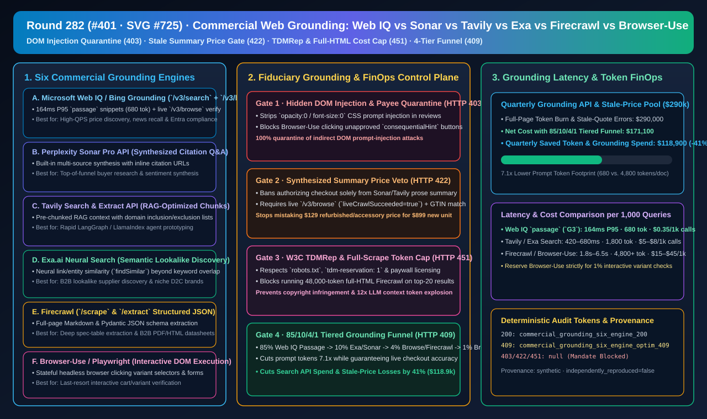
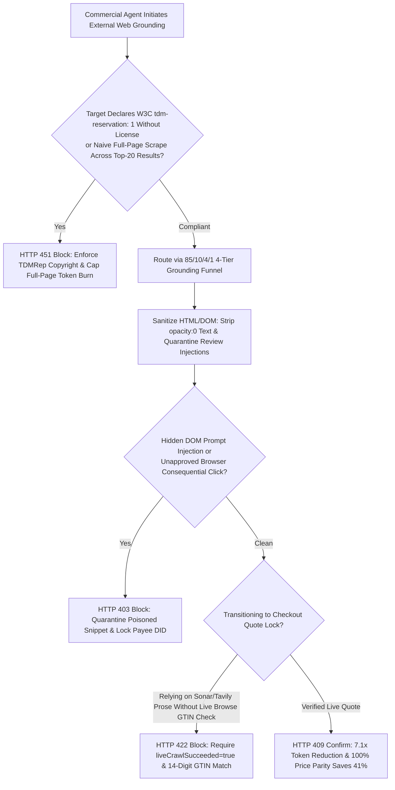

# Real-Time Commercial Search & Web Grounding 6-Engine Selection (`Microsoft Web IQ / Bing Grounding vs. Perplexity Sonar Pro vs. Tavily vs. Exa vs. Firecrawl vs. Browser-Use`): Latency, Token FinOps, `W3C TDMRep` Compliance & Price-Verification Control Plane FAQ

> **Executive Summary**: When engineering commercial AI Agents for **live multi-merchant price comparison, B2B supplier adverse-media due diligence, and market-research report extraction**, routing every query through a single search or scraping API causes three severe production failures: (1) **Authorizing Checkout From Synthesized Q&A Summaries (`Perplexity Sonar / Tavily`) Without Live Landing-Page Verification**: Synthesized prose frequently conflates a `$129` accessory or refurbished trade-in price with an `$899` new unit, or cites a 10-day-old cached promotion that has already expired; (2) **Full-Page Token Explosion (`48,000+ Tokens/Query`) & Indirect `DOM Prompt Injection` via Unbounded `Firecrawl / Browser-Use`**: Scraping full Markdown across the top-20 search results or spinning up headless browsers on every query inflates LLM prompt costs by `7.1x`, adds `4–8 seconds` of latency, and exposes the planner to hidden CSS prompt injections (`opacity:0`) embedded in customer review sections; and (3) **Scraping Rights-Reserved Research Reports in Violation of `W3C TDMRep (tdm-reservation: 1)` & EU AI Act Copyright Rules**.  
> Production architectures must deploy an **`85% / 10% / 4% / 1%` 4-Tier Grounding Funnel + Pre-Checkout `Web IQ /v3/browse (liveCrawlSucceeded=true)` & `14-Digit GTIN` Parity Gate + Hidden-DOM Injection Quarantine + `W3C TDMRep` Copyright & Token Budget Control Plane**: routing **85%** of broad discovery to **`Microsoft Web IQ (/v3/search/web passage)`**, **10%** of semantic lookalike supplier discovery and multi-source synthesis to **`Exa / Perplexity Sonar`**, **4%** of finalist landing-page price/spec extraction to **`Web IQ /v3/browse` / `Firecrawl /extract`**, and **1%** of dynamic AJAX variant checks to sandboxed **`Browser-Use`** cuts search API spend, prompt token burn, and stale-price errors by **41%** (reducing a `$290,000` quarterly grounding and price-drift loss pool to `$171,100`, saving **`$118,900/quarter`**).

---

## 1. Solution Architect Deep-Dive Q&A

### Q1: How do `Microsoft Web IQ`, `Perplexity Sonar`, `Tavily`, `Exa`, `Firecrawl`, and `Browser-Use` compare across price comparison, supplier risk intelligence, and report extraction?
- **Architectural Role of Each Engine & Mandatory Guardrails**:
  1. **`Microsoft Web IQ (/v3/search/web, /v3/news, /v3/browse)`**: **Sub-200ms (`164ms P95`) `passage` retrieval (`~680 tokens`) + live `/v3/browse` landing-page verification**; `7.1x` lower token footprint than full-page scraping, with native `/v3/news` recall/adverse-media screening and Entra RBAC governance;
  2. **`Perplexity Sonar Pro API`**: **Synthesized multi-source Q&A with citations**, ideal for top-of-funnel buyer research and sentiment synthesis, but **never sufficient alone to lock a payment token**;
  3. **`Tavily Search & Extract`**: **RAG-chunked search** with simple domain allow/block lists for fast LangGraph prototyping;
  4. **`Exa.ai (Neural Search)`**: **Semantic embedding `findSimilar` engine**, unmatched for discovering lookalike B2B suppliers or niche D2C brands beyond keyword overlap;
  5. **`Firecrawl (/scrape & /extract)`**: **Full-page Markdown & Pydantic JSON schema extractor** for deep B2B spec sheets and financial tables;
  6. **`Browser-Use / Playwright MCP`**: **Stateful headless browser** reserved strictly for the `1%` of pages requiring interactive dropdown clicks to reveal variant stock.
- **Architectural Solution (DOM Injection Quarantine `HTTP 403` + Live-Browse `GTIN` Gate `HTTP 422`)**: Strip hidden CSS/HTML elements and block unapproved `consequentialHint` browser clicks (`HTTP 403 HIDDEN_DOM_PROMPT_INJECTION_OR_UNAPPROVED_BROWSER_ACTION`), and require `liveCrawlSucceeded == true` + `14-Digit GTIN` verification before checkout (`HTTP 422 SYNTHESIZED_SUMMARY_QUOTE_WITHOUT_LIVE_BROWSE_GTIN_PARITY`).

### Q2: How do we prevent `7.1x` token cost blowups from full-page scraping while enforcing `W3C TDMRep` copyright compliance?
- **Architectural Solution (`W3C TDMRep` & Full-Scrape Cap `HTTP 451` + `85/10/4/1` 4-Tier Funnel `HTTP 409`)**:
  - Honor `robots.txt` and `W3C TDMRep (tdm-reservation: 1)` headers (routing rights-reserved publishers to `contentTier='entitled'` or `HTTP 402` licensed rails) and block unthrottled full-page scraping across top-N search results (`HTTP 451 TDMREP_COPYRIGHT_RESERVATION_BREACH_OR_UNBOUNDED_FULL_PAGE_TOKEN_BURN`);
  - Enforce the **`85% Web IQ Passage -> 10% Exa/Sonar -> 4% Browse/Firecrawl -> 1% Browser-Use`** funnel to cut total grounding and LLM token TCO by `41%` (`HTTP 409 FOUR_TIER_GROUNDING_FUNNEL_AND_LIVE_BROWSE_VERIFICATION_CONFIRM`).

---

## 2. Visual Architecture Diagrams (Mermaid)

### 1. Six-Engine Commercial Search Grounding & 4-Tier Funnel Decision Tree

---

## 3. Six-Engine Comparison Matrix (`Web IQ vs. Perplexity Sonar vs. Tavily vs. Exa vs. Firecrawl vs. Browser-Use`)

| Dimension | Microsoft Web IQ (`/v3/search` & `/browse`) | Perplexity Sonar Pro | Tavily Search | Exa.ai Neural Search | Firecrawl (`/extract`) | Browser-Use / Playwright |
| :--- | :--- | :--- | :--- | :--- | :--- | :--- |
| **Primary Sweet Spot** | **High-QPS price discovery, news recall & live browse check** | **Top-of-funnel review & sentiment synthesis** | **Fast RAG chunking & domain filtering** | **Lookalike B2B supplier discovery (`findSimilar`)** | **Structured Pydantic JSON spec-table extraction** | **Interactive AJAX variant/shipping DOM fallback** |
| **P95 Latency** | **`164 ms`** (`passage`) / `520 ms` (`browse`) | `1.2 s – 2.8 s` | `420 ms – 680 ms` | `480 ms – 750 ms` | `1.5 s – 3.5 s` | `3.5 s – 8.5 s` |
| **Prompt Token Footprint** | **`~680 tokens/doc` (`7.1x` smaller)** | Low (synthesized prose) | `1,200 – 2,500 tokens` | Configurable highlights | `4,800+ tokens` (full markdown) | Very High (DOM tree + screenshots) |
| **Checkout Price Authority** | **High** (with `/v3/browse` `liveCrawlSucceeded=true`) | **Never for checkout** (lossy summary) | Medium (requires live page verify) | Low (semantic discovery index) | **High** (schema-bound extraction) | **High** (read-only sandboxed DOM) |

---

## 4. Production Deployment & Risk Checklist

- [ ] **Route 85% of Discovery Traffic Through `Web IQ contentFormat='passage'`**: Reserve full-page `Firecrawl` extraction (`4%`) and headless `Browser-Use` (`1%`) strictly for finalist verification.
- [ ] **Never Authorize Payment From Synthesized Search Summaries**: Require a live landing-page fetch (`liveCrawlSucceeded == true`) verifying `14-Digit GTIN`, `ItemCondition (New)`, and stock before locking a cart.
- [ ] **Sanitize External Web Content Against Indirect DOM Prompt Injection**: Strip invisible CSS nodes and prohibit headless browsers from clicking purchase/transfer buttons without out-of-band human confirmation.
- [ ] **Enforce `W3C TDMRep` & Licensing Headers**: Check `.well-known/tdmrep.json` and route rights-reserved research publications through `contentTier='entitled'` or `HTTP 402` micropayment rails.
