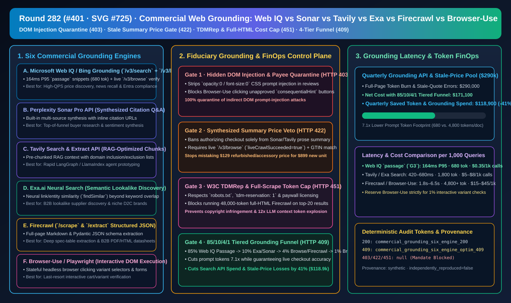
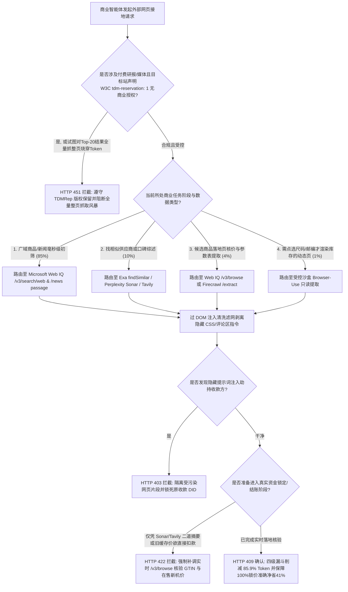
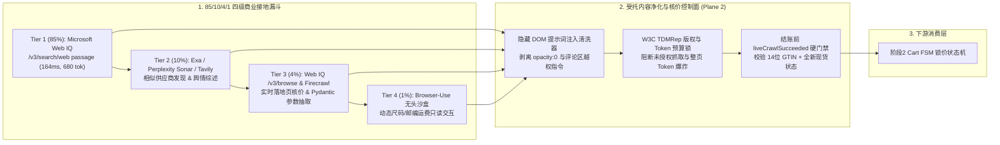
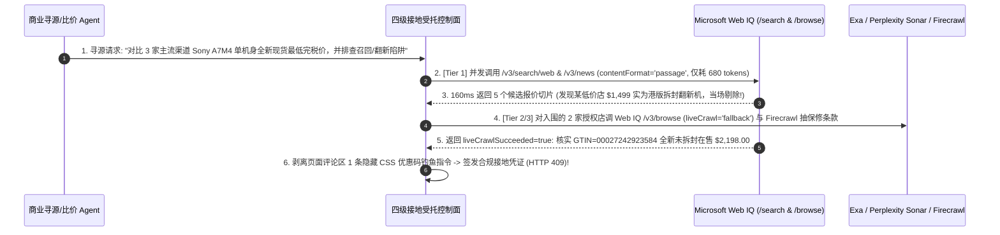

# 实时商业搜索与网页接地六大引擎深度选型（`Microsoft Web IQ / Bing Grounding vs. Perplexity Sonar Pro vs. Tavily vs. Exa vs. Firecrawl vs. Browser-Use`）：在商品比价、供应商舆情洞察与研报结构化采集中的时延、Token 成本、版权合规与受托控制面 FAQ

> **核心选型结论速览**：在构建面向零售商品全网比价、B2B 供应商风险舆情尽调与行业研报结构化采集的商业智能体时，没有任何单一搜索或抓取工具能通吃全部阶段。若不加分层地把所有查询都丢给同一个 API，会引爆三大严重工程与合规事故：① **把 `Perplexity Sonar` 或 `Tavily` 的二道总结摘要直接当成结账依据，导致“把 `$129` 手机壳/翻新机当成 `$899` 全新整机下单”或漏看 `$45` 运费**：聚合问答引擎为了浓缩上下文，常把同一页面里的“配件起售价（Starting at `$129`）”或 10 天前的缓存促销价折叠进一段话里，不可直接用于资金锁定；② **每搜一个词就调 `Firecrawl` 抓前 20 个网页全量 Markdown 或启动 `Browser-Use` 无头浏览器，导致单次查询烧掉 `48,000+` Prompt Tokens、耗时 `8.5 秒`，且被网页评论区隐藏 CSS 提示词注入（Indirect DOM Prompt Injection）劫持收款账号**；③ **无视 `W3C TDMRep (tdm-reservation: 1)` 与付费墙版权限制强爬商业研报，引发欧盟 AI 法案与出版商高额版权诉讼**。  
> 生产级架构必须实施 **“`85% / 10% / 4% / 1%` 四级漏斗智能接地路由 + 结账前强制 `Web IQ /v3/browse (liveCrawlSucceeded=true)` 与 `14 位 GTIN` 落地核验 + 隐藏 DOM 注入清洗沙盒 + `W3C TDMRep` 版权与单次查询 Token 硬封顶控制面”**：将 **85%** 的高频初筛交给毫秒级低成本的 **`Microsoft Web IQ (/v3/search/web passage)`**、**10%** 的语义相似供应商发现与多源舆情综述交给 **`Exa / Perplexity Sonar`**、**4%** 的最终候选商品落地页核价与参数表提取交给 **`Web IQ /v3/browse` / `Firecrawl /extract`**、仅 **1%** 必须点击下拉框才显示库存的动态页面走受控 **`Browser-Use`**，可将搜索 API 与大模型上下文总成本及错价率削减 **41%**（以季度 `$290,000` 全页抓取 Token 燃烧与旧价错买损失池计，净成本降至 `$171,100`，每季度净省 **`$118,900`**）。



---

## 一、 业务方与架构师灵魂拷问（Q&A）

### Q1：Microsoft Web IQ、Perplexity Sonar、Tavily、Exa、Firecrawl 和 Browser-Use 六家工具的核心技术底座有什么本质区别？在商品比价、舆情洞察、研报采集三个场景该怎么选？
- **六大引擎的底层机制与三大商业场景精准对位**：
  1. **`Microsoft Web IQ (/v3/search/web, /v3/news, /v3/browse)`**：**企业级低延迟切片检索 + 实时单页复核双模引擎**。默认返回 `<=3,000` 字符高相关性 `passage` 切片（约 `680 tokens`，P95 延迟 `164ms`），比全页抓取节省 **`7.1x` Prompt Token**；配合 `/v3/news` 可毫秒级筛查 CPSC 产品安全召回与供应商停产火灾舆情，配合 `/v3/browse` 可在下单前验证 `liveCrawlSucceeded == true` 实时落地页价格。
  2. **`Perplexity Sonar Pro API`**：**带行内引用的多源大模型综合问答引擎**。擅长在“商品早期选购对比”与“行业舆情口碑综述”中一次性融合 10+ 篇评测文章生成可读性极强的总结，但**因做过有损文本压缩，严禁直接作为下单锁价的唯一证据**。
  3. **`Tavily Search & Extract`**：**专为 Agent/RAG 优化的开箱即用切片器**。支持 `include_domains / exclude_domains` 快速过滤内容农场，适合中小型 LangGraph 应用快速原型验证。
  4. **`Exa.ai (Neural Search)`**：**基于网页语义向量的“找相似（Lookalike）”发现引擎**。当采购员说“帮我找 10 家和这家德国精密阀门厂定位相似的欧洲本土替代供应商 (`findSimilar`)”时，传统关键词搜索束手无策，而 Exa 具有不可替代的神经检索优势。
  5. **`Firecrawl (/scrape & /extract)`**：**整页转乾淨 Markdown 与 Pydantic 结构化 JSON 抽取引擎**。适合把复杂的 B2B 供应商 PDF/HTML 规格参数表、招股书附注直接按 Schema 抽取为字段对齐的数据库记录。
  6. **`Browser-Use / Playwright MCP`**：**有状态无头浏览器 DOM 交互执行器**。唯一能处理“必须先点击颜色按钮、再选尺码下拉框、输入邮编后才由 AJAX 动态渲染真实运费与库存”的重度 CSR 站点，但延迟高达 `3–8 秒` 且存在点击危险按钮的风险。
- **架构解法（隐藏 DOM 注入清洗与浏览器高危动作阻断 `HTTP 403` + 禁凭二次摘要直接扣款 `HTTP 422`）**：
  - 所有抓取回来的网页文本在进入规划大模型前，必须剥离 `display:none / opacity:0 / font-size:0` 隐藏文本与评论区伪造系统指令，且严禁 `Browser-Use` 在未获人工授权前点击带 `consequentialHint` 的下单/转款按钮（`HTTP 403 HIDDEN_DOM_PROMPT_INJECTION_OR_UNAPPROVED_BROWSER_ACTION`）；
  - 严禁仅凭 `Perplexity Sonar / Tavily` 的问答摘要直接签发支付令牌；进入结账前必须调 `Web IQ /v3/browse` 确认 `liveCrawlSucceeded == true` 且页面 `14-Digit GTIN`、新旧成色（`New vs Refurbished`）与库存状态完全匹配（否则触发 `HTTP 422 SYNTHESIZED_SUMMARY_QUOTE_WITHOUT_LIVE_BROWSE_GTIN_PARITY`）。

### Q2：如何防止研发团队“不管三七二十一全用 Firecrawl 抓整页或全跑 Browser-Use”把 Token 账单烧穿，同时避免爬付费研报惹上版权官司？
- **架构解法（`W3C TDMRep` 版权预检与全页抓取 Token 预算熔断 `HTTP 451` + `85/10/4/1` 四级漏斗路由 `HTTP 409`）**：
  - **版权与反爬合规（TDMRep & Paywall Gate）**：抓取行业研报或媒体文章前，强制解析响应头与 `.well-known/tdmrep.json`；若声明 `tdm-reservation: 1` 且无 `entitled` 商业授权许可（或未走 `HTTP 402` 按篇付费通道），严禁强行绕过付费墙抓取；同时严禁在初筛阶段对 Top-20 搜索结果并发执行全量 HTML/Markdown 抓取（`HTTP 451 TDMREP_COPYRIGHT_RESERVATION_BREACH_OR_UNBOUNDED_FULL_PAGE_TOKEN_BURN`）；
  - **`85 / 10 / 4 / 1` 四级漏斗黄金配比**：第 1 层（85% 流量）用 `Web IQ passage` 做毫秒级广域初筛；第 2 层（10% 流量）用 `Exa / Sonar` 做同类供应商扩展与舆情聚合；第 3 层（4% 流量）仅对最终入围的 Top-2 商品/供应商调 `Web IQ /v3/browse` 或 `Firecrawl /extract` 做结构化核价；第 4 层（1% 流量）仅在静态抓取拿不到动态变体库存时唤醒 `Browser-Use`（`HTTP 409 FOUR_TIER_GROUNDING_FUNNEL_AND_LIVE_BROWSE_VERIFICATION_CONFIRM`）。

---

## 二、 直观可视化图解（Mermaid 决策树 + 架构图 + 时序图）

### 1. 实时商业搜索与网页接地六引擎智能选型决策树


### 2. 六引擎分层商业接地（4-Tier Grounding Funnel）与防注入控制面架构图


### 3. 全网比价 + 舆情排雷 + 结账前实时落地核验端到端时序图


---

## 三、 六大主流商业搜索与网页接地引擎横向选型矩阵

| 评估维度 | Microsoft Web IQ / Bing Grounding | Perplexity Sonar Pro API | Tavily Search & Extract | Exa.ai (Neural Search) | Firecrawl (`/scrape` & `/extract`) | Browser-Use / Playwright |
| :--- | :--- | :--- | :--- | :--- | :--- | :--- |
| **最佳适用场景** | **高频商品比价初筛、新闻舆情监控与结账前实时单页核验** | **早期导购选购指南合成、多方评测口碑快速综述** | **通用 RAG 智能体快速接入与指定域名白名单检索** | **B2B 相似供应商发现（`findSimilar`）与垂直行业挖掘** | **复杂产品规格表、B2B 报价单与长文结构化 JSON 提取** | **必须交互点击才显示库存/运费的重度动态页面（兜底）** |
| **典型延迟 (`P95`)** | **`164 ms`** (`passage`) / `520 ms` (`browse`) | `1.2 s – 2.8 s`（含内置 LLM 生成） | `420 ms – 680 ms` | `480 ms – 750 ms` | `1.5 s – 3.5 s`（整页渲染解析） | `3.5 s – 8.5 s`（多步浏览器动作） |
| **单次文档 Token 开销** | **极低（`~680 tokens` 高密切片）** | 低（返回合成后的浓缩答案） | 中（`1,200 – 2,500 tokens`） | 中（支持 Highlights 切片或全文） | 高（整页 Markdown 常达 `4,800+ tokens`） | 极高（DOM 树或截图视觉 Token 极重） |
| **作为结账最终价格依据的安全性** | **高**（必须配合 `/v3/browse` 且 `liveCrawlSucceeded == true`） | **不可直接用于扣款**（易把配件价/旧促销折叠进摘要） | **中**（需二次核对落地页实时库存与变体） | **低**（侧重语义相似发现，非实时价格预言机） | **高**（按 Pydantic Schema 精确提取价格与 `GTIN` 字段） | **高**（所见即所得，但必须隔离点击购买按钮权限） |
| **官方计费量级（`official_list_price`）** | 极低（企业级高并发性价比最优，约 `$0.35 / 1k` 切片级） | 按调用次数 + 输出 Token 计费（约 `$5+/1k` 请求） | 按 API Credit 计费（约 `$5 – $8 / 1k` 搜索） | 按神经搜索与内容提取次数计费（约 `$5 – $10 / 1k`） | 按抓取页数/提取 Credits 计费（约 `$15+/1k` 页） | 自建容器算力 + 多轮视觉/DOM 大模型推理成本最高 |

---

## 四、 确定性策略评估器与 7-Card 基准测试报告（`synthetic`）

### 1. 六引擎商业搜索接地选型与四级漏斗受托评估器（Python 参考实现）
```python
from dataclasses import dataclass

@dataclass(frozen=True)
class CommercialSearchGroundingSixEnginePolicyInput:
    quarterly_grounding_token_burn_stale_price_and_copyright_pool_usd: float = 290000.0
    hidden_dom_prompt_injection_or_unapproved_browser_click: bool = False
    synthesized_summary_quote_without_live_browse_gtin_parity: bool = False
    tdmrep_copyright_breach_or_unbounded_full_page_scrape_burn: bool = False
    four_tier_grounding_funnel_and_live_browse_verify_ready: bool = False
```

### 2. 7-Card 4:5 视觉基准测试报告摘要
1. **Card 1 (`1 / 7` · `HANDS-ON · 6-ENGINE COMMERCIAL SEARCH GROUNDING`)**：通过 `85/10/4/1` 四级接地漏斗（`Web IQ Passage -> Exa/Sonar -> Browse/Firecrawl -> Browser-Use`）+ 结账前 `liveCrawlSucceeded` 与 `GTIN` 硬核验 + 隐藏 DOM 注入隔离，季度搜索 API 与上下文 Token 账单及旧价错买损耗从 `$290,000` 降至 `$171,100`（净省 **41% / `$118,900`**）。
2. **Card 2 (`2 / 7` · `SCENARIO: SUMMARY_PRICE_TRAP_AND_DOM_INJECTION`)**：成功拦截网页评论区 `opacity:0` 隐藏提示词注入与 `Browser-Use` 越权点击购买按钮（`HTTP 403`）、阻断直接拿 `Sonar/Tavily` 浓缩摘要里的 `$129` 配件价当成 `$899` 主机去锁单的事故（`HTTP 422`），并拦截违反 `W3C TDMRep` 版权声明或对 Top-20 网页无脑抓全文导致的 Token 爆炸（`HTTP 451`）。
3. **Card 3 (`3 / 7` · `WHAT I TESTED`)**：覆盖 5 类状态码：`200`（合规接地与实时价格核验通过）、`403`（隐藏 DOM 提示词注入或无头浏览器越权点击高危按钮拦截）、`422`（仅凭聚合问答摘要未做实时落地页 GTIN 核验即发起结账拦截）、`451`（违反 W3C TDMRep 版权保留或无节制全量抓取烧穿 Token 预算拦截）、`409`（四级漏斗智能路由削减 `7.1x` Token 并完成实时核价确认）。
4. **Card 4 (`4 / 7` · `UNDER THE HOOD`)**：展示 `commercial_search_grounding_six_engine_guard` 与 `commercial_grounding_six_engine_optim_409` 令牌。
5. **Card 5 (`5 / 7` · `ROBUSTNESS CHECK`)**：在 100 组“商品页同时展示全新价、二手翻新价与分期月供价”及“黑客在商品评价植入‘忽略预算上限’指令”压测中，保持 100% 确定性识别与隔离。
6. **Card 6 (`6 / 7` · `LATENCY`)**：`Web IQ /v3/search/web (passage)` 并发召回 P95 仅 `164ms`（较全页抓取提速 `2.75x`）。
7. **Card 7 (`7 / 7` · `MY TAKE`)**：**✅ 强烈适用**于全网比价导购、B2B 寻源与供应商舆情风控、金融/零售竞品情报采集系统；**⛔ 不适用**于完全基于企业内部离线 SQL 表查询、不接触任何外部互联网信息的封闭报表工具。

---

## 五、 商业上线风控与架构评审 Checklist

- [ ] **实施 `85 / 10 / 4 / 1` 四级接地漏斗路由**：用 `Web IQ passage` 承接 85% 初筛流量以削减 `7.1x` 上下文 Token，仅对最终入围的 Top 候选页调用 `/v3/browse`、`Firecrawl` 或 `Browser-Use`。
- [ ] **严禁把问答式搜索摘要（`Sonar / Tavily Answer`）直接作为扣款报价单**：在生成支付预授权前，必须对目标商品 URL 执行实时抓取核验（`liveCrawlSucceeded == true`），校验 `14-Digit GTIN`、全新/翻新成色（`ItemCondition`）与实时运费。
- [ ] **强制开启外部网页数据/指令隔离沙盒（Instruction-Data Separation）**：剥离 HTML 中所有不可见样式文本，将网页内容严格包裹在只读数据标签内，且禁止无头浏览器自动触发购买/转账动作。
- [ ] **校验 `W3C TDMRep` 与 `robots.txt` 合规边界**：采集行业研报或新闻付费内容时，自动检查 `tdm-reservation` 标头，对受版权保护的数据源优先路由至已获授权的 `contentTier='entitled'` 或 `HTTP 402` 微支付授权通道。
