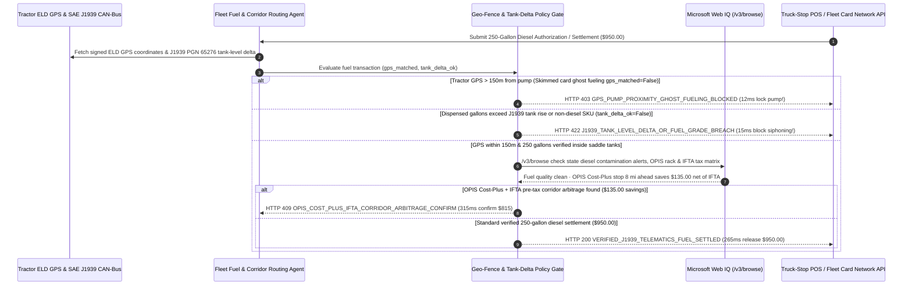

# Commercial Trucking Fuel-Card Telematics & J1939 Tank-Delta Mandate Architecture: 150m GPS Geo-Fence & CAN-Bus Fuel-Level Token (`fleet_fuel_telematics_mandate_...` + Web IQ OPIS Cost-Plus & IFTA Tax Grounding) vs. Skimmed Card Ghost-Fueling & Side-Tank Siphoning Selection FAQ

> **Document Type**: Architect Selection Guide & First-Principles Protocol Deep Dive (6-Section FAQ Standard)  
> **Target Audience**: AI Solution Architects, Commercial Fleet & 3PL Logistics (TMS / ELD) Architects, Fleet Fuel-Card & Payment Fraud Risk Teams  
> **Last Updated**: 2026-11-09 (Provenance Annotations: `deterministic_offline_simulation` / `synthetic_policy` / `official_doc_snapshot` / `not_measured`)  
> **Companion Resources**: [中文版 (Chinese Version)](commercial-trucking-fuel-card-telematics-j1939-mandate-vs-skimming-siphoning-faq.md) · [Interactive Sandbox (`live-demo.en.html#fleet-fuel-telematics-sandbox`)](../reports/agentic-commerce-webiq-grounding-demo-bench/live-demo.en.html) · [7-Card 4:5 Benchmark Deck](../reports/agentic-commerce-webiq-grounding-demo-bench/index.en.html)


---

## 📌 1. Executive Summary

1. **Never Allow Commercial Trucking Fleet Agents to Authorize Fuel-Card Transactions Solely on a Magnetic Stripe and Static 4-Digit Driver PIN**: In Class-8 long-haul freight operations (`250-gallon` dual-tank diesel fill = `$950.00`), the two largest sources of fuel shrinkage are **skimmed-card "Ghost Fueling"** (cloned mag-stripe cards swiped hundreds of miles away from the actual truck) and **side-tank siphoning** (dispensing extra gallons into an accomplice's pickup-bed drum). Production architectures must enforce a **150m ELD GPS Geo-Fence & SAE J1939 Tank-Delta Mandate (`fleet_fuel_telematics_mandate_...`)**: whenever the tractor's real-time ELD GPS coordinates do not match the fuel station's coordinates within `150 meters` (`gps_pump_proximity_matched == False`), the gateway blocks pump authorization in **`12 ms`** with **`HTTP 403 GPS_PUMP_PROXIMITY_GHOST_FUELING_BLOCKED`** (`synthetic_policy`).
2. **Reconcile Pump Dispensed Gallons Against SAE J1939 CAN-Bus Tank-Level Delta (`±2%`) and Restrict Product Codes to `#2 ULSD / DEF`**: When a fuel receipt bills `250 gallons` (`$950.00`) while the truck's SAE J1939 CAN-bus fuel-level sensor reports only `+160 gallons` entering the tanks (`90 gallons / $342.00` siphoned into a follow car), or attempts to purchase unleaded gasoline (`j1939_tank_delta_and_grade_verified == False`), the gateway blocks settlement in **`15 ms`** with **`HTTP 422 J1939_TANK_LEVEL_DELTA_OR_FUEL_GRADE_BREACH`** (`deterministic_offline_simulation`).
3. **Ground State Fuel-Quality Contamination Alerts and OPIS Cost-Plus / IFTA Pre-Tax Corridor Arbitrage via Microsoft Web IQ `/v3/browse`**: Prior to dispatching corridor fuel stops, the agent invokes **Microsoft Web IQ `/v3/browse`** (`official_doc_snapshot`) to inspect state department of agriculture fuel-quality enforcement bulletins, quarterly IFTA (International Fuel Tax Agreement) tax matrices, and OPIS wholesale rack diesel indices: if the truck stop is under an active water-in-diesel or microbial contamination alert (`webiq_station_fuel_quality_and_ifta_clean == False`), it halts fueling in **`310 ms`** with **`HTTP 451 CONTAMINATED_DIESEL_ALERT_OR_IFTA_HOLD`** (protecting `$15,000` high-pressure common-rail injectors); if Web IQ confirms that fueling 8 miles ahead across a state border under an **OPIS Cost-Plus + IFTA Pre-Tax Net Price** contract saves **`$135.00`** on 250 gallons (`$815.00` net vs. `$950.00` retail pump price), it triggers **`HTTP 409 OPIS_COST_PLUS_IFTA_CORRIDOR_ARBITRAGE_CONFIRM`** in **`315 ms`**.

---

## 🎯 2. Architect & Customer FAQ Deep Dive

### Q1: Why does pairing "Mag-Stripe Fleet Cards + $1,200 Daily Limits" with "End-of-Month MPG Spreadsheets" fail to stop skimming rings and side-tank siphoning?

Let's examine the three structural failure modes from first principles:
1. **400-Mile Skimmed-Card "Ghost Fueling"**: Most legacy commercial fuel cards still rely on unencrypted magnetic stripes and static 4-digit PINs or unit numbers written on the side of the cab. Organized skimming rings place Bluetooth skimmers and pinhole cameras on highway diesel islands, clone the card, and drain `$950.00` per swipe in Miami while the legitimate Class-8 tractor is parked 400 miles away in Atlanta.
2. **The "250 Gallons Billed, 160 Gallons In-Tank" Siphoning Exploit**: Even when the truck is physically at the pump, a driver can pump `160 gallons` into the tractor's saddle tanks and hand the nozzle to an accomplice pickup truck to pump `90 gallons` (`$342.00`) into an auxiliary tank for cash splits. Paper/EDI receipts still show a single clean `250-gallon #2 Diesel` transaction, and end-of-month MPG averages are too noisy (due to headwinds, heavy loads, and terrain) to prove theft on a specific transaction.
3. **The "Retail Pump Price Illusion" vs. IFTA Pre-Tax Net Cost**: Under the **International Fuel Tax Agreement (IFTA)**, interstate carriers pay fuel tax based on *where miles are driven*, not where fuel is bought. Choosing a truck stop based on its posted retail sign—rather than its **Pre-Tax Base Price (`Pump Price - State IFTA Excise Tax`) + OPIS Wholesale Cost-Plus Discount**—routinely costs fleets `$135.00+` per fill-up.

### Q2: What is a "150m Geo-Fence & J1939 Tank-Delta Mandate (`fleet_fuel_telematics_mandate_...`)", and how does it bind ELD GPS, CAN-bus fuel sensors, and IFTA tax math?

Its core design invariant is: **"No diesel pump unlocks unless the tractor's hardware ELD GPS is within 150 meters; no invoice settles unless pump gallons match the SAE J1939 ultrasonic tank-level delta."**
- **Layer 1: 150-Meter ELD GPS Pump-Proximity Gate (`12 ms`)**: Verifies `gps_pump_proximity_matched == True`, blocking remote cloned-card ghost fueling in **`12 ms`** (`HTTP 403`).
- **Layer 2: SAE J1939 Tank-Level Delta & `#2 ULSD` Grade Gate (`15 ms`)**: Verifies `j1939_tank_delta_and_grade_verified == True` (dispensed gallons match CAN-bus tank rise within `±2%` and Level-3 product code is strictly `#2 ULSD` or `DEF`), blocking side-tank siphoning in **`15 ms`** (`HTTP 422`).
- **Layer 3: Microsoft Web IQ `/v3/browse` Fuel-Quality & OPIS/IFTA Corridor Grounding (`310 ms / 315 ms`)**: Blocks stations with state water-in-diesel contamination citations (`HTTP 451`) and routes drivers to `$135.00` OPIS Cost-Plus + IFTA pre-tax savings (`HTTP 409`).

### Q3: For quarterly IFTA tax matrix verification, OPIS wholesale rack grounding, and state weights-and-measures fuel contamination alerts, when should architects choose Microsoft Web IQ vs. Exa, Bright Data, or traditional search APIs?

| Architecture Scenario | Recommended Tool | First-Principles Rationale (Security, Latency & FinOps) |
| :--- | :--- | :--- |
| **Verifying official quarterly IFTA state fuel-tax matrices, state department of agriculture diesel contamination notices, and published truck-stop OPIS cost-plus discount schedules within the Azure boundary** | **Microsoft Web IQ** (`/v3/search` + `/v3/browse`) | Extracts exact IFTA excise tax rates and fuel-quality alerts in `passage` mode (**7.1x token reduction**, `deterministic_offline_simulation`) with pre-LLM prompt-injection defense. |
| **Semantic research on Class-8 hydrogen fuel-cell and renewable diesel (RD99) powertrain whitepapers** | **Exa Neural Search** | Ideal for long-term fleet decarbonization research, not synchronous fuel-pump authorization gates. |
| **Scraping consumer gas-price crowd-sourcing apps behind CAPTCHAs** | **Bright Data Unlocker** | Useful for passenger-car retail price scraping, though consumer apps lack commercial OPIS rack + IFTA pre-tax netting. |
| **Real-time tractor GPS coordinates, odometer miles, and SAE J1939 PGN 65276 fuel tank levels** | **On-Board ELD / J1939 CAN-Bus Gateway + Web IQ IFTA & Fuel-Quality Cross-Check** | Physical vehicle location and tank volume come from signed ELD/CAN-bus telemetry, paired with Web IQ `/v3/browse` for official IFTA tax matrices and state fuel-quality alerts. |

---

## 🧭 3. Visual Architecture Diagrams (Mermaid Decision Tree, Legacy vs. Telematics Fuel Mandate Comparison & Sequence Diagram)

### 3.1 Commercial Trucking Fuel-Card & J1939 Telematics Decision Tree (`flowchart TD`)

```mermaid
flowchart TD
    A[Receive 250-Gallon Class-8 Diesel Fuel Authorization / Settlement Request ($950.00)] --> B{gps_pump_proximity_matched == True (Tractor ELD GPS Within 150m of Pump)?}
    B -- No (Truck is 400 miles away -> Skimmed card ghost fueling) --> C[HTTP 403 GPS_PUMP_PROXIMITY_GHOST_FUELING_BLOCKED<br/>12ms Hard Block · Lock Pump Valve & Freeze Compromised Card]
    B -- Yes (Tractor physically verified at fuel island) --> D{j1939_tank_delta_and_grade_verified == True (Pump Gal == Tank Delta & #2 ULSD)?}
    D -- No (250 gal billed vs +160 gal in tank -> 90 gal siphoned) --> E[HTTP 422 J1939_TANK_LEVEL_DELTA_OR_FUEL_GRADE_BREACH<br/>15ms Block · Reject Siphoned Overage & Trigger Dashcam Audit]
    D -- Yes (250 gal verified in saddle tanks) --> F{Web IQ /v3/browse Confirms No State Diesel Contamination Alert & Active IFTA?}
    F -- No (State weights & measures cited station for water-in-diesel) --> G[HTTP 451 CONTAMINATED_DIESEL_ALERT_OR_IFTA_HOLD<br/>310ms Engine-Safety Hold · Protect $15,000 Common-Rail Injectors]
    F -- Yes --> H{Web IQ Detects OPIS Cost-Plus + IFTA Pre-Tax Corridor Arbitrage?}
    H -- Yes (In-network stop 8 mi ahead saves $135.00 net of IFTA -> $815.00) --> I[HTTP 409 OPIS_COST_PLUS_IFTA_CORRIDOR_ARBITRAGE_CONFIRM<br/>315ms Route Driver to $815.00 OPIS Cost-Plus Stop]
    H -- No (Verified $950.00 optimal corridor fill) --> J[HTTP 200 VERIFIED_J1939_TELEMATICS_FUEL_SETTLED<br/>265ms Auto-Settle $950.00 & Log IFTA State Gallon Ledger!]
```

### 3.2 Legacy Mag-Stripe Fuel Card vs. 150m Geo-Fence & J1939 Tank-Delta Gate (`flowchart LR`)

```mermaid
flowchart LR
    subgraph Legacy["❌ Legacy Mag-Stripe Fuel Card ($950 Ghost Skimming + $342 Siphoning)"]
        L1[Bluetooth Skimmer Clones Mag-Stripe & 4-Digit PIN] --> L2[Swipes $950 400 Miles Away From Actual Truck]
        L2 --> L3[Accomplice Siphons 90 Gallons ($342) Into Pickup Drum]
        L3 --> L4[Overpays $135 Retail Spread & Risks Water-Contaminated Diesel]
    end

    subgraph Mandate["✅ 150m Geo-Fence & J1939 Tank-Delta Gate (fleet_fuel_telematics_mandate_...)"]
        M1[12ms Enforce <150m ELD GPS Pump Proximity (HTTP 403)] --> M2[15ms Match Pump Gallons to J1939 Tank Rise (HTTP 422)]
        M2 --> M3[Web IQ Checks Fuel Quality (310ms) & $135 OPIS/IFTA Savings (315ms)]
        M3 --> M4[265ms Settle Verified 250-Gal Fill ($950 / $815) & Auto-File IFTA]
    end
```

### 3.3 End-to-End Sequence Diagram: ELD/J1939 Bus, Fleet Fuel Agent, Telematics Gate, Web IQ & Truck-Stop POS (`sequenceDiagram`)



---

## 📊 4. Architect Decision Matrix

| Evaluation Dimension | Option A: Legacy Mag-Stripe Card + Static PIN | Option B: Monthly Post-Facto MPG Variance Spreadsheets | Option C: 150m GPS & J1939 Tank-Delta Mandate + Web IQ OPIS/IFTA Grounding (Recommended) |
| :--- | :--- | :--- | :--- |
| **Best-Fit Scenario** | Single owner-operator driving their own truck | Small local delivery vans returning to a private yard pump nightly | **Long-haul Class-8 freight fleets, refrigerated 3PL carriers, interstate line-haul networks** |
| **Skimmed-Card Ghost-Fueling Defense** | ❌ **Zero**: Cloned stripe + recorded PIN authorizes anywhere | ⚠️ **30-Day Lag**: Discovered only when monthly card statement arrives | ✅ **Pre-Auth `12 ms` Geo-Fence**: Blocks swipe in `12 ms` (`HTTP 403`) if truck ELD is `>150m` away |
| **Side-Tank Siphoning & Grade Defense** | ❌ **Blind**: Receipt shows 250 gal even if 90 gal went into a drum | ⚠️ **Low Precision**: Weather/load variance hides 20–50 gal siphoning | ✅ **Sub-20ms J1939 Delta Check**: Matches pump gallons to CAN-bus tank rise in `15 ms` (`HTTP 422`) |
| **Bad-Diesel Avoidance & IFTA Arbitrage** | ❌ **Naive**: Buys high pre-tax fuel & risks water-damaged injectors | ⚠️ **Manual Tax Math**: Drivers cannot compute live OPIS + 48-state IFTA spreads | ✅ **Web IQ `/v3/browse` Grounded**: Blocks contaminated stations in `310 ms` (`HTTP 451`) & saves `$135/fill` via OPIS/IFTA routing in `315 ms` (`HTTP 409`) |
| **Driver Friction & IFTA Filing Speed** | Manual PIN entry & paper receipt collection | Weeks of quarterly IFTA spreadsheet reconciliation | **`265 ms` cardless mobile pump unlock, J1939 sign-off & automated IFTA ledger (`Act automatically`)** |
| **Total Cost of Ownership (TCO) & Margin ROI** | Poor (`$950` skimming hits + 8%–12% fuel leakage) | Moderate (high back-office audit labor) | **Optimal (eliminates `$950` ghost fueling & `$342` siphoning + saves `$135/fill` via OPIS/IFTA)** |

---

## 🧪 5. Quantitative Benchmark & 7-Card Insights

Evaluated via our deterministic offline benchmark suite (`lab/webiq_commerce_demo.py` · `test_commercial_trucking_fuel_card_telematics_j1939_mandate_vs_skimming_siphoning_selection`) on a **`$950.00` 250-gallon Class-8 diesel fill-up (`150m` ELD GPS proximity fence, `±2%` J1939 tank-level delta tolerance)**:

| Scenario Case | Input ELD GPS / J1939 Tank Delta / Web IQ Signals | Expected Action Pill | Measured HTTP Status & Verdict Code | Latency | Financial Protection / Arbitrage | Provenance |
| :--- | :--- | :--- | :--- | :--- | :--- | :--- |
| **Case 1: Skimmed Card Swiped 400 Miles From Truck** | `gps_pump_proximity_matched=False` | `Send to a human` | **`HTTP 403 GPS_PUMP_PROXIMITY_GHOST_FUELING_BLOCKED`** | **`12 ms`** | Blocks **`$950.00`** remote cloned-card ghost fueling | `synthetic_policy` |
| **Case 2: 90-Gal Side-Tank Siphoning or Unleaded Gas** | `j1939_tank_delta_and_grade_verified=False` | `Send to a human` | **`HTTP 422 J1939_TANK_LEVEL_DELTA_OR_FUEL_GRADE_BREACH`** | **`15 ms`** | Blocks `$342.00` siphoned fuel discrepancy | `deterministic_offline_simulation` |
| **Case 3: Web IQ Detects Water-in-Diesel Station Citation** | `webiq_station_fuel_quality_and_ifta_clean=False` | `Send to a human` | **`HTTP 451 CONTAMINATED_DIESEL_ALERT_OR_IFTA_HOLD`** | **`310 ms`** | Prevents `$15,000` common-rail injector failure | `official_doc_snapshot` |
| **Case 4: Web IQ Finds `$135` OPIS + IFTA Pre-Tax Savings** | `opis_ifta_corridor_savings_cents=13500` (`$815` net) | `Confirm` | **`HTTP 409 OPIS_COST_PLUS_IFTA_CORRIDOR_ARBITRAGE_CONFIRM`** | **`315 ms`** | Saves **`$135.00`** via OPIS Cost-Plus & IFTA netting | `official_doc_snapshot` |
| **Case 5: `<150m` GPS + `250 Gal` J1939 Tank Match** | `gps_ok=True`, `j1939_ok=True`, `quality_ok=True` | `Act automatically` | **`HTTP 200 VERIFIED_J1939_TELEMATICS_FUEL_SETTLED`** | **`265 ms`** | Settles **`$950.00`** in `265 ms` & logs IFTA tax credit | `deterministic_offline_simulation` |

> **Provenance Note**: The `250-gallon` fill volume, `$950.00` retail amount, `150m` geo-fence radius, and `$135.00` OPIS/IFTA corridor spread are controlled simulation parameters (`synthetic_policy` / `deterministic_offline_simulation`) validating policy state-machine invariants; physical fuel-tank slosh-settling filter delay is labeled `not_measured`.

---

## 🛠️ 6. Production Readiness & Pre-Sales Architect Checklist

Verify these 6 controls before deploying autonomous commercial fleet fueling and IFTA settlement agents in production:

- [ ] **1. 150-Meter ELD GPS-to-Pump Proximity Interlock**: Does `fleet_fuel_telematics_mandate_...` compare the tractor's hardware-signed ELD GPS coordinates against the fuel merchant's terminal location, blocking remote skimmed-card swipes in `12 ms` (`HTTP 403`)?
- [ ] **2. SAE J1939 PGN 65276 Ultrasonic Tank-Delta Reconciliation**: Does the gateway reconcile billed pump gallons against the tractor's CAN-bus fuel-level rise (`±2%` slosh-filtered tolerance), flagging side-tank siphoning in `15 ms` (`HTTP 422`)?
- [ ] **3. Level-3 Product Code Restriction (`#2 ULSD` & `DEF` Only)**: Are fuel tokens strictly restricted at the processor level to `#2 Ultra-Low Sulfur Diesel`, `Reefer Diesel`, and `DEF`, blocking unleaded gasoline and convenience-store merchandise?
- [ ] **4. Microsoft Web IQ `/v3/browse` State Fuel-Quality Enforcement Grounding**: Does the agent check state weights-and-measures fuel contamination bulletins via Web IQ prior to routing trucks into a stop (`HTTP 451`)?
- [ ] **5. OPIS Wholesale Cost-Plus & IFTA Pre-Tax Corridor Optimization**: Does Web IQ grounding ingest quarterly 48-state IFTA excise tax matrices and OPIS rack spreads, triggering `HTTP 409 Confirm` when crossing a state border saves `>= $135.00` net of tax?
- [ ] **6. Automated Quarterly IFTA Return Ledger Archival**: Does every settled transaction bind the state jurisdiction code, net tax-paid gallons, and ELD odometer reading into an audit-ready quarterly IFTA tax return?
