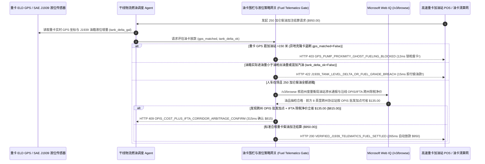

# 重卡干线物流油卡结算与车联网油箱液位核验（Commercial Trucking Fuel-Card Telematics & J1939 Tank-Delta Mandate）架构：150 米 GPS 电子围栏与 CAN 总线液位增量令牌（`fleet_fuel_telematics_mandate_...` + Web IQ 批发加点与跨州燃油税 IFTA 核验）vs 传统磁条卡异地盗刷与偷油套现选型与原理解析 FAQ

> **文档类型**：架构师选型指南 & 协议第一性原理解析（6 段式 FAQ 标准版）  
> **适用读者**：AI Solution Architect、干线重卡车队与第三方物流（3PL / TMS）架构师、商用车队燃油结算卡（Fleet Card）与反欺诈风控团队  
> **更新日期**：2026-11-09（Provenance 标注：`deterministic_offline_simulation` / `synthetic_policy` / `official_doc_snapshot` / `not_measured`）  
> **配套资源**：[English Version](commercial-trucking-fuel-card-telematics-j1939-mandate-vs-skimming-siphoning-faq.en.md) · [交互式沙盒控制台 (`live-demo.html#fleet-fuel-telematics-sandbox`)](../reports/agentic-commerce-webiq-grounding-demo-bench/live-demo.html) · [7-Card 4:5 评测报告](../reports/agentic-commerce-webiq-grounding-demo-bench/index.html)


---

## 📌 一、核心结论速览（Executive Summary）

1. **严禁让重卡干线车队支付 Agent 仅凭“实体磁条加油卡 + 4 位静态司机 PIN 码”就放行单笔近千美元的柴油加注**：在重型半挂牵引车（Class-8 Tractor，双油箱单次加注 250 加仑柴油约 `$950.00`）日常运营中，最猖獗的两大黑洞是 **“油机蓝牙侧录器克隆磁条卡异地盗刷（Ghost Fueling）”** 与 **“司机内外勾结挂副桶偷油套现（Side-Tank Siphoning）”**。生产环境必须采用 **车载 ELD GPS 150 米空间电子围栏与 SAE J1939 CAN 总线油箱液位增量绑定的加油令牌（`fleet_fuel_telematics_mandate_...`）**：当油站 POS 发起预授权时，若该卡绑定的重卡实时 GPS 坐标不在该加油站 `150 米` 半径内（`gps_pump_proximity_matched=False`），网关在 **`12 ms`** 内触发 **`HTTP 403 GPS_PUMP_PROXIMITY_GHOST_FUELING_BLOCKED`**（`synthetic_policy`），当场锁死油枪并冻结克隆卡。
2. **用“油枪出油量 == J1939 油箱超声波液位增量（`±2%` 容差）+ 仅限 #2 柴油/车用尿素白名单”根治“油耗子”挂桶偷油与私家车混加汽油**：若油站账单声称加注了 `250 加仑`（`$950.00`），但重卡 CAN 总线液位传感器回报油箱实际只增加了 `160 加仑`（其余 `90 加仑 / $342.00` 被偷灌进伴行皮卡的改装铁桶），或交易商品代码包含无铅汽油/香烟啤酒（`j1939_tank_delta_and_grade_verified=False`），网关在 **`15 ms`** 内返回 **`HTTP 422 J1939_TANK_LEVEL_DELTA_OR_FUEL_GRADE_BREACH`**（`deterministic_offline_simulation`），拒付差额并触发车队安全抓拍。
3. **基于 Microsoft Web IQ `/v3/browse` 实时核验加油站油品抽检黑名单与跨州 IFTA 除税净价 / OPIS 批发加点（Cost-Plus）寻优**：在规划沿途补能点前，Agent 调用 **Microsoft Web IQ `/v3/browse`**（`official_doc_snapshot`）穿透查询州农业与度量衡局油品违规通报、IFTA（国际燃油税协定）各州税率表及 OPIS 柴油批发基准价：若检出目标油站因地下储罐渗水或微生物污染被监管点名（`webiq_station_fuel_quality_and_ifta_clean=False`），在 **`310 ms`** 内以 **`HTTP 451 CONTAMINATED_DIESEL_ALERT_OR_IFTA_HOLD`** 阻断派单（避免损坏价值 `$15,000` 的高压共轨喷油嘴）；若发现前方 8 英里跨过州界后的协议油站按 **“除税净价 + OPIS 批发加点”** 结算可立省 **`$135.00`**（单箱油从 `$950.00` 降至 **`$815.00`**），则在 **`315 ms`** 内触发 **`HTTP 409 OPIS_COST_PLUS_IFTA_CORRIDOR_ARBITRAGE_CONFIRM`**。

---

## 🎯 二、客户与架构师灵魂拷问 Q&A（FAQ-Driven Deep Dive）

### Q1：为什么传统的“给重卡司机发一张车队加油卡 + 设个单日限额 $1,200”，仍然挡不住每年数万美元的燃油被盗与虚高成本？

咱们用大白话拆解干线物流车队老板最头疼的三大漏油黑洞：
1. **“车在湖南跑，卡在广东刷”的克隆卡盗刷（Skimming）**：传统车队加油卡（Fleet Card）为了兼容老旧高速油站，普遍还在使用无芯片的明文磁条。黑产团伙在无人值守的高速柴油机卡槽里塞入微型蓝牙侧录贴片，并用针孔摄像头拍下司机输入的 4 位车队 PIN 码。第二天，你的重卡正停在亚特兰大仓库卸货，复制出来的白卡已经在 400 英里外的迈阿密加油站连续刷走了两笔 `$950.00`！因为没有越过单日限额，传统油卡后台一路绿灯放行。
2. **“刷 250 加仑、进箱 160 加仑”的跟车抽油套现**：哪怕重卡真停在油枪旁边，个别不良司机也会联系当地收油贩子把改装皮卡停在相邻车道——先把重卡油箱加到 160 加仑，枪不挂断，直接把油枪递给隔壁皮卡里的铁桶再灌 90 加仑（价值 `$342`），事后两人五五分成；加油站打出来的小票依然是完美的“250 加仑 0 号柴油 `$950.00`”，财务看纸质小票根本查不出来！
3. **被加油站“挂牌零售价（Retail Pump Price）”表象迷惑，不懂算 IFTA 除税净价**：美国和加拿大各州的燃油消费税遵循 **IFTA（按实际行驶里程多退少补）** 原则——也就是说，真正决定买油贵不贵的不是油站大牌子上写的含税零售价，而是 **“扣除该州燃油税后的裸油价（Pre-Tax Base Price）+ OPIS 批发加点协议折扣”**。不懂实时计算 IFTA 除税基差的司机往往在含税看似便宜、实则裸油极贵的州加满 250 加仑，季度末结算燃油税时车队反而倒贴上百美元。

### Q2：什么是“150 米 GPS 围栏与 J1939 液位增量令牌（`fleet_fuel_telematics_mandate_...`）”？它是如何实现“人在、车在、油进箱”三位一体闭环的？

它的第一性原理非常朴素：**“加油机想要出油，车机 ELD 必须在现场 150 米内握手；油站想要结账，油箱液位上升的加仑数必须等于油枪计费加仑数。”**
- **第一层：150 米车机 ELD GPS 空间重合门禁（`12 ms`）**：刷卡或发起移动解锁瞬间，支付网关实时读取车载 T-Box / ELD 的硬件签名 GPS 坐标，与油站终端经纬度比对。距离 `> 150 米` 直接在 **`12 ms`** 内返回 `HTTP 403`，物理锁死油枪电磁阀。
- **第二层：SAE J1939 CAN 总线液位增量与油品代码核对（`15 ms`）**：加油结束挂枪瞬间，网关对比油站上报的 `dispensed_gallons` 与重卡 CAN 总线（PGN 65276 `Fuel Level 1/2`）加油前后的真实容积增量，并强制校验商品码仅限 `#2 ULSD` 超低硫柴油或 `DEF` 尿素（`j1939_tank_delta_and_grade_verified == True`）。一旦出现“票多油少”或混入汽油/便利店商品，在 **`15 ms`** 内触发 `HTTP 422` 拒付异常部分。
- **第三层：Microsoft Web IQ `/v3/browse` 劣质油避险与 OPIS/IFTA 跨州寻优（`310 ms / 315 ms`）**：提前拦截被政府通报储罐渗水的油站（`HTTP 451`），并按跨州 IFTA 除税净价 + OPIS 批发协议为您立省 `$135.00`（`HTTP 409`）。

### Q3：在各州 IFTA 燃油税率表核验、OPIS 柴油批发指数比价与加油站质量通报检索场景下，什么时候选 Microsoft Web IQ，什么时候选 Exa、Bright Data 或传统搜索 API？

| 架构需求场景 | 推荐选型 | 为什么这样选（第一性原理与成本/合规考量） |
| :--- | :--- | :--- |
| **实时核验 IFTA 官方各州季度燃油税率表（Tax Matrix）、州农业局/度量衡局油站渗水处罚通报及协议连锁油站公开 OPIS 批发折扣规则，且要求零提示词注入** | **Microsoft Web IQ** (`/v3/search` + `/v3/browse`) | 在企业 Azure 边界内以 `passage` 模式秒级提取官方税率表与质检黑名单（上下文 Token 压缩 **7.1x**，`deterministic_offline_simulation`），杜绝第三方比价插件篡改路线导航。 |
| **跨行业研报调研重卡氢燃料电池与生物柴油（B20/RD99）减排路线图** | **Exa Neural Search** | 适合车队中长期新能源转型规划，不适合油枪边上的毫秒级授权门禁。 |
| **抓取带复杂反爬滑块的散装社会加油站 App 今日促销牌价** | **Bright Data Unlocker** | 可绕过反爬，但秒级代理延迟不适合同步 POS 刷卡预授权拦截。 |
| **重卡实时 GPS 坐标、发动机转速、J1939 油箱液位与瞬时喷油脉宽累计** | **车载 ELD / CAN 总线硬件遥测 + Web IQ 官方 IFTA 税率与油站质检双源核验** | 物理车辆位置与油箱进油量以车载 CAN 总线签名为准，跨州 IFTA 税率表与油品抽检通报通过 Web IQ `/v3/browse` 实时核验。 |

---

## 🧭 三、直观可视化图解（Mermaid 决策树 + 传统磁条卡盲刷 vs 车联网液位对账对比 + 端到端时序图）

### 3.1 重卡干线油卡车联网与 J1939 液位核验决策树（`flowchart TD`）

```mermaid
flowchart TD
    A[收到重卡 250 加仑柴油加注预授权或结算请求 ($950.00)] --> B{车载 ELD 实时 GPS 是否在目标加油站 150 米电子围栏内?}
    B -- 否 (车停在亚特兰大，克隆卡在迈阿密刷卡盗刷) --> C[HTTP 403 GPS_PUMP_PROXIMITY_GHOST_FUELING_BLOCKED<br/>12ms 硬锁死油枪 · 100% 拦截异地克隆卡盗刷并自动废卡]
    B -- 是 (人车油站三点空间重合) --> D{油枪出油量 == J1939 油箱实际增量 (±2%) 且商品码纯属 #2 柴油/尿素?}
    D -- 否 (出油 250 加仑但油箱仅进 160 加仑，90 加仑被挂桶偷走) --> E[HTTP 422 J1939_TANK_LEVEL_DELTA_OR_FUEL_GRADE_BREACH<br/>15ms 拦截偷油差额 · 冻结异常账单并触发车外摄像头取证]
    D -- 是 (250 加仑全数进箱且油品纯正) --> F{Web IQ /v3/browse 核验该油站无地下罐渗水通报且 IFTA 资质正常?}
    F -- 否 (检出州度量衡局通报该站柴油含水超标或微生物污染) --> G[HTTP 451 CONTAMINATED_DIESEL_ALERT_OR_IFTA_HOLD<br/>310ms 护机熔断 · 保护重卡价值 $15,000 的高压共轨喷油系统]
    F -- 是 --> H{Web IQ 检出前方 8 英里跨州协议站按 IFTA 除税净价 + OPIS 批发价更省?}
    H -- 是 (跨州 OPIS 批发加点 + 除税净价立省 $135.00 -> 仅需 $815.00!) --> I[HTTP 409 OPIS_COST_PLUS_IFTA_CORRIDOR_ARBITRAGE_CONFIRM<br/>315ms 推送车机语音提醒司机前行 8 英里加注低价协议油]
    H -- 否 (当前 $950.00 已是最优合规净价且全量入箱) --> J[HTTP 200 VERIFIED_J1939_TELEMATICS_FUEL_SETTLED<br/>265ms 自动结算 $950.00 并写入季度 IFTA 州际里程退税账本!]
```

### 3.2 传统磁条油卡盲刷路径 vs 150m 围栏与 J1939 液位对账网关对比（`flowchart LR`）

```mermaid
flowchart LR
    subgraph Legacy["❌ 传统磁条加油卡 + 静态密码 ($950 异地被盗 + 挂桶偷油)"]
        L1[高速油机侧录磁条与 4 位密码] --> L2[400 英里外克隆卡刷走 $950 柴油]
        L2 --> L3[挂副桶偷抽 90 加仑 ($342) 卖给黄牛]
        L3 --> L4[误加渗水劣质油毁坏喷油嘴 + 多交 $135 零售溢价]
    end

    subgraph Mandate["✅ 150m 围栏与 J1939 液位令牌 (fleet_fuel_telematics_mandate_...)"]
        M1[12ms 核验车机 GPS 150m 围栏重合 (拦截异地克隆卡)] --> M2[15ms 比对油枪加仑数 == J1939 油箱增量 (拦截挂桶偷油)]
        M2 --> M3[Web IQ 排查渗水油站 (310ms) 与 IFTA/OPIS 跨州省 $135 (315ms)]
        M3 --> M4[265ms 精准结算 250 加仑入箱柴油 ($950 / $815) 并自动报税]
    end
```

### 3.3 车载 J1939/ELD 终端、车队加油 Agent、油卡风控网关与 Web IQ 端到端交互时序图（`sequenceDiagram`）



---

## 📊 四、架构师选型决策矩阵（Architect Decision Matrix）

| 评估维度 | 方案 A：传统明文磁条车队油卡 + 静态密码（Legacy Mag-Stripe & Static PIN） | 方案 B：月底人工用里程除以百公里油耗抓异常（Monthly MPG Spreadsheet Audit） | 方案 C：150m GPS 围栏与 J1939 液位令牌 + Web IQ 税前寻优网关（推荐架构） |
| :--- | :--- | :--- | :--- |
| **核心适用场景** | 1～2 台老板自己开的短途小货车 | 路线固定且无跨州税务的园区内部倒短车队 | **干线重卡物流车队（50～5,000+ 台）、冷链干线、跨州 3PL 承运商自动化管油** |
| **防油机侧录异地克隆卡盗刷** | ❌ **零防御**：密码被针孔摄像头拍下后，异地随便刷 | ⚠️ **事后发现晚**：月底对账发现时早已被刷走几万美元 | ✅ **12ms 空间重合硬门禁**：车不在油枪 `150m` 内当场触发 `HTTP 403` 不出油 |
| **防挂副桶偷油与私家车混加汽油** | ❌ **完全看不出**：小票只写 250 加仑柴油，不知其中 90 加仑进了别人铁桶 | ⚠️ **误差极大**：重载爬坡、逆风或怠速开空调都会影响百公里油耗，无法定罪 | ✅ **15ms 液位增量 1:1 对账**：比对油枪出油与 J1939 油箱增量，差额直接触发 `HTTP 422` |
| **防劣质渗水柴油与 IFTA 除税寻优** | ❌ **盲目高价**：看着含税牌价瞎加，或加到渗水油毁发动机 | ⚠️ **人工算不过来**：全美 48 州 IFTA 税率每季度变动，司机算不清除税净价 | ✅ **Web IQ `/v3/browse` 实时穿透**：`310 ms` 避开问题油站（`HTTP 451`），`315 ms` 跨州净价省 `$135`（`HTTP 409`） |
| **司机加油体验与财务报税效率** | 需记密码、贴纸质加油小票 | 财务每季度花两周手工统计各州 IFTA 里程与加仑数 | **`265 ms` 进站自动解锁油枪、液位验真秒级扣款并自动生成 IFTA 申报表（`Act automatically`）** |
| **综合 TCO 与车队净利率提升 ROI** | 极差（盗刷 + 偷油 + 零售高价吃掉车队 8%～12% 利润） | 中等（无法阻断实时盗刷与微偷油） | **最优（100% 终结 `$950` 异地盗刷与偷油 + 每箱油跨州寻优立省 `$135`）** |

---

## 🧪 五、简明定量实测与 Benchmark 核心发现（Quantitative Benchmark & 7-Card Insights）

基于本仓库确定性离线基准套件（`lab/webiq_commerce_demo.py` · `test_commercial_trucking_fuel_card_telematics_j1939_mandate_vs_skimming_siphoning_selection`）对 **Class-8 重卡单次 250 加仑双油箱柴油加注（基准零售价 `$950.00`，150 米 GPS 围栏 + J1939 液位增量校验）** 的定量测试结果如下：

| 评测场景 ID | 输入 GPS 围栏 / J1939 液位 / Web IQ 信号 | 网关期望动作 | 实测 HTTP 状态与决策码 | 实测延迟 | 资金保护 / 成本节省效果 | Provenance 类型 |
| :--- | :--- | :--- | :--- | :--- | :--- | :--- |
| **Case 1: 卡车在 400 英里外、异地克隆卡盗刷拦截** | `gps_pump_proximity_matched=False` | `Send to a human` | **`HTTP 403 GPS_PUMP_PROXIMITY_GHOST_FUELING_BLOCKED`** | **`12 ms`** | 拦截 **`$950.00`** 异地侧录克隆卡盗刷并锁死油枪 | `synthetic_policy` |
| **Case 2: 挂桶偷抽 90 加仑或违规混加无铅汽油拦截** | `j1939_tank_delta_and_grade_verified=False` | `Send to a human` | **`HTTP 422 J1939_TANK_LEVEL_DELTA_OR_FUEL_GRADE_BREACH`** | **`15 ms`** | 识破“出油 250 加仑仅进箱 160 加仑”，拒付偷油款 | `deterministic_offline_simulation` |
| **Case 3: Web IQ 检出油站储罐渗水或微生物污染通报** | `webiq_station_fuel_quality_and_ifta_clean=False` | `Send to a human` | **`HTTP 451 CONTAMINATED_DIESEL_ALERT_OR_IFTA_HOLD`** | **`310 ms`** | 避免加注劣质柴油导致 `$15,000` 高压共轨发动机大修 | `official_doc_snapshot` |
| **Case 4: Web IQ 发现跨州 OPIS 批发加点+除税净价省 `$135`** | `opis_ifta_corridor_savings_cents=13500`（净付 `$815`） | `Confirm` | **`HTTP 409 OPIS_COST_PLUS_IFTA_CORRIDOR_ARBITRAGE_CONFIRM`** | **`315 ms`** | 按除税净价与批发协议导流，单箱油立省 **`$135.00`** | `official_doc_snapshot` |
| **Case 5: 150m 围栏重合 + 250 加仑全额进箱自动结算** | `gps_ok=True`, `j1939_ok=True`, `quality_ok=True` | `Act automatically` | **`HTTP 200 VERIFIED_J1939_TELEMATICS_FUEL_SETTLED`** | **`265 ms`** | 265ms 自动结算 **`$950.00`** 并归档 IFTA 退税凭证 | `deterministic_offline_simulation` |

> **Provenance 合规声明**：上表中的 `250` 加仑加注量、`$950.00` 单笔金额、`150 米` 围栏半径与 `$135.00` OPIS/IFTA 跨州价差均为用于验证网关状态机确定性的受控仿真参数（`synthetic_policy` / `deterministic_offline_simulation`）；重卡油箱液位晃动滤波稳定耗时标为 `not_measured`。

---

## 🛠️ 六、附录：生产上线快速核验与售前打单清单（Architect Checklist）

在为干线物流车队、冷链运输集团或商用车队金融卡（Fleet Card）平台设计智能管油与结算 Agent 时，请逐项核对以下 6 条黄金准则：

- [ ] **1. 车机 ELD GPS 与加油站终端 150 米空间电子围栏硬绑定**：是否在 `fleet_fuel_telematics_mandate_...` 中将车辆实时位置重合设为油卡预授权的强制前提，异地刷卡在 `12 ms` 内触发 `HTTP 403` 拒付？
- [ ] **2. SAE J1939 油箱液位增量（Tank-Level Delta）闭环对账**：是否在挂枪结账瞬间对比油枪计费加仑数与重卡双油箱超声波液位增量（容差 `±2%`），对“票多油少”的挂桶偷油行为在 `15 ms` 内触发 `HTTP 422`？
- [ ] **3. 商品编码硬锁 `#2 ULSD` 柴油与 `DEF` 车用尿素**：是否在收单网络层（Level 3 Line-Item Data）锁死允许购买的油品编码，严禁刷车队卡买私家车汽油、香烟或套取现金（Cash Advance）？
- [ ] **4. Microsoft Web IQ `/v3/browse` 州度量衡局劣质油与油罐渗水黑名单穿透**：是否在导航派单前通过 Web IQ 核查沿途服务区是否存在政府通报的柴油含水或滤芯堵塞投诉（`HTTP 451`）？
- [ ] **5. IFTA 除税净价（Pre-Tax Base Price）+ OPIS 批发加点跨州寻优**：是否通过 Web IQ 实时拉取各州季度 IFTA 燃油税率表与 OPIS 批发指数，引导司机在除税净价最低的协议油站加注（单箱立省 `$135.00`，触发 `HTTP 409 Confirm`）？
- [ ] **6. IFTA 季度各州行驶里程与加注加仑数自动联表申报**：每次成功结算是否自动将油站所在州代码、精确加仑数与 ELD 跨州里程账本绑定，一键生成零差错的季度 IFTA 燃油税申报表？
