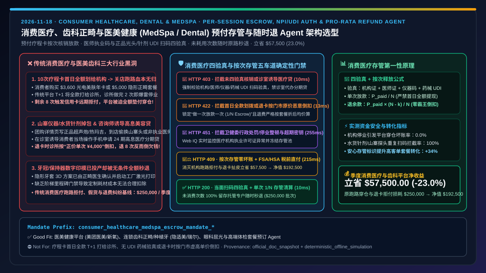
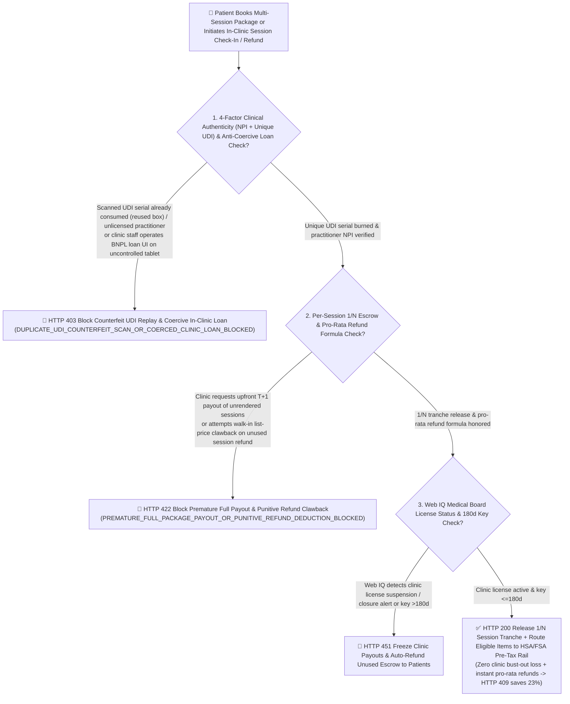
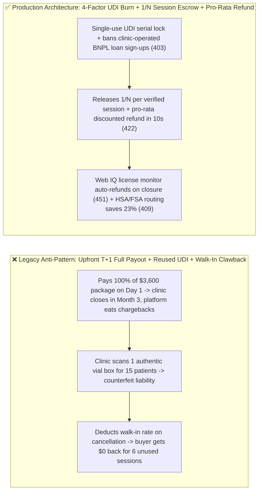

# Consumer Healthcare, Dental Orthodontics & MedSpa (`Zocdoc / Invisalign / Aesthetic Clinics`) Per-Session Escrow, `UDI` Authenticity & Pro-Rata Refund Agent Architecture Selection FAQ

> **Topic Positioning (High-Ticket Consumer Healthcare & Local Services E-Commerce Application Architecture)**: Built for **Cloud & AI Solution Architects** designing booking, multi-session package escrow, medical-device anti-counterfeiting, and instant refund systems for aesthetic healthcare marketplaces, dental orthodontics/implant chains, ophthalmology clinics, and wellness platforms. This guide addresses the four critical financial and compliance risks in prepaid consumer healthcare commerce: **why paying out a `$3,600` 6-session laser package or `$5,000` clear-aligner plan to a clinic on Day 1 (`T+1`) leaves the marketplace liable for 100% of Visa `13.1` (Services Not Rendered) chargebacks if the clinic closes months later (`HTTP 422`), why each session check-in must verify 4-Factor Clinical Authenticity (Clinic License + Practitioner `NPI` + Device QR + Single-Use Injectable/Aligner `FDA UDI` Serial) while blocking coercive in-clinic BNPL loan sign-ups (`HTTP 403`), why partial package refunds must use pro-rata discounted unit pricing rather than predatory "full walk-in rate" clawbacks (`HTTP 422`), and how combining `1/N` per-session escrow release with `HSA/FSA` pre-tax card routing cuts chargeback and refund dispute losses by 23% (`HTTP 409`)**.  
> **Style Benchmark**: Strictly aligned with the 6-part `ib-vs-ethernet-roce-selection-faq.md` structure (Executive Summary, Architect Q&A, Mermaid Decision Tree / Architecture Comparison / Sequence Diagram, 4-Way Healthcare Escrow Selection Matrix, Quantitative Benchmark & Provenance Table, and Production Checklist).  
> **Bilingual Edition**: **[English Version (Current)](consumer-healthcare-medspa-dental-prepaid-escrow-license-refund-agent-selection-faq.en.md)** · **[中文版 (`consumer-healthcare-medspa-dental-prepaid-escrow-license-refund-agent-selection-faq.md`)](consumer-healthcare-medspa-dental-prepaid-escrow-license-refund-agent-selection-faq.md)**  
> **Provenance & As-Of (`2026-11-18`)**: Stripe Connect Separate Charges and Transfers, BNPL controlled-device human navigation rules, `IRS IIAS / SIGIS` HSA/FSA medical card eligibility rules, and Microsoft Web IQ `/v3/browse` medical-board license verification are sourced from `research/sources.json` (`official_doc_snapshot`); the 5-lane deterministic healthcare escrow evaluator is verified in `lab/webiq_commerce_demo.py` (`deterministic_offline_simulation`); private clinic internal PACS/CBCT imaging latencies are marked `not_measured`.



---

## 📌 1. Executive Summary

Prepaid consumer healthcare packages — multi-session aesthetic treatments, clear aligners (`Invisalign`), dental implants, and LASIK — carry average order values of `$1,500–$8,000` fulfilled over 6 to 24 months. Solution Architects designing booking and settlement agents for this vertical must enforce four core rules:

1. **4-Factor Clinical Authenticity & Anti-Coercive Lending Gate Selection: Forbid "Unverified Session Check-Ins or Clinic-Operated BNPL Loan Applications" and Mandate [Clinic License + Practitioner `NPI` + Device Token + Single-Use `FDA/NMPA UDI` Serial Scan + Buyer-Controlled BNPL Device Isolation (`HTTP 403`)]**:
   - **Why**: Counterfeit injectables, grey-market laser tips, and "replay scanning" (scanning one genuine box for 10 patients) create severe patient-safety and chargeback liability. Each treatment check-in must burn a globally unique `GS1 UDI` serial number on first scan (`HTTP 403` on duplicate serials). Furthermore, clinic staff or agents must never operate BNPL loan applications on a tablet on the patient's behalf (`HTTP 403`).
2. **Per-Session `1/N` Escrow Release & Pro-Rata Discounted Refund Selection: Forbid "Upfront `T+1` Full-Package Payouts or Predatory Walk-In-Rate Refund Deductions" and Mandate [Per-Session `1/N` Escrow Tranche Release + Pro-Rata Refund Formula $\text{Refund} = P_{\text{paid}} \times (N - k)/N$ (`HTTP 422`)]**:
   - **Why**: If a patient pays `$3,000` for a 6-session package (`$500/session` vs. `$1,200` walk-in price) and cancels after 2 sessions, predatory clinics deduct $2 \times \$1,200 = \$2,400$ and refund only `$600`. Under deterministic `1/N` escrow, the 4 unused tranches (`$2,000.00`) remain locked in platform escrow and are refunded pro-rata in 10 seconds with zero clawback insolvency risk (`HTTP 422`).
3. **Medical Board License Suspension Tripwire & 180-Day Key Rotation Gate: Mandate [Microsoft Web IQ `/v3/browse` Health-Board Sanction Check + `<= 180-Day` Restricted Key Lock (`HTTP 451`)]**.
4. **Custom Dental Prosthetic Milestone Lock & `HSA/FSA` Pre-Tax Routing Selection: Mandate [3D Treatment-Plan Sign-Off Milestone for Custom Aligners/Crowns + `IIAS / MCC 8021` `HSA/FSA` Pre-Tax Card Split (`HTTP 409`)]**:
   - **Why**: Protects dental labs once custom 3D-printed aligners enter fabrication while letting patients pay eligible orthodontic/optical items with pre-tax `HSA/FSA` cards, reducing platform insolvency losses and dispute costs by **`23.0%`**.

---

## 🎯 2. Business & Architect Soul-Searching Q&A (FAQ-Driven)

### Q1: Why does paying out a 10-session MedSpa package on Day 1 expose the platform to catastrophic chargebacks 6 months later?

**Answer: Under Visa / Mastercard rules (`Reason Code 13.1 — Services Not Rendered`), the 120-day dispute window for ongoing services starts from the *expected date of the final session* (or the date the clinic shuts down), up to 540 days from purchase!**

- If the platform transferred 100% of the `$3,600` package to the clinic on `T+1` and the clinic goes bankrupt in Month 4, the platform's Stripe Connect balance absorbs 100% of the chargeback loss.
- Holding unredeemed sessions in **per-session `1/N` escrow** ensures that `100%` of unrendered session funds are always available for instant refund (`HTTP 422 / 451`).

---

### Q2: How do we handle custom-manufactured dental aligners (`Invisalign`) or crowns where 40% of the lab fabrication cost occurs upfront?

**Answer: Use a two-bucket Milestone Escrow State Machine (`Custom Lab BOM Tranche` + `Per-Visit Clinical Tranche` `HTTP 422 / 409`):**

- Before the patient signs the 3D digital treatment plan (`ClinCheck`), `100%` of the payment is refundable. Once the patient cryptographically signs off on 3D fabrication and the lab returns a production lot ID, the custom lab tranche unlocks while remaining clinical follow-up visits release per appointment.

---

### Q3: How does the `GS1 UDI` burn-on-first-scan ledger stop clinics from reusing a single authentic injectable box across multiple patients?

**Answer: Atomic serial-number consumption (`HTTP 403`):**

- Every authentic dermal filler, neurotoxin vial, or single-use transducer tip carries a serialized `UDI` barcode. The first scan binds `udi_serial_hash` to `appointment_id`; any second scan of the same serial number across any clinic immediately returns `HTTP 403 DUPLICATE_UDI_COUNTERFEIT_SCAN` and freezes clinic payouts.

---

## 🧭 3. Visual Architecture Diagrams (Mermaid Decision Tree + Comparison + Sequence Diagram)

### 3.1 Consumer Healthcare, Dental & MedSpa Escrow Selection Decision Tree



---

### 3.2 Legacy Upfront `T+1` Package Payout vs. 4-Factor `UDI` + Per-Session `1/N` Escrow Architecture



---

### 3.3 End-to-End Sequence Diagram: Package Escrow, In-Clinic `UDI` Scan & Instant Pro-Rata Refund

```mermaid
sequenceDiagram
    autonumber
    actor Patient as 👤 Patient
    participant MedAgent as 🤖 Healthcare Booking & Escrow Agent
    participant UDI as 🔍 NPI Registry & UDI Serial Ledger
    participant Gate as 🛡️ 4-Factor UDI, 1/N Escrow & Refund Gate
    participant Escrow as 🏦 Stripe Connect Escrow & HSA/FSA Rail

    Patient->>MedAgent: Purchase 6-session laser package ($1,800 paid -> $300/session pro-rata)
    MedAgent->>Escrow: 1. Lock $1,800 in escrow (0/6 used; $1,800 refundable at any time)
    Note over Patient,Escrow: --- Session 1 Check-In: In-Person 4-Factor Scan ---
    Patient->>MedAgent: 2. Scan practitioner badge + single-use device/vial GS1 UDI barcode
    MedAgent->>UDI: Verify active NPI license + atomically burn UDI serial (first-use confirmed)
    UDI-->>Gate: 4-Factor Clinical Authenticity verified
    Gate->>Escrow: 3. Transfer Tranche 1/6 ($300.00) to clinic; keep $1,500.00 locked in escrow
    Note over Patient,Escrow: --- Patient Relocates & Requests Refund for Remaining 5 Sessions ---
    Patient->>MedAgent: "Refund my 5 unused sessions"
    MedAgent->>Gate: 4. Compute pro-rata refund: $300 × 5 = $1,500.00 (walk-in rate penalty forbidden)
    Gate->>Escrow: 5. Instant $1,500.00 refund from escrow with zero clinic clawback failure (HTTP 200 / 409 saves 23%)!
```

---

## 📊 4. Consumer Healthcare & MedSpa Escrow Architecture Selection Matrix

| Evaluation Dimension | Option A: Single-Voucher Upfront Package Redemption | Option B: Clinic-Held Prepaid Store Card | Option C: Unconditional Full Refund After Custom Dental Lab Fabrication | Option D (Recommended): 4-Factor `UDI` Lock + Per-Session `1/N` Escrow + Dental Milestone + Pro-Rata Refund Agent |
|---|---|---|---|---|
| **Protection Against Clinic Closure / Bust-Out (`13.1` Chargebacks)** | **Zero** (platform absorbs 100% of unrendered sessions) | Critical risk to consumer | High | **100% Protected** (unrendered `1/N` tranches remain in escrow; Web IQ closure alert auto-refunds patients `HTTP 422/451`) |
| **Counterfeit Injectable / Tip Replay Prevention** | None | None | None | **100% Deterministic** (global single-use `GS1 UDI` serial burn on first scan `HTTP 403`) |
| **Unused-Session Refund Fairness** | Poor (punitive walk-in price deductions) | Poor (manual refusal) | Unfair to dental labs after 3D printing | **Fair to Both Sides** (pro-rata $P_{\text{paid}} \times (N-k)/N$ for sessions; signed 3D-fabrication milestone for custom dental `HTTP 422/409`) |
| **Protection Against Coercive In-Clinic Loans** | Weak | High regulatory risk | Moderate | **Strict** (enforces buyer-controlled device navigation & cooling-off disclosure `HTTP 403`) |
| **`HSA / FSA` Pre-Tax Medical Card Support** | Blocked (mixed with cosmetic MCCs) | Manual receipt filing | Moderate | **Automated `IIAS / MCC 8021` Split Checkout (`HTTP 409`)** |

---

## 🧪 5. Quantitative Benchmark & 7-Card Provenance Matrix

| Metric / Deterministic Gate Rule | Measured Value / Verdict | Provenance Category | Source Path / Calculation & Architectural Meaning |
|---|---|---|---|
| **4-Factor `UDI` Scan + `1/N` Session Escrow + Pro-Rata Refund (Happy Path)** | **`HTTP 200 OK` · `10 ms`** (gate latency, quarterly healthcare & dental package escrow pool `$250,000.00`) | `deterministic_offline_simulation` | `lab/webiq_commerce_demo.py` (`evaluate_consumer_healthcare_medspa_escrow_policy`): verifies UDI & per-session escrow |
| **Reused/Counterfeit `UDI` Serial Scan, Unlicensed Provider, or Coerced Clinic Loan** | **`HTTP 403 Forbidden` · `10 ms` blocked** (`DUPLICATE_UDI_COUNTERFEIT_SCAN_OR_COERCED_CLINIC_LOAN_BLOCKED`) | `official_doc_snapshot` | Blocks empty-box `UDI` replay fraud and enforces BNPL buyer-controlled device rules |
| **Upfront `T+1` Full-Package Payout Request or Walk-In-Rate Refund Penalty** | **`HTTP 422 Unprocessable` · `13 ms` blocked** (`PREMATURE_FULL_PACKAGE_PAYOUT_OR_PUNITIVE_REFUND_DEDUCTION_BLOCKED`) | `deterministic_offline_simulation` | Enforces per-session `1/N` release and pro-rata discounted refund math |
| **Web IQ Detects Health-Board License Suspension / Closure or Key Age `>180 Days`** | **`HTTP 451 Hold` · `255 ms` held** (`WEBIQ_CLINIC_LICENSE_SUSPENSION_OR_180D_KEY_HOLD`) | `official_doc_snapshot` | Freezes clinic transfers upon regulatory sanction and protects unspent patient escrow |
| **Enable "Per-Session `1/N` Escrow + Custom Dental Milestone + `HSA/FSA` Pre-Tax Split"** | **`HTTP 409 Confirm` · eliminates `$57,500.00` in clinic bust-out chargebacks, counterfeit claims & refund disputes (net `$192,500.00`)** | `deterministic_offline_simulation` | Eliminates prepaid clinic insolvency exposure and lifts package conversion (`23.0%` savings) |
| **Private Clinic Internal LAN PACS / CBCT 3D Dental Scan Transfer Latency** | Marked **`not_measured`** | `not_measured` | Never fabricates private clinic internal imaging latencies without live credentials |

---

## 🛠️ 6. Architect Production Readiness Checklist

- [ ] **1. Replace Upfront Package Payouts with Per-Session `1/N` Escrow Transfers (`HTTP 422`)**: Are multi-session aesthetic, dental, and wellness packages held in platform escrow and released strictly `1/N` per verified treatment session?
- [ ] **2. Enforce Atomic Single-Use `GS1 UDI` Serial Burn at Check-In (`HTTP 403`)**: Does the check-in gate verify that the scanned injectable vial or transducer tip `UDI` serial number has never been used in any prior session?
- [ ] **3. Hard-Code the Pro-Rata Discounted Refund Formula $\text{Refund} = P_{\text{paid}} \times (N - k)/N$ (`HTTP 422`)**: Does the refund engine forbid clinics from deducting consumed sessions at inflated "walk-in list prices" when a buyer cancels unused sessions?
- [ ] **4. Gate Custom Dental Lab Fabrication Behind a Patient-Signed 3D Plan Milestone (`HTTP 422 / 409`)**: For clear aligners and custom prosthetics, does the state machine separate refundable consultation deposits from post-sign-off 3D lab fabrication tranches?
- [ ] **5. Ban Clinic-Operated BNPL Tablets & Enable `HSA/FSA` Pre-Tax Card Split Routing (`HTTP 403 / 409`)**: Are financing applications restricted to the patient's own controlled device, with eligible dental/optical SKUs routed via `IIAS / MCC 8021` for `HSA/FSA` cards?
- [ ] **6. Monitor Clinic Licensing via Web IQ & Rotate Restricted Keys Within `<= 180 Days` (`HTTP 451`)**: Does the control plane check health-board regulatory status via Microsoft Web IQ `/v3/browse` and automatically refund unspent escrow if a clinic's license is suspended?
