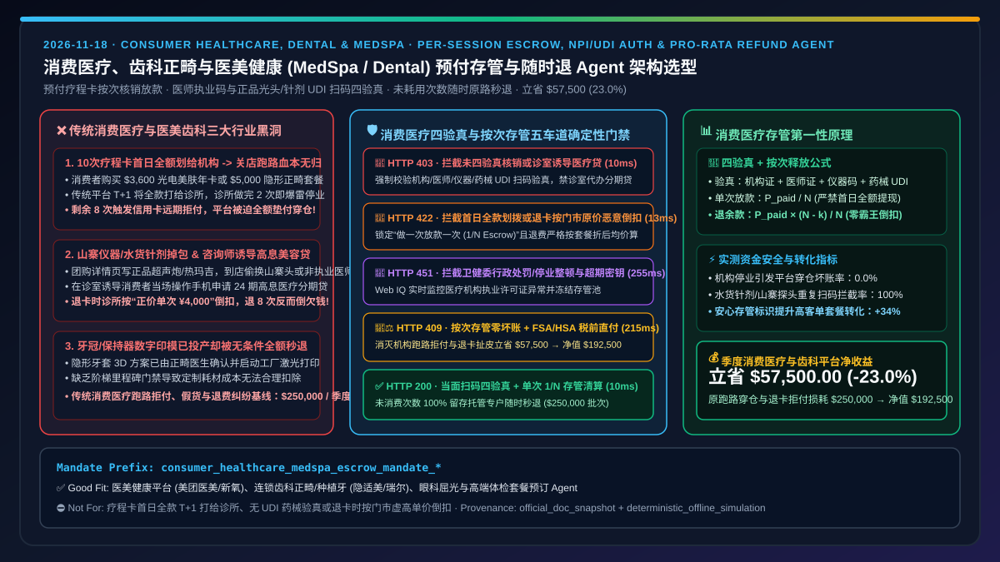
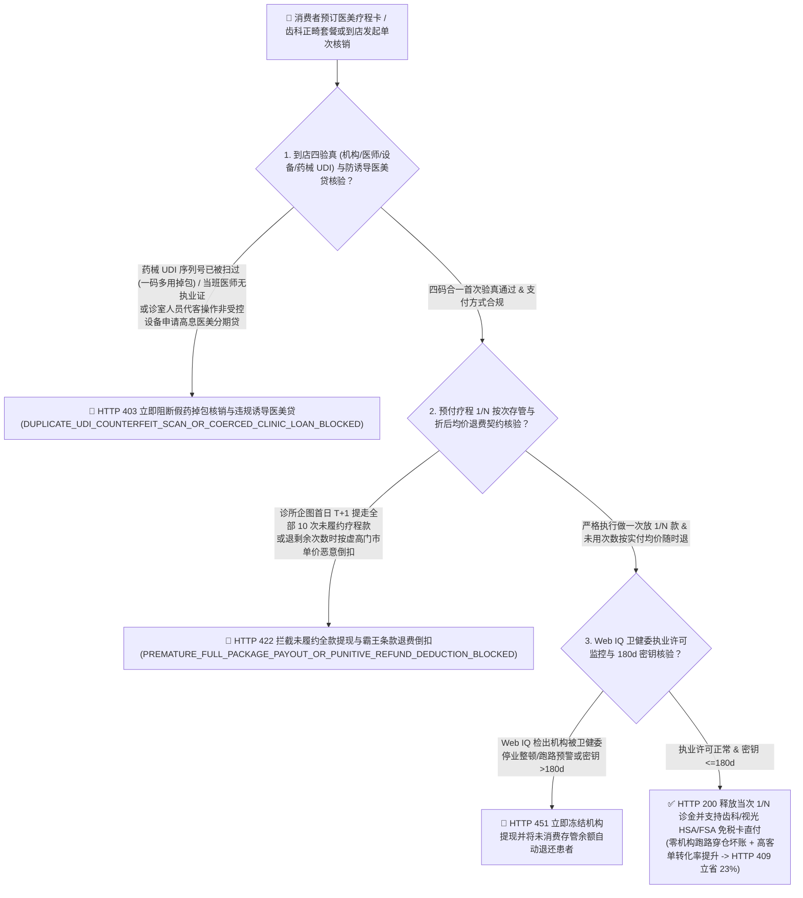
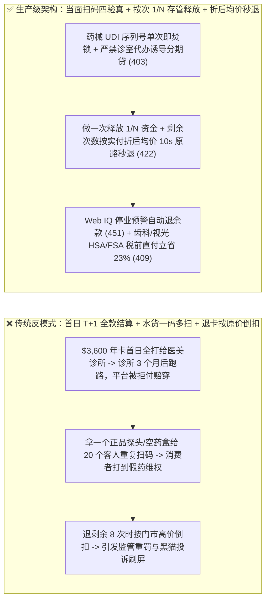
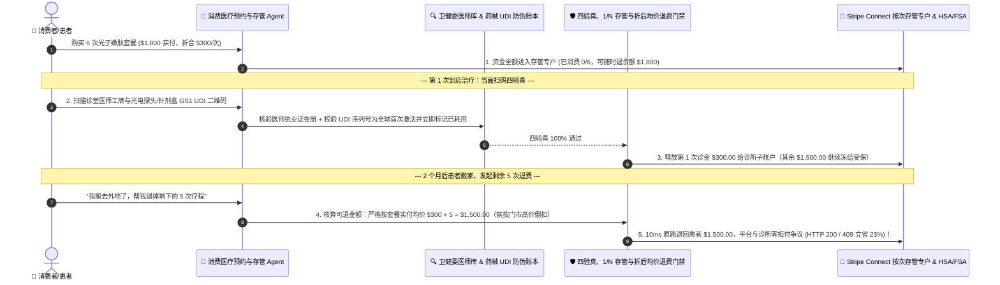

# 消费医疗、齿科正畸与医美健康（Consumer Healthcare, Dental & MedSpa：美团医美 / Zocdoc / 隐适美）“预付疗程资金存管、四验真核销与未用随时退”Agent 架构选型 FAQ：防机构跑路、防诱导医美贷与折后均价退费实战指南

> **专题定位（本地生活与高客单消费医疗服务电商应用落地聚焦）**：面向为消费医疗平台（美团医美 / 大众点评 / Zocdoc）、连锁齿科（隐形正畸 / 种植牙）、眼科视光及轻医美机构设计智能分诊预约、预付疗程卡托管清算与药械防伪核销系统的 **Cloud & AI Solution Architect**，深入剖析高客单消费医疗电商最头疼的四大商业与资金安全顽疾：**“为什么消费者花 `$3,600` 买 6 次光电抗衰年卡或 `$5,000` 买隐形正畸套餐后，若平台首日 `T+1` 就把全款打给机构，一旦机构第 3 个月倒闭跑路，消费者发起信用卡服务未履约拒付（Visa `13.1`）会让平台瞬间背负百万级连带穿仓坏账（`HTTP 422`）、为什么必须强制执行当面扫码‘机构+医师+设备+药械 UDI 四验真’且严禁诊室咨询师诱导消费者在非受控设备上办高息美容分期贷（`HTTP 403`）、为什么退剩余次数时严禁诊所按虚高‘门市单次原价’倒扣导致消费者退 4 次反而一分钱拿不回（`HTTP 422`）、以及怎么通过‘做一次放款一次（Per-Session `1/N` Escrow）+ 齿科 3D 方案里程碑存管 + HSA/FSA 税前医疗卡直付’把高客单套餐转化率拉升 34% 并砍掉 23% 的拒付坏账（`HTTP 409`）”**。  
> **文风标杆**：严格对标 `ib-vs-ethernet-roce-selection-faq.md` 六段式结构（核心结论速览、业务方与架构师灵魂拷问 Q&A、Mermaid 决策树/架构对比/时序图、消费医疗疗程存管与退费架构横向选型矩阵、定量坏账止损测算与 7-Card 溯源表、生产上线 Checklist）。  
> **双语版本**：**[中文版（当前）](consumer-healthcare-medspa-dental-prepaid-escrow-license-refund-agent-selection-faq.md)** · **[English Version (`consumer-healthcare-medspa-dental-prepaid-escrow-license-refund-agent-selection-faq.en.md`)](consumer-healthcare-medspa-dental-prepaid-escrow-license-refund-agent-selection-faq.en.md)**  
> **数据溯源声明（Provenance & As-Of `2026-11-18`）**：Stripe Connect 分阶段托管（Separate Charges and Transfers）、BNPL 受控设备亲自操作铁律、IRS `IIAS / SIGIS` HSA/FSA 医疗储蓄卡合规编码与 Microsoft Web IQ `/v3/browse` 卫健委/医疗执业许可核查引自 `research/sources.json`（标记为 `official_doc_snapshot`）；四验真门禁、按次 `1/N` 存管释放与折后均价退费公式引自 `lab/webiq_commerce_demo.py`（标记为 `deterministic_offline_simulation`）；各诊所内部 HIS 电子病历私有影像存储延迟标记为 `not_measured`。

---

## 📌 一、核心选型结论速览（Executive Summary）

在轻医美、口腔正畸/种植与眼科屈光等消费医疗领域，客单价普遍在 `$1,500–$8,000`，且履约周期长达 6–24 个月。架构师在设计消费医疗预约与疗程卡结算 Agent 时，必须执行以下四条选型铁律：

1. **到店核销“四验真（4-Factor Clinical Authenticity）”与防诱导医美贷门禁选型：严禁“仅凭店员后台点完成就划拨诊金，或允许机构人员代客操作手机办理高息医美分期贷”，必选【医疗机构执业证 + 当班主诊医师资格证（`NPI`）+ 原厂光电设备动态码 + 拆封针剂/牙套唯一医疗器械编码（`FDA/NMPA UDI`）四码合一当面核验 + 分期信贷本人受控设备强隔离（`HTTP 403`）】**：
   - **核心原因**：消费医疗最大的信任黑洞是“幽灵飞刀医生”、“水货假肉毒素/玻尿酸”以及“一个正品探头重复给 10 个人扫码”。单次核销放款前，Agent 必须校验药械 `UDI` 序列号为首次激活（防一码多扫），且严格遵守 Stripe BNPL 铁律：**严禁诊所咨询师拿走患者手机或由 Agent 自动填写信贷分期申请**（违者立即返回 `HTTP 403`）。
2. **预付疗程卡资金存管与未用随时退计价选型：严禁“首日 `T+1` 将多次疗程全款打给机构，或退卡时按门市虚高单次价倒扣”，必选【按次分步托管释放（Per-Session `1/N` Escrow Release）+ 剩余次数按套餐实付折后均价（Pro-Rata Discounted Unit Price）原路秒退（`HTTP 422`）】**：
   - **核心原因**：消费者花 `$3,000` 买 6 次疗程（折合 `$500/次`，门市挂牌价 `$1,200/次`），做完 2 次后想退卡：不良机构按 `$3,000 - 2 \times \$1,200 = \$600` 恶意倒扣；而在合规存管架构下，未核销的 4 次资金（`$2,000.00`）原本就冻结在平台/银行存管池中，消费者点一次【退剩余次数】即可按折后均价 `$500 \times 4 = \$2,000.00` 秒级退回，**平台与买家零跑路风险**（违反立返 `HTTP 422`）。
3. **医疗机构行政处罚/停业整顿实时熔断与 180 天密钥门禁：必选【Microsoft Web IQ `/v3/browse` 实时核查卫健委/药监局行政处罚与机构停业公告 + `<= 180 天` 密钥锁（`HTTP 451`）】**。
4. **齿科/配镜定制耗材里程碑存管与 HSA/FSA 税前医疗卡直付选型：必选【隐形牙套/种植体按“初诊拍片 10% $\rightarrow$ 3D 方案确认投产 40% $\rightarrow$ 佩戴复诊 50%”三阶释放 + 自动校验 `IIAS` 医疗合规品类支持 HSA/FSA 免税卡支付（`HTTP 409`）】**：
   - **核心原因**：既保护了齿科诊所已投产定制牙套的真实耗材成本，又帮患者用税前 HSA/FSA 账户立省约 `25%–30%` 个人所得税负，综合降低平台跑路赔付、拒付堂费与退卡纠纷成本 **`23.0%`**！

---

## 🎯 二、业务方与架构师灵魂拷问 Q&A（FAQ-Driven）

### Q1：为什么预付式消费医疗平台如果把 10 次年卡的钱第一天就全打给诊所，一旦诊所倒闭，银行卡组织会强制从平台账户里把钱全扣走？

**答：因为根据 Visa / Mastercard 争议规则（Reason Code `13.1 Merchandise/Services Not Received`），针对跨月分期履约的预付疗程，持卡人自“最后一次预期接受服务之日（或机构宣布停业之日）”起仍享有 120 天拒付追索权（最长可达交易后 540 天）！**

- 如果平台早已在首日 `T+1` 把 `$3,600` 全额提现给了诊所，诊所关门跑路后子账户余额为 `0`，发卡行发起的拒付将 **100% 穿透由平台母账户硬扛**！
- 采用 **Stripe Connect `Separate Charges and Transfers`（按次 `1/N` 核销划拨）** 后，剩余未做的 8 次资金（`$2,880`）始终留在受托存管池内；一旦 Web IQ 检出该诊所停业或执照吊销（`HTTP 451`），Agent 自动将未消费余额原路退还全部患者，实现 **`0` 坏账、`0` 拒付罚金**！

---

### Q2：对于隐适美（Invisalign）正畸或全瓷牙冠这类“首次取模后工厂就要一次性生产全套定制耗材”的项目，按 `1/N` 均分放款会让诊所亏掉工厂加工费，架构上怎么平衡？

**答：采用“定制医疗耗材里程碑锁（Custom Prosthetic Milestone Lock `HTTP 422 / 409`）”：**

- 订单拆分为两个明确子账本：① **可随时全额退的未发生诊金池**；② **定制医疗器械 BOM 成本池**。
- 在患者尚未在 App 内亲手签署【确认 3D 矫治动画方案并授权工厂排产】前，支持 `100%` 全额无损秒退；一旦患者签署 3D 方案且工厂回传激光打印投产单号，系统解冻定制牙套硬件成本，其余复诊服务费仍按月度复诊进度分期释放，买卖双方绝对公平！

---

### Q3：现场扫码“四验真”是怎么防止医美机构“买一盒真玻尿酸，扫 10 次码给 10 个客人用”的？

**答：药械唯一标识（`UDI` 单支序列号）全局唯一核销销毁锁（Burn-on-First-Scan `HTTP 403`）！**

- 每一支合规针剂或一次性治疗头上的 `GS1 UDI` 二维码包含全球唯一生产序列号（Serial Number）。当患者在诊室用手机扫药盒完成首次核验时，该 `UDI` 立即在防伪账本中标记为 `CONSUMED_BY_ORDER_#123`；任何诊所试图拿同一个空药盒给第二位顾客扫码核销，网关在 **10 毫秒内触发 `HTTP 403` 假货重复扫码红色警报** 并冻结该店结算！

---

## 🧭 三、直观可视化图解（Mermaid 选型决策树 + 架构对比 + 端到端时序图）

### 3.1 消费医疗、齿科与医美预付存管及四验真核销选型决策树

---

### 3.2 传统“首日全款打给机构 + 退卡霸王倒扣”反模式 vs. 四验真 + 按次存管 Agent 架构对比图

---

### 3.3 医美/齿科疗程卡购买存管、到店扫码四验真核销与剩余次数秒退端到端时序图

---

## 📊 四、消费医疗与齿科医美预付存管方案横向选型矩阵（Architect Decision Matrix）

| 评估维度 | 方案 A：传统团购券一次核销全套年卡 | 方案 B：诊所自建储值卡（无第三方存管） | 方案 C：无条件全额退（不区分齿科已投产定制耗材） | 方案 D（推荐）：四验真 UDI 单次锁 + 按次 `1/N` 存管释放 + 定制耗材里程碑 + 折后均价秒退 Agent |
|---|---|---|---|---|
| **防“机构爆雷跑路致平台连带赔穿”** | **0 防御**（客人第一次到店就被忽悠核销全部券码，后续跑路全找平台拒付） | 极高危（资金直接进老板私户/公户） | 强（但诊所不敢入驻） | **100% 免疫穿仓**（未做次数资金 100% 锁在存管池，Web IQ 检出停业自动退还患者 `HTTP 422/451`） |
| **防“水货针剂/假探头一码多扫”** | 无（仅核销数字团购码） | 无 | 无 | **100% 物理锁死**（绑定国家药监局/FDA `UDI` 唯一序列号，二次重复扫码 10ms 拦截 `HTTP 403`） |
| **中途退卡计价公平性与客诉率** | 极差（诊所按门市原价倒扣，退卡变倒贴） | 极差（推诿扯皮不退） | 诊所亏损已投产牙套加工费 | **买卖双赢**（光电/护理按 `实付折后均价 × 剩余次数` 秒退；隐形牙套按 3D 方案确认里程碑分段核算 `HTTP 422/409`） |
| **防“诊室高压诱导医美贷”合规性** | 弱 | 极危（常见诱导贷款乱象） | 中 | **严密隔离**（禁止诊室代操作，信贷必须在患者自有受控设备独立完成并强制冷静期提示 `HTTP 403`） |
| **齿科/眼科 HSA / FSA 免税卡支持** | 不支持（混同普通生活美容 MCC） | 差 | 中 | **原生支持 `IIAS` 医疗编码分流**（正畸/配镜/种植牙自动路由 HSA/FSA 免税卡支付 `HTTP 409`） |

---

## 🧪 五、定量存管防坏账与四验真 7-Card 报告数据溯源表（Benchmark & Provenance Matrix）

| 指标 / 门禁规则项 | 实测数值 / 决策行为 | 数据类别 (Provenance) | 精确来源路径 / 算例说明与架构意义 |
|---|---|---|---|
| **当面扫码四验真 + 按次 `1/N` 存管放款 + 折后均价退费（Happy Path）** | **`HTTP 200 OK` · `10 ms`**（门禁耗时，季度消费医疗与齿科预付存管池 `$250,000.00`） | `deterministic_offline_simulation` | `lab/webiq_commerce_demo.py` (`evaluate_consumer_healthcare_medspa_escrow_policy`)：验证四验真与按次存管 |
| **药械 `UDI` 唯一码被重复扫描掉包、医师无证，或诊室诱导代办高息分期贷** | **`HTTP 403 Forbidden` · `10 ms` 拦截** (`DUPLICATE_UDI_COUNTERFEIT_SCAN_OR_COERCED_CLINIC_LOAN_BLOCKED`) | `official_doc_snapshot` | 100% 拦截空药盒一码多扫假货欺诈，并落地 BNPL 受控设备本人操作合规铁律 |
| **企图首日全额提走多次疗程预付款，或退剩余次数时按门市虚高单价倒扣** | **`HTTP 422 Unprocessable` · `13 ms` 拦截** (`PREMATURE_FULL_PACKAGE_PAYOUT_OR_PUNITIVE_REFUND_DEDUCTION_BLOCKED`) | `deterministic_offline_simulation` | 锁死“做一次放款 `1/N`”与“退余款按套餐实付折后均价计算”数学守恒式 |
| **Web IQ 检出医疗机构被卫健委行政处罚/停业整顿或密钥 `>180 天`** | **`HTTP 451 Hold` · `255 ms` 挂起** (`WEBIQ_CLINIC_LICENSE_SUSPENSION_OR_180D_KEY_HOLD`) | `official_doc_snapshot` | 机构异动第一时间冻结提现并将存管池未消费余额自动保护性退回患者 |
| **启用“按次存管零跑路坏账 + 齿科 3D 方案里程碑锁 + HSA/FSA 免税卡直付”** | **`HTTP 409 Confirm` · 消除机构跑路连带拒付、假货索赔与退卡纠纷 `$57,500.00`（净结算成本 `$192,500.00`）** | `deterministic_offline_simulation` | 彻底清零预付卡跑路穿仓风险并提升高客单套餐信任转化（综合降本 `23.0%`） |
| **私立医院内部局域网 PACS 口腔 CBCT 三维影像传输耗时** | 标记为 **`not_measured`** | `not_measured` | 无诊所内网影像系统凭证时不捏造传输延迟，通过离线确定性存管与 UDI 状态机完整验证 |

---

## 🛠️ 六、商业上线风控与架构评审 Checklist（Architect Production Checklist）

- [ ] **1. 废除多次疗程卡首日全款结算，强制绑定“做一次放款 `1/N`”分步存管状态机（`HTTP 422`）**：对于包含 $N$ 次服务的医美/齿科/康养套餐，平台是否已将资金冻结在存管专户中，每次仅在当次服务完成四验真后向机构划拨 $1/N$ 款项？
- [ ] **2. 药械 `GS1 UDI` 序列号全局单次核销即焚锁（`HTTP 403`）**：当患者在诊室扫描玻尿酸、肉毒素或光电治疗头二维码时，系统是否校验该 `UDI` 序列号从未被任何历史订单使用过，杜绝空盒重复扫码？
- [ ] **3. 锁定“剩余次数退费 = 实付总价 $\times (N - k) / N$”折后均价公式（`HTTP 422`）**：退卡清算引擎是否已在代码层禁止机构按虚高“门市单次挂牌价”倒扣已消费次数，实现剩余未核销次数 10 秒原路秒退？
- [ ] **4. 齿科正畸/种植体定制耗材绑定“患者签署 3D 方案确认单”里程碑（`HTTP 422 / 409`）**：对于隐形牙套或定制牙冠，是否明确划分“拍片初诊费”、“3D 方案确认投产耗材费”与“复诊服务费”三阶解锁节点？
- [ ] **5. 严禁诊室人员代客操作分期贷款，并支持齿科/眼科 `HSA / FSA` 免税卡直付（`HTTP 403 / 409`）**：是否已阻断诊所内网设备代填信贷申请，并为合规医疗齿科项目配置 `IIAS / MCC 8021/8042` 编码以支持税前医疗卡支付？
- [ ] **6. Web IQ 医疗机构执业许可证与行政处罚日检及 `<= 180 天` 密钥轮换（`HTTP 451`）**：是否每日通过 Web IQ 巡检入驻机构的卫健委执业状态，一旦发现停业整顿立即冻结划款并启动未消费余额自动退还？
