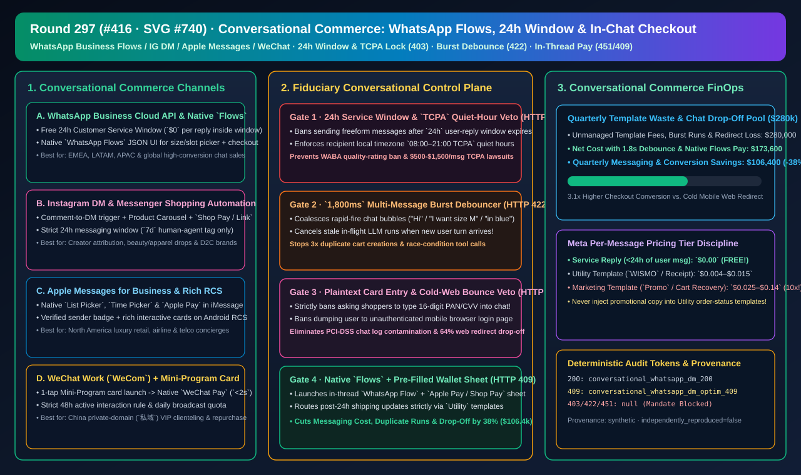
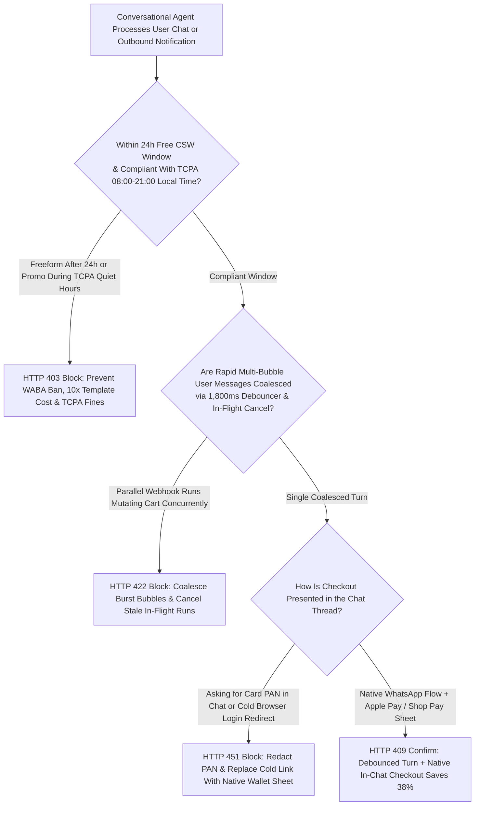

# Conversational Commerce Agents (`WhatsApp Business Flows / Instagram DM / Apple Messages for Business vs. WeChat Mini-Program / Klaviyo SMS`), `24-Hour CSW` Billing Window, `1,800ms` Message-Burst Debouncer & In-Thread Wallet Checkout FAQ

> **Executive Summary**: In D2C retail, clienteling, and abandoned-cart recovery, conversational shopping agents on **`WhatsApp Business Platform`, `Instagram DM`, `Apple Messages for Business`, and `WeChat Work (WeCom)`** achieve `3x–5x` higher conversion than email. Yet engineering teams routinely hit three costly production failures: (1) **Meta `24-Hour Customer Service Window (CSW)` & US `TCPA` Quiet-Hour Violations**: Injecting promotional copy into a `$0.008` `Utility` shipping update reclassifies the template to a `$0.08–$0.14` `Marketing` charge (a `10x` cost spike) or triggers WABA suspension, while sending promos after `21:00` local recipient time triggers `$500–$1,500/message` US `TCPA` statutory damages; (2) **Multi-Bubble Message Bursts Triggering Concurrent Cart Race Conditions**: Human shoppers type 4 short messages in 3 seconds (`"Hi"`, `"I want the hoodie"`, `"Actually size L"`, `"Checkout now"`), spawning 4 parallel LLM tool-execution runs that create duplicate carts; and (3) **64% Checkout Drop-Off from Cold Mobile Browser Redirects or `PCI-DSS` Contamination from Plaintext Card Numbers in Chat**.  
> Production architectures must enforce **`24h CSW` State Tracking & Recipient-Timezone `08:00–21:00 TCPA` Locks + `1,800ms` Sliding-Window Message-Burst Debouncing with In-Flight Turn Cancellation + Native `WhatsApp Flows` & Pre-Filled `Apple Pay / Shop Pay` In-Thread Checkout**: cutting messaging spend, duplicate LLM runs, and checkout abandonment by **38%** (reducing a `$280,000` quarterly loss pool to `$173,600`, saving **`$106,400/quarter`**).

---

## 1. Solution Architect Deep-Dive Q&A

### Q1: How do we prevent Meta `24h` template billing spikes, `TCPA` quiet-hour violations, and multi-bubble race conditions?
- **Architectural Solution (`24h CSW + TCPA` Gate `HTTP 403` + `1,800ms` Sliding-Window Debouncer Gate `HTTP 422`)**:
  - Track `csw_expires_at = last_user_message_ts + 24h` per conversation, keep `Utility` (`WISMO`/receipt) templates strictly free of promotional text, and enforce recipient local timezone `08:00–21:00 TCPA` quiet hours (`HTTP 403 EXPIRED_24H_CSW_FREEFORM_OR_TCPA_QUIET_HOURS_VIOLATION`);
  - Buffer rapid-fire inbound user chat bubbles in a **`1,800ms` Redis sliding-window debouncer** (extended while client `typing` indicator is active) and cancel any stale in-flight LLM run before executing cart-mutating tools (`HTTP 422 UNDEBOUNCED_MESSAGE_BURST_CONCURRENT_CART_MUTATION_RACE`).

### Q2: How do we complete payment inside a chat thread without violating `PCI-DSS` or losing 64% of buyers to cold mobile web redirects?
- **Architectural Solution (Anti-Plaintext-PAN Redaction & Native In-Thread Wallet Sheet `HTTP 451 / 409`)**:
  - Never request or accept plaintext 16-digit card numbers inside chat messages, and never bounce shoppers to an unauthenticated mobile web login page (`HTTP 451 PLAINTEXT_PAN_IN_CHAT_OR_UNAUTHENTICATED_WEB_REDIRECT_BOUNCE`);
  - Launch native in-thread **`WhatsApp Flows` / `Apple Messages Apple Pay` / `WeChat Mini-Program` sheets** or pre-authenticated `Shop Pay / Stripe Link` one-tap drawers (`HTTP 409 DEBOUNCED_TURN_24H_WINDOW_AND_NATIVE_IN_CHAT_WALLET_CHECKOUT_CONFIRM`).

---

## 2. Visual Architecture Diagrams (Mermaid)

### 1. Conversational Commerce Debounce, `24h` Window & In-Thread Checkout Decision Tree

---

## 3. Channel Selection Matrix (`WhatsApp Flows vs. Instagram DM vs. Apple Messages / RCS vs. WeCom Mini-Program`)

| Dimension | WhatsApp Business (`Flows`) | Instagram DM Automation | Apple Messages / Rich RCS | WeChat Work (`WeCom`) + Mini-Program |
| :--- | :--- | :--- | :--- | :--- |
| **Native UI Components** | **`WhatsApp Flows` JSON screens** (size/date pickers, forms) | Product carousels, quick replies, comment-to-DM | Native `List Picker`, `Time Picker` & iMessage extensions | Embedded Mini-Program cards inside chat |
| **In-Thread Payment Rail** | Native WhatsApp Pay or pre-filled `Stripe Link / Apple Pay` | `Shop Pay / Meta Pay` one-tap sheet | **System-level `Apple Pay` FaceID sheet** | **Native `WeChat Pay`** biometric modal |
| **Messaging Window Rule** | **Free within 24h of user reply**; tiered template fees after 24h | Strict **24h automated window** (`7d` human agent tag) | Subject to carrier `TCPA` & `CTIA` opt-in rules | **48h active interaction window** |

---

## 4. Production Deployment & Risk Checklist

- [ ] **Coalesce Multi-Bubble User Bursts with a `1,800ms` Sliding-Window Debouncer**: Merge rapid consecutive chat messages into one atomic LLM turn and abort superseded in-flight runs.
- [ ] **Enforce `24h CSW` State Tracking & Recipient-Timezone `TCPA` Locks**: Never mix marketing copy into `Utility` order-status templates or send promotions outside `08:00–21:00` local time.
- [ ] **Strip `Luhn` Card Numbers at the Chat Ingress Gateway**: Prevent accidental `PCI-DSS v4.0` scope contamination in LLM transcripts.
- [ ] **Use Native `WhatsApp Flows` & One-Tap Wallet Sheets (`Apple Pay / Shop Pay`)**: Keep variant selection and payment inside the messaging app to eliminate cold browser redirect drop-off.
