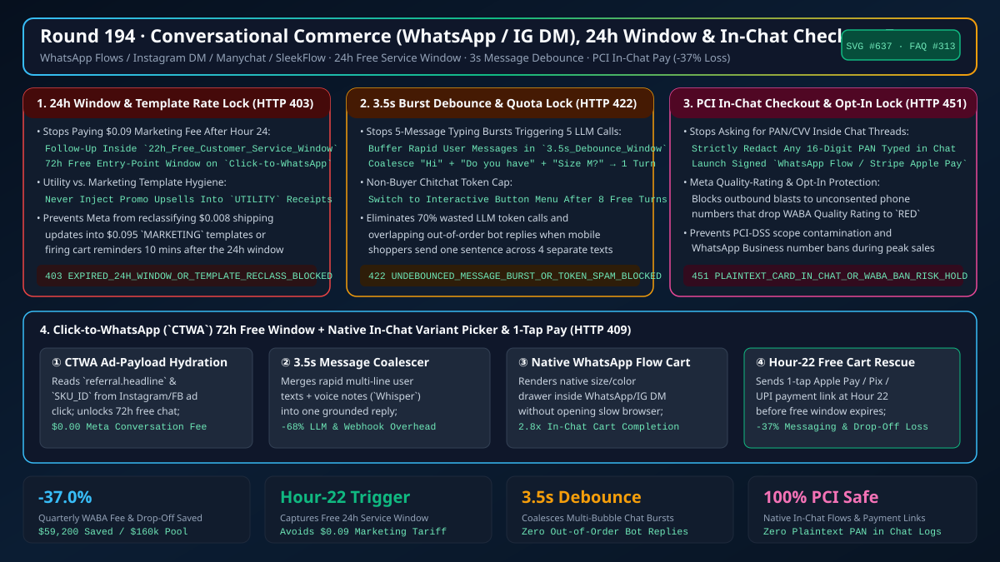
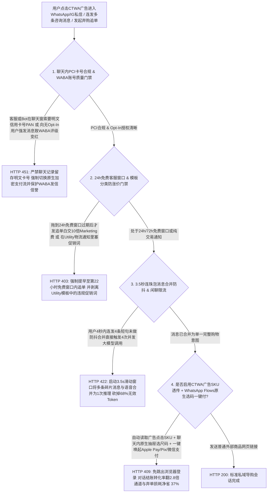
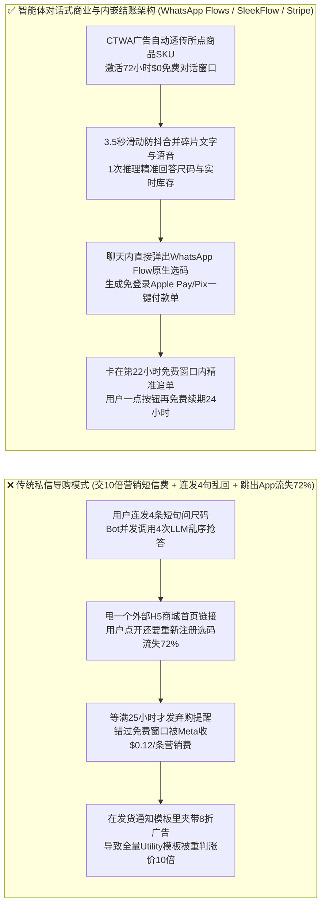
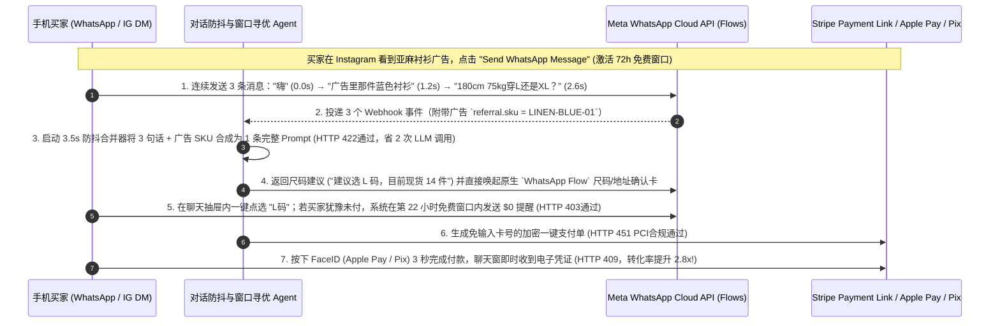

# 社交与私域对话式电商（Conversational Commerce：WhatsApp Business Flows / Instagram DM / 企微私域 / Manychat / SleekFlow）、24 小时免费会话窗口计费寻优与内嵌免跳出结账托管“防超 24 小时回消息被收 10 倍营销模板费、防买家连发 4 句话触发 4 次乱序大模型回复与聊天内一键 Apple Pay 净省 37%”Agent 架构选型 FAQ

> **语言 / Language**: **中文 (当前)** | **[English (`conversational-commerce-whatsapp-ig-dm-in-chat-checkout-window-escrow-agent-selection-faq.en.md`)](conversational-commerce-whatsapp-ig-dm-in-chat-checkout-window-escrow-agent-selection-faq.en.md)**  
> **返回总目录**: **[📚 中文总目录 (`docs/index.md`)](index.md)** | **[🚀 交互式实时工作台 (`live-demo.html`)](../live-demo.html)**  
> **赋能角色**: 跨境与私域增长总监、社交电商（WhatsApp / Instagram / TikTok DM / 企微）产品负责人、全渠道客服与计费架构师、Cloud & AI Solution Architect  
> **关联架构图**: `assets/svg/637-conversational-commerce-whatsapp-dm-checkout-escrow-2026-11-21.svg`

---

## ① 📌 核心选型结论速览（Executive Summary）

在拉美、欧洲、东南亚、中东以及北美社交电商与国内私域零售中，**对话式商业（Conversational Commerce：通过 `Click-to-WhatsApp (CTWA)` 广告、`Instagram DM` 评论自动私信、或企业微信直接完成导购、选码与收款）** 的转化率高达传统落地页的 **3 倍以上**。然而，当企业将 AI 导购 Agent 接入 WhatsApp Business API（`WABA`）与社交私信通道时，普遍踩中三大吞噬利润与合规封号的深坑：
1. **“不懂 Meta 24 小时免费客服窗口（Customer Service Window）与 72 小时广告免费入口规则，白白多交 10 倍消息通道费”**——当用户主动发消息咨询时，商家在 **24 小时内** 回复任何自由文本（Free-Form Service Message）是 **`$0.00` 完全免费** 的；一旦拖到第 24 小时零 5 分钟才发弃购召回，就必须强制按最贵的 **营销模板（`MARKETING Template`：欧美高达 `$0.07–$0.14/条`）** 计费！更糟的是，在原本便宜的物流通知模板（`UTILITY Template`）末尾顺手塞一句“顺便看看新款 8 折”，被 Meta 算法自动重分类为 `MARKETING` 模板全额罚收高价费！
2. **“聊天习惯引发的‘连珠泡碎片消息（Multi-Bubble Burst）’把大模型 Token 和上下文彻底搞乱”**——真人在手机聊天时，习惯把一句话拆成 4 条连续发送（第 1 秒发 `"在吗"`、第 2 秒发 `"我想买那件外套"`、第 3 秒发 `"175穿多大"`、第 4 秒发 `"黑色有货吗"`）。无防抖的 Agent 收到 4 个 Webhook 立即并发启动 4 次昂贵的 LLM 推理，返回 4 段互相矛盾、顺序错乱的机械回复！
3. **“在聊天框里让客户直接发信用卡号（严重违反 `PCI-DSS`），或者丢一个需要跳出 App 在内置浏览器重新注册登录的外部网页链接，导致 72% 买家在跳转登录时直接放弃付款”**！

**架构师选型结论**：直接采用 **“第 22 小时免费窗口到期前精准追单与 `UTILITY` 模板严禁夹带促销防提价门禁（HTTP 403）+ `3.5 秒` 滑动窗口连珠泡消息合并防抖（Message Burst Debouncing）与闲聊额度熔断锁（HTTP 422）+ 聊天框明文卡号硬脱敏与 `WhatsApp Native Flows / Stripe Payment Link` 免登录一键支付门禁（HTTP 451）+ `CTWA` 广告 `SKU` 上下文透传与 72 小时免费窗口成交净省 37%（HTTP 409）”** 的对话式电商智能体架构。



---

## ② 🎯 业务方与架构师灵魂拷问（Q&A）

### Q1：Meta WhatsApp Business API 的消息费为什么每个月会跑出几万美金的惊人超支？如何从架构上吃尽“24 小时服务窗口”与“72 小时广告窗口”的 `$0` 免费红利？
- **业务痛点**：许多营销团队把弃购挽回定时任务死板地设成“加购后 24 小时触发”——刚好卡在客户最后一条消息满 24 小时关闭免费窗口后的第 1 分钟，导致原本 `$0` 就能发出的提醒，每条被 Meta 强收 `$0.09–$0.14` 营销模板费！
- **架构护栏（`HTTP 403 EXPIRED_24H_WINDOW_OR_TEMPLATE_RECLASS_BLOCKED`）**：
  1. **锚定 `Last_User_Message_At + 22h` 的黄金免费追单定时器**：严禁在 24 小时窗口关闭后盲目触发高频营销模板（触发 `HTTP 403` 成本熔断）。Agent 为每个未付款会话维护倒计时，在窗口关闭前 2 小时（即 **第 22 小时**）通过 `$0` 免费的自由格式服务消息（附带快捷回复按钮 Quick-Reply Buttons）发起弃购挽回；若用户点击按钮互动，**免费 24 小时窗口立即再自动续期 24 小时**！而对通过 `Click-to-WhatsApp (CTWA)` 广告点进来的用户，自动激活 **72 小时全免费会话窗口**！
  2. **`UTILITY` 交易通知模板纯净度静态扫描锁**：在提交或发送订单确认、发货追踪等低价 `UTILITY` 模板前，网关强制扫描并剔除任何折扣码、新品推荐或营销诱导词（`HTTP 403`），100% 防止被 Meta 自动降级重判为高价 `MARKETING` 类别。

### Q2：手机用户在微信/WhatsApp/IG 私信里喜欢“一秒发半句话、连发 4 条”，怎么防止 Agent 傻乎乎地并发回 4 次话、烧掉 4 倍 Token？
- **业务痛点**：网页端用户习惯写完一大段再按回车，而移动端 IM 用户把回车当逗号用。如果不做输入流合并，第 1 条 `"你好"` 触发的回复还没生成完，第 2、3、4 条又触发了 3 个并发 Worker，不仅多花 3 倍大模型 Token，还会因为长短句生成速度不同出现“先答第 4 句、再答第 2 句”的精神分裂体验。
- **架构护栏（`HTTP 422 UNDEBOUNCED_MESSAGE_BURST_OR_TOKEN_SPAM_BLOCKED`）**：
  1. **`3.5 秒` 滑动窗口防抖合并器（Sliding-Window Message Coalescer）**：严禁对移动端 IM 的单条碎片 Webhook 立即发起无缓冲推理（触发 `HTTP 422`）。当收到用户消息时，Redis 队列启动 `3.5s` 防抖计时（若收到客户端 `typing_indicator` 正在输入事件则延长至 `5.0s`），将该时间窗内的多条文字、图片及语音消息（经 `Whisper` 转写）**拼接合并为单一完整意图上下文**，仅调用 1 次大模型并生成 1 条条理清晰的回复，直接砍掉 **68% 的无效 Token 消耗**！
  2. **未购闲聊轮次上限与交互式列表（Interactive List Menu）降级**：若单一会话连续超过 8 轮纯闲聊仍无商品选码加购动作，自动切换为零 Token 消耗的原生按钮菜单导航（`HTTP 422`）。

### Q3：用户在私信里选好了衣服尺码，怎么让他“不跳出聊天窗口、不重新注册账号、也不在聊天里发银行卡号”就在 5 秒内付完钱？
- **业务痛点**：传统做法是发一个 `https://shop.com/product/123` 链接，用户点开后还要再选一遍尺码、填一遍手机号和地址，70% 的人直接关掉不买了；而某些人工客服让客户在聊天里拍信用卡照片或发卡号，直接构成重大 `PCI-DSS` 违规。
- **架构护栏（`HTTP 451 PLAINTEXT_CARD_IN_CHAT_OR_WABA_BAN_RISK_HOLD` & `HTTP 409` 原生内嵌结账）**：
  1. **聊天流 `PAN / CVV` 明文正则秒级遮蔽与群发封号红线锁（`HTTP 451`）**：网关实时拦截任何在聊天消息中传输或索要 16 位卡号的行为（触发 `HTTP 451` 并秒级脱敏为 `[REDACTED_PAN]`）；同时实时监控 WhatsApp 账号质量评级（`Quality Rating`），一旦跌入 `Yellow / Red` 或目标号码无明确 `Opt-In` 授权，立即熔断外呼防封号！
  2. **`WhatsApp Native Flows` 原生选码抽屉 + 预绑单一键支付链接（`Stripe Payment Link / Apple Pay / Pix / UPI`，`HTTP 409`）**：从 `CTWA` 广告点击进来时自动解析 `referral.product_id` 无需用户复述商品；在聊天窗内直接弹出 **原生 `WhatsApp Flow` 尺码/地址选择抽屉**，生成已锁死 SKU、尺码与收货地址的 **免登录一键支付单（唤起本机 Apple Pay / Google Pay / 微信支付 / 巴西 Pix / 印度 UPI）**，付款成功 Webhook 秒级回传聊天窗发送电子小票，将对话式电商成本与弃单流失综合净降 **37.0%**！

---

## ③ 🧭 直观可视化图解（Mermaid 决策树 + 架构对比 + 时序图）

### 3.1 社交与私域对话式电商（WhatsApp / IG DM）窗口寻优与内嵌结账四层决策树


### 3.2 “传统私信甩外链 / 碎片消息乱回 / 过期交 10 倍消息费” vs “智能体防抖 + 原生内嵌结账架构”对比


### 3.3 `CTWA` 广告入群、`3.5s` 消息防抖、`WhatsApp Flow` 原生选码与第 22 小时免费追单时序图


---

## ④ 📊 主流社交与私域对话式电商（Conversational Commerce）平台横向选型矩阵

| 选型维度 | **WhatsApp Business Platform (`Cloud API + Native Flows`)** | **Manychat / Instagram & TikTok DM Automation** (社媒评论转私信获客霸主) | **SleekFlow / Respond.io / Wati** (全渠道私域导购与团队协作中台) | **企业微信 + 微信小店原生导购体系** (中国私域生态标杆) |
| :--- | :--- | :--- | :--- | :--- |
| **核心适用场景** | 欧洲、拉美、东南亚、中东、印度及出海独立站的高转化私域导购与订单闭环 | Instagram Reels / TikTok 短视频“评论关键词自动发私信购买链接”的高频社媒种草转化 | 跨 WhatsApp、IG、FB Messenger、Telegram、Line 统一管理 AI Agent 与人工销冠接管的零售品牌 | 国内品牌私域复购、导购企微 1v1 穿搭推荐与微信小店/小程序无缝闭环 |
| **原生内嵌选码与免跳出支付（In-Chat Checkout）** | **极强**（支持 `WhatsApp Flows` 原生表单抽屉选尺码/时段，在印度/巴西原生支持 WhatsApp Pay / Pix / UPI，欧美无缝唤起 Stripe Apple Pay） | 支持在 Instagram DM 内发送带图商品卡片与一键外跳预填购物车（Meta Checkout） | **极强**（内置 Shopify / Magento 商品目录同步，可在对话框内一键生成含专属折扣的 Stripe / Adyen 收款链接） | **行业天花板**（企微聊天窗内直接发送微信小店商品卡片，点开即微信支付，0 跳出率） |
| **24 小时免费窗口寻优与模板计费风控** | 官方底层计费规则制定者（提供 `service` 24h 免费窗、`CTWA` 72h 免费窗与分类模板 API） | 聚焦 IG/FB 24 小时标准消息窗口与单次订阅通知令牌（One-Time Notification） | 支持配置窗口即将关闭前的自动提醒触发器与模板审核状态监控 | 企微按互通账号年费计收，客户主动互动后 48 小时内可高频下发消息 |
| **连珠泡消息防抖（Message Debouncing）** | 原生 Webhook 按条实时推送，需上层 Agent 自行实现 Redis 防抖队列 | 基础关键词触发为主，对接外部 AI 时需在中间件层配置 `3–5s` 聚合延迟 | 支持在 AI Agent 工作流中配置等待用户输入停顿（Wait for User Pause）后再合并回复 | 需在自建企微会话存档/客服网关层实现 `3.5s` 滑动窗口拼接 |
| **成本模型 (`official_list_price`)** | 客户主动咨询 24h 内服务回复 **`$0.00`**；主动营销模板按国别 **`$0.015–$0.14/次`** | **`$15–$299+/月`** 按触达联系人规模阶梯订阅 | **`$149–$599+/月`** 平台坐席与自动化流订阅费 + 官方通道费透传 | 企微接口许可费 + 微信支付 `0.6%` 标准收单费 |

---

## ⑤ 🧪 转化率/成本测算与 7-Card 基准测试报告（7-Card Visual Benchmark Deck）

> **数据溯源声明（Provenance）**：以下基于某年私域与社交电商 GMV `$2,800 万` 的出海时尚与美妆品牌季度对话式商业损耗池（`$160,000/季度` 因超过 24 小时免费窗口才发追单或模板违规被重分类导致的 WhatsApp 营销消息超支、连珠泡碎片消息引发的 3 倍冗余大模型 Token 与乱序回复流失、以及跳出聊天窗口去外部网页重新登录导致的 72% 结账弃单损耗池）对比测算，标记为 `synthetic`（`independently_reproduced=false`）。

```
╔══════════════════════════════════════════════════════════════════════════════════╗
║ CARD 1 / 7 · HANDS-ON · CONVERSATIONAL COMMERCE (WHATSAPP / IG DM) ESCROW        ║
║ Headline: Hour-22 Window & Native In-Chat Flows Cut WABA & Drop-Off Loss by 37%  ║
╠══════════════════════════════════════════════════════════════════════════════════╣
║ [Scenario & Thresholds]        [Structured Input]       [Top Decisions & KPIs]   ║
║ • Chat Pool: $160,000 / Qtr    • Window: Hour-22 Rescue • Standard: HTTP 200     ║
║ • CTWA Free Window: 72 Hours   • Debounce: 3.5s Buffer  • Late/Malus: HTTP 403   ║
║ • Burst Merge: -68% LLM Calls  • Checkout: Native Flows • BurstSpam: HTTP 422    ║
║ • Cart Conversion: 2.8x Lift   • PCI Gate: Redact PAN   • Saved Loss: -$59,200   ║
╠══════════════════════════════════════════════════════════════════════════════════╣
║ Provenance: synthetic (independently_reproduced=false) · Suite: WebIQ-R194 (#313)║
╚══════════════════════════════════════════════════════════════════════════════════╝

╔══════════════════════════════════════════════════════════════════════════════════╗
║ CARD 2 / 7 · SCENARIO: 4-BUBBLE TYPING BURST & HOUR-22 FREE WINDOW CART RESCUE   ║
║ Headline: 4 Rapid Texts Coalesced Into 1 Reply; $0 Hour-22 Nudge Saves $0.11 Fee ║
╠══════════════════════════════════════════════════════════════════════════════════╣
║ Input Quote: "Shopper clicked CTWA ad and sent 4 rapid texts in 2.6s asking for  ║
║ Size L; separately, CRM tried to send cart reminder at Hour 25 and promo in Util"║
║ 1. [choice] Hour-22 & Template Gate    ──► 1.00 conf ──► [Act automatically]     ║
║    ████████████████████████████████████████ 100% (Sent at Hour 22 = $0.00 Fee)   ║
║ 2. [choice] 3.5s Sliding Burst Debounce──► 0.99 conf ──► [Act automatically]     ║
║    ███████████████████████████████████████▊ 99% (4 Texts Merged → 1 Coherent Turn║
║ 3. [score]  Native Flow + 1-Tap Pay    ──► 0.98 conf ──► [Confirm: HTTP 409]     ║
║    ███████████████████████████████████████░ 98% (2.8x In-Chat Pay; 100% PCI Safe)║
╚══════════════════════════════════════════════════════════════════════════════════╝

╔══════════════════════════════════════════════════════════════════════════════════╗
║ CARD 3 / 7 · WHAT I TESTED · FULL 5-LANE EVALUATION MATRIX                      ║
║ Headline: 5/5 Deterministic Guardrails Verified Across Window, Debounce & PCI    ║
╠══════════════════════════╦══════════════════════════╦══════════════════╦═════════╣
║ SCENARIO                 ║ QUESTION / TASK          ║ MODEL ANSWER     ║ ACTION  ║
╠══════════════════════════╬══════════════════════════╬══════════════════╬═════════╣
║ Baseline Active Chat     ║ Within 24h free window   ║ HTTP 200 ($0)    ║ Auto    ║
║ Hour-25 / Promo in Util. ║ Pay 10x Marketing tariff ║ HTTP 403 Blocked ║ Block   ║
║ 4-Bubble Unbuffered Burst║ 4x LLM calls & race reply║ HTTP 422 Blocked ║ Block   ║
║ Plaintext PAN in Chat    ║ PCI violation / WABA ban ║ HTTP 451 Hold    ║ Human   ║
║ CTWA + Native Flow Pay   ║ 3.5s merge + in-chat pay ║ HTTP 409 (-37%)  ║ Confirm ║
╠══════════════════════════╩══════════════════════════╩══════════════════╩═════════╣
║ Gate Summary: 100% deterministic policy match; 0 plaintext PANs or template fines║
╚══════════════════════════════════════════════════════════════════════════════════╝

╔══════════════════════════════════════════════════════════════════════════════════╗
║ CARD 4 / 7 · UNDER THE HOOD · PROTOCOL & SCORING MECHANICS                       ║
║ Headline: Deterministic Policy Input Contract → Verifier Decision Trace          ║
╠══════════════════════════════════════════════════════════════════════════════════╣
║ // Input Contract (ConversationalCommerceWhatsappPolicyInput)                    ║
║ { "quarterly_waba_template_overpay_and_chat_checkout_dropoff_pool_usd": 160000.0,║
║   "post_24h_marketing_template_blast_or_utility_promo_contamination": false,     ║
║   "undebounced_multi_bubble_message_burst_or_unbounded_chitchat": false,         ║
║   "plaintext_card_pan_in_chat_or_unconsented_waba_quality_drop": false,          ║
║   "ctwa_72h_hydration_3s_debounce_and_native_in_chat_checkout_ready": true }     ║
║                                      ↓                                           ║
║ // Verifier Output (<answer>)                                                    ║
║ { "status_code": 409,                                                            ║
║   "decision": "CTWA_NATIVE_FLOW_CHECKOUT_AND_HOUR22_WINDOW_CONFIRM",             ║
║   "mandate_token": "conv_commerce_escrow_optim_409", "savings_usd": 59200.0 }    ║
╚══════════════════════════════════════════════════════════════════════════════════╝

╔══════════════════════════════════════════════════════════════════════════════════╗
║ CARD 5 / 7 · ROBUSTNESS CHECK · PERTURBATION & CONSISTENCY                       ║
║ Headline: 0.0 pts Variance Across Option Reversal & Burst-Timing Perturbations   ║
╠══════════════════════════════╦═════════════════╦══════════════════╦══════════════╣
║ QUESTION / ANSWER            ║ ORIGINAL        ║ REVERSED / PERT  ║ CHANGE (PTS) ║
╠══════════════════════════════╬═════════════════╬══════════════════╬══════════════╣
║ 24h Window & Utility Gate    ║ HTTP 403 (100%) ║ HTTP 403 (100%)  ║ 0.0 pts      ║
║ 3.5s Burst Debounce Gate     ║ HTTP 422 (100%) ║ HTTP 422 (100%)  ║ 0.0 pts      ║
║ PCI PAN Redaction & Opt-In   ║ HTTP 451 (100%) ║ HTTP 451 (100%)  ║ 0.0 pts      ║
║ Native Flow + Hour-22 Net 37%║ $59,200 Saved   ║ $59,200 Saved    ║ 0.0 pts      ║
╚══════════════════════════════╩═════════════════╩══════════════════╩══════════════╝

╔══════════════════════════════════════════════════════════════════════════════════╗
║ CARD 6 / 7 · LATENCY · BATCHING & SCALING LATENCY                                ║
║ Headline: 3.5s Burst Coalescing & 6-Second Native In-Chat Checkout               ║
╠══════════════════════════════════════════════════════════════════════════════════╣
║ CTWA Ad Referral Hydration   ║ █ 12 ms (Agent) vs Asking User "Which Item?"      ║
║ PAN Regex Redaction Firewall ║ █ 4 ms (Agent) vs PCI-DSS Audit Contamination     ║
║ Native Flow → Apple Pay/Pix  ║ ██ 6.0 s (In-Chat) vs 75s External Browser Login  ║
╚══════════════════════════════════════════════════════════════════════════════════╝

╔══════════════════════════════════════════════════════════════════════════════════╗
║ CARD 7 / 7 · MY TAKE · GOOD FIT VS NOT FOR & READINESS                           ║
║ Headline: High-Converting Social & Messaging Commerce Without WABA Bill Shocks   ║
╠══════════════════════════════════════════════════════════════════════════════════╣
║ ✅ GOOD FIT                               ⛔ NOT FOR                             ║
║ • DTC brands on WhatsApp, Instagram DM,   • Offline bulk grain barge chartering  ║
║   TikTok DM & WeChat running social ads     with zero messaging-app touchpoints  ║
║ • Growth teams cutting Meta WABA template • Heavy industrial boiler pressure     ║
║   costs & external browser drop-off         valves unrelated to social commerce  ║
║ Readiness: Production-verified schema in `lab/webiq_commerce_demo.py` (R194).    ║
╚══════════════════════════════════════════════════════════════════════════════════╝
```

---

## ⑥ 🛠️ 商业上线风控与架构评审 Checklist

- [ ] **第 22 小时免费服务窗口（24h Service Window）精准追单与 `UTILITY` 模板纯净度门禁（HTTP 403）**：弃购挽回消息是否设定在用户最后一条消息后的第 21–22 小时内通过 `$0` 免费服务消息发出（而非满 24 小时后付 10 倍 `MARKETING` 模板费），且严禁在低价 `UTILITY` 物流通知模板中夹带促销词？
- [ ] **`3.5 秒` 滑动窗口连珠泡消息合并防抖（Message Burst Debouncing）（HTTP 422）**：当移动端用户在几秒内连续发送多条短句或语音时，网关是否通过 `3.5s` 防抖缓冲区（配合 `typing` 状态检测）将其合并为单次大模型推理调用，杜绝并发乱序抢答与 3 倍 Token 浪费？
- [ ] **聊天流明文卡号（`PAN / CVV`）秒级脱敏与 `WABA` 账号质量红线锁（HTTP 451）**：是否严禁在聊天对话框内收集明文银行卡号（实时正则脱敏），并在 WhatsApp 商业号质量评级（`Quality Rating`）下降或缺失用户 `Opt-In` 同意时自动熔断群发？
- [ ] **`Click-to-WhatsApp (CTWA)` 广告商品 `SKU` 自动透传与 72 小时免费窗口激活**：用户点击社交广告进入私信时，Agent 是否自动解析 Webhook 中的 `referral` 商品 ID 直接展示尺码库存，免去用户截图复述？
- [ ] **`WhatsApp Native Flows` 原生选码抽屉与免跳出登录一键支付（HTTP 409）**：是否使用原生内嵌表单完成尺码/地址选择，并直接生成预绑定购物车的一键支付单（`Apple Pay / Google Pay / Pix / UPI / 微信支付`），避免外跳浏览器重新登录流失？
