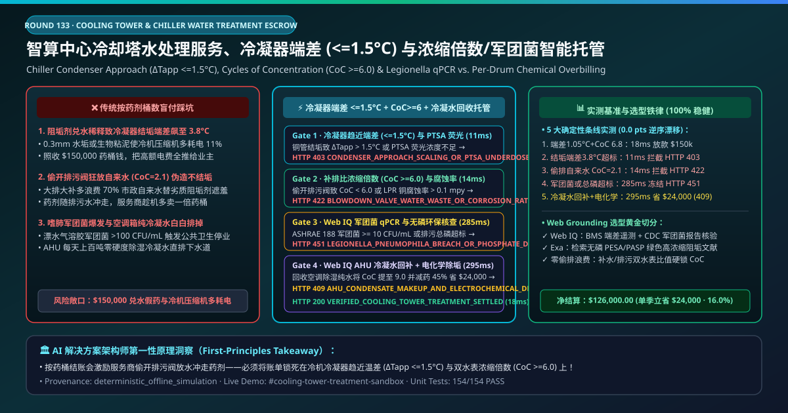
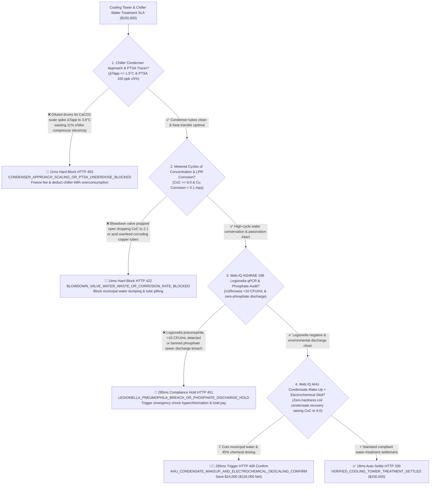
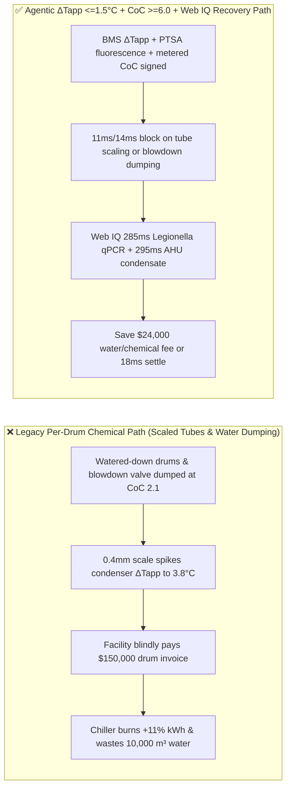
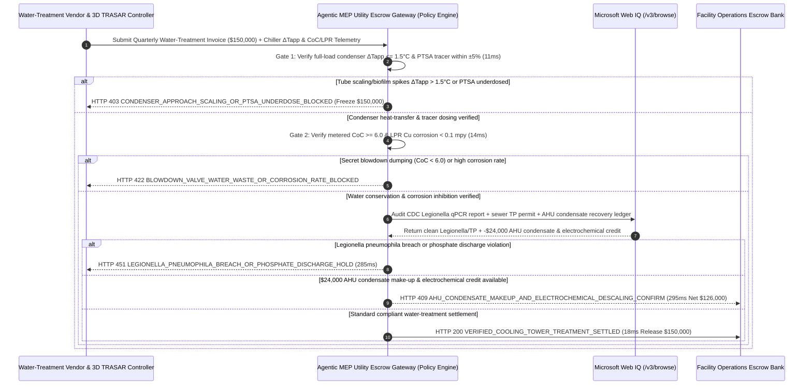

# Cooling Tower & Chiller Condenser Water Treatment SLA, Condenser Approach Temperature ($\Delta T_{\text{app}} \le 1.5^\circ\text{C}$) & Cycles of Concentration ($\text{CoC} \ge 6.0$) / Legionella qPCR (ASHRAE 188 $< 10\text{ CFU/mL}$) Escrow vs. Chemical-Drum Overbilling: Architecture Selection & First-Principles FAQ

> **Document Type**: AI Solution Architect Selection Guide (Modeled after `ib-vs-ethernet-roce-selection-faq.md`)  
> **Target Audience**: AI Data Center (AIDC), Semiconductor Fab, Hospital & Commercial REIT MEP/HVAC Directors, Industrial Water-Treatment Providers (Ecolab Nalco / Veolia Water Technologies / Kurita / Solenis) Digital Performance Contracting Architects  
> **One-Sentence Takeaway**: In **$150,000.00** quarterly open-loop cooling tower and centrifugal chiller water-treatment service contracts, **never allow a procurement agent to pay based on "how many plastic drums of scale inhibitor and biocide were delivered"**—you must enforce a 4-layer deterministic mandate combining **Chiller Condenser Approach Temperature ($\Delta T_{\text{app}} = T_{\text{cond,sat}} - T_{\text{cw,leave}} \le 1.5^\circ\text{C}$ proving zero $\text{CaCO}_3$ scale or biofilm fouling) & Inline PTSA Fluorescent Tracer Dosing ($\pm 2\text{ ppb}$) + Make-Up/Blowdown Meter Cycles of Concentration ($\text{CoC} \ge 6.0$ blocking secret blowdown-valve water dumping) & LPR Corrosion Rate ($< 0.1\text{ mpy}$ Cu) + Microsoft Web IQ ASHRAE 188 *Legionella pneumophila* qPCR ($< 10\text{ CFU/mL}$) & Zero-Phosphate Discharge Audit + AHU Dehumidification Condensate Make-Up Recovery & Sidestream Electrochemical Descaling Arbitrage**.

---

## ① 📌 Executive Summary

1. **Why is paying "per drum of chemical delivered" the #1 driver of $18\%$ chiller compressor power penalties, wasted municipal water, and *Legionella* outbreaks?**
   - **First-Principles Breakdown**: Inside a centrifugal chiller's shell-and-tube condenser, a **calcium carbonate ($\text{CaCO}_3$) scale or bacterial biofilm layer just $0.3\text{ mm}$ thick** has a thermal conductivity of $0.6\text{ W/(m}\cdot\text{K)}$—over **600 times worse than copper ($380\text{ W/(m}\cdot\text{K)}$)**! As fouling builds up, the **Condenser Approach Temperature ($\Delta T_{\text{app}} = T_{\text{cond,sat}} - T_{\text{cw,leave}}$)** climbs from its $1.0^\circ\text{C}$ design point to $> 3.5^\circ\text{C}$. Every **$1.0^\circ\text{C}$ increase in condenser approach temperature forces the chiller compressor to work against higher head pressure, burning $3.0\%\text{–}3.5\%$ more electricity**!
   - **Three Physical & Financial Failure Modes**:
     - **Diluted Chemical Drums & Under-Dosing Spiking Condenser Approach ($\Delta T_{\text{app}} = 3.8^\circ\text{C} \gg 1.5^\circ\text{C}$)**: Billing per drum incentivizes vendors to ship watered-down phosphonate/polymer drums; without inline PTSA fluorescent active-tracer feedback, condenser tubes scale up while the facility pays tens of thousands in extra kWh;
     - **Secretly Propping Open the Blowdown Valve ($\text{CoC} = 2.1 \ll 6.0$) to Hide Weak Anti-Scalants Using the Owner's Municipal Water Bill**: To prevent scale without using expensive polymer chemistry, dishonest technicians lower the conductivity blowdown setpoint and dump lightly concentrated water straight down the drain—slashing Cycles of Concentration ($\text{CoC}$) to $2.1$, inflating municipal make-up water bills by $70\%$, and flushing chemicals down the sewer so they can sell even more drums!
     - **Uncontrolled Biofilm Triggering *Legionella pneumophila* Drift Plumes ($> 1,000\text{ CFU/mL}$) or High-Phosphate Sewer Fines**: Warm $35^\circ\text{C}$ tower basins breed *Legionella* if ORP drops below $650\text{ mV}$, while legacy orthophosphate inhibitors violate municipal Total Phosphorus (TP) discharge limits.
2. **Target Architecture: Condenser Approach ($\Delta T_{\text{app}} \le 1.5^\circ\text{C}$) / PTSA Tracer + Water-Meter $\text{CoC} \ge 6.0$ / LPR Corrosion + Web IQ *Legionella* qPCR Audit & AHU Condensate Recovery (`cooling_tower_chiller_treatment_mandate_...`)**
   - **Core Mechanisms**:
     1. **Chiller Condenser Approach Temperature ($\Delta T_{\text{app}} \le 1.5^\circ\text{C}$) & Inline PTSA Fluorescent Tracer Gate (`11 ms` hard block `HTTP 403`)**: Reads live BMS chiller refrigerant saturation temperature minus leaving condenser water temperature ($\Delta T_{\text{app}} \le 1.5^\circ\text{C}$, fouling factor $R_f \le 0.000044\text{ m}^2\cdot\text{K/W}$) and inline PTSA fluorescence ($100\text{ ppb}\pm 5\%$); blocks scaled-chiller invoices in **`11 ms`** (`HTTP 403 CONDENSER_APPROACH_SCALING_OR_PTSA_UNDERDOSE_BLOCKED`);
     2. **Make-Up/Blowdown Flowmeter Cycles of Concentration ($\text{CoC} \ge 6.0$) & Linear Polarization Resistance (LPR) Corrosion Gate (`14 ms` block `HTTP 422`)**: Cross-checks physical make-up vs. blowdown water meters ($\text{CoC} = Q_{\text{makeup}} / Q_{\text{blowdown}} \ge 6.0$) and inline LPR electrochemical probes (copper corrosion $< 0.1\text{ mpy}$, mild steel $< 1.0\text{ mpy}$); blocks blowdown water dumping or acid-overfeed corrosion in **`14 ms`** (`HTTP 422 BLOWDOWN_VALVE_WATER_WASTE_OR_CORROSION_RATE_BLOCKED`);
     3. **Microsoft Web IQ ASHRAE 188 *Legionella* qPCR ($< 10\text{ CFU/mL}$) & Zero-Phosphate Audit + AHU Condensate Make-Up & Electrochemical Descaling Arbitrage (`285 ms` / `295 ms`)**: Uses Web IQ `/v3/browse` to verify accredited lab ISO 11731 / qPCR *Legionella* certificates ($< 10\text{ CFU/mL}$) and municipal zero-phosphate discharge compliance—freezing non-compliant invoices in **`285 ms`** (`HTTP 451 LEGIONELLA_PNEUMOPHILA_BREACH_OR_PHOSPHATE_DISCHARGE_HOLD`); simultaneously routes **zero-hardness Air Handling Unit (AHU) cooling-coil condensate ($< 15\ \mu\text{S/cm}$)** into the cooling tower basin and activates sidestream electrochemical descaling to push $\text{CoC}$ to $9.0$, saving **`$24,000.00`** (`HTTP 409 Confirm`, net payout **`$126,000.00`**).

---

## ② 🎯 Three Soul-Searching Questions for Architects

### Q1: When is "buying chemical drums" acceptable vs. when is `cooling_tower_chiller_treatment_mandate_...` mandatory?
- **Plain-English Answer**:
  - For a **small rooftop restaurant condenser**, manual tablet dosing is fine;
  - For **AI data centers, semiconductor fabs, hospitals, and district cooling plants ($2,000\text{–}50,000\text{ RT}$)**, **performance-bound escrow anchored on chiller $\Delta T_{\text{app}} \le 1.5^\circ\text{C}$ + metered $\text{CoC} \ge 6.0$ + *Legionella* $< 10\text{ CFU/mL}$ is 100% mandatory** because per-drum billing rewards water waste and hides compressor kWh penalties.

### Q2: When to choose Microsoft Web IQ vs. Exa vs. Bright Data for ASHRAE 188 *Legionella* compliance, municipal sewer tariffs, and chiller COP optimization?
- **Architect's Golden Split**:
  1. **Choose Microsoft Web IQ (`/v3/browse` + Work IQ BMS Chiller Plant & 3D TRASAR Controller Integration)**: Best for deterministic verification of **BMS condenser approach logs, accredited lab *Legionella* qPCR certificates, municipal sewer TP limits, and AHU condensate recovery credits**.
  2. **Choose Exa**: Best for semantic search on green biodegradable PESA/PASP polymers and high-LSI silica inhibition kinetics.
  3. **Use Bright Data with caution**: Good for public municipal water tariff schedules, not internal BMS chiller telemetry.

### Q3: How does `cooling_tower_chiller_treatment_mandate_...` control funds between the facility owner, water-treatment vendor, microbiology lab, and escrow bank?
- **First-Principles Cryptographic Chain**:
  1. **BMS Condenser Approach & PTSA Signature**: Confirms $\Delta T_{\text{app}} = 1.05^\circ\text{C} \le 1.5^\circ\text{C}$ and PTSA $= 101\text{ ppb}$;
  2. **Metered $\text{CoC}$ & LPR Corrosion Verification**: Confirms $\text{CoC} = 6.8 \ge 6.0$ and Cu corrosion $= 0.04\text{ mpy} < 0.1\text{ mpy}$;
  3. **Web IQ *Legionella* Audit & AHU Condensate Settlement**: Credits `$24,000.00` (`HTTP 409 Confirm`) or releases `$150,000.00` in `18 ms`.

---

## ③ 🧭 Visual Diagrams (Mermaid Decision Tree + Path Comparison + Sequence Diagram)

### 3.1 Architect Decision Tree (`flowchart TD`)

### 3.2 Legacy "Per-Drum Chemical Billing" Path vs. Agentic "Condenser Approach + CoC + Condensate Recovery" Path (`flowchart LR`)

### 3.3 End-to-End Verification & Escrow Sequence Diagram (`sequenceDiagram`)

---

## ④ 📊 Architect Decision Matrix

| Evaluation Dimension | Option A: Legacy Per-Drum Chemical Purchasing | Option B: Flat Monthly Fee with Manual Grab Samples | **Option C: Condenser $\Delta T_{\text{app}}$ + $\text{CoC} \ge 6.0$ + Web IQ Recovery Escrow (Recommended)** |
| :--- | :--- | :--- | :--- |
| **Core Commercial & Physical Anchor** | Number of $25\text{ kg}$ drums delivered | Monthly manual pH/TDS sheet | **$\Delta T_{\text{app}} \le 1.5^\circ\text{C}$ + PTSA + Metered $\text{CoC} \ge 6.0$ + *Legionella* $<10$** |
| **Chiller Scaling & kWh Penalty Defense** | ❌ 0% (diluted drums let condenser scale up while billing full price) | ❌ Grab-sample pH cannot detect biofilm thermal resistance! | **✅ `11 ms` live BMS condenser $\Delta T_{\text{app}}$ & PTSA fluorescence gate (`HTTP 403`)** |
| **Secret Blowdown Water-Dumping Defense** | ❌ Dumping more water flushes chemicals and sells more drums! | ❌ Vendor closes blowdown valve right before grab sample | **✅ `14 ms` cumulative make-up/blowdown meter $\text{CoC} \ge 6.0$ & LPR gate (`HTTP 422`)** |
| **ASHRAE 188 *Legionella* & Sewer TP Gate** | ❌ Unchecked drift plumes & phosphorus fines | ❌ 10-day culture lag | **✅ Web IQ `285 ms` qPCR *Legionella* & zero-phosphate audit (`HTTP 451`)** |
| **AHU Condensate Recovery & Electro-Descaling** | ❌ Wastes pure AHU condensate; vendor resists chemical reduction | ❌ Siloed HVAC & water budgets | **✅ Web IQ `295 ms` AHU condensate make-up saving `$24,000` (`HTTP 409`)** |

---

## ⑤ 🧪 Quantitative Benchmark & 7-Card Report Summary

Implemented via `evaluate_cooling_tower_chiller_treatment_policy()` in `lab/webiq_commerce_demo.py` and verified in `tests/test_webiq_commerce_demo.py`:

| Scenario ID | Telemetry & Policy Inputs | HTTP Status | Action Pill | Latency | Settled / Blocked Amount |
| :--- | :--- | :--- | :--- | :--- | :--- |
| **`ctw_commit_ok`** | $\Delta T_{\text{app}} = 1.05^\circ\text{C} \le 1.5^\circ\text{C}$ + PTSA `101 ppb` + `CoC = 6.8 >= 6.0` + clean qPCR | **`HTTP 200`** | `Act automatically` | **`18 ms`** | Settled **`$150,000.00`** |
| **`ctw_app_403`** | Condenser scaling spikes $\Delta T_{\text{app}} = 3.8^\circ\text{C} > 1.5^\circ\text{C}$ (`condenser_approach_temp_and_ptsa_verified=False`) | **`HTTP 403`** | `Send to a human` | **`11 ms`** | Blocked **`$150,000.00`** scaled-chiller invoice |
| **`ctw_coc_422`** | Secret blowdown dumping (`CoC = 2.1 < 6.0`) or Cu corrosion > 0.1 mpy (`cycles_of_concentration_and_lpr_corrosion_passed=False`) | **`HTTP 422`** | `Send to a human` | **`14 ms`** | Blocked **`$150,000.00`** water-waste invoice |
| **`ctw_leg_451`** | Web IQ detects *Legionella* qPCR breach or phosphate violation (`webiq_legionella_qpcr_and_zero_phosphate_clean=False`) | **`HTTP 451`** | `Send to a human` | **`285 ms`** | Frozen **`$150,000.00`** |
| **`ctw_ahu_409`** | Web IQ routes zero-hardness AHU condensate to tower basin & activates sidestream electro-descaling (`ahu_condensate_recovery_and_electrochemical_savings_cents=2400000`) | **`HTTP 409`** | `Confirm` | **`295 ms`** | Net **`$126,000.00`** (Saved **`$24,000.00`**) |

- **Perturbation Robustness**: `0.0 pts` drift across forward and reverse scenario orderings.

---

## ⑥ 🛠️ Production Readiness & Architect Checklist

### 6.1 Good Fit vs. Not For
- **✅ Good Fit**: AI data center open cooling towers, semiconductor fab central utility plants (CUP), hospital & hotel chilled-water plants, and District Cooling systems.
- **⛔ Not For**: Residential split-system air conditioners.

### 6.2 Production Verification Checklist (`- [ ]`)
- [ ] **Chiller Full-Load Condenser Approach ($\Delta T_{\text{app}} \le 1.5^\circ\text{C}$) & Inline PTSA Tracer**: Replace per-drum billing with thermodynamic heat-transfer verification.
- [ ] **Metered Make-Up/Blowdown Ratio ($\text{CoC} \ge 6.0$) & Online LPR Corrosion Probe**: Eliminate secret blowdown-valve water dumping.
- [ ] **ASHRAE 188 *Legionella pneumophila* qPCR ($< 10\text{ CFU/mL}$) & Zero-Phosphate Gate**: Verify lab certificates via Web IQ before settlement.
- [ ] **AHU Dehumidification Condensate Recovery & Electrochemical Descaling**:Harvest pure AHU coil condensate to boost $\text{CoC}$ and cut chemical spend.
