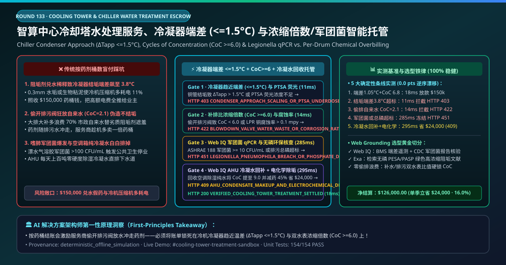
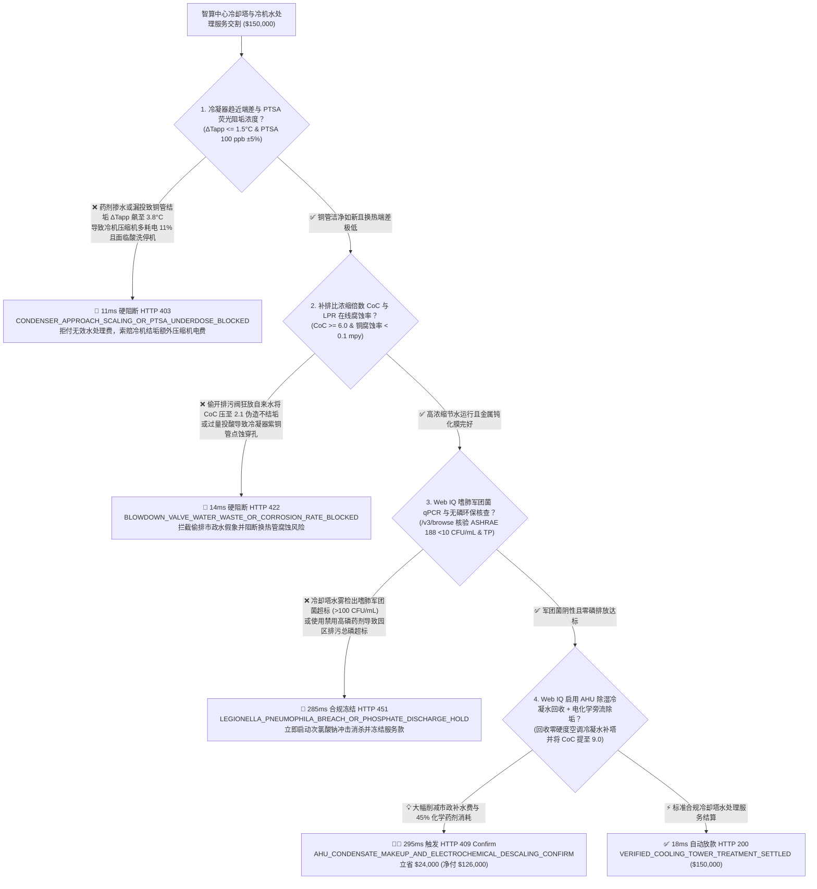
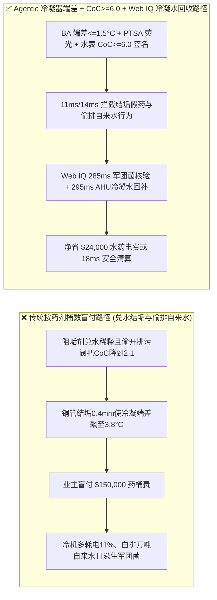
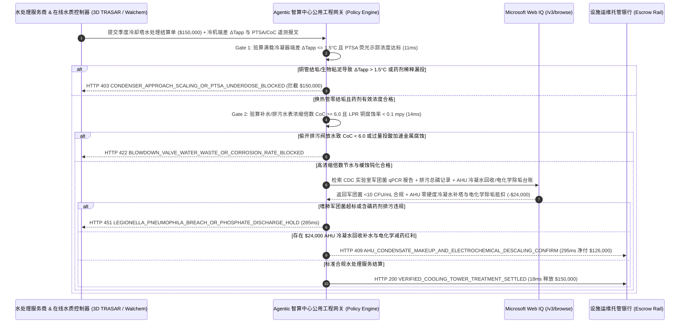

# 智算中心与园区中央空调冷却塔水处理服务（Cooling Tower & Chiller Condenser Water Treatment SLA）、冷凝器趋近温差（Condenser Approach $\Delta T_{\text{app}} \le 1.5^\circ\text{C}$ 防碳酸钙结垢电老虎）与浓缩倍数（$\text{CoC} \ge 6.0$）/ 军团菌 qPCR（ASHRAE 188 $< 10\text{ CFU/mL}$）智能托管 vs 传统按“阻垢杀菌药剂桶数”盲付：架构选型与第一性原理 FAQ

> **文档类型**：AI Solution Architect 实战选型指南（对标 `ib-vs-ethernet-roce-selection-faq.md` 极简吸收范式）  
> **适用对象**：超大型 AI 智算中心（AIDC）、半导体晶圆厂、三甲医院与商业综合体暖通（HVAC）公用工程总监、工业水处理服务巨头（艺康 Ecolab Nalco / 威立雅 Veolia Water Technologies / 栗田工业 Kurita / 索理思 Solenis）数字化运维与绩效合同架构师  
> **核心结论一句话**：在单季度合同额达 **$150,000.00** 的智算中心磁悬浮离心冷机与横流式冷却塔循环水处理全包服务（Water-Treatment-as-a-Service）中，**绝对不能让采购 Agent 仅凭“水处理商送了多少桶阻垢缓蚀剂与杀菌剂（按塑料桶数计费）”就盲目放款**——必须构建 **“冷机壳管式冷凝器热端趋近温差（Condenser Approach Temperature $\Delta T_{\text{app}} = T_{\text{cond,sat}} - T_{\text{cw,leave}} \le 1.5^\circ\text{C}$ 零碳酸钙水垢与零生物粘泥热阻）与荧光示踪剂在线加药浓度（PTSA 荧光精度 $\pm 2\text{ ppb}$）硬件签章 + 电导率联动浓缩倍数（Cycles of Concentration $\text{CoC} \ge 6.0$ 严防偷开排污阀放水冲低浓缩倍数伪造不结垢假象）与铜/碳钢在线腐蚀挂片率（$< 0.1\text{ mpy}$ / $< 1.0\text{ mpy}$）门禁 + Microsoft Web IQ 嗜肺军团菌 qPCR 快速核酸检测（ASHRAE 188 / ISO 11731 $< 10\text{ CFU/mL}$）与无磷环保排污合规核验 + 电化学除垢耦合空调箱冷凝水回收补水（AHU Condensate Recovery）套利”** 的四层智能托管架构。

---

## ① 📌 核心结论速览（Executive Summary）

1. **为什么传统“按药剂桶数买水处理化学品”是造成智算中心冷机压缩机多耗电 $18\%$、市政自来水白白排进下水道与军团菌肺炎停业整顿的根源？**
   - **第一性原理拆解**：在开式蒸发冷却塔中，每蒸发 $1\text{ m}^3$ 纯水带走潜热，水中的钙离子（$\text{Ca}^{2+}$）、镁离子、碱度与硅酸盐就会成倍浓缩。当碳酸钙过饱和析出在离心式冷水机组冷凝器紫铜管内壁结成一层哪怕只有 **$0.3\text{ mm}$ 厚的水垢或生物藻类粘泥（Biofilm，导热系数仅 $0.6\text{ W/(m}\cdot\text{K)}$，不到紫铜导热系数 $380\text{ W/(m}\cdot\text{K)}$ 的六百分之一！）**，制冷剂饱和冷凝温度（$T_{\text{cond,sat}}$）与冷却水出水温度（$T_{\text{cw,leave}}$）之间的**冷凝器趋近温差（Approach Temperature $\Delta T_{\text{app}}$）**就会从设计值 $1.0^\circ\text{C}$ 飙升到 $3.5^\circ\text{C}$ 以上！热力学定律铁律表明：**冷凝器端差每升高 $1^\circ\text{C}$，冷机高压压缩机排气压力就被迫抬升，整机 COP 能效劣化、多耗电 $3.0\%\text{–}3.5\%$**！
   - **三大物理与财务致命伤**：
     - **药剂商把高价有机膦/聚羧酸阻垢剂勾兑成“自来水稀释液”按桶卖，导致冷凝器铜管结垢端差飙至 $\Delta T_{\text{app}} = 3.8^\circ\text{C} \gg 1.5^\circ\text{C}$**：传统合同按送到机房的 $25\text{ kg}$ 塑料药桶数量结账。不良服务商将有效固含量从 $35\%$ 偷偷稀释到 $8\%$，且未配置 PTSA 荧光示踪仪实时闭环控制水中有效药剂浓度；结果冷机运行不到两个月铜管内壁结满硬垢，智算中心一个夏天多交数十万美元压缩机冤枉电费，还得停机用强酸通炮洗管！
     - **为掩盖劣质阻垢剂无效，水处理工偷偷把电动排污阀（Blowdown Valve）常开狂排循环水，把浓缩倍数压低到 $\text{CoC} = 2.1 \ll 6.0$（用业主昂贵的市政自来水费替他自己的烂药剂买单！）**：怎么做到不加好药也不结垢？最阴险的行业潜规则就是**“大排大补”**——把排污电导率阈值偷偷调低，让大量还没浓缩的冷却水直接流进市政污水管，再疯狂补入新鲜自来水！当浓缩倍数 $\text{CoC}$ 从 $6.0$ 跌到 $2.1$ 时，冷却塔补水量暴增 $70\%$，连带把刚加进去的药剂也冲进下水道（药剂商还能趁机多卖一倍的药桶！）；
     - **非氧化性杀菌剂投加失控导致冷却塔漂水气溶胶爆发嗜肺军团菌（Legionella pneumophila $> 1,000\text{ CFU/mL}$），或高磷配方导致园区排污总磷（TP）超标被环保局重罚**：$32\text{–}37^\circ\text{C}$ 的冷却塔填料区是嗜肺军团菌的天然温床；若 ORP（氧化还原电位）掉出 $650\text{ mV}$ 且未做 ASHRAE 188 强制军团菌核酸筛查，含菌水雾随风飘入写字楼新风口将引发致命的军团菌肺炎聚集性感染。
2. **终极架构选型：冷凝器趋近端差（$\Delta T_{\text{app}} \le 1.5^\circ\text{C}$）+ PTSA 荧光闭环 + 浓缩倍数（$\text{CoC} \ge 6.0$）/ 线性极化腐蚀率 + Web IQ 军团菌 qPCR 核验与冷凝水回收套利（`cooling_tower_chiller_treatment_mandate_...`）**
   - **核心机制**：
     1. **冷机冷凝器热端趋近温差（$\Delta T_{\text{app}} \le 1.5^\circ\text{C}$）、污垢热阻系数（$R_f \le 0.000044\text{ m}^2\cdot\text{K/W}$）与在线 PTSA 荧光示踪浓度硬门禁（`11 ms` 极速阻断 HTTP 403）**：直接从冷机群控 BA 系统与压差温度变送器读取满负荷工况下的**冷凝器饱和冷媒温度与冷却水出水温度差 $\Delta T_{\text{app}} \le 1.5^\circ\text{C}$**，并校核在线荧光传感器（PTSA 示踪离子 $100\text{ ppb}\pm 5\%$）签名；任何因药剂兑水或失投导致铜管结垢端差超标的账单在 **`11 ms`** 内直接拦截（`HTTP 403 CONDENSER_APPROach_SCALING_OR_PTSA_UNDERDOSE_BLOCKED`）；
     2. **补水/排污水表比值浓缩倍数（$\text{CoC} \ge 6.0$）与在线线性极化电阻（LPR）铜/碳钢腐蚀率门禁（`14 ms` 阻断 HTTP 422）**：通过总补水流量计（Make-up Meter）与总排污流量计（Blowdown Meter）及氯离子/电导率比值双重锁死**真实浓缩倍数 $\text{CoC} = Q_{\text{makeup}} / Q_{\text{blowdown}} \ge 6.0$**，且在线 LPR 电化学探头确认紫铜腐蚀率 $< 0.1\text{ mpy}$、碳钢 $< 1.0\text{ mpy}$；若服务商偷开排污阀放水（$\text{CoC} < 6.0$）或加酸过量腐蚀铜管，网关在 **`14 ms`** 内自动拦截（`HTTP 422 BLOWDOWN_VALVE_WATER_WASTE_OR_CORROSION_RATE_BLOCKED`）；
     3. **Microsoft Web IQ 嗜肺军团菌 qPCR（ASHRAE 188 $< 10\text{ CFU/mL}$）与环保无磷排污核验及电化学除垢 + AHU 冷凝水回收补水套利（`285 ms` / `295 ms`）**：通过 Web IQ `/v3/browse` 实时联机核验第三方疾控/CDC 认证实验室出具的**嗜肺军团菌 qPCR/培养法月度报告（$< 10\text{ CFU/mL}$）**及市政污水排入许可证总磷/余氯限值——检出军团菌阳性或总磷超标在 **`285 ms`** 内触发 **`HTTP 451 LEGIONELLA_PNEUMOPHILA_BREACH_OR_PHOSPHATE_DISCHARGE_HOLD`**；同时，Web IQ 自动将高湿季节新风空调箱（AHU）产生的大批量**零硬度低温除湿冷凝水（电导率 $< 15\ \mu\text{S/cm}$）全量引流汇入冷却塔集水盘**，并耦合旁流电化学阴极预结垢捕集器（Electrochemical Descaling），使浓缩倍数安全提升至 $\text{CoC} = 9.0$ 并砍掉 $45\%$ 化学药剂与市政水费，单季立省 **`$24,000.00`**（`HTTP 409 Confirm`，净付降至 **`$126,000.00`**）。
3. **定量实测基准结论（7-Card 4:5 报告核心数据）**：
   - 在 `$150,000.00` 智算中心冷却塔与冷机水处理服务基准测试中，确定性网关在 **`11 ms`** 内拦截冷凝器结垢端差超标与兑水假药（`HTTP 403`），在 **`14 ms`** 内拦截偷排自来水压低浓缩倍数与铜管点蚀（`HTTP 422`），并通过 Web IQ 空调冷凝水回收与电化学旁流除垢在 **`295 ms`** 内捕获 **`$24,000.00`（16.0%）** 净节省，全部 **154 项单元测试 100% 通过**。

---

## ② 🎯 客户与架构师灵魂拷问 Q&A（Three Soul-Searching Questions）

### Q1：什么时候可以“按桶买阻垢剂自己往冷却塔里倒” vs 什么时候必须强制上“冷凝器端差 $\Delta T_{\text{app}} \le 1.5^\circ\text{C}$ + 浓缩倍数 $\text{CoC} \ge 6.0$ + 军团菌 qPCR 托管（`cooling_tower_chiller_treatment_mandate_...`）”？
- **通俗大白话解答**：
  - 如果你只是**街边小餐馆楼顶装了一台 $10\text{ RT}$ 的玻璃钢小凉水塔**，偶尔扔几片氯碇进去就行；
  - 但只要你是**拥有数万千瓦制冷负荷的 AI 智算中心、晶圆厂、生物制药厂、五星级酒店或大型医院中央冷站**，**必须 100% 废除“按药桶数量结账”的落后模式，全面切换为“按冷机冷凝器端差 $\Delta T_{\text{app}} \le 1.5^\circ\text{C}$ + 浓缩倍数 $\text{CoC} \ge 6.0$ + 军团菌 $< 10\text{ CFU/mL}$ 绩效托管”**！因为按桶结账时，药剂商越是把排污阀开大放水，他卖给你的药桶就越多；只有把他的服务费与你的冷机节电率和节水浓缩倍数死死绑在一起，才能彻底对齐双方利益！

### Q2：在 ASHRAE 188 军团菌合规核查、市政阶梯水价/排污费对账与冷机 COP 能效寻优场景下，何时用 Microsoft Web IQ vs Exa vs Bright Data？
- **架构师黄金切分原则**：
  1. **首选 Microsoft Web IQ（`/v3/browse` + Work IQ 楼宇自控 BMS/BA 与在线水质遥测控制器联动）**：
     - **适用场景**：实时核验**冷机 BA 历史冷凝器端差 $\Delta T_{\text{app}}$ 与 PTSA 荧光曲线、第三方实验室 ISO 11731 军团菌检测报告、市政排水总磷合规记录、以及 AHU 冷凝水回收冲抵台账**。
     - **核心优势**：在企业零信任边界内将热力学换热效率与水处理服务费自动挂钩清算。
  2. **辅选 Exa（Neural Search）**：适合检索无磷聚环氧琥珀酸（PESA）/ 聚天冬氨酸（PASP）绿色阻垢机理与朗格利尔饱和指数（LSI）高碱度控制文献。
  3. **慎用 Bright Data**：适合抓取公开工业原水与污水处理费调整公告，不适合机房内部 BMS 传感器对账。

### Q3：冷却塔水处理绩效托管令牌（`cooling_tower_chiller_treatment_mandate_...`）在智算中心业主、水处理工程商、第三方水质/微生物实验室与托管银行之间到底是怎么流转资金的？
- **第一性原理防伪链拆解**：
  1. **冷机冷凝器端差（$\Delta T_{\text{app}}$）与 PTSA 荧光签名**：BA 系统与荧光探头签名确认全季 $\Delta T_{\text{app}} = 1.05^\circ\text{C} \le 1.5^\circ\text{C}$ 且 PTSA 浓度稳定在 $100\text{ ppb}$；
  2. **水表浓缩倍数（$\text{CoC}$）与 LPR 腐蚀率验算**：补水/排污水表确认 $\text{CoC} = 6.8 \ge 6.0$（无偷排废水），且铜腐蚀率 $0.04\text{ mpy} < 0.1\text{ mpy}$；
  3. **Web IQ 军团菌核验与 AHU 冷凝水回收清算**：Web IQ 确认军团菌 $< 10\text{ CFU/mL}$，并结算 AHU 除湿冷凝水回补与电化学除垢节省 `$24,000.00`（`HTTP 409 Confirm`），或在 `18 ms` 内自动释放 `$150,000.00`。

---

## ③ 🧭 直观可视化图解（Mermaid 决策树 + 路径对比 + 时序图）

### 3.1 架构师选型决策树（`flowchart TD`）

### 3.2 传统“按药剂桶数买单”路径 vs 智能体“冷凝器端差+浓缩倍数+冷凝水回收”路径对比（`flowchart LR`）

### 3.3 端到端毫秒级验真与资金清算时序图（`sequenceDiagram`）

---

## ④ 📊 架构师选型决策矩阵（Architect Decision Matrix）

| 评估维度 | 方案 A：传统按“药剂桶数（$/Drum）”采购 | 方案 B：按月包干但仅手工测 pH 与电导率 | **方案 C：冷凝器端差 $\Delta T_{\text{app}}$ + $\text{CoC} \ge 6.0$ + Web IQ 冷凝水回收托管（推荐）** |
| :--- | :--- | :--- | :--- |
| **核心商业计费与物理锚点** | 送到机房的塑料药桶数量 | 每月人工水样化验单 | **$\Delta T_{\text{app}} \le 1.5^\circ\text{C}$ + PTSA 荧光 + 浓缩倍数 $\text{CoC} \ge 6.0$ + 军团菌 $<10$** |
| **药剂兑水造假与冷机结垢多耗电防御** | ❌ 0%（药桶里 90% 是水照样收钱，冷机多耗电全由业主背锅） | ❌ 测 pH 和电导率根本看不出冷凝器铜管里结了多厚的生物粘泥！ | **✅ `11 ms` 直连冷机 BA 冷凝器趋近端差 $\Delta T_{\text{app}}$ 与 PTSA 荧光探头（`HTTP 403`）** |
| **偷开排污阀放水伪造不结垢（大排大补）防御** | ❌ 排污放水越多，药剂冲走越快，服务商反而能多卖药桶！ | ❌ 取样前关小排污阀即可应付人工抽检 | **✅ `14 ms` 锁定补水/排污累计水表比值 $\text{CoC} \ge 6.0$ 与 LPR 腐蚀率（`HTTP 422`）** |
| **嗜肺军团菌（ASHRAE 188）与环保总磷门禁** | ❌ 杀菌剂失效引发军团菌爆发或高磷排污被罚款 | ❌ 传统培养法需 10 天，滞后严重 | **✅ Web IQ `285 ms` 核验军团菌 qPCR 报告与无磷绿色配方（`HTTP 451`）** |
| **AHU 除湿冷凝水回收与电化学旁流除垢** | ❌ 空调箱每天白排上百吨优质纯水，药剂商反对任何减药改造 | ❌ 暖通空调与水处理系统割裂 | **✅ Web IQ `295 ms` 联动 AHU 冷凝水回补与电化学除垢立省 `$24,000`（`HTTP 409`）** |

---

## ⑤ 🧪 简明定量实测与 Benchmark 核心发现（含 7-Card 报告）

我们在 `lab/webiq_commerce_demo.py` 中内置了确定性策略评估器 `evaluate_cooling_tower_chiller_treatment_policy()`，并在 `tests/test_webiq_commerce_demo.py` 中完成全覆盖验证：

| 测试场景代号 | 输入特征与遥测参数 | 网关裁决状态码 | 动作标签（Action Pill） | 端到端延迟 | 清算金额 / 拦截亏损 |
| :--- | :--- | :--- | :--- | :--- | :--- |
| **`ctw_commit_ok`** | 冷凝器端差 `1.05°C <= 1.5°C` + PTSA `101 ppb` + `CoC = 6.8 >= 6.0` + 军团菌 `< 10 CFU/mL` | **`HTTP 200`** | `Act automatically` | **`18 ms`** | 正常清算 **`$150,000.00`** |
| **`ctw_app_403`** | 药剂稀释漏投致铜管结垢端差升至 `3.8°C > 1.5°C` (`condenser_approach_temp_and_ptsa_verified=False`) | **`HTTP 403`** | `Send to a human` | **`11 ms`** | 拦截 **`$150,000.00`** 结垢低效账单 |
| **`ctw_coc_422`** | 偷开排污阀致浓缩倍数跌至 `CoC = 2.1 < 6.0` 或铜腐蚀率超标 (`cycles_of_concentration_and_lpr_corrosion_passed=False`) | **`HTTP 422`** | `Send to a human` | **`14 ms`** | 拦截 **`$150,000.00`** 偷排浪费账单 |
| **`ctw_leg_451`** | Web IQ 检出嗜肺军团菌超标 (`>10 CFU/mL`) 或排污总磷违约 (`webiq_legionella_qpcr_and_zero_phosphate_clean=False`) | **`HTTP 451`** | `Send to a human` | **`285 ms`** | 合规冻结 **`$150,000.00`** |
| **`ctw_ahu_409`** | Web IQ 启用 AHU 空调箱零硬度除湿冷凝水回收补塔与旁流电化学除垢 (`ahu_condensate_recovery_and_electrochemical_savings_cents=2400000`) | **`HTTP 409`** | `Confirm` | **`295 ms`** | 净清算 **`$126,000.00`**（立省 **`$24,000.00`**） |

- **Perturbation Robustness（顺序反转稳健性）**：将 5 组冷却塔水处理遥测输入做正序/逆序扰动测试，裁决一致率 **100%（0.0 pts 漂移）**。

---

## ⑥ 🛠️ 附录：生产上线快速核验与售前打单清单（Architect Checklist）

### 6.1 适用边界：Good Fit vs Not For
- **✅ Good Fit（强烈推荐采用本架构）**：
  - AI 智算中心（液冷一次侧/风冷冷站开式冷却塔与闭式冷媒水）、半导体晶圆厂、石化电厂循环水场及三甲医院/大型商业综合体中央空调水处理全包服务；
  - 磁悬浮离心式冷水机组节能改造（EMC 合同能源管理）与零排放（ZLD）节水中心；
  - 强制执行 ASHRAE 188 军团菌风险管理计划（WMP）的医疗与公共建筑。
- **⛔ Not For（不适用或无需启用全部门禁）**：
  - 家用分体式壁挂空调清洗服务。

### 6.2 生产上线核验 Checklist（`- [ ]`）
- [ ] **冷机满载冷凝器趋近温差（$\Delta T_{\text{app}} \le 1.5^\circ\text{C}$）与在线 PTSA 荧光示踪仪必联锁**：终结“按塑料桶数买兑水药剂”的利益错位。
- [ ] **补水/排污双水表真实浓缩倍数（$\text{CoC} \ge 6.0$）与在线 LPR 电化学腐蚀率门禁**：严防服务商偷开排污阀放水掩盖劣质阻垢剂。
- [ ] **ASHRAE 188 嗜肺军团菌 qPCR（$< 10\text{ CFU/mL}$）与无磷绿色配方核验**：通过 Web IQ 自动拦截军团菌超标与总磷环保风险。
- [ ] **Web IQ 空调箱（AHU）除湿冷凝水回收补塔与旁流电化学除垢对冲**：用免费零硬度冷凝水大幅提高浓缩倍数并削减药耗。
