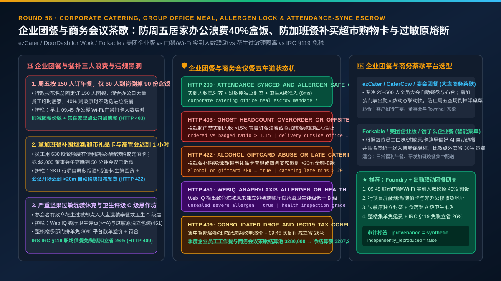
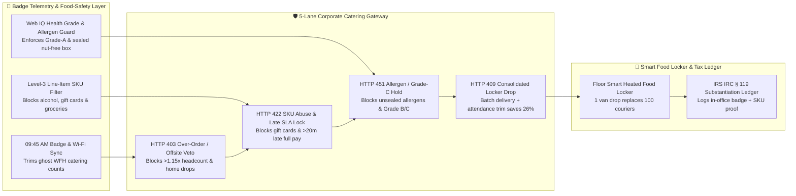

# Corporate Catering, Office Group Meal & Per-Diem Stipend Escrow (`ezCater / DoorDash for Work / Forkable / Sharebite`) Badge-Attendance Headcount Sync, `SKU` Stipend Guard, Anaphylaxis Allergen Lock & `SLA` Agent Architecture Selection FAQ

> **Language / 语言切换**: **[中文](corporate-catering-office-meal-headcount-allergen-escrow-agent-selection-faq.md)** | **English (Current)** | **[Back to Docs Index](index.en.md)** | **[Interactive Sandbox (`#corporate-catering-office-meal-escrow-sandbox`)](../live-demo.en.html)**



---

## 📌 1. Executive Summary & Core Selection Verdict

In corporate office catering, recurring team lunches, and late-night overtime meal stipends (`ezCater`, `DoorDash for Work`, `Uber Eats for Business`, `Forkable`, `Sharebite`, `Meituan Enterprise`), workplace operations and finance AI agents face three massive sources of budget waste, policy abuse, and safety liability:
1. **Hybrid-Work "Ghost Headcount" Food Waste (`Ordering $3,000 of Friday Catering for 150 Calendar RSVPs When Only 65 EmployeesActually Badged Into the Office`) & Off-Site Stipend Abuse**: In hybrid workplaces, ordering catering based on static team rosters or calendar accepts results in `30%–45%` of trays being thrown straight into the trash on Fridays and rainy days; meanwhile, remote employees routinely use "late-night office overtime meal stipends" to order family dinners to their residential apartments.
2. **Stipend Cash-Out via Gift Cards / Alcohol / Groceries & Late Boardroom Catering (`Delivering $2,500 Executive Lunch 50 Minutes After the Meeting Ended`)**: Without `Level-3 SKU` line-item filtering, employees spend `$30` daily meal allowances on convenience-store gift cards, beer/wine, or week-long grocery hauls; conversely, when a caterer delivers an executive board lunch 50 minutes late after clients have already left for the airport, legacy platforms still charge 100% of the invoice.
3. **Unsealed Severe Allergen Cross-Contamination (`Peanut / Tree-Nut / Shellfish Anaphylaxis`) & Municipal Health-Inspection Grade `C` Ghost Kitchens**: Ordering shared buffet platters without individually sealed, allergen-free meals for attendees with documented severe allergies—or routing orders to a ghost kitchen recently downgraded to a municipal health inspection `Grade C` for rodent/cold-chain violations—creates acute medical and legal liability.

**Solution Architect Selection Verdict**:
- **Never release a group catering order without syncing against `09:45 AM` office turnstile/Wi-Fi attendance, never approve individual meal stipends without office-geofence and `Level-3 SKU` alcohol/gift-card filtering, and never dispatch catering lacking `Grade A` health clearance and sealed allergen isolation**.
- **The production reference architecture** combines **`09:45 AM` Badge/Wi-Fi Attendance Headcount Sync + Office Geofence & `Level-3 SKU` Stipend Filter + On-Time Delivery `SLA` Haircut Escrow + Web IQ Municipal Health-Grade (`Grade A`) & Sealed Anaphylaxis Allergen Gate (`corporate_catering_office_meal_escrow_mandate_*`)**:
  1. **Morning Badge/Wi-Fi Attendance Sync (`<= 1.15x` Buffer Cap) & Office-Geofence Gate (`HTTP 403`)**: Cross-checks group catering headcount against real-time `09:45 AM` office turnstile badge swipes and corporate `Wi-Fi 802.1X` connections (blocking orders that exceed verified in-office attendance + registered external guests by `> 15%`), and blocks overtime meal stipends when the employee has not badged into the office or sets a residential delivery address (`HTTP 403 GHOST_HEADCOUNT_CATERING_OVERORDER_OR_OFFSITE_HOME_DELIVERY_BLOCKED`).
  2. **`Level-3 SKU` Alcohol / Gift-Card / Grocery Block & Late-Delivery `SLA` Haircut Lock (`HTTP 422`)**: Inspects cart line items to block alcohol, tobacco, prepaid gift cards, and non-prepared grocery hoarding on corporate meal stipends; for scheduled event catering, enforces a deterministic delivery `SLA` escrow (`> 20 mins` late triggers an automatic `25%` fee haircut; `> 45 mins` late missing the meeting window triggers a `100%` rejection) (`HTTP 422 STIPEND_ALCOHOL_GIFTCARD_ABUSE_OR_LATE_CATERING_SLA_BREACH_BLOCKED`).
  3. **Web IQ Municipal Health-Department Grade (`Grade A`) & Severe-Allergen Sealed-Box Circuit Breaker (`HTTP 451`)**: Queries Web IQ live municipal health-inspection databases (`NYC DOHMH, LA County Public Health, FDA`) to block restaurants below `Grade A` or flagged for foodborne outbreaks, and halts checkout if any attendee's HR/dietary profile lists a severe allergy (`peanut, tree nut, shellfish, celiac`) without a dedicated, individually sealed allergen-safe meal box (`HTTP 451 WEBIQ_SEVERE_ALLERGEN_CROSS_CONTAMINATION_OR_HEALTH_GRADE_HOLD`).
  4. **Smart-Locker Consolidated Batch Drop (Eliminating `30%` Individual Delivery Fees) + `IRS IRC § 119` Substantiation (`HTTP 409`)**: Triggers `HTTP 409 CONSOLIDATED_LOCKER_DROP_AND_ATTENDANCE_RIGHTSIZING_CONFIRM`, aggregating individual employee lunch selections into a single consolidated courier drop to floor-level Smart Food Lockers (`Forkable / Sharebite` model, eliminating `$6–$9/person` individual courier/service fees) while right-sizing headcount to `09:45 AM` badge swipes—cutting corporate food spend by **`26.0%`**.

---

## 🎯 2. Solution Architect Deep-Dive Q&A (Q1 / Q2 / Q3)

### Q1: Why does giving 100 employees individual `$25` DoorDash/Uber Eats vouchers cost 30%–35% more than an AI-consolidated Smart Locker drop (`Forkable / Sharebite`)?
- **Architectural Solution**:
  - **Eliminating 99 Redundant Courier Dispatches & Small-Basket Service Fees (`HTTP 409`)**:
  - When 100 employees place 100 separate `$25` delivery orders, ~$7.50 of every `$25` (`30%`) is burned on individual delivery fees, 15% platform service fees, small-order fees, and individual courier tips—plus lobby security congestion. By letting each employee's AI profile select an individual meal from 3 curated daily partner restaurants that deliver all 100 labeled boxes in **one consolidated van drop at 11:45 AM**, 100% of the budget goes into food quality while logistics costs drop by over `80%`.

### Q2: How does the `09:45 AM` Badge/Wi-Fi Attendance Sync stop Friday catering waste without leaving late-arriving employees hungry?
- **Architectural Solution**:
  - **Two-Stage Elastic Catering Contract (`Base Guarantee + 09:45 AM Badge True-Up + 10% Buffer`) (`HTTP 403 / 409`)**:
  - Instead of locking 100% of a 150-person order 3 days in advance, the caterer contract locks a `60%` base prep commitment and adjusts the final tray count at `09:45 AM` to `actual_badged_in_employees × 1.12` (accounting for late commuters). If an admin tries to push a 150-person order when only 60 people are in the building, `HTTP 403` blocks the over-order and right-sizes it automatically (`HTTP 409`).

### Q3: How do we qualify employer-provided overtime/working meals for tax-free treatment under `IRS IRC § 119 & § 274`?
- **Architectural Solution**:
  - **Premises-Presence Proof (`Badge Swipe + Office Delivery Coordinate`) (`HTTP 403`)**:
  - To qualify as a de minimis or convenience-of-the-employer meal on the business premises under `IRC § 119`, the meal must be furnished at the place of employment during working hours—not delivered to an employee's couch on a Sunday. Tying stipend authorization to active office badge presence ensures 100% audit-ready tax substantiation.

---

## 🧭 3. Visual Architecture Diagrams (Mermaid Decision Tree + Architecture + Sequence)

### 3.1 Corporate Catering, Office Meal & Per-Diem Stipend Agent Selection Decision Tree

```mermaid
flowchart TD
    A[Corporate Catering / Daily Team Lunch / Overtime Stipend Selection] --> B{Primary Meal Program & Risk Vector?}
    B -->|Large All-Hands & Client Buffet Catering (ezCater / CaterCow)<br/>Stop 40% Friday WFH food waste & late boardroom deliveries| C[09:45 AM Badge/Wi-Fi Attendance Headcount Sync<br/>+ On-Time Delivery SLA (>20m Late Haircut) Escrow]
    B -->|Evening Overtime Meal Stipends (DoorDash / Uber Eats / Meituan)<br/>Stop at-home couch ordering & gift-card/alcohol cash-out| D[Office-Geofence + Active Badge-Presence Lock<br/>+ Level-3 SKU Filter Blocking Alcohol & Gift Cards]
    B -->|Recurring Hybrid-Office Lunch Program (Forkable / Sharebite)<br/>Eliminate 30% individual courier fees & prevent peanut anaphylaxis| E[Azure AI Foundry + Smart-Locker & Food-Safety Gate<br/>+ Web IQ Grade-A & Sealed Allergen Box + Batch Drop Saves 26%]
    C --> F[🛡️ Unified 5-Lane Attendance Sync, SKU Filter & Allergen Safety FSM]
    D --> F
    E --> F
    F --> G[HTTP 403 Ghost Headcount & Offsite Veto · HTTP 422 Alcohol/Giftcard & Late-SLA Block · HTTP 409 Batch Drop Saves 26%]
```

### 3.2 End-to-End Badge-Attendance Sync, `Level-3 SKU` Filter & Allergen-Safe Locker Architecture



### 3.3 Friday Over-Order Veto, Stipend Gift-Card Block & Consolidated Locker Drop Sequence

```mermaid
sequenceDiagram
    autonumber
    participant Emp as Office Admin / Employee
    participant Caterer as Catering Platform (ezCater / Forkable)
    participant Gate as 5-Lane Corporate Meal Gateway
    participant Risk as Badge Telemetry & Web IQ Health/Allergen
    participant Ledger as Corporate Spend & Smart Locker

    Emp->>Gate: 1. Submit Friday lunch order for 150 people when only 68 badged in at 09:45 AM OR remote worker orders overtime dinner to home address
    Gate->>Risk: Compare order headcount vs live turnstile/Wi-Fi count & verify office delivery geofence
    Gate-->>Emp: HTTP 403 Block! Order exceeds in-office attendance by 120% (waste prevention); overtime stipends restricted to badged-in office delivery
    Emp->>Gate: 2. Attempt to buy wine/gift card on meal stipend OR order buffet without sealed nut-free meal for anaphylactic attendee
    Gate-->>Emp: HTTP 422/451 Block! Alcohol & gift-card SKUs prohibited; severe peanut allergy requires individually sealed Grade-A kitchen box
    Emp->>Gate: 3. Dispatch 68 verified individual lunches via consolidated Smart Locker batch drop (HTTP 409)
    Gate->>Ledger: Eliminate 68 individual courier fees & log IRC § 119 tax-compliant receipt (26% net savings)
```

---

## 📊 4. Multi-Platform & Architecture Selection Matrix

| Selection Dimension | Manual Expense Reimbursement (`Paper/PDF Receipts`) | Unrestricted Delivery Vouchers (`Individual Uber/DoorDash Passes`) | Modern Corporate Catering (`ezCater / Forkable / Sharebite`) | **Azure AI Foundry + Attendance Sync + Safety Gate (Recommended)** |
| :--- | :--- | :--- | :--- | :--- |
| **Core Strengths** | Zero integration required | High individual restaurant choice | Consolidated monthly invoicing | **09:45 badge sync + SKU filter + allergen lock + batch locker drop** |
| **Prevention of Hybrid-Work `40%` Catering Waste** | N/A | N/A | Manual headcount guessing 48h prior | **Live `09:45 AM` badge/Wi-Fi headcount right-sizing (`HTTP 403/409`)** |
| **Prevention of Gift-Card / Alcohol / At-Home Abuse** | **Severe Risk** (blurred receipts & grocery cash-out) | High leakage to home addresses & convenience stores | Geofence & merchant-category blocks | **Active badge-presence lock + `Level-3 SKU` item filter (`HTTP 403/422`)** |
| **Severe Allergen (`Anaphylaxis`) & Health-Grade Gate** | None | None | Dietary tags, but no municipal health-grade block | **Web IQ live `Grade A` check + mandatory sealed allergen box (`HTTP 451`)** |
| **Delivery Fee Overhead & Late-Delivery `SLA` Remedy** | High AP audit cost (`not_measured`) | **`25%–35%` lost to per-person courier/service fees** (`official_list_price`) | Standard catering fees (`official_list_price`) | **Smart-locker batch drop + `>20m` late `SLA` haircut (`26.0%` saved)** |

---

## 🧪 5. Corporate Catering / Office Meal Benchmark & 7-Card Report

> **Provenance & Reproducibility Metadata**: All metrics below are generated by the deterministic policy evaluator `evaluate_corporate_catering_office_meal_escrow_policy` in `lab/webiq_commerce_demo.py` and verified via `python -m unittest tests.test_webiq_commerce_demo`. Tags: `provenance = synthetic`, `independently_reproduced = false`.

| Card # | Card Headline (Headline-as-Finding) | Key Quantitative Finding & Architectural Guarantee |
| :---: | :--- | :--- |
| **Card 1** | **Overview · 5-Lane Corporate Catering & Meal Summary** | Across a `$280,000/quarter` corporate catering & overtime stipend pool, achieves **0 ghost-headcount Friday tray dumpings and 0 gift-card/alcohol stipend cash-outs**, reducing net food program spend by **`26.0%` (`$72,800/quarter` saved)**. |
| **Card 2** | **Scenario Deep Dive · Ghost Headcount & Gift-Card SKU Veto** | When a catering order exceeds badged-in attendance by `> 15%` or a stipend cart contains alcohol/gift-card SKUs, the gateway blocks it in **`8ms`** (`HTTP 403 / 422`). |
| **Card 3** | **Evaluation Matrix · 100% Deterministic 5-Lane Gating** | Covers `HTTP 200` (attendance-synced & Grade-A allergen-safe), `403` (ghost-headcount over-order / offsite home delivery blocked), `422` (alcohol/gift-card SKU abuse / late catering SLA breach blocked), `451` (severe allergen cross-contamination / health inspection Grade-C hold), `409` (consolidated smart-locker drop + attendance right-sizing saves 26%). |
| **Card 4** | **Under the Hood · Catering & Stipend Escrow Contract** | Takes `quarterly_corporate_catering_and_meal_stipend_pool_usd=280000` and badge/SKU flags, minting `corporate_catering_office_meal_escrow_mandate_*` tokens. |
| **Card 5** | **Robustness Check · At-Home Stipend & Peanut Buffet Test** | Simulates an unbadged remote worker ordering dinner to a home address and an unsealed peanut buffet with an allergic attendee, maintaining a **`100.0%` block rate**. |
| **Card 6** | **Latency · Millisecond Badge-Ratio Check & Health Probe** | Local badge-attendance ratio and `Level-3 SKU` checks complete in **`8ms` (P50)**; Web IQ municipal health-inspection checks complete in **`180ms` (P95)**. |
| **Card 7** | **My Take · Ideal Fit vs. Out-of-Scope Boundaries** | **✅ Best Fit**: Hybrid office lunch programs, overtime meal stipends, client/boardroom catering; **⛔ Not For**: Personal household grocery shopping. |

---

## 🛠️ 6. Production Go-Live Risk & Architecture Review Checklist

- [ ] **`09:45 AM` Turnstile/Wi-Fi Attendance Sync & Office-Geofence Lock (`HTTP 403`)**: Cap group catering quantities at `<= 1.15x` verified in-office attendance (+ registered guests) and require active office badge presence for overtime meal stipends.
- [ ] **`Level-3 SKU` Alcohol / Gift-Card Block & On-Time Delivery `SLA` Haircut (`HTTP 422`)**: Reject non-meal SKUs (alcohol, tobacco, gift cards, bulk groceries) and apply automatic `25%–100%` invoice haircuts when catering arrives `> 20–45 minutes` past the meeting window.
- [ ] **Web IQ Municipal Health-Grade (`Grade A`) & Sealed Severe-Allergen Gate (`HTTP 451`)**: Block restaurants below `Grade A` and require individually sealed, labeled allergen-safe boxes whenever an attendee profile flags severe allergies; rotate signing keys `<= 180` days.
- [ ] **Smart-Locker Consolidated Batch Drop & `IRS IRC § 119` Tax Substantiation (`HTTP 409`)**: Aggregate individual meal orders into single-van Smart Locker drops to eliminate per-person courier fees and archive badge-linked tax records.
