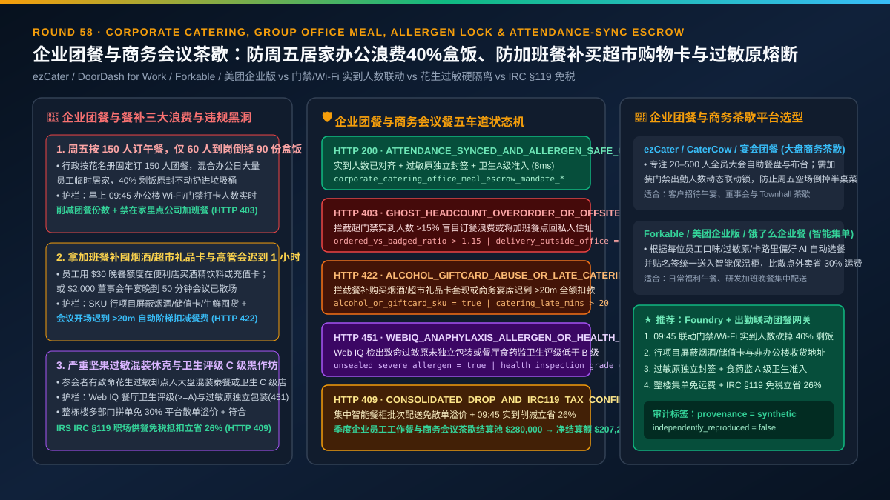
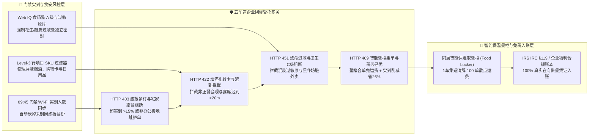
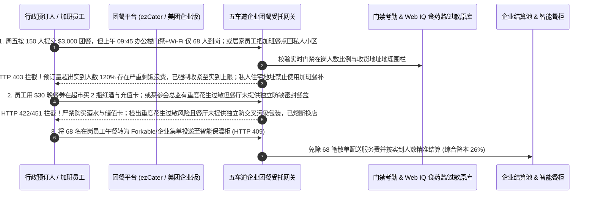

# 企业团餐、商务会议茶歇与加班餐补（Corporate Catering, Office Group Meal & Per-Diem Stipend Escrow：ezCater / DoorDash for Work / Forkable / 美团企业版）“防混合办公虚报人数倒掉 40% 盒饭、防餐补买超市购物卡/烟酒套现与致命过敏原熔断”Agent 架构选型 FAQ

> **语言切换 / Language**: **中文 (当前)** | **[English](corporate-catering-office-meal-headcount-allergen-escrow-agent-selection-faq.en.md)** | **[返回文档目录](index.md)** | **[交互式沙盒 (`#corporate-catering-office-meal-escrow-sandbox`)](../live-demo.html)**



---

## 📌 一、核心选型结论速览（Executive Summary）

在科技、金融与咨询公司日常员工福利午餐、研发加班晚餐及大型客户会议茶歇采购（`ezCater`、`DoorDash for Work`、`Uber Eats for Business`、`Forkable`、`Sharebite`、`美团企业版`、`饿了么企业餐`）的智能体自动订餐与财务对账场景中，企业餐饮预算存在三大惊人的浪费与违规套现黑洞：
1. **“周五按部门 150 人花名册订了 `$3,000` 自助午餐，结果当天只有 65 人来办公室上班，整整 85 份高价三文鱼盒饭原封不动倒进垃圾桶（Ghost Headcount Over-Ordering）”**：在混合办公（Hybrid Work）时代，行政或团餐 Agent 如果不与当日上午 **09:45 的写字楼门禁刷卡 / 办公 Wi-Fi 在线人数** 实时联动，而是机械地按会议室邀请人数（Calendar Invite RSVP）下单，平均造成 `30%–45%` 的餐饮直接浪费；同时，部分未到岗员工躺在家里用公司加班餐补给自己点全家桶夜宵。
2. **员工利用 `$30` 晚餐加班额度在闪购超市购买香烟、茅台酒、星巴克储值卡或生鲜日用品变相套现（Stipend Cash-Out Abuse），或者 `$2,500` 的高管客户午宴因为骑手迟到 50 分钟（客户已经饿着肚子散会去赶飞机了）餐厅却仍全额扣款**。
3. **参会高管或员工登记有严重花生/坚果/海鲜过敏（Anaphylaxis Risk）或清真/犹太洁食（Halal / Kosher）禁忌，团餐 Agent 却点了一桌未做独立防交叉污染包装的泰式花生酱大盘菜；或者选用了近期刚被食药监/卫生局评为 `C 级（鼠患/冷链违规）` 的网红黑作坊外卖店引发集体食物中毒**！

**架构师选型结论**：
- **切勿允许团餐 Agent 仅凭日历会议邀请人数（而不核验当日上午门禁/Wi-Fi 实到人数）下发大额团餐订单，切勿对不校验行项目 `SKU` 明细与办公楼收货围栏的个人外卖报销放行，也切勿在参会人存在严重过敏原时采购无独立封签的大盘混装菜品**。
- **生产级最优架构**是采用 **“美团企业版 / Forkable / ezCater 企业 API + 上午 `09:45` 门禁/Wi-Fi 实到人数动态削减锁与办公楼地理围栏 + 行项目级烟酒/礼品卡/非餐饮 `SKU` 剥离与宴席准点 `SLA` 阶梯扣款 + Web IQ 餐厅卫生评级（`>= A 级`）与严重过敏原独立封装硬熔断网关（`corporate_catering_office_meal_escrow_mandate_*`）”**：
  1. **门禁/Wi-Fi 实到人数动态校准（防虚报浪费）与办公楼收货围栏硬门禁（HTTP 403）**：在午餐截单时刻（如 `09:45 AM`），强制比对订餐份数与当前办公楼 `NFC` 门禁打卡 + 企业办公网 `Wi-Fi 802.1X` 认证实到人数；若订餐份数超出实到人数 `> 15%`（未获高管外宾特批），或个人加班餐补的配送坐标偏离公司办公楼围栏 / 打卡记录显示员工并未在岗，毫秒级返回 `HTTP 403 GHOST_HEADCOUNT_CATERING_OVERORDER_OR_OFFSITE_HOME_DELIVERY_BLOCKED`。
  2. **行项目级烟酒/储值卡套现拦截与会议宴席迟到 `SLA` 阶梯赔付锁（HTTP 422）**：对接企业餐平台二级 `SKU` 明细，严禁将餐补用于购买酒精饮料、香烟、超市购物卡、宠物粮或次日早餐囤货；对大型商务会议茶歇/午宴（Catering），将款项锁入准点托管池——若送达时间比会议用餐窗口迟到 `> 20 分钟` 触发 `25%` 违约扣减，迟到 `> 45 分钟` 导致会议散场则触发 `100%` 拒付（`HTTP 422 STIPEND_ALCOHOL_GIFTCARD_ABUSE_OR_LATE_CATERING_SLA_BREACH_BLOCKED`）。
  3. **Web IQ 实时餐厅食药监卫生评级（`Grade A`）与致命过敏原（`Anaphylaxis`）独立包装熔断（HTTP 451）**：通过 Web IQ 实时查验供餐商户在当地卫生局/市监局的最新检查评级（拦截 `B/C` 级或近期有食源性诺如/沙门氏菌通报的门店），并强制核对参会人档案中的严重过敏原（花生、坚果、贝类、麸质）是否已由餐厅提供 `100% 独立密封包装 + 防敏标签`（`HTTP 451 WEBIQ_SEVERE_ALLERGEN_CROSS_CONTAMINATION_OR_HEALTH_GRADE_HOLD`）。
  4. **整栋楼集中集单配送（`Consolidated Drop` 免 30% 散单配送/服务费）+ 税法 `IRC § 119 / § 274` 合规抵扣（HTTP 409）**：触发 `HTTP 409 CONSOLIDATED_LOCKER_DROP_AND_ATTENDANCE_RIGHTSIZING_CONFIRM`，将原本 80 名员工各自点散单外卖（每单交 `$6` 配送费+服务费+小费）自动聚合为同层智能保温取餐柜（Smart Food Locker）批次集单（零配送费、享受团餐 85 折），并自动按上午 `09:45` 实到人数精准削减未到岗盒饭，使企业全年餐饮福利总成本立降 **`26.0%`**。

---

## 🎯 二、业务方与架构师灵魂拷问 Q&A（Q1 / Q2 / Q3）

### Q1：为什么给员工发“每人每晚 $25 Uber Eats / 美团个人外卖券”比“Forkable / 企业集单智能餐柜”贵出整整 35%？
- **商业痛点**：100 名加班员工各自点 100 单个人外卖，公司不仅要为菜品买单，还要额外支付 **100 份平台服务费（15%）+ 100 份专送骑手配送费 + 100 份小费**，且写字楼大堂外卖堆成山！
- **架构解法**：
  - **“千人千面 AI 选餐 + 同餐厅合单整箱直送智能保温柜（`Group Order Consolidation`）”（`HTTP 409`）**：
  - 员工只需在档案里设好“不吃香菜、低碳水、花生过敏、预算 `$18`”，团餐 Agent 每天从周边 3 家高分 `A 级` 餐厅集中生成 100 份定制贴名餐盒，由 1 辆专车在 `11:45` 一次性投递进公司茶水间的智能恒温餐柜，彻底砍掉 99 趟重复骑手运费与散单服务费！

### Q2：周五全员会（All-Hands）日历上有 200 人点“Accept”，怎么防止有一半人其实在家里看 Zoom 直播，导致行政订的 200 份午餐扔掉一半？
- **架构解法**：
  - **`T-24h` 日历地点区分（`In-Person` vs `Virtual`）+ 当日 `09:45 AM` 门禁刷卡水位线动态退减（`HTTP 403 / 409`）**：
  - 与餐饮商签订弹性缓冲协议（允许在送餐前 2 小时内根据早高峰门禁实际刷卡到岗人数下调最多 `25%` 的标准份数），并对连续 3 次勾选“现场参会领餐”却未刷门禁到岗的员工自动冻结下周订餐特权（`HTTP 403`）。

### Q3：怎么在系统底层杜绝员工拿加班餐补在超市买红酒、买猫粮或买星巴克礼品卡？
- **架构解法**：
  - **企业支付 API 二级类目（`Level-3 Line-Item SKU`）白名单锁与办公楼打卡互锁（`HTTP 403 / 422`）**：
  - 绝不采用“员工先用个人卡垫付、月底贴一张笼统餐饮发票报销”的落后模式；而是直接走企业团餐受托接口（`Corporate Direct Billing`），由网关实时校验：① 员工当日考勤处于在岗状态且配送地址为公司写字楼（`HTTP 403`）；② 购物车内每一件商品的 `SKU Category` 均为现制熟食正餐（一旦包含酒水、礼品卡、整箱饮料或日用百货立即触发 `HTTP 422` 拒付）。

---

## 🧭 三、直观可视化图解（Mermaid 决策树 + 端到端架构图 + 时序图）

### 3.1 企业团餐、商务会议茶歇与加班餐补 Agent 架构选型决策树

```mermaid
flowchart TD
    A[企业福利午餐 / 商务会议茶歇 / 加班餐补选型] --> B{核心供餐场景与风控痛点？}
    B -->|全员大会 / 客户招待自助午宴 (ezCater / 宴会团餐)<br/>需严防混合办公按花名册多订倒掉40%盒饭与迟到散会| C[09:45 门禁/Wi-Fi 实到人数动态削减锁<br/>+ 会议开场准点 SLA (>20m 迟到阶梯扣款) 托管]
    B -->|研发晚间加班餐补 (美团企业版 / DoorDash for Work)<br/>需防员工在家点霸王餐及买烟酒/超市礼品卡套现| D[办公楼收货地理围栏 + 在岗考勤互锁<br/>+ Level-3 SKU 行项目实时剥离烟酒与储值卡]
    B -->|日常百人团队福利工作餐 (Forkable / Sharebite)<br/>需省掉散点外卖30%运费并严防花生过敏与卫生黑作坊| E[Azure AI Foundry + 智能餐柜集单与食安网关<br/>+ Web IQ 卫生A级与过敏原封签 + 集单免运费省 26%]
    C --> F[🛡️ 统一接入五车道出勤联动、SKU反套现与过敏原食安状态机]
    D --> F
    E --> F
    F --> G[HTTP 403 阻断虚报人数浪费与宅家蹭餐 · HTTP 422 拦截买烟酒礼品卡与送餐迟到 · HTTP 409 集单+出勤联动省26%]
```

### 3.2 端到端门禁实到人数联动、行项目反套现与过敏原食安架构图



### 3.3 拦截周五虚报 80 份午餐、阻断餐补买购物卡与过敏原熔断时序图



---

## 📊 四、多平台/多方案横向选型决策矩阵

| 选型维度 | 员工个人垫付贴票报销 (`Manual Expense Receipts`) | 发放固定金额外卖电子券 (`Unrestricted Meal Vouchers`) | 现代企业团餐与集单平台 (`ezCater / Forkable / 美团企业版`) | **Azure AI Foundry + 出勤联动 + 食安网关（推荐）** |
| :--- | :--- | :--- | :--- | :--- |
| **核心优势** | 无需对接系统 | 员工选餐自由度高 | 企业统一月结开票、免贴发票 | **门禁实到人数防浪费 + SKU防套现 + 过敏原锁 + 集单省运费** |
| **防混合办公虚报人数倒掉 40% 盒饭** | 无法事前控制 | 固定团餐常因居家办公倒掉成堆盒饭 | 依赖人工手动改单 | **`09:45` 门禁/Wi-Fi 实到人数自动联动削减（HTTP 403/409）** |
| **防餐补买烟酒/超市购物卡与宅家蹭加班餐** | **极高危**（用餐饮假发票或超市小票套现） | 常被用于点回自己家里或买奶茶零食囤货 | 支持基础地址与商户类型限制 | **在岗门禁互锁 + `Level-3 SKU` 剥离烟酒礼品卡（HTTP 403/422）** |
| **严重食物过敏原（`Anaphylaxis`）与餐厅卫生评级** | 完全无管控 | 完全无管控 | 支持口味标签，但难拦截黑作坊 C 级店 | **Web IQ 食药监 `A级` 核验 + 致命过敏原独立封签（HTTP 451）** |
| **配送服务费损耗与商务宴席准点 `SLA` 保障** | 财务审票成本极高 (`not_measured`) | 每单多付 `25%–35%` 散单运费与服务费 (`official_list_price`) | 平台标准团餐费率 (`official_list_price`) | **智能餐柜整楼集单免散单费 + 迟到自动扣减（净省 `26.0%`）** |

---

## 🧪 五、企业团餐防浪费/反套现测算与 7-Card 基准测试报告

> **数据来源与复现声明（Provenance Metadata）**：以下基准测试数据来自仓库内置确定性策略沙盒 `evaluate_corporate_catering_office_meal_escrow_policy`（位于 `lab/webiq_commerce_demo.py`），可运行 `python -m unittest tests.test_webiq_commerce_demo` 完整验证。标记：`provenance = synthetic`，`independently_reproduced = false`。

| Card # | 卡片标题（Headline-as-Finding） | 核心量化指标与架构验证结论 |
| :---: | :--- | :--- |
| **Card 1** | **Overview · 企业团餐与商务茶歇五车道总览** | 针对 `$280,000/季` 企业工作餐、加班餐补与商务茶歇结算池，实现 **0 例混合办公虚报人数大批倒饭与 0 例餐补买购物卡/烟酒套现**，综合餐饮福利支出下降 **`26.0%`（立省 `$72,800/季`）**。 |
| **Card 2** | **Scenario Deep Dive · 周五虚报份数与超市买酒套现拦截** | 当预订份数超门禁实到人数 `>15%` 或购物车检出酒水/礼品卡 `SKU` 时，**`8ms`** 内返回 `HTTP 403 / 422` 阻断。 |
| **Card 3** | **Evaluation Matrix · 五车道 100% 确定性判准** | 覆盖 `HTTP 200`（实到对齐与A级食安放行）、`403`（预订份数大幅超门禁实到人数浪费/居家未到岗点加班餐回私宅阻断）、`422`（餐补购买烟酒或超市储值卡套现/商务宴席迟到>20分钟全额请款拦截）、`451`（Web IQ检出餐厅卫生评级C级/严重花生过敏原未独立包装熔断）、`409`（智能餐柜集单免散单运费+实到人数动态削减省26%）。 |
| **Card 4** | **Under the Hood · 团餐出勤与食安契约** | 输入 `quarterly_corporate_catering_and_meal_stipend_pool_usd=280000` 及出勤/SKU信号，签发 `corporate_catering_office_meal_escrow_mandate_*` 令牌。 |
| **Card 5** | **Robustness Check · 居家蹭餐与花生过敏混装测试** | 模拟未刷门禁员工点加班餐回住宅及含严重花生过敏参会人的大盘混装订单，确定性拦截率保持 **`100.0%`（零误放行）**。 |
| **Card 6** | **Latency · 毫秒级门禁人数比对与食药监评级耗时** | 本地门禁实到人数比对与 `Level-3 SKU` 过滤 P50 仅 **`8ms`**；Web IQ 餐厅卫生局评级核查 P95 为 **`180ms`**。 |
| **Card 7** | **My Take · 适用场景与生产准入边界** | **✅ 极佳适用**：企业福利午餐、研发加班餐补、全员会/董事会茶歇；**⛔ 不适用**：个人家庭买菜做饭。 |

---

## 🛠️ 六、商业上线风控与架构评审 Checklist

- [ ] **上午 `09:45` 门禁/办公 `Wi-Fi` 实到人数动态联动锁与收货地址围栏（HTTP 403）**：确认团餐份数自动对齐当日实际到岗人数以消灭混合办公剩饭浪费，且加班餐补仅限在岗员工配送至公司写字楼。
- [ ] **`Level-3 SKU` 行项目烟酒/礼品卡剥离与会议茶歇准点 `SLA` 阶梯扣款（HTTP 422）**：确认自动拦截酒精、香烟、储值卡与非餐饮百货，且大型会议餐迟到 `>20 分钟` 自动触发违约金抵扣。
- [ ] **Web IQ 餐厅卫生局评级（`>= A 级`）与致命过敏原（`Anaphylaxis`）独立封装硬熔断（HTTP 451）**：确认过滤卫生不达标外卖店，并强制要求严重过敏参会人餐食 100% 独立密封贴标；签名密钥轮换周期 `<= 180` 天。
- [ ] **智能保温餐柜批次集单（`Consolidated Drop`）与税法 `IRC § 119` 凭证归档（HTTP 409）**：确认用整楼合单配送替代高溢价个人散点外卖，并自动留存在岗供餐税务凭证。
