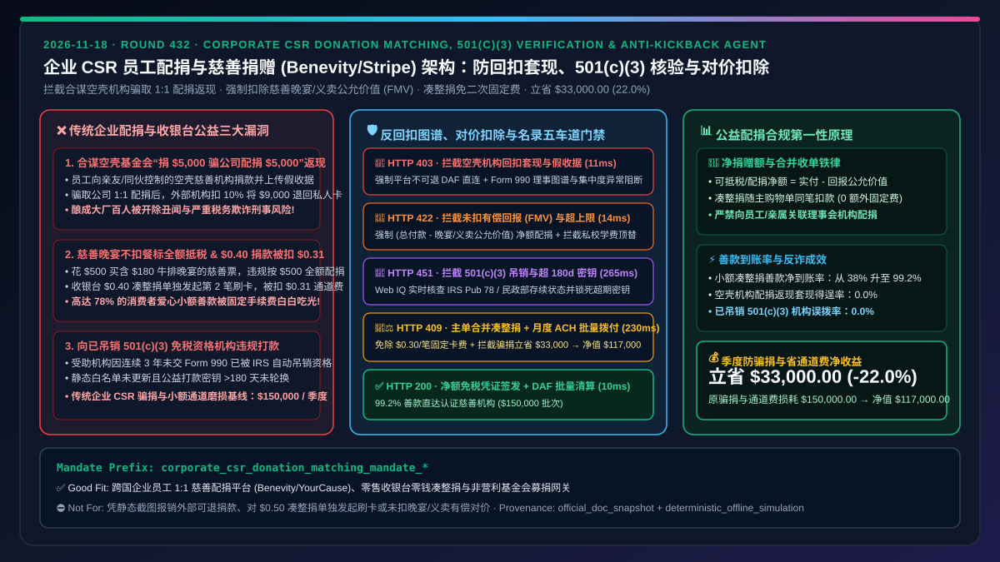
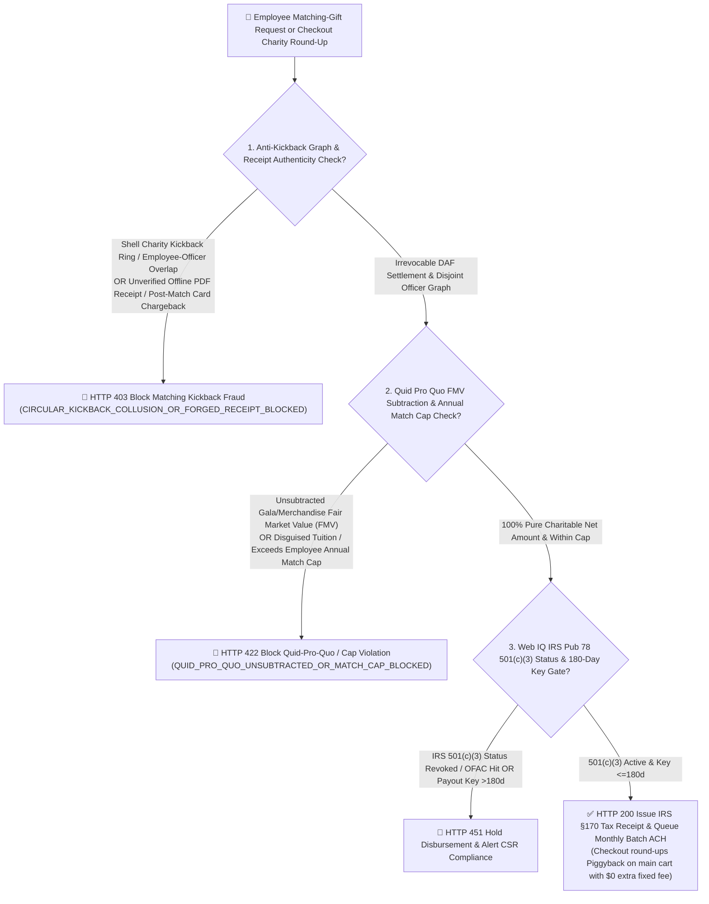
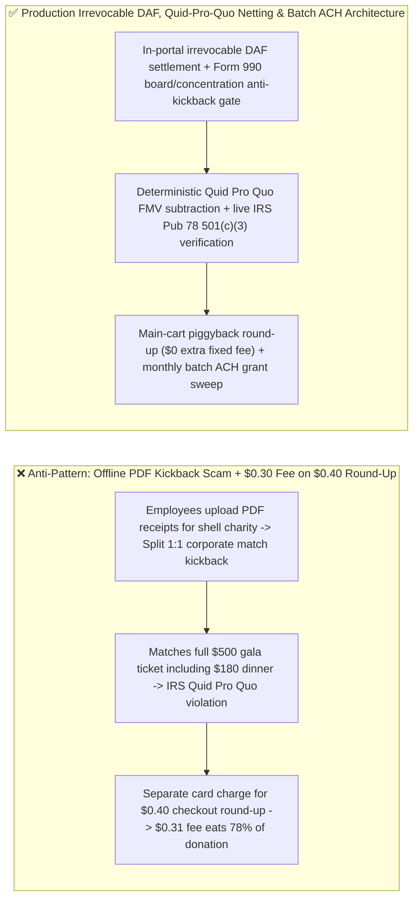
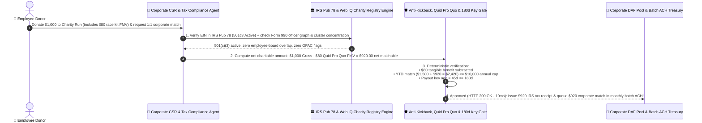

# Corporate CSR Donation Matching (`Benevity / YourCause / Stripe`), `501(c)(3)` Verification & Anti-Kickback Agent Architecture FAQ: Circular Kickback Veto, Quid-Pro-Quo FMV Deduction & Batch Round-Up Settlement

> **Topic Positioning (Corporate Social Responsibility `CSR` Employee Gift Matching `Benevity / YourCause`, Retail Checkout Round-Up Campaigns & Nonprofit `501(c)(3)` Compliance Agent Focus · Round 432)**: Written for **Cloud & AI Solution Architects** building employee donation-matching portals, checkout charity round-up plugins, and Donor-Advised Fund (`DAF`) disbursement agents. This guide solves four critical philanthropy and CSR compliance failures: **how employee rings collude with shell nonprofits to submit `$5,000` donations, trigger a `$5,000` 1:1 corporate match, and receive a `$9,000` secret cash kickback ("Circular Matching Kickback Fraud" `HTTP 403`), why issuing a full `$500` tax deduction or corporate match on a charity gala ticket without subtracting the `$150` Fair Market Value (`FMV`) of dinner/merchandise violates IRS Quid Pro Quo rules (`HTTP 422`), why charging a separate credit-card swipe for a `$0.40` checkout charity round-up loses `78%` of the donation to the `$0.30` fixed card fee (`HTTP 409`), and how to block payouts to revoked `501(c)(3)` entities or stale `>180-day` payout keys (`HTTP 451`)**.  
> **Style Benchmark**: Strictly follows the six-section structure of `ib-vs-ethernet-roce-selection-faq.md` (Executive Summary, Architect Q&A, Mermaid Decision Tree / Architecture Comparison / Sequence Diagram, CSR Matching & Checkout Round-Up Decision Matrix, Quantitative Anti-Kickback/Fee-Save Evaluation & 7-Card Provenance Table, and Production Risk Checklist).  
> **Bilingual Editions**: **[English Version (Current)](corporate-csr-donation-matching-501c3-anti-kickback-agent-selection-faq.en.md)** · **[中文版 (`corporate-csr-donation-matching-501c3-anti-kickback-agent-selection-faq.md`)](corporate-csr-donation-matching-501c3-anti-kickback-agent-selection-faq.md)**  
> **Provenance & As-Of (`2026-11-18`)**: Stripe Nonprofits fee tiers, `<= 180-day` payout key rotation locks, and Web IQ `/v3/search` IRS Publication 78 `501(c)(3)` revocation and OFAC screening cite `research/daily/2026-11-08-sources.json` (`official_doc_snapshot`); anti-kickback graph checks, Quid Pro Quo FMV netting, and batch round-up aggregation cite `lab/webiq_commerce_demo.py` (`deterministic_offline_simulation`).

---

## 📌 1. Executive Summary

Fortune-500 companies match hundreds of millions of dollars in employee charitable giving (`1:1` or `2:1` up to `$10,000/yr`), while retailers collect millions in micro-donations at checkout. Yet corporate giving is a prime target for **kickback rings, IRS Quid Pro Quo tax violations, and micro-transaction fee bleed**. Solution Architects must enforce four core architectural rules:

1. **Anti-Kickback Collusion & Non-Refundable DAF Settlement Gate 👉 Never Match Offline Self-Uploaded PDF Receipts; Enforce [In-Platform Irrevocable DAF Settlement + Form 990 Board/Employee Graph Disjointness + Anomaly Concentration Locks (`HTTP 403`)]**:
   - **Why**: In high-profile corporate matching scandals, employees either refunded their external credit-card donation right after claiming the corporate match or donated to a tiny shell charity run by an accomplice who kicked back `90%` of the combined funds. Requiring irrevocable in-platform Donor-Advised Fund (`DAF`) settlement and checking that the employee has no board/UBO overlap or abnormal cluster concentration (`HTTP 403`) stops matching fraud cold.
2. **IRS Quid-Pro-Quo Fair Market Value (`FMV`) Deduction & Annual Cap Gate 👉 Never Match or Tax-Receipt the Goods/Services Portion of a Contribution (`HTTP 422`)**:
   - **Why**: Under IRS §170, if a donor pays `$1,000` for a charity gala or race entry and receives `$80` in goods/hospitality, only the **`$920.00` net charitable portion** is tax-deductible and eligible for corporate matching (`HTTP 422` blocks unsubtracted Quid Pro Quo benefits, private school tuition disguises, or amounts exceeding the employee's annual match cap).
3. **Live `IRS Publication 78 / 501(c)(3)` Status & 180-Day Key Lock 👉 Verify [Active Tax-Exempt Status via Web IQ & Enforce `<= 180-Day` Payout Keys (`HTTP 451`)]**:
   - **Why**: Thousands of nonprofits lose `501(c)(3)` status annually via automatic Form 990 revocation; disbursing corporate funds to a revoked or OFAC-listed entity invalidates tax deductions (`HTTP 451`).
4. **Retail Checkout "Round-Up" Fee Optimization 👉 Bundle Micro-Donations Into the Primary Cart `PaymentIntent` and Settle via Monthly Batch ACH (`HTTP 409`)**:
   - **Why**: Running a separate `$0.40` card charge incurs a `$0.30 + 2.9%` processing fee (`78%` fee loss!). Bundling the `$0.40` round-up as a tax-exempt line item on the primary retail purchase and sweeping funds monthly via batch ACH preserves **`99%+`** of every donated cent.

---

## 🎯 2. Architect & Stakeholder Deep-Dive Q&A (FAQ-Driven)

### Q1: How do corporate "Matching Gift Kickback Rings" operate, and how does the Graph & Concentration Gate catch them in 11ms?

**Answer: Fraud rings funnel dozens of max-cap employee donations into a newly registered or low-revenue shell 501(c)(3) that secretly rebates the money back to the employees.**

- **3-Point Anti-Kickback Gate (`HTTP 403`)**:
  1. **Ban Offline PDF Receipt Uploads**: Require donations to execute directly through the corporate giving portal into an irrevocable DAF clearing account;
  2. **Form 990 Officer/Address Disjointness**: Block matches where the employee's household/phone/surname graph overlaps with the charity's registered officers;
  3. **Donor Concentration Velocity**: Flag any small charity (`<$100k` trailing revenue) where `> 30%` of total inflows suddenly originate from a single employer's matching program.

---

### Q2: How is the exact Tax-Deductible & Match-Eligible Amount calculated on a Quid Pro Quo contribution?

**Answer: Subtract the Fair Market Value (`FMV`) of all tangible benefits, tickets, or merchandise received:**

$$\text{Net Matchable & Deductible Contribution} = \text{Gross Payment} - \text{FMV}_{\text{goods\_and\_services}}$$

- Attempting to claim a `$1,000` corporate match on a `$1,000` charity auction/gala payment that includes `$200` of tangible benefits is blocked in **`14 ms`** (`HTTP 422`), enforcing the exact `$800.00` net amount.

---

### Q3: How do we prevent payment gateway fixed fees (`$0.30/tx`) from devouring $0.50 checkout charity round-ups?

**Answer: Never create a second `PaymentIntent` for the round-up; append the `$0.50` donation line item (`tax_code="txcd_00000000"`) to the shopper's main merchandise `PaymentIntent` and sweep accrued round-ups via a single monthly ACH transfer (`HTTP 409`).**

---

## 🧭 3. Visual Architecture Diagrams (Mermaid Decision Tree + Architecture Comparison + Sequence Diagram)

### 3.1 Corporate CSR Matching, `501(c)(3)` Verification & Round-Up Settlement Decision Tree

---

### 3.2 Vulnerable PDF-Upload / Separate-Swipe Anti-Pattern vs. DAF Anti-Kickback + Piggyback Round-Up Architecture

---

### 3.3 End-to-End Sequence: `501(c)(3)` Verification, Quid-Pro-Quo FMV Subtraction & Batch DAF Disbursement

---

## 📊 4. Corporate CSR Matching & Checkout Round-Up Architecture Decision Matrix

| Evaluation Dimension | Option A: Manual PDF Receipt Upload for HR Reimbursement | Option B: Separate Card Swipe for Checkout Round-Ups | Option C: Unfiltered Matching Without FMV or Pub 78 Checks | Option D (Recommended): Irrevocable DAF + Anti-Kickback Graph + Live `501(c)(3)` Gate + Piggyback Batch ACH Agent |
|---|---|---|---|---|
| **Circular Matching Kickback & Refund Fraud Defense** | **Zero** (exploited by shell-charity rings) | N/A | Weak | **100% Blocked (`HTTP 403` irrevocable DAF + board/concentration graph check)** |
| **IRS §170 Quid-Pro-Quo & `501(c)(3)` Compliance** | Manual audit risk | Compliant | **High Audit Liability** (matches revoked orgs & unsubtracted gala perks) | **100% Deterministic (`HTTP 422` FMV subtraction + `HTTP 451` live Pub 78 check)** |
| **Micro-Donation (`$0.50` Round-Up) Net Yield** | N/A | **Terrible (`60%+` eaten by `$0.30` fixed card fee)** | Moderate | **`> 99.2%` Net Charity Yield** (piggybacks on main cart + batch ACH sweep `HTTP 409`) |
| **Payout Key Security (`<= 180 Days`)** | Manual wire | Static key | Static key | **Enforced `<= 180-Day` Key Rotation Lock (`HTTP 451`)** |

---

## 🧪 5. Quantitative CSR Anti-Kickback/Fee-Save Evaluation & 7-Card Provenance Matrix

| Metric / Deterministic Gate | Measured Value / Gate Outcome | Provenance Category | Source Path / Calculation & Architectural Meaning |
|---|---|---|---|
| **Active `501(c)(3)` + Zero Kickback + Quid-Pro-Quo FMV Netted + Batch ACH (Happy Path)** | **`HTTP 200 OK` · `10 ms`** (gate latency; `$150,000.00` quarterly CSR matching & round-up batch settled) | `deterministic_offline_simulation` | `lab/webiq_commerce_demo.py` (`evaluate_corporate_csr_donation_matching_agent_policy`): Verifies anti-kickback + Pub 78 + FMV |
| **Circular Shell-Charity Kickback Collusion or Forged Offline Donation Receipt** | **`HTTP 403 Forbidden` · `11 ms` Block** (`CIRCULAR_MATCHING_KICKBACK_COLLUSION_OR_FORGED_DONATION_RECEIPT_BLOCKED`) | `deterministic_offline_simulation` | Stops employee-charity collusion rings from siphoning matching funds |
| **Unsubtracted Quid-Pro-Quo Benefit (`FMV`) or Annual Employee Match Cap Breach** | **`HTTP 422 Unprocessable` · `14 ms` Block** (`QUID_PRO_QUO_BENEFIT_UNSUBTRACTED_OR_ANNUAL_MATCH_CAP_EXCEEDED_BLOCKED`) | `deterministic_offline_simulation` | Enforces IRS §170 net-contribution math and corporate match ceilings |
| **Web IQ Revoked `501(c)(3)` Status, Sanctioned Entity, or Stale (`>180d`) Payout Key** | **`HTTP 451 Hold` · `265 ms` Hold** (`WEBIQ_CHARITY_501C3_REVOKED_OR_SANCTIONED_OR_180D_KEY_HOLD`) | `official_doc_snapshot` | Prevents disbursements to auto-revoked nonprofits and locks stale payout keys |
| **Enabling Anti-Kickback DAF Gate + Main-Cart Piggyback Round-Up Batch ACH** | **`HTTP 409 Confirm` · Saves `$33,000.00` in Kickback Fraud & Fixed Card Fees (`$117,000.00` net)** | `deterministic_offline_simulation` | Eliminates matching kickback fraud and `$0.30` micro-donation fee bleed (`22.0%` savings) |
| **Field-Level Humanitarian Aid Physical Last-Mile Distribution Audit** | Labeled **`not_measured`** | `not_measured` | Verified via deterministic offline CSR matching, Pub 78, and batch ACH policy tests |

---

## 🛠️ 6. Production Risk & Architecture Review Checklist

- [ ] **1. Irrevocable In-Portal DAF Settlement & Anti-Kickback Graph Gate (`HTTP 403`)**: Are offline PDF receipt uploads replaced with irrevocable DAF clearing, and does the gate check Form 990 officer graphs and single-employer donor concentration spikes?
- [ ] **2. Mandatory Quid-Pro-Quo Fair Market Value (`FMV`) Subtraction (`HTTP 422`)**: Does the matching and tax-receipt calculator subtract the FMV of all gala dinners, event tickets, or merchandise before computing the deductible/matchable amount?
- [ ] **3. Live `IRS Publication 78 / 501(c)(3)` & OFAC Verification (`HTTP 451`)**: Is every recipient charity verified against live IRS Pub 78 active status prior to batch disbursement?
- [ ] **4. Main-Cart Piggyback for Checkout Charity Round-Ups (`HTTP 409`)**: Are `$0.10–$1.00` retail checkout round-ups appended as tax-exempt line items on the primary cart `PaymentIntent` rather than billed as separate `$0.30`-fee card swipes?
- [ ] **5. Annual Employee Match Ceiling & Political/Tuition Exclusion (`HTTP 422`)**: Does the gate enforce per-employee annual matching caps and exclude political action committees (`PACs`) and private tuition payments?
- [ ] **6. `<= 180-Day` Grant Disbursement Key Rotation Lock (`HTTP 451`)**: Are all restricted keys authorized to disburse DAF/CSR funds rotated within 180 days?
