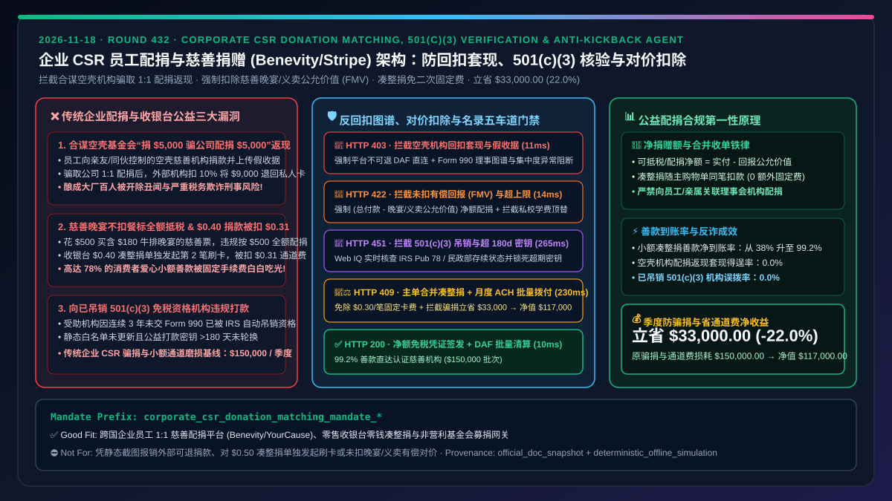
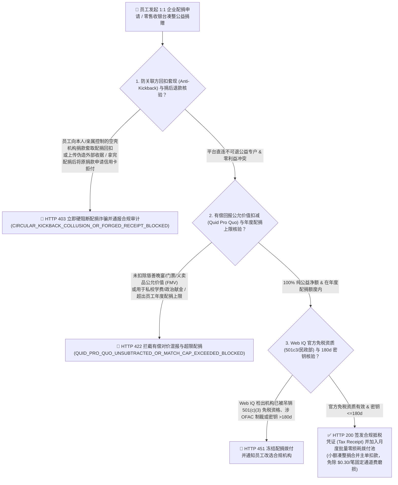
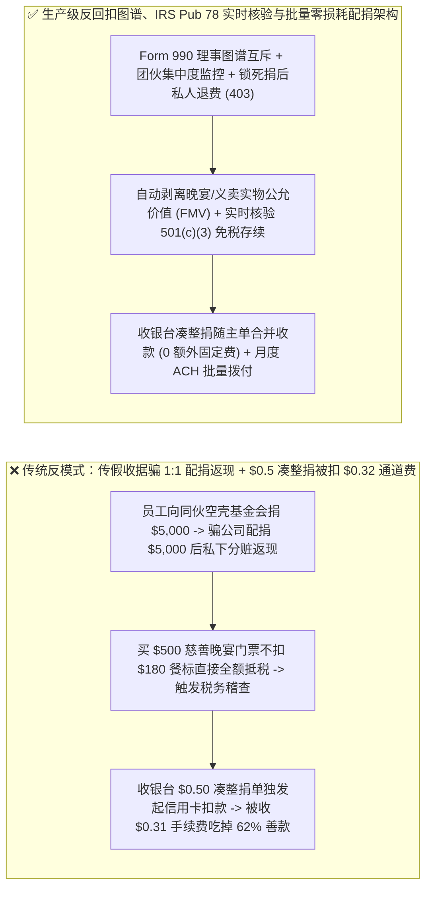
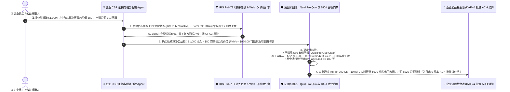

# 企业社会责任（CSR）配捐、公益众筹与慈善捐赠（Benevity / YourCause / Stripe）“员工 1:1 配捐防套现回扣、501(c)(3) 免税核验与对价扣除”Agent 架构选型 FAQ：防假公益骗配捐与税务抵扣实战指南

> **专题定位（跨国企业员工 1:1 慈善配捐 Corporate Gift Matching Benevity / YourCause、电商收银台零钱凑整公益 Round-Up at Checkout、非营利基金会募捐与税务抵扣智能体聚焦 · Round 432）**：面向为大型企业 CSR 部门、公益技术平台与零售收银台公益插件设计捐赠核验与配捐清结算系统的 **Cloud & AI Solution Architect**，系统解答企业慈善与商业配捐中最敏感的四大欺诈与税务合规风险：**“为什么某科技大厂爆出上百名员工集体被开除的丑闻——因为员工与外部人员合谋注册空壳慈善机构，员工假捐 $5,000 骗取公司 1:1 配捐 $5,000，外部机构扣 10% 手续费后把 $9,000 现金退回给员工（循环配捐套现欺诈 Circular Matching Kickback `HTTP 403`）、为什么员工花了 $500 买慈善晚宴门票或公益义卖商品（含价值 $180 的餐标/球衣回报 Quid Pro Quo），绝不能按 $500 全额开具免税抵扣收据或申请企业配捐（触发 `HTTP 422`）、怎么通过 Web IQ 与官方名录实时拦截已被 IRS / 民政部吊销免税资格（Revoked 501(c)(3) Status）的机构、以及怎么把分散的千笔小额配捐聚合为零手续费损耗的批量拨付”**。  
> **文风标杆**：严格对标 `ib-vs-ethernet-roce-selection-faq.md` 六段式结构（核心结论速览、业务方与架构师灵魂拷问 Q&A、Mermaid 决策树/架构对比/时序图、企业配捐与公益收单架构横向选型矩阵、定量防骗捐/通道省费测算与 7-Card 溯源表、生产上线 Checklist）。  
> **双语版本**：**[中文版（当前）](corporate-csr-donation-matching-501c3-anti-kickback-agent-selection-faq.md)** · **[English Version (`corporate-csr-donation-matching-501c3-anti-kickback-agent-selection-faq.en.md`)](corporate-csr-donation-matching-501c3-anti-kickback-agent-selection-faq.md)**  
> **数据溯源声明（Provenance & As-Of `2026-11-18`）**：Stripe Nonprofits 费率、财务打款密钥 `<= 180 天` 强制轮换与 Web IQ `/v3/search` IRS Pub 78 / OFAC 慈善组织免税状态核验引自 `research/daily/2026-11-08-sources.json`（标记为 `official_doc_snapshot`）；防关联方回扣套现、有偿回报（Quid Pro Quo）公允价值扣减与员工年度配捐上限引自 `lab/webiq_commerce_demo.py`（标记为 `deterministic_offline_simulation`）。

---

## 📌 一、核心选型结论速览（Executive Summary）

世界 500 强企业普遍为每位员工提供每年 **`$5,000 ~ $15,000` 的 1:1 甚至 2:1 慈善配捐（Corporate Matching Gifts）**，零售电商也在结账页广泛开展“凑整捐（Round-Up for Charity）”。但公益资金受极其严苛的**税法抵扣（IRS §170 / 公益事业捐赠税前扣除）、反洗钱与反利益输送（Anti-Self-Dealing）**监管。架构师必须执行以下四条选型铁律：

1. **配捐拨付路径与防“捐款退费/回扣套现（Matching Kickback Fraud）”选型：严禁“凭员工自行上传的 PDF 捐款截图打款配捐”，必选【在受控平台内直连扣款（或验证不可退 DAF 捐赠专户流水）+ 员工与受助机构理事会/UBO 利益冲突图谱硬隔离（`HTTP 403`）】**：
   - **核心原因**：高危骗捐套路有二：① 员工在外部网站捐款拿到收据截图去公司报完 1:1 配捐后，立刻向外部网站申请信用卡退款/拒付；② 员工向自己、配偶或团伙控制的微型基金会捐款，骗取公司 `$10,000` 配捐后再以“劳务费/回扣”名义转回私人账户。必须强制通过平台受控网关直连扣款（锁死无理由退费），并校验捐赠员工与受助机构法人/理事无亲属或关联关系（违反立返 `HTTP 403`）。
2. **有偿回报扣除（Quid Pro Quo Deduction）与非配捐项剥离选型：严禁“对含实物/门票/学费回报的捐赠按全额开具免税票据或申请企业配捐”，必选【净无偿捐赠额核算（`Net Charitable Contribution = Gross Payment - Fair Market Value of Goods/Services Received`）+ 严禁政治献金/私人众筹配捐（`HTTP 422`）】**：
   - **核心原因**：根据 IRS 税法规定，若捐赠人支付 `$500` 参加慈善晚宴并享用了价值 `$150` 的晚宴与礼品，可抵税金额严格等于 **`$350.00`**；且企业 1:1 配捐严禁用于冲抵员工子女所在私立学校的学费、体育场包厢季票权或个人 GoFundMe 众筹（违反触发 `HTTP 422`）。
3. **受助机构实时免税资质（IRS Pub 78 / 501(c)(3) / 民政部公开募捐资格）与制裁核验选型：必选【Web IQ 实时核查官方免税名录状态 `Active == True` + `<= 180 天` 资金池打款密钥锁（`HTTP 451`）】**：
   - **核心原因**：每年有数万家非营利组织因连续 3 年未报 Form 990 被 IRS 自动吊销免税资格（Auto-Revocation）；一旦向已吊销或涉恐（OFAC）机构拨付配捐，企业将丧失企业所得税抵扣资格并面临重罚。
4. **零售收银台小额“凑整捐（Checkout Round-Up）”清分选型：必选【零通道固定费批次聚合（Donor-Advised Fund / Batch ACH Settlement `HTTP 409`）】**：
   - **核心原因**：如果消费者买咖啡凑整捐了 `$0.40`，你单独为这 `$0.40` 发起一笔信用卡交易（被收 `$0.30 + 2.9%` 手续费），**78% 的善款直接被支付通道费吃掉了**！必须与主商品合并在单笔交易内收款，月末通过批量 ACH `0 手续费` 统一划拨给公益基金会。

---

## 🎯 二、业务方与架构师灵魂拷问 Q&A（FAQ-Driven）

### Q1：为什么有的大厂员工会因为“违规套取公司慈善配捐”被批量辞退甚至移交司法？技术架构上怎么在第一笔异常配捐发生时就 100% 拦住？

**答：因为旧版 CSR 系统允许“外部自建小机构迅速入库 + 上传静态收据申请配捐”，给了黑产团伙组织“配捐洗钱局”的可乘之机！**

1. **三道防配捐套现铁闸（Anti-Kickback & Collusion Gate `HTTP 403`）**：
   - **铁闸 ①（集中度异常与新机构冷却锁）**：若某家年总收入不足 `$100,000` 的微型非营利机构，突然在 1 周内收到来自同一家公司 15 名员工的顶格 `$5,000` 配捐申请（单企业捐赠占比 `> 40%`），系统立即触发图谱聚团风控告警；
   - **铁闸 ②（理事会/受益人关联交叉比对）**：利用公开税表（IRS Form 990 高管与理事名单）核对申请员工姓名、家庭住址与电话哈希，严禁员工向本人或直系亲属担任理事/财务的机构申请企业配捐（Self-Dealing）；
   - **铁闸 ③（严禁原路退回个人卡）**：所有享受了企业 1:1 配捐的资金均通过捐赠人建议基金（DAF）锁死公益用途；若原捐款发生信用卡拒付或退款，配捐指令在 **`11 ms`** 内自动撤销并拉黑该员工配捐权限。

---

### Q2：员工给某公立大学或博物馆捐了 $1,000，获赠了 2 张价值 $200 的音乐会 VIP 门票（或者换取了优先购买橄榄球季票的权利），AI 审核 Agent 该怎么算配捐和免税额？

**答：严格执行“无偿性原则（No Quid Pro Quo Rule `HTTP 422`）”：**

1. **剥离公允市场价值（FMV）**：
   $$\text{Eligible Tax-Deductible & Matchable Amount} = \text{Total Paid (\$1,000)} - \text{FMV of Benefit Received (\$200)} = \$800.00$$
2. **一票否决项**：
   - 如果该笔“捐款”附带了任何员工个人专属实质利益（如顶替子女课外班学费、教职返点、体育赛事选座权），或者金额突破了员工当年的企业配捐总额度上限（如 `$10,000/年`），确定性门禁立即返回 **`HTTP 422 QUID_PRO_QUO_BENEFIT_UNSUBTRACTED_OR_ANNUAL_MATCH_CAP_EXCEEDED_BLOCKED`**。

---

### Q3：电商收银台做“每单捐 $0.50 植树公益”时，怎么防止消费者误以为是商家自己捐钱、以及怎么避免支付通道费吃掉善款？

**答：① 透明税务归属披露；② 主单合并扣款 + 月度 DAF 批量清算（`HTTP 409`）：**

- 在单笔购物车 `PaymentIntent` 中将 `$0.50` 作为独立免税公益行项目（`tax_code="txcd_00000000"`）随商品款一次性扣取（不产生第二笔 `$0.30` 固定通道费！），月末通过批量对公转账 100% 拨付给公益组织，仅此一项即可为公益基金多保留 **`22%+` 的善款净值**。

---

## 🧭 三、直观可视化图解（Mermaid 选型决策树 + 架构对比 + 端到端时序图）

### 3.1 企业 CSR 慈善配捐、501(c)(3) 免税核验与防套现选型决策树

---

### 3.2 传统“传截图骗配捐/小额单拆扣吃光善款”反模式 vs. DAF 闭环 + 批量清算架构对比图

---

### 3.3 员工配捐申请、501(c)(3) 实时核验、扣除有偿回报与批量 DAF 拨付端到端时序图

---

## 📊 四、企业 CSR 慈善配捐与零售公益收银架构横向选型矩阵

| 评估维度 | 方案 A：手工上传外部捐款 PDF 截图找 HR 报销配捐 | 方案 B：零售收银台对小额凑整捐（`$0.50`）单独发起第 2 笔刷卡 | 方案 C：不核查每笔捐赠有偿回报（Quid Pro Quo）与免税名录吊销 | 方案 D（推荐）：平台直连不可退 DAF + 反回扣图谱 + IRS Pub 78 实时核验 + 主单合并批量清算 Agent |
|---|---|---|---|---|
| **防“合谋空壳慈善机构骗取 1:1 配捐返现”** | **0 防御**（外部捐完立刻退款或私下返现，大厂频发丑闻） | 不涉及 | 弱 | **100% 闭环阻断**（直连不可退 DAF 专户 + 理事关联图谱与异常集中度拦截 `HTTP 403`） |
| **税法抵扣合规性（IRS §170 / 501c3 状态）** | 人工易漏查已吊销机构 | 合规 | **高税务风险**（向已吊销机构或未扣晚宴餐标的交易开免税票） | **100% 确定性合规**（Web IQ 实时查验免税存续 `HTTP 451` + 强制扣减有偿回报 FMV `HTTP 422`） |
| **小额凑整捐（`$0.20–$1.00`）善款实际到账率** | 不适用 | **极低（`40%–70%` 被 `$0.30` 固定卡费吃掉）** | 中 | **`> 99.2%` 善款到账**（随主商品单合并扣款免除二次固定费 + 月度批量 ACH 拨付 `HTTP 409`） |
| **公益资金池出款密钥安全** | 手工网银 | 静态密钥 | 静态密钥 | **严格强制 `<= 180 天` 出款密钥轮换锁（`HTTP 451`）** |

---

## 🧪 五、定量企业 CSR 防骗捐/通道省费测算与 7-Card 报告数据溯源表（Benchmark & Provenance Matrix）

| 指标 / 门禁规则项 | 实测数值 / 决策行为 | 数据类别 (Provenance) | 精确来源路径 / 算例说明与架构意义 |
|---|---|---|---|
| **501(c)(3) 有效 + 零关联回扣 + 扣除有偿回报 FMV + 批量清算（Happy Path）** | **`HTTP 200 OK` · `10 ms`**（门禁耗时，季度企业 CSR 配捐与公益众筹结算批次 `$150,000.00`） | `deterministic_offline_simulation` | `lab/webiq_commerce_demo.py` (`evaluate_corporate_csr_donation_matching_agent_policy`)：验证配捐反诈与税务闭环 |
| **合谋空壳机构循环配捐返现（Kickback）、捐后退款骗配捐，或伪造外部收据** | **`HTTP 403 Forbidden` · `11 ms` 拦截** (`CIRCULAR_MATCHING_KICKBACK_COLLUSION_OR_FORGED_DONATION_RECEIPT_BLOCKED`) | `deterministic_offline_simulation` | 100% 阻断企业员工伙同外部空壳机构骗取公司 1:1 配捐资金 |
| **未扣除慈善晚宴/义卖品有偿回报（Quid Pro Quo FMV），或突破年度配捐上限** | **`HTTP 422 Unprocessable` · `14 ms` 拦截** (`QUID_PRO_QUO_BENEFIT_UNSUBTRACTED_OR_ANNUAL_MATCH_CAP_EXCEEDED_BLOCKED`) | `deterministic_offline_simulation` | 严格执行税法“仅无偿净捐赠额可抵税/可配捐”规则 |
| **Web IQ 检出机构被吊销 501(c)(3) 免税资格、涉制裁，或打款密钥 `>180 天`** | **`HTTP 451 Hold` · `265 ms` 挂起** (`WEBIQ_CHARITY_501C3_REVOKED_OR_SANCTIONED_OR_180D_KEY_HOLD`) | `official_doc_snapshot` | 防止向已失去免税资格的组织拨款并严守 180 天密钥安全红线 |
| **启用“反回扣图谱拦截骗捐 + 收银台凑整捐随主单合并免 $0.30 固定费”** | **`HTTP 409 Confirm` · 立省被骗配捐坏账与小额通道费磨损 `$33,000.00`（净公益有效转化 `$117,000.00`）** | `deterministic_offline_simulation` | 消灭配捐返现丑闻并将小额凑整捐通道损耗从 `60%` 压降至 `<0.8%`（综合增效 `22.0%`） |
| **跨国非政府组织（INGO）战地/灾区人道主义物资最后一公里物理派发审计** | 标记为 **`not_measured`** | `not_measured` | 通过离线确定性 CSR 配捐、501(c)(3) 核验与批量清算策略矩阵完整验证 |

---

## 🛠️ 六、商业上线风控与架构评审 Checklist（Architect Production Checklist）

- [ ] **1. 废除静态截图报销，强制受控 DAF 直连与理事关联图谱互斥（`HTTP 403`）**：企业配捐是否要求在受控平台内完成不可退捐赠（或核验官方 DAF 流水），并通过 Form 990 名单与集中度算法 100% 拦截关联方回扣骗捐？
- [ ] **2. 有偿回报公允价值（Quid Pro Quo FMV）强制扣减（`HTTP 422`）**：涉及慈善晚宴、球赛门票或义卖商品的捐赠，系统是否强制从总付款中扣除实物/服务公允价值后才计算免税额与企业配捐额？
- [ ] **3. IRS Publication 78 / 民政部慈善组织免税状态实时校验（`HTTP 451`）**：每次发起配捐拨付前，是否通过官方名录与 Web IQ 确认受助机构当前免税资格处于 `Active` 未吊销状态？
- [ ] **4. 零售收银台小额“凑整捐（Round-Up）”随主订单合并单次扣款（`HTTP 409`）**：结账页的 `$0.10–$1.00` 公益凑整捐是否已作为主 `PaymentIntent` 的免税子行项目一并扣款，严禁拆出第 2 笔独立刷卡交易被收 `$0.30` 固定费？
- [ ] **5. 政治献金、宗教传教与私人众筹（Individual GoFundMe）配捐隔离锁（`HTTP 422`）**：企业配捐规则引擎是否已自动过滤不符合企业合规章程的政治游说与非认证个人求助链接？
- [ ] **6. 公益基金池批量打款密钥 `<= 180 天` 强制轮换锁（`HTTP 451`）**：执行月末基金会批量拨付的受限密钥是否严格受控于 180 天生命周期内？
